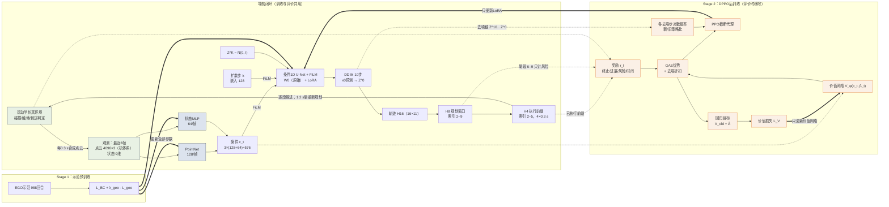

# 图1正确关系示意（用于核对与重绘）

线型约定：实线 = 数据流；粗线 = 参数更新（梯度）；虚线 = 仅训练时存在的信息。
颜色：灰蓝 = 冻结（Stage 2 中）；蓝 = Stage 1 更新；橙 = Stage 2 更新。

## 要点

1. 只有一条导航闭环：环境 → 观测 → 编码 → 条件 → U-Net去噪 → H16 → H8 → H4 → 环境。没有双向箭头。
2. 奖励来自环境对已执行H4的判定，加上H8尾段的风险；奖励先进GAE，不直接进更新。
3. 优势有两个去向：PPO代理（更新LoRA）和回归目标（更新价值网络）。
4. 对数概率来自去噪链，只进PPO代理，不进价值损失。
5. 两条更新线互不交叉：PPO → LoRA；L_V → 价值网络。
6. Stage 1 更新全部参数；Stage 2 编码器与 W0 冻结。
7. 价值网络只在Stage 2存在，不参与导航。
