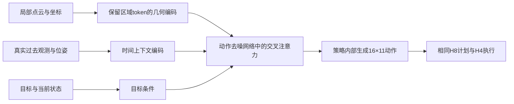

# iDP3-UAV：继续RL，还是转向扩散策略架构？

| 字段 | 内容 |
|------|------|
| 文档类型 | 研究与方向裁决；不是已批准的算法设计或运行指导 |
| 研究日期 | 2026-10-16 |
| 版本 | v1.3；保留原入口，完成三份意见逐项取舍与下一阶段方向判断 |
| 判断依据 | v3全策略原轨迹分析、384轮实际训练量、E5训练原件及全链路源码审计、论文全文与作者代码/讨论 |
| 当前实施状态 | 本轮没有修改训练、评价、权重或原始证据，没有启动WSL实验 |
| 本轮新增要求 | 非RL候选必须涉及实质架构改变；重复已有FM/Anchor/CFG、只换编码器或调参数，不作为转向理由 |

> v1.1：完整审查回复见§10。参考保持提升为独立A2；A1仍单独检验更新组织。A1失败后按信用证据选择A2、B或C，不机械跳C，也不规定必须叠加A2。用户新确认EGO未来计划与实际执行记录都有、训练以实际执行为主；覆盖审计据此调整。研究建议尚未转为已交付的执行配置。

> v1.2：用户确认训练集未变。本轮从既有A0源码归档找到已验收的位置导出，实际重算988条示范的距离退让、返回及高度覆盖，见§11；此前“没有可用位置原件，无法统计”的判断已纠正。原state/action全字段、点云及时间对齐仍未由该导出补齐；不把几何返回称为安全恢复。

> v1.3：§12完成独立审查附件及同条消息两组意见的综合判断。下一笔训练资源推荐用于共同RL对照与更新组织候选；固定E5参考保持列为明确后继，reward信用与实质空间架构保留有条件的替代路线。不是已确定更新为主因，也不是已经交付新训练源码。

## 0. 先给方向判断

[JUDGMENT] **停止原样延长当前R1训练；目前不赞成立即永久放弃RL。下一项有执行优先级的研究仍是受控检验DPPO的更新组织，而非再做一轮笼统的reward调参。非RL只保留一个有实质区别的主候选：让扩散策略在局部几何、跨周期历史与未来动作之间建立明确联系的时空生成架构。** 这个优先级是研究判断，不是已批准启动新训练。

[JUDGMENT] 选择继续有限度检验RL，原因不是已经投入很多，也不是论文必须包含RL，而是本项目确有BC没有完成、RL学会的路线，同时出现大量原能力流失。行为获得与丢失并存，尚未分离reward偏好、状态覆盖和更新作用；我给更新组织执行优先级，依据是复用成本与可归因性，不是已证明它是首要原因。重大架构转向有研究价值，但还没有本项目数据证明它是更有效的第一笔训练投入。

[JUDGMENT] **我撤回上轮把“小幅目标—几何交互或PointNet++对照”排在方向选择首位的建议。** 这些可以是局部诊断或实现修正，不能满足此次重大转向的理由。用户指出此前已有多轮扩散策略尝试；现存设计、源码及训练材料也要求我们先扣除已做工作。

[UNCERTAIN] 更新组织是否足以解决退化、实质新架构是否能凭冻结数据明显提高到达，均未证明。以下给出各路线最强依据、最强反对理由与换路条件，不能把推荐写成已定因。

## 1. 本项目实际在比较什么

### 1.1 当前基座与循环规划

[FACT] 当前A0/R1/fresh共同基座是E5的DDIM、x0预测策略，不是旧项目简介中的FM+Anchor+CFG+SFP组合。点云4096×3经MultiStagePointNet得到128维；9维状态含世界位置、机体系目标向量、目标距离和yaw的sin/cos，经MLP得到64维。三帧192维特征拼成576维，条件化一维卷积U-Net。目标和点云已经进入模型；当前没有显式局部地图、持久路线状态或上一完整计划记忆。

[FACT] 上图索引从0开始；H8对应`full[2:10]`，实际H4对应`full[2:6]`。轻量环境dt=0.3s，每决策执行1.2s，60决策截止。环境保留8帧不等于actor实际使用8帧。11维step-wise动作、坐标解释和时间切片是新旧路线共同需要守住的语义。

[FACT] RL冻结基座/编码器，训练rank8 LoRA和critic。当前BC参照KL是诊断，没有作为固定教师保持项反传。冻结主干不等于执行行为不变；另一方面，LoRA也确实已产生新的有效路线，不能仅凭低秩就说容量不足。

[FACT] E5使用过可训练的碰撞辅助，原日志与训练入口共同支持这一点。它不是纯扩散MSE基线。现有可重建接口还发现：条件用前三帧，辅助却用窗口末帧几何并累计全16步，未与本轮`2:10`计划对齐；原AutoDL当时的dataset快照未回传，不能把当前接口复现无条件变成全部历史运行的字节事实。独立BC入口有真实验证集和末段加权，不能把通用workspace的其他问题错误归到这次E5训练。

证据入口：[`当前基座与全链路代码审计`，§1—7、§10](../../jindu/2026-10-15_当前基座与全链路代码审计_v1_0.md)。本报告复用该审计的逐行定位与原日志核验，不重新运行模型。

### 1.2 同任务原轨迹揭示的事实

| 策略/时点 | 安全到达/420 | 直连受阻任务/145 | 未受阻任务/275 |
|-----------|-------------:|------------------:|-------------------:|
| BC | 116 | 18 | 98 |
| fresh u32 | 125 | 20 | 105 |
| fresh u128 | 59 | 8 | 51 |
| fresh u256 | 43 | 4 | 39 |
| fresh u384 | 16 | 0 | 16 |

[FACT] 上表来自同420条件、开放空间统一评价及完整执行轨迹。fresh u32相对BC净增9次，即2.14个百分点，现有聚类不确定区间包含0；不能写成稳定显著提高。fresh后期简单与受阻任务一起退化，不符合“复杂绕障不断提高、只是牺牲简单场景”的概括。

[FACT] 原R1 seed203 u256救回80个BC失败条件，同时丢失95个BC成功条件；task65柱链存在整组稳定的新外绕成功。这证明有实际行为能力变化，既不是只有一个成功率数字，也不是只从画得更宽的路线推断“学会避障”。原203 u32与fresh u32虽同为125次成功，仅50个条件共同成功；相同总数会掩盖行为替换。

[FACT] fresh训练自身成功率下降：分段成功24.94%→17.42%→12.98%→4.67%；每transition平均即时reward为0.373→0.093→−0.034→−0.336，后者不是平均episode回报。384轮确实产生393216转移和15360次提交，0 rejected，学习率2e−5线性降到1e−5。不能说“没有真正更新”；现有统计不支持“训练代理reward一路变高”的概括，但还不足以排除个别行为的奖励利用或不同折扣/回合分母下的情况。

[FACT] 取消人工空间终止后，原先受影响的166条轨迹均实际继续到60决策超时，无新增到达或碰撞；其中有返回和刷新距离的行为。人工边界确实不应当作物理失败，但删除它没有自动恢复到达。

[FACT] 393216条实际训练转移中，有67827个周期在没有newbest/risk/terminal付款时净接近目标>0.05m，即时均−0.05；其中47.42%原始GAE为正，最终成功回合内为82.55%。这支持“即时区分不足”，不支持“恢复完全没有学习信用”。raw GAE正号也不是最终actor梯度的证明。

[LIMIT] 420条件由84任务×5次采样构成，使用同21训练几何。它可以比较固定开发任务上的策略变化，不能证明未见世界泛化；五次执行随机性也不是五个独立训练seed。上述是轻量运动学闭环，不是PX4/Gazebo结果。

证据与派生数据：[`v3全策略原轨迹分析与下一阶段方案裁决`，§1—7](../../jindu/2026-10-15_RouteA_v3开放空间全策略轨迹分析与下一阶段方案裁决_v1_0.md)及该文六份数据。5880条原轨迹、233246周期已经分析；此次没有为研究方向重新采一遍旧矩阵。

## 2. 哪些说法现在成立，哪些不能成立

| 判断 | 当前证据支持程度 | 对方向选择的意义 |
|------|------------------|------------------|
| 当前原样长训会持续提高 | 已被这次fresh时程反对 | 不再原样延长或筛掉坏seed |
| RL产生过BC没有的有效绕障路线 | 有原轨迹直接证据 | 不能宣告RL只有破坏作用 |
| 成功总分高就能保证保住BC能力 | 不成立 | reward排序不能约束每次策略更新 |
| 只改reward肯定足够 | 未证明；存在即时区分不足的真实动机 | 保留独立reward路线，不把它定为唯一主因 |
| 架构太弱是当前长训退化的主因 | 未证明 | 缺状态、优化和覆盖要分开；更大网络不是直接处方 |
| 非RL能够省掉闭环分布偏移与恢复难题 | 不成立 | BC也会在自身生成的陌生状态上失效 |
| 当前等于从零RL，不需要BC | 不成立 | 真实初始化/冻结主干/探索分布都依赖BC；尚无同预算从零对照 |
| 新架构可以超越示范 | 有可能，但不是保证 | 结构归纳偏置能改善组合和泛化，不能凭空提供全部缺失恢复行为 |

[JUDGMENT] 三种问题必须分别回答：**模型能否表示该路线；现有监督/交互是否提供学会它的信息；更新是否把有用信息稳定写进策略。** 当前证据证明行为会被获得、也会丢失，尚不能给三项分配因果责任。把三者统称“reward不够好”或“扩散架构不好”，都会让下一次实验难以解释。

## 3. 既往扩散策略尝试：扣除重复工作

| 既往内容 | 本轮能核实的状态 | 本次不再如何推荐 |
|----------|------------------|------------------|
| DDPM/DDIM→FM、少步Euler | 有多版本FM源码、设计及历史训练/部署记录；当前E5不是FM | 不把换FM本身当新架构或自动提升到达的依据 |
| Anchor17、截断扩散、CFG | 早期设计和实现已存在；8月备用路线审计记录当时FM部署Anchor关闭 | 不把重新启用已有模块说成新规划能力 |
| SFP稳定项、jerk | 5月总纲记录层次1已实现，层次2尚待实现 | 不把更平滑等同绕障/恢复；旧11→5方案违反当前动作约束 |
| PointNet++ | 设计和可选源码存在，E5未使用；本轮没找到同协议闭环优劣原件 | 不重复推荐一个编码器开关作为重大转向；也不伪称已实验证伪 |
| 前轨迹条件 | `prev_traj_encoder.py`与`phase1a_policy_prevcond.py`存在；E5未接入 | 不把“加prev_action字段”当新完整记忆架构 |
| yaw加权、decorrelation等 | 项目约束已记录被否定方向 | 不重新进入候选 |

[FACT] 历史来源为`sheji/iDP3_UAV_项目全面总结.md`§2/4/5、`sheji/Integrated_Master_Design_v1.md`§2—6、`sheji/PointNetPlusPlus_Encoder_Design.md`、当前源码索引及8月ReinFlow备用路线§2.4。旧文档的“最终路线”和手写状态不替代当前代码与运行证据；例如5月总纲对FQL/DPPO的描述不能成为10月的算法结论。

[FACT] 当前dataset的`prev_action`是同一动作序列向前错8步的长度16窗口，与当前标签重叠8步；它不是已经证实可在推理时取得的上一轮完整计划。新历史模型须从真实过去状态/动作构造条件，不能把重叠未来标签输入当作“记忆能力”。

[JUDGMENT] 本轮没有找到的历史结果应标未知。用户指出做过多次尝试是重要背景，但不能由“有文件”推断“已完成严格对照且失败”，也不能反过来因未找到日志就把旧尝试当作从未做过。

## 4. 文献对继续RL给出的支持与反对

### 4.1 最强支持不是“别人用了RL”，而是相近问题有可检验的机制

[FACT] [DPPO，2409.00588](https://arxiv.org/abs/2409.00588)在连续机器人任务、长时稀疏任务及硬件迁移中证明扩散策略可以通过在线RL提高；其主方法并不依赖固定BC正则。它利用去噪链的条件转移概率优化策略，而不是把不可计算的最终动作边缘似然直接当已知量。**没有BC辅助loss不等于算法必然失效**；但论文也没有保证任意LoRA、点云条件或reward都能稳定提高。

[FACT] 与本项目现象更近的是[Bootstrapping RL with IL for Vision-Based Agile Flight，2403.12203](https://arxiv.org/abs/2403.12203)：相同视觉模仿初始化，普通微调早期改善、后期退化；作者通过critic预热和actor/critic更新安排等改善结果。该文有多seed、同预算对照，支持把训练组织当竞争解释。其teacher/DAgger、特权critic、推力/角速度动作及实验条件与我们不同，不能复制整套采数或数值。

[FACT] [DSRL，2506.15799](https://arxiv.org/abs/2506.15799)固定生成器，仅用RL选择初始噪声，在机器人任务及实机适应中有效；[ReinFlow，2505.22094](https://arxiv.org/abs/2505.22094)则通过可学习噪声把flow变成可优化的随机链。它们说明“保留预训练模型并扩展行为”有多种实现，并非只能无约束地改生成器。DSRL需要基座本来能被噪声引导出有用行为，ReinFlow需要flow基座；二者都不是当前E5上已经验收的方案。

### 4.2 官方复现经验确有用处，但不能套作我们的根因

[FACT] [DPPO issue #27](https://github.com/irom-princeton/dppo/issues/27)记录了后训几轮后性能接近0的问题；作者发现更新组织改动后，D3IL配置应按微调去噪步数调整effective batch。[v0.8发布记录](https://github.com/irom-princeton/dppo/releases/tag/v0.8)列出相应修复。本地已包含相关上游代码基点，剩下的是本任务有效配对批、标准化与提交频率是否合适，不能宣称“补上官方修复即可恢复”。

[FACT] [issue #34](https://github.com/irom-princeton/dppo/issues/34)还显示checkpoint加载兼容和评价口径会制造复现落差；Kitchen归一化子任务得分不等于四阶段全部成功。其他尚无作者确认解答的问题只能作症状线索，不能算经过验证的解决办法。作者的[finetuning说明](https://github.com/irom-princeton/dppo/blob/main/cfg/finetuning.md)也没有支持“学习率越小越好”。

[FACT] [What Matters In On-Policy RL，2006.05990](https://arxiv.org/abs/2006.05990)系统比较收集量、minibatch、训练遍数、优势处理等；实验表明这些细节能显著改变结果。它支持控制更新组织，不证明把本项目逻辑批翻倍必然有效，也不允许把10个去噪位置当10个独立环境样本。

[JUDGMENT] 这组证据使更新组织值得先做一个有限、可归因的对照，优先级依据是与当前症状的接近程度和复用成本。它尚不具备“已找到主因”的证据强度。本地已有冻结编码器、独立critic、较小LR及逻辑批处理，必须扣除这些已实现内容，不能把外部整套收益再预支一次。

### 4.3 BC保持有价值，但存在明确代价

[FACT] [FDPP，2501.08259](https://arxiv.org/abs/2501.08259)用固定预训练参照的去噪转移KL限制偏好微调。其Push-T表II中成功率98%→90%、平均长度58.20→120.20；不能只看摘要而说“保持没有代价”。小KL可能不足，大KL可能阻碍适应。该文偏好reward未包含原任务目标，与我们的到达奖励不同。

[JUDGMENT] 用户提出的“让BC成功行为拿高分”是必要的校准工作，但不是策略保持保证。设某条BC成功轨迹回报高，这只说明它在目标函数中值得选择；训练还要访问相关状态、得到合适优势，并完成不过度破坏其他状态的参数更新。目标函数没有自动包含“当前策略与BC距离小”的约束。

如果采用教师保持，应把问题明确成：

$$L_{actor}=L_{PPO}+\lambda L_{reference}.$$

[FACT/定义] 这是改变训练目标，且是软约束；BC并非“硬模仿”。对扩散策略，冻结示范的去噪重建、教师生成chain的交叉熵、逐Gaussian转移的解析KL是不同的$L_{reference}$。当前上游可选`use_bc_loss`采用base生成chain后提高student对此chain的logprob，不等于frozen988监督，也不等于FDPP解析KL。本地开关仍未接成所需训练功能。

[JUDGMENT] 没有跨模型通用的λ=0.01—0.05“黄金区间”。动作维度、去噪求和/求均值、逻辑批归一和PPO尺度都会改变系数含义；也没有理由预设后期必须减弱保持，因为本项目后期恰是能力流失最重的时候。先判断实际损失/梯度与旧新任务的权衡，不能从通用文字挑一个系数。

[FACT] [AWAC，2006.09359](https://arxiv.org/abs/2006.09359)、[RLPD，2302.02948](https://arxiv.org/abs/2302.02948)和[Cal-QL，2303.05479](https://arxiv.org/abs/2303.05479)分别研究优势加权数据学习、离线/在线混合、值校准；它们表明保留旧信息并继续改进并不只有固定KL一种办法，也显示过度保守和critic失配的风险。它们是离策略算法，不能把旧数据直接混进当前on-policy PPO而声称仍是原算法。

### 4.4 三个容易因论文名称误判的方向

- [FACT] [DiPOD，2606.13795](https://arxiv.org/abs/2606.13795)的“drift”主要是ELBO代理与真实生成似然/梯度偏离；on-policy自蒸馏参照随最新策略刷新，不是固定BC保持。机器人实验从零做humanoid motion tracking，文中明确不是BC post-training。本地chain-Gaussian PPO不能仅因标题相似就被定为同一故障。
- [FACT] [D²PPO，2508.02644](https://arxiv.org/abs/2508.02644)的重要改动是扩散预训练的dispersive loss；所报后训收益依赖预训练阶段变化，不能当成给当前冻结PointNet加一项loss的即插收益。它也不是实质新架构，且项目已否定过其他decorrelation方向，不能混用名称重新推荐。
- [FACT] [FQL，2502.02538](https://arxiv.org/abs/2502.02538)让flow当BC教师，最终执行独立one-step actor；[IBRL，2311.02198](https://arxiv.org/abs/2311.02198)允许Q在IL与RL候选间选择。它们有真实优势，但执行策略核心和归因改变；严格MC-2下不属于无条件可直接采用的E5升级。

## 5. 非RL：值得讨论的是哪一种实质架构改变

### 5.1 首选候选：保留局部几何与历史的动作扩散架构

[JUDGMENT] 这条路线的首轮核心是保留空间信息、改变动作生成时使用条件的方式，不把所有记忆方法一起堆入。三个接口分别为：

1. **空间表示**：从“每帧全部点云压成单一128维全局向量”，改为保留若干局部区域的坐标与特征，让生成动作能够分别关注近障碍、通道与绕行侧。
2. **时间表示**：首轮可先保持现有三帧观测数量，让局部token保留时间索引并处理坐标对齐，避免同时改变信息量和结构。只有冻结数据展示“相似当前观测、不同较长历史要求不同后续”的歧义，才把更长窗口或可更新记忆提升为独立候选；不默认加入PTP或输入含未来的`prev_action`。
3. **生成条件关系**：在去噪网络内部，让未来动作位置与目标、局部几何、时间上下文进行交叉注意力交互。可保留U-Net的动作生成骨架，实质替换其只接单一FiLM条件的方式；不必为了“改得大”无依据地全部换成通用DiT。

[JUDGMENT] 它与此前“PointNet++换编码器”不同：保留空间token直到动作生成阶段；与“前轨迹条件”不同：明确真实过去的信息来源与时间对齐，不以一个历史向量替代场景—动作关系；与FM替换不同：改变条件化与决策信息结构，不仅改变噪声到样本的数值路径。即使保留U-Net和三帧数量，这仍是编码输出、网络条件交互与动作表示接口的实质改变，而不是多拼一个目标输入。**它不是目前已验证的新算法。**

[FACT] [3D Diffuser Actor，2402.10885](https://arxiv.org/abs/2402.10885)对空间关系注意力、目标与动作生成提供直接架构和消融证据；[Learning Long-Context Diffusion Policies via Past-Token Prediction，2505.09561](https://arxiv.org/abs/2505.09561)说明历史建模与训练方式有关；[Training and Evaluating Diffusion Policies with Long Context Lengths，2606.16447](https://arxiv.org/abs/2606.16447)进一步对读并指出冻结编码器、数据量和U-Net交叉注意力的贡献。后者的小数据比较并不支持通用DiT必然优于U-Net，也不支持把PTP辅助损失单独当全部提升原因。

[LIMIT] 三项证据来自操作任务，3D Diffuser Actor的末端位姿参数化不能直接代替我们的11维delta。也没有论文证明“相同三帧数据只要加attention就会学会本项目恢复”。本候选是依据这些机制形成的项目设计推断，其组合整体仍待验证。

### 5.2 它可能解决什么，不能承诺什么

| 当前轨迹现象 | 新结构可能提供的帮助 | 不能据此跳过的反证 |
|--------------|----------------------|----------------------|
| 多障碍绕行侧反复变化 | 保存历史局部布局和进入路线信息，动作生成时持续使用 | 有的变化可能是合理重规划；不能强迫永远沿旧路线 |
| 绕过障碍后持续偏离目标 | 联合目标、几何与历史，区分正在绕行还是已越过出口 | 目标向量本来已可指示目标在后方，失败不等于模型不知道方向 |
| 到近处后越过且未返回 | 利用接近方向、过去运动和局部空间，而非只看瞬间距离 | 若数据缺乏越过后的返回示范，更强结构仍可能不会恢复 |
| 必要退让和重新接近 | 记住为何退出、哪些方向试过 | 不能只用“轨迹更连贯”判有效，要实际到达 |
| 更高/更宽空间失效 | 几何相对关系可能改善组合泛化 | 冻结数据覆盖不足不能由attention保证消除；世界坐标动作仍需正确变换 |

[JUDGMENT] 现有988个完整episodes理论上可重组真实历史监督，无需重新采集EGO数据；但必须先核episodes内实际有多少返回、退让、上绕、不同接近方向和大空间样本。“有60151帧”不等于有60151个独立恢复案例；重叠切窗不会制造新的行为。

[JUDGMENT] 第一版不把上一轮完整预测当无条件可信的记忆，更不把它强行贴到新轨迹上。执行中的障碍新观测应能推翻旧计划。若以后输入上一计划，必须通过真实模型生成训练样本或明确处理teacher-forcing差异，不能把演示中的未来计划当部署可用信息。

### 5.3 另外三类大改，为什么不优先

| 架构路线 | 真正改变 | 最强支持 | 当前不列第一的原因 |
|----------|----------|----------|----------------------|
| 高层子目标/路线意图＋低层扩散 | 将跨障碍选路与局部轨迹分层学习 | HDP、NoMaD说明层次组织有用 | UAV子目标监督和错误高层输出的纠正尚未解决；不能依赖外部A*/拓扑规划贡献全部能力 |
| 等变三维策略 | 坐标变换由网络结构保证或约束 | EquiBot、Equivariant Diffusion Policy | 我们状态含重力相关高度、yaw及混合世界/机体变量；并非任意SIM(3)/SE(3)对称。整体缩放会改变实体尺寸/安全间距，不能照搬 |
| 流式/因果连续生成 | 新旧动作块共同去噪，减少每轮重置 | TEDi/Streaming、Diffusion Forcing等 | 若主要问题是延迟或块间不连续，相关性强；现有轻量退化没有证明由实时推理延迟引起。连续地走错也会超时 |

[FACT] [HDP，CVPR2024](https://openaccess.thecvf.com/content/CVPR2024/papers/Ma_Hierarchical_Diffusion_Policy_for_Kinematics-Aware_Multi-Task_Robotic_Manipulation_CVPR_2024_paper.pdf)的keyframe与机械臂低速、gripper状态有关；§4.3式(10)还在推理时用梯度改joint轨迹。整套不能当MC-1下可直接复用的UAV方案。其低层消融使用专家高层，不应把该表数字等同完整层次网络的收益。可借内部子目标思想，不能借来已证明无人机到达的结论。

[FACT] [NoMaD，2310.07896](https://arxiv.org/abs/2310.07896)把目标导航/无目标探索与扩散结合，但实际部署还依赖图像目标、地面机器人数据、拓扑组织及低层控制；它不是只换网络就完成未知3D无人机规划的证据。与之类似，模仿高速飞行的成功系统常含特权教师/再标注或模型轨迹选择，必须拆清能力来自哪里。

[JUDGMENT] Flow Matching、Consistency等生成过程可以服务实时性；“生成空间的概率路径更直”不等于无人机物理空间的飞行路线更直、更平滑或更安全。现有FM尝试已存在，仅换生成范式不足以成为本次转向理由。大VLA/π系列的数据规模、语言任务和算力也不匹配当前冻结数据，不能按文章时间线选模型。

## 6. 多个明确方案：改什么，保留什么，失败后怎么办

### 方案A1：继续当前扩散基座的RL，先检验更新组织

[JUDGMENT/第一执行优先级] 从同一已验E5重新开始新实验；共同对照与候选保持相同reward、场景、执行长度和环境转移预算，只改变有效配对批与提交组织。10月15日方案中的1280→2560逻辑pair、每轮40→20次提交，是可复用现有累积实现的具体候选；不是已验证最优值，也不作为本报告自动批准的参数。

- **改变**：现有`engine/pair_schedule.py`、`engine/trainer.py`及配置中的逻辑配对批；报告实际归一分组、critic相对更新和Adam提交。批量与提交同时变化，应称更新组织组合，不能把全部效果只归于“大batch”。
- **保留**：E5点云/目标编码、U-Net/DDIM、rank8 LoRA、世界池、H8计划/H4执行、当前newbest主体。这样能检验固定模型是否仍有稳定改进空间。
- **首轮不叠加**：教师loss、进展reward、扩池、解冻编码器、改H执行。若都同时改，下一轮仍无法确定什么有效。
- **支持它的结果**：BC保留和受阻新增共同提高，改进跨训练seed成立且持续到预定终点；不是仅参数变化变小或曲线更稳。
- **反对它的结果**：只是延缓丢失、同环境预算仍退化，或旧路线保住了而新增受阻能力消失。此时不继续围绕batch无限试参数。

[LIMIT] 每轮提交减半也改变actor/critic的累计优化量。必须同时按真实环境转移量和累计提交量画趋势；候选在相同交互预算终点更好，只能证明这段预算内的收益，不能排除“退化被推迟”。若要声称持续保持，须另有预定更长对照，不能把首轮256外轮自动叫作解决长训退化。

[JUDGMENT] 这一方案是对“先留住并利用实际已有学习成果”的检验，不能称架构创新。它排在前面不意味着方案B已被否定，也不意味着外部论文已确定它比新架构好。

### 方案A2：单独加入固定E5参考保持

[JUDGMENT/v1.1新增] 参考保持应当进入正式方案，不能只留在文献讨论。候选是保持选定的RL基线不变，单独加入可微的固定E5 Gaussian转移KL；具体条件、归一尺度、反对理由和触发依据见§10.2。它不与A1首轮同时加入。

[JUDGMENT] 若A1作为新的更新基线已被选中，则A2与A1直接比较；若A1没有改善甚至更坏，应比较原共同对照与“原共同对照＋参考保持”。不能因为给它编号A2，就必须先叠加一个未证明有益的A1。每臂从相同BC起点重新训练，不从失败的u256接续。固定E5保持也不能自动保住RL后来新学会的路线。

### 方案B：继续RL，但独立重做局部目标信用

[JUDGMENT/与A竞争] 保持共同协议、更新组织与模型固定，比较原newbest与有界实际距离反馈，或严格按折扣/终止语义实现的potential shaping；两种公式不先叠加。目标是让当前接近、远离、必要退让后的返回有可区分的周期信号，同时保持成功、物理失败、风险和效率之间的合理排序。

- **改变**：现有`env/reward_v2_support/reward.py`的目标进展及对应配置、分项记录。无需为新reward复制评价/训练入口。
- **保留**：成功+100/真实物理失败−50作为首个对照的终点值、H8风险、模型和PPO主体；目前没有全轨迹证据说明必须先拉高terminal或risk。
- **必须检查**：成功直线、成功必要外绕、退让—返回、重复接近—后退循环和超时路线；既看完整折扣回报，也看实际归一后进入PPO的信用。即时付款变正本身不代表训练有效。
- **不做**：只加单向接近正奖而不计离开成本，或恢复旧progress却不检查循环获利；不堆停滞状态机、路径长度与多项安全罚。
- **反对它的结果**：目标恢复有所改善却压掉必要退让/受阻新增，或周期排序改变但实际到达不提高。此时问题不宜继续归为“奖励还不够大”。

[JUDGMENT] 方案B有本项目真实动机，优先级略后于A只是当前判断。若沿实际surrogate核查，发现有益恢复/保留动作系统性受错误方向推动，B可以上升为第一，不需拘泥于上轮优先级。

### 方案C：停止RL主线投入，重建实质时空扩散架构

[JUDGMENT/非RL主候选] 采用§5.1的局部几何token与动作交叉注意力结构；首轮可保持三帧数量，长历史须有数据依据才另加。训练仍只用冻结示范和声明清楚的几何辅助，不用RL更新。它需要新模型训练，不兼容加载旧E5全部权重即用的设想。

- **改变**：点云编码输出接口、时序条件组织、去噪网络条件关系、dataset历史窗口/有效mask、新模型配置和装载兼容。输出保持16×11与明确动作时序；不为了换架构同时改成单步速度或5维动作。
- **原训练链先修正**：对齐同一当前帧与动作起点的几何辅助，修正scheduler单位，核实并声明EMA更新单位；使用真实episode验证分集。这些同时用于“修正后的旧结构BC”和新结构，避免把修bug收益全部写成架构贡献；不能把尚未证明的EMA缺陷当已定错误。
- **保留**：冻结数据集、目标/坐标语义、可比较的H8/H4执行、同一统一评价入口、原始轨迹与MC-1—5。必要模型装载差异通过已有入口扩展，不再造每策略专用控制器。
- **首轮支持它的结果**：相对修正后的旧结构，同固定数据上安全到达有有意义的净提升，至少一项对应能力改善，推理代价可接受；原有保留、受阻与恢复分别报告，不要求每组同时上涨或旧成功零损失。两项训练只能判断整套候选是否值得继续；空间关系/历史的独立贡献在胜出后另做消融，首轮不作单模块归因。
- **反对它的结果**：只有更低MSE或更平滑轨迹；只提高未受阻直连；同数据中缺失恢复行为仍学不会；或者成本显著上升却没有到达净收益。这时不能继续靠增加层数解释失败。

[JUDGMENT] 这是本次唯一建议保留为主要竞争方案的非RL大改。它也可以成为以后RL的更好起点；“本轮先不用RL训练新结构”不必等同今后永久禁止RL。不过，两条路线在当前资源上的优先级仍须真实选择，不能以“都可以结合”回避决定。

### 方案D：保留生成器，改用latent steering RL

[JUDGMENT/独立算法备选] 用DSRL思想固定E5/DDIM，只学习初噪选择；既不更新E5 LoRA，也不外部改路径。它直接回应“预训练模型应继续作为能力基础”的要求，但仍是RL，不是非RL架构转向。

[FACT] 本项目6月Route B已经尝试FM latent SAC；`2026-06-27-routeB-lowrank-dsrl-stabilization-design.md`转述过full176维Q发散，并提出低秩16/32。当前还存在低秩`env/dsrl_wrapper.py`和`policy/fm_base_policy.py`实现。本轮没有重验那次原训练日志，不能把转述升级成新的独立验收，也不能忽略过去失败而称DSRL首次进入项目。

- **可复用**：现有低秩噪声映射、固定生成器包装思想及官方DSRL方法。
- **须改变**：FM/1536特征接口接到E5/DDIM/576条件；全16×11初噪、H8计划与H4执行一致；去除旧绝对高度validity的错误语义；重核Q、探索与数据组织。
- **主要风险**：冻结权重仍能改变噪声和状态访问分布，不保证旧成功保持；基座支持狭窄时无从选择新路线；176维或低秩Q都需验证，不能说固定生成器就省去了RL难点。
- **换入条件**：有益路线在E5噪声候选中可取得，但LoRA后训持续破坏行为；且已复核旧Route B具体失败与当前可复用差额。它不应抢在最直接的A/C比较前变成新一轮大系统重写。

### 五个候选的取舍

| 方案 | 最主要被检验的解释 | 是否改变生成架构 | 新信息来源 | 为什么现在不是唯一答案 |
|------|--------------------|--------------------|--------------|--------------------------|
| A 更新组织 | 有益学习在优化中持续丢失 | 否 | 相同在线任务反馈 | 不能修复缺信息和即时同分 |
| B 局部目标信用 | reward局部排序不够 | 否 | 相同在线反馈，改变打分 | 不能保证参数保持或扩展表示 |
| A2 固定参考保持 | 累计偏移破坏原能力 | 否，新增训练目标 | 当前训练状态上的固定E5参照 | 可固化BC错误，不能自动保住RL新增路线 |
| C 时空扩散 | 早期池化和短历史限制决策 | 是 | 同冻结示范重组，辅助来源披露 | 缺少直接覆盖时，恢复改善不能保证 |
| D latent RL | 生成器有候选，直接改权重不稳 | 新latent actor，E5固定 | 在线reward/Q | 有历史失败和可引导性限制 |

## 7. 共同前提、资源与有裁决力的实验顺序

### 7.1 两条路线都要遵守的比较定义

[JUDGMENT] 新RL取消人工空间终止和一次性−50人工失败罚，保留可配置渐进空间软成本，允许必要宽绕仍高于碰撞。**不能用默认成本0替代用户要求。** 成本公式及强度仍须对完整路线和循环信用校准；10月15日的任务相对有界时长成本只是具体候选，不是已训练结论。与该成本所需起点/尺度、有限72s期限有关的critic条件，要在共同对照中明确，而非偷偷随候选变化。

[JUDGMENT] 收集批边界与真正任务截止分开处理；如果定义72s内必须完成，最后期限不能继续当可无限bootstrap的普通截断。共同协议一起改变时，较旧R1的收益先归共同组合；只有候选相对新共同对照的差异，才可讨论更新或reward作用。

[JUDGMENT] 非RL重训先校准真实当前帧、动作起点、辅助帧与数据时间，再共同修正旧结构和新结构。无需先重训BC才能做E5上的A方案，因为A的目的恰是固定已有基座检验更新；不要把两条研究路线不必要地串成必须全部完成的长前置链。

### 7.2 推荐顺序

1. **先核信用证据是否足够，不加一套新分析系统。** 在已有训练/信用诊断上选原能力保留、RL新增、后期丢失、恢复与退让的固定组，先查当时chain、old logprob、逻辑批顺序及参数状态能否对应。现存`dppo_credit`是更新后选单个去噪位置的只读诊断，没有实际反传，不能凭它重建全部历史梯度。资料足够才沿`raw GAE→实际逻辑批归一→去噪折扣/裁剪→surrogate→LoRA梯度`核查；不足则把实际信用记录放进新受控训练，或明确做固定checkpoint的反事实诊断，不能称历史梯度复原。已有正GAE比例不能代替这一步。并检查冻结示范中真实长历史/返回行为的覆盖，决定C有多少可用监督。
2. **A作为第一训练竞争实验。** 新共同对照与单一更新组织候选完成同预算，使用同训练seed起点；第一阶段为筛选而非多seed能力定论。10月15日提出过256外轮、u32/u128/u256评价，它仍是可评审预算，不在本轮自动启动。阶段波动记下，按预定终点裁决，不因中途一时变差临时改参数。
3. **A2、B与C按证据竞争后继优先级。** 若A1仍损害有意义的原能力而参考E5适用，提升A2；若实际信用显示局部目标排序/传播有问题，提升B；若空间表示/历史歧义和冻结数据支持更强，或当前RL候选持续无净收益，提升C。A1失败只约束该实现、seed和预算，不自动跳C，不要求把未证明有益的A1与KL强行叠加。C的真实数据接口和既有代码差额可以先准备。
4. **有针对性净收益后再补训练seed和独立几何。** 保留全部seed，不丢效果差的。开发完成后冻结模型选择规则，再用隔离的val/test及后续Gazebo闭环验证；不把评价轨迹转入训练。

[JUDGMENT] 若只够两项新训练，我当前选择A的共同对照与候选；若用户决定把论文资源直接投向结构研究，则相应选择C的修正旧结构BC与新架构，而非拿一个有训练接口问题的旧结构作弱基线。这是两个互斥的资源优先选择，前者是我的当前推荐，后者有明确研究价值。

### 7.3 如何比较，避免只看到“成功率一个数”

- **三个参照分别使用**：A/B候选效应相对新共同RL对照；原有能力保留/新增/丢失相对原E5 BC；C架构效应相对修正后的旧结构BC。分别报告安全到达绝对变化与配对变化，不把三者都称“共同BC”。区间按世界/任务聚类，不能把同任务五个采样或去噪pair当独立训练复现。
- **难度依据**：真实直连是否受阻、通道/柱链/必要外绕/目标附近恢复分别看；环境来源叫dense不自动等于该起终点难。原seed203柱链成功作为具体路线证据保留，不用单案例概括全部复杂任务趋势。
- **完整规划过程**：首次明显绕行、最小净空、前H4与后H4目标/安全关系、重规划是否换侧、越过最近点后的回返、最后何因未完成；成功与失败都保留全迹。
- **能力边界**：到达优先，其后看提前避障、空间扩大、密集/恢复三目标是否至少一项有可复现净增益。空间扩大不能用所有场景一律远绕替代，软成本也不能把必要外绕压回碰撞路线。
- **模型选择**：预先决定固定终点或开发集选checkpoint；完整报告训练趋势和所有seed。最佳checkpoint的开发成绩不能当独立测试成绩。
- **成本**：训练GPU时、环境交互数、候选采样数、推理时延和显存分别计；新结构有缓存/attention成本，RL有rollout与去噪反传成本。没有测量就不声称哪条更快或便宜。

[FACT] [What Matters in Learning from Offline Human Demonstrations for Robot Manipulation，2108.03298](https://proceedings.mlr.press/v164/mandlekar22a.html)同时显示历史模型与模型选择的重要性，但RNN并非每任务更好，最低验证loss/最后checkpoint也不可靠；该文机器数据与人类数据的算法排名不同。我们的EGO数据是机器生成，不能照抄其人类示范上的倍数收益。[Statistical Precipice，2108.13264](https://arxiv.org/abs/2108.13264)则提醒少量seed和选择协议能改变算法排序；不因此把主要二元到达指标改成裁掉困难任务的汇总量。

### 7.4 会使我改变推荐的证据

| 新证据 | 推荐如何改变 |
|--------|----------------|
| A在同预算下持续保留旧能力并增加受阻到达 | 继续RL，先补seed；无需为追求新架构而转向 |
| A1只让退化发生得更晚，没有持续净收益 | 停止无限batch搜索，按实际信用及覆盖证据选择A2、B或C；不宣布所有RL都失败 |
| 冻结数据存在相似当前观测但不同历史对应不同正确路线 | 提升C的时序结构价值，验证真实历史接口与独立消融 |
| 同状态有益候选已存在，真实更新却压低它们 | 信用合理而仍破坏时提升A2；信用排序失当时提升B，不能直接归为架构一定不够 |
| 新结构只改善拟合，没有受阻闭环净增益 | 不全面转向，不继续盲目增大模型 |
| C提高受阻与恢复、旧能力保留，代价可接受且跨seed成立 | 非RL架构成为主线，RL可暂缓；论文贡献随证据调整 |
| 当前与新结构都受缺失返回/高度示范制约 | 明确纯BC的覆盖边界；优先保留能提供新反馈的RL或经授权的新监督途径，而非反复换网络 |

## 8. 这次研究的局限与最终意见

[LIMIT] 外部论文任务、数据规模、动作形式与部署支持差异很大；作者成功不等于我们复现，官方代码存在不等于本轮已运行。未解答issue不算验证办法；论文摘要、精确表格、代码和作者评论发生冲突时，以可核内容限定结论，而非选择更支持预设方向的一项。

[FACT] 本轮发现并保留了几处反证：FDPP并非零能力代价；DiPOD的漂移不是初始BC遗忘；长上下文论文的DiT结果并不支持越大越好；FLaRe正文/附录学习率不一致时官方代码为2e−5；Beyond Imitation v1某行SPL高于SR，与其自身定义不符，且候选主要按局部栅格解析评分，不能充作长期恢复信用已解决的证据。这些问题降低相关精确断言的权重，不等于整篇无效。

[JUDGMENT] **我的最终判断是：停止原样R1长训，不因后期退化永久否定RL。先核实际更新，再用一个更新组织对照检验相同交互预算内的净收益；固定参考保持A2与reward信用B是明确后继候选，实质架构C继续竞争。A1失败后按证据选择，不机械跳C，也不无限叠小修；这不是宣判所有RL路线已失败。**

[JUDGMENT] 论文无需预先证明DPPO必须有效。若最后实质新架构在相同数据和诚实闭环比较中更好，贡献与题目应按结果改；若RL能稳定提高，则保留RL主线。研究路线应由可复现到达与具体新能力决定，不能由此前的投入、算法名称或一次令人印象深刻的轨迹决定。

## 9. 文献覆盖、归档与完成边界

[FACT] 本轮检索覆盖2020—2026，去重为**36篇不同论文**，另读作者代码、官方调试指南、发布说明及复现讨论。不是将issue算作论文，也不是声称每篇每页均已读或已运行复现；具体进入判断的方法、消融、局限与源码段落列在阅读证据中。

| 分组 | 不重复论文数 | 重点 |
|------|--------------:|------|
| 扩散/flow与示范后RL | 12 | DPPO、DSRL、ReinFlow、DiPOD、FDPP、D²PPO、AWAC、RLPD、Cal-QL、IBRL、Agile Flight Bootstrapping、FQL |
| 生成架构、空间/时间表示与非RL导航 | 18 | DP/DP3/iDP3、3D Diffuser Actor、PTP与长上下文对读、Diffusion Forcing、TEDi、SFP、等变架构、FlowPolicy、Consistency、NoMaD、Point Transformer、High-Speed Flight、HDP |
| 额外导航/后训实项目 | 3 | FLaRe、NavRL、Beyond Imitation；重复DPPO/DSRL/NoMaD不再次计数 |
| 更新组织、离线时序学习和统计 | 3 | What Matters On-Policy、Robomimic示范研究、Statistical Precipice |

- [原文阅读、反证与迁移证据](2026-10-16_RL与扩散架构方向裁决_原文阅读与迁移证据.md)：保存36篇的实际阅读范围、方法/实验/局限、监督与数据依赖、作者源码和不能直接移植的部分。
- [来源metadata与36篇索引](../被参考/2026-10-16_RL与扩散架构方向裁决_来源metadata.md)：检索日期、URL/arXiv/DOI、用途、相关性与原件定位。
- 新原文/源码副本直接位于既有`论文/被参考/`，复用已有资料；没有按日期或主题新建文献文件夹。部分旧PDF缺EOF时保存官方完整HTML，不覆盖原件，也不把损坏PDF称已读完整。

[FACT] 本轮完成的是方向比较与具体候选计划；没有改活动训练程序，没有新建评价程序，没有启动新实验。实施前仍需按选定路线形成参数/接口明确的设计与现有程序修改，不能把这里的研究候选当作已交付可执行配置。旧14策略矩阵与已验权重不改。

## 10. v1.1：对独立审查的核查与下一轮对照修订

### 10.1 采纳什么，修正什么

本节`engine/`、`entrypoints/`、`audit/`源码短路径相对于`C:/Users/cjj/Desktop/IDP3/chengxu/Improved-3D-Diffusion-Policy/diffusion_policy_3d/rl/dppo_uav_rebuild/`；`scripts/`、`third_party/`相对同源码仓库根；dataset位于`diffusion_policy_3d/dataset/`。

[FACT] 本节阅读用户明确提供的独立审查附件、消息中两组建议，并重核本地loss、逻辑配对、trainer与更新后诊断。附件是待审查材料；其中“只再给RL一次机会”、提高DiPOD优先级及OpenAI产品评价，不自动成为本项目的决定或指令。

| 审查建议 | 本轮判断 |
|----------|----------|
| 参考保持须独立成方案 | 采纳，补A2；不能仅藏在文献讨论里 |
| A1无收益后必先A2 | 不作无条件顺序；先分清破坏、错误信用与状态覆盖，且不能把无益A1强行作为A2底座 |
| 只改pair batch/只改提交数，其他预算全不变 | 按原定义不可同时做到；见§10.3的数量关系 |
| 缺返回示范则新架构一定学不会 | 表述过强；缺直接监督不能保证恢复，但不排除组合泛化。数据门按所主张能力设置 |
| PBRS作为局部信用候选 | 保留；不直接批准线性潜势与α=2—5，且不保证增加实际actor信用 |
| DSRL先测噪声可引导性 | 采纳；分局部候选、持续闭环和可学习选择器三个层次 |
| 开发+5pp、终验+10pp、至少3seed | 作为待预定目标，不写成已确认标准或统计保证 |

### 10.2 A2的具体研究定义与采用条件

[JUDGMENT] 首选比较**固定E5条件Gaussian转移的解析KL**，不将四种不同保持loss混成一个开关。每个训练pair使用同一条件$o$、同一去噪输入$x_k$与同一噪声位置$k$；E5教师无梯度，当前LoRA分支有梯度。参考分布来自实际训练条件，不将420开发轨迹混入更新。

在当前两分支使用相同、固定的对角方差时，候选定义为：

$$L_{ref}=\mathbb E_{(o,x_k,k)\sim\mathcal B}\left[\frac1{88}\sum_{j\in[2:10]\times11}\frac{(\mu_{\theta,j}(o,x_k,k)-\mu_{E5,j}(o,x_k,k))^2}{2\sigma_{k,j}^2}\right],\qquad L_{actor}=L_{PPO}+\lambda L_{ref}.$$

[定义/边界] 这是在训练访问的条件与去噪状态上、对H8动作片段的平均转移KL；不是最终执行H4的边缘KL，也不能直接宣称给完整episode行为KL提供上界。方差若不同须用完整Gaussian KL，不能继续用此简式。88、去噪位置与pair的求平均方式均是尺度定义，不能先套用网上λ范围。

[JUDGMENT] 首轮固定参照和固定λ更便于解释；不同时加入自适应λ、后期退火、旧数据回放或新教师。选λ前看实际PPO/reference梯度及逐去噪位置尺度，不用可能接近0的平均PPO loss作分母。在初始LoRA与E5完全相同时参考KL和其梯度可为0，不能据初始0/0定系数；应在有可测偏离的受控更新上校准。

[FACT] 上游`use_bc_loss`在当前状态上让base生成chain，再提高student对此chain的clamped logprob；它不是上式，也不是冻结988示范的去噪重建。本地`engine/official_loss_components.py:63`拒绝True，`engine/trainer.py:272`实际传False，不能把打开开关当已完成A2。已有Gaussian公式可复用，新增loss必须进入真正反传与逻辑批累积。

[JUDGMENT] **A2上升的证据**：在有合理优势/信用的条件下，更新仍持续损害旧成功或已经有效的动作；固定E5参考在对应条件有意义，且其梯度没有把必要新绕行明显压回错误BC行为。A2胜出的依据仍为同预算净到达及任务集合变化，不能只看KL减小。

[RISK] 固定E5约束直接针对原能力，E5不会的新路线没有因此被保护。它还可能保持BC的失败行为；当前on-policy条件不覆盖旧成功状态时，也不能保证这些状态上的能力。把早期RL模型设教师或不断刷新教师，回答的是另一问题，不在首个固定E5对照中混用。

[JUDGMENT] 若A1有益，比较A1与A1＋reference；若A1无益，允许比较共同对照与共同对照＋reference。所有训练臂都从相同E5起点开始，不能从退化checkpoint接续后再声称只差保持项。原历史A0仍表示v1.7训练策略，不用“A0”重命名新的共同对照。

### 10.3 batch与提交：哪些比较可以解释

[FACT/推导] 当前full-joint训练每轮满足：

$$P=NKE=BC,\quad N=1024,\ K=10,\ E=5,\ P=51200.$$

其中$B$是每次提交所累计的逻辑pair数，$C$为提交次数；每次同时更新actor与critic。故：

| 逻辑pair B | 提交C | 遍数E | 每轮pair计算 | 含义 |
|------------:|-------:|-------:|--------------:|------|
| 1280 | 40 | 5 | 51200 | 共同对照候选 |
| 2560 | 20 | 5 | 51200 | A1；固定交互与pair总量，更新组织改变 |
| 2560 | 40 | 10 | 102400 | 保持提交数，但数据重复/计算翻倍 |
| 1280 | 20 | 2.5 | 25600 | pair计算减少，且不符合当前完整整数遍覆盖合同 |

[JUDGMENT] 首轮仍选前两项，不铺四项长训。报告按环境转移和累计提交量的双重曲线，只裁决相同交互预算内的收益。后续若要机制分解，可把“优势归一统计组”和“梯度累计到一次提交的组”分开比较；那是两个明确的新变量，不把它说成原pair batch与提交可以任意独立。

[FACT] 当前`engine/pair_schedule.py:27、67`和`entrypoints/config_schema_v2.py:18、92`固定1280合同，2560尚不能直接运行。需要在现有入口/配置约束与训练累积中参数化，不新增第二套训练程序，也不将研究建议伪称已可执行命令。

### 10.4 真正actor信用核查：具体要测什么

[FACT] 本地`engine/official_loss_components.py:81`与上游loss一致：逐元素logprob先clamp到[−5,2]，再对H8×11求均值，最后形成ratio。令$c$为clamp，则

$$r_i=\exp\left(\frac1{88}\sum_j[c(\ell_{\theta,ij})-c(\ell_{old,ij})]\right).$$

[PROVEN/限定] 无clamp时，它是该片段在给定去噪输入下的Gaussian联合ratio的$1/88$次方。若每维logprob差均0.01，代码ratio约1.01005，联合ratio约2.41090。有clamp时更不能称规范化最终动作密度的精确比值；据此计算的小approx-KL不保证最终动作分布或距E5的累计变化小。

[JUDGMENT/纠正] 不能进一步直接断言“实际梯度方向错了”。单pair无饱和、无PPO裁剪时，两种score方向相同，只差正尺度；跨pair权重、clamp掩掉的维度和PPO有效裁剪集合才可能改变总梯度。当前写法确属上游实践；本轮保留实现，先量其作用，不一边改成求和一边改batch或reward。

| 要核的层次 | 可复用部分与需要补的证据 |
|------------|--------------------------|
| 实际pair与归一 | 记录选定逻辑提交的pair顺序、优势均值/标准差/分位边界、实际去噪折扣；micro128不作为独立归一组 |
| surrogate | 原始/截断new、old logprob；饱和比例；ratio；按优势正负区分有效PPO裁剪，不只统计超clip区间 |
| 更新 | 分组loss梯度、裁剪前后范数、实际AdamW参数差；解释更新时考虑优化器状态和weight decay |
| 行为 | 固定输入/初噪的H4及H8变化，结合持续到达的统一评价；单个局部更接近不自动算正确动作 |

[定义] 分组应包括原能力、RL新增/后期流失、恢复和必要退让，且保持实际全逻辑批分母。若$g_G=\nabla L_G$，$g_G^\top\Delta\theta$仅是一阶loss变化方向；它和梯度范数都不是return改善证明。最终还要看实际参数提交后的条件概率与生成行为。

[FACT/证据缺口] `pipeline.py:675`才调用`training_audit.py:523`的更新后诊断；它每transition选一个k、在no_grad下按1024条另算，不能还原训练时1280 pair各次反传。现有`credit_probe.py:272`的分组梯度helper还硬编码H4，`:293`的outcome过滤未实现，不能直接当R1/H8探针。应扩展现有函数，在少量预定提交上记录；不保存全部393216条的大型梯度图或新建评价系统。历史链/旧概率/参数状态不足时，明确是新受控记录或固定checkpoint反事实，不能补造历史实际梯度。

[FACT] 当前eta固定1，方差由噪声时程决定；`entropy=-eta`没有LoRA梯度。LoRA仍能改变mean，最终动作模式也可改变。因此提高当前entropy系数不能直接增加探索；“条件熵固定”不等于最终路线分布固定。

[JUDGMENT] 本轮再次读DiPOD §3、§4.3：它主要处理VI/ELBO代理漂移，机器人部分从头motion tracking且只做初始蒸馏。不能仅由行为偏移或当前mean-ratio代理就把DiPOD-style loss升为默认A2。固定E5保持、ELBO自蒸馏、PPO代理核查是三件不同工作。

### 10.5 对“newbest＋折扣一致距离势”的数学审查

候选完整写成：

$$r'_k=T_k-\rho_k-0.05+r_{s,k}+10\frac{b_k-b_{k+1}}{D_0}+\alpha[\gamma\Phi_{k+1}-\Phi_k].$$

[定义] $\gamma$是环境决策折扣，不是去噪折扣；$d$来自实际执行H4后或首次事件处的状态，不来自未执行tail。$r_s$保留共同的渐进空间软成本，不能因审查公式漏项而删除。训练人工终止与真正任务期限须先按共同协议统一。

[PROVEN/条件] 对$F_k=\alpha(\gamma\Phi_{k+1}-\Phi_k)$，

$$\sum_{k=0}^{T-1}\gamma^kF_k=\alpha(\gamma^T\Phi_T-\Phi_0).$$

若采用审查中的$\Phi=1-d/D_0$，reset时$\Phi_0=0$；所有真正终止均设吸收态$\Phi_T=0$时，完整回合折扣shaping严格为0。它保留的是包含newbest等分项的原目标排序，不会把原目标本身偏好的错误路线改成低分。1024转移的收集边界不是吸收态，不能清零潜势后继续按普通bootstrap处理。

[PROVEN/更强限制] 若价值函数同时准确变换为$V'=V-\alpha\Phi$，则

$$\delta'=r+F+\gamma V'_{next}-V'=r+\gamma V_{next}-V=\delta.$$

因此匹配的TD残差、GAE乃至真实优势可以不变。PBRS可能通过改变价值逼近、初始化与有限数据学习过程提高效率，却不能保证“多了正分，所以actor必然多得恢复信用”。这与[GAE原文§4、式20—24](https://arxiv.org/html/1506.02438v6)一致；[Ng等的原定理](https://people.eecs.berkeley.edu/~russell/papers/icml99-shaping.pdf)也不是任意函数逼近/PPO训练的收敛保证。

取审查的$\gamma=.99,D_0=10,\alpha=5$，且无newbest/risk/terminal：

| 情形 | PBRS | 加−0.05时间成本后 |
|------|-----:|------------------:|
| 历史最好4m，当前5→4.9m返回 | +0.0245 | −0.0255 |
| 当前30m，保持原距离 | +0.1000 | +0.0500 |
| 当前30m，真正超时进入吸收态 | +10 | 另计本周期其他分项 |

[JUDGMENT] 上表是公式反例，不是项目轨迹统计；它没有计共同空间软成本。说明线性潜势不保证每次恢复即时转正，也可能在远处静止或超时归零时给正分。完整折扣回报会补偿此前的负项，不能直接称reward hacking；但对不准critic、有限GAE和批归一，局部作用须实测。

[PROVEN/措辞修正] 严格PBRS也不保证任意折扣闭环的shaping和为0。长度L闭环的和为$\alpha(\gamma^L-1)\Phi_{start}$，是端点基线项；须看完整真终止回合，不能仅据闭环正号定为可利用。

[JUDGMENT] 不直接批准$\Phi=1-d/D_0$及α=2—5。可先在已有原迹比较有界潜势，例如$\Phi=-e/(D_0+e), e=\max(d-r_g,0)$；它能限制尺度，但远处反馈减弱，终止正补偿仍可能存在，也不是自动更优。开放空间下线性潜势无下界；有限真终止的望远镜恒等式仍成立，不能因无界就笼统说定理失效。继续任务则须另查边界项与期望条件。

[JUDGMENT] B首个候选可以保留newbest再补PBRS，以检验学习过程；删除newbest而只保留PBRS是改变基准目标的另一个候选，不能混为一臂。所有方案都要同时观察必要退让、返回和持续推进，不把“每步必须正分”设为新要求。

### 10.6 EGO来源、实际执行与C的数据门

[用户本轮确认] 训练集由EGO搜集；既有EGO计划的未来轨迹，也有实际执行后的动作与状态，以实际执行记录为主。不能再把数据描述为纯人类示范、纯未来计划，或假定专家路径完美且没有偏离。实际偏差可能提供恢复监督，也可能只是未恢复的失败；须读episode，而非凭来源判断覆盖。

[FACT/已纠正] 原冻结Zarr/HDF5小数组与录制/转zarr源码尚未在IDP3找到；但既有A0源码归档实际含已验收的`frozen_demo_export_v1.json`，保留988条episode的逐帧位置与目标。本轮已从该导出实测几何退让、返回与高度覆盖，见§11。它不能替代action、完整state、点云与时间戳；此前因未检查归档而称位置也无法统计，是检索遗漏。

[用户确认/范围] 用户确认“训练集没变”；结合E5归档配置的`merged_body_12.zarr`路径及既有冻结审计，本次只分析该988条数据。不把8份历史Zarr合成一个E5训练集，不因缺少旧启动命令再次阻塞覆盖分析。checkpoint配置本身不单独证明CLI从未覆盖路径，但本轮无需否定用户的直接确认。

覆盖核查首先分开：

1. **计划与执行**：同一时刻EGO预计将怎样走、实际后来怎样走；不能把安全计划当已经执行成功。
2. **实际行为事件**：退让后返回、越过最近点后重新接近、改变绕行侧、垂直绕行以及最后是否到达；分别报告事件数、独立episode数和任务来源，重叠窗口不增加独立案例。
3. **时间与部署可得性**：记录时间、action起点、计划生成时刻与实际执行时刻；数据采样间隔不能默认等于当前轻量rollout的0.3s。
4. **标签质量**：偏离后存在动作不等于存在正确恢复标签；成功恢复、未恢复失败及有歧义段分开报告。

[FACT] 用户确认有真实执行记录，不改变`drone_dataset.py:247`的索引事实：H16窗口向前错8步构造的`prev_action`会与当前标签重叠8步。它不能未经字段/时间核查就成为部署可用的过去实际动作。若确为上一时刻保存的未来计划，则须确认部署有对应的模型自生成计划及训练分布差异；E5当前没有消费此字段，不能把问题倒写成当前E5已有未来泄漏。

[JUDGMENT] **数据门应区分C1与C2。** C1保持三帧、改局部几何与动作交互，可研究信息使用效率；C2增加真实长历史/持久记忆，需有历史相关决策的依据。缺少直接返回示范会削弱恢复主张，不证明组合泛化绝无可能，不能据此封死C1。真正不能接受的是未来信息泄漏、不可取得的部署条件或未经披露的新监督。若证实相同可用输入对应互不兼容的必要动作，当前信息下的确定性正确决策也无法仅靠加大网络保证。

[JUDGMENT] 修正旧结构BC的程序接口可在不训练时进行；**修正后重新训练BC不是“零训练”**，必须计入C的比较预算。E5上的A1不以这次BC重训完成为前置；C1则必须与同修正、同数据/分集/辅助和模型选择规则的旧结构比较，才能讨论整套架构效应。

### 10.7 DSRL噪声诊断的三个层次

| 层次 | 可以回答 | 不可以据此声称 |
|------|----------|------------------|
| 固定观测、多初噪H8/H4候选 | 给定采样分布/幅度/预算下，有多少局部安全、有效返回/退让或接近候选 | 单个chunk已完成全程到达 |
| 每个候选后的实际新状态持续重规划 | 特定采样/选择规则能否完成返回、绕行和安全到达 | 用特权oracle选出的收益属于部署策略 |
| 用部署可得观测学习latent选择 | 相对随机噪声的实际提高、与诊断oracle差距和跨条件表现 | 冻结E5就保证保持旧任务或DSRL必成功 |

[JUDGMENT] 在相同观测与噪声下比较E5/u32/后期模型，可以看候选如何变化；不能只挑每条轨迹最好的随机seed而称新策略提高。有限采样没发现有益候选也不证明任何噪声都不能产生它，只能降低该采样协议的优先级。[DSRL原文](https://arxiv.org/abs/2506.15799)的可引导性局限仍适用；不先铺大量候选/大量新长训。

### 10.8 修订后的决策顺序、门槛与实施差额

1. **先核实际更新，继续分层检查数据覆盖。** 源码检查和§11的位置覆盖实测已完成；历史真实actor梯度、计划/执行动作时序及障碍条件覆盖仍缺对应原件。需要新的实际信用记录时，嵌入共同对照/A1的少量预定提交，不声称已经从历史日志取回。
2. **共同对照与A1先比较。** 同E5、同共同协议、同1024转移×预算、同5遍、micro128；只比较1280/40与2560/20。256外轮、u32/u128/u256仍为候选预算，尚非新执行批准。
3. **按原因选择后继。** 有合理信用却破坏原能力且固定参照合适，优先A2；局部目标排序/优势传播有具体问题，B上升；空间表示或真实历史歧义证据更强、或当前RL候选净收益持续不足，C1/C2上升。A1失败既不自动跳C，也不自动要求A1＋KL。
4. **取得净收益后补seed和独立世界。** 不删坏seed，不把84任务×5执行当420个独立任务，不用开发选择结果充独立终验。

[JUDGMENT] +5pp开发/+10pp终验可以讨论为目标，未写成既有门槛。若仍以420分母、BC116计，分别需到137和158次到达；若使用新独立测试分母，须重算。3训练seed是复现计划，不保证置信区间一定支持提高。保留率要报告，但用户允许部分原能力下降；不能未经确认把“旧成功完全不降、每种能力都涨”改成新验收条件。核心仍是较大的安全到达净提升及至少一项目标能力的可复现改善。

[FACT/尚待实现] A1要修改现有配置约束与pair接口；A2要在现有逻辑loss接解析KL反传；信用probe要对齐真实H8逻辑批而非旧H4 helper；B要正确处理潜势、任务终止及共同空间成本。当前没有把这些写成“改配置即可运行”。后续复用同一训练/评价入口、同一源码位置，新增必要参数和具体风险检查；本轮未改变算法行为、未启动实验。

[JUDGMENT/修订结论] **下一步重点是解释并减少“原能力与新能力在持续更新中同时流失”。更新组织、参考保持和reward信用分别保留为可比较干预；非RL以实质架构和对应数据证据竞争。选哪一项先做取决于核查结果及资源，不能将审查建议整包叠成一套新默认训练。**

## 11. 冻结EGO示范的位置覆盖实测：返回存在，但较大近目标恢复稀少

### 11.1 数据范围与复核依据

[FACT] 本轮只读打开`wsl_snapshot/20261009_185302_routea_r1_resetfix_s2_3seed256_run01_pack/source_archives/a0_source_before_merge.tar.gz`内的`./data/reward_v17/frozen_demo_export_v1.json`，成员大小3,898,547 bytes，重新计算SHA256为`2cd4a9341d9c5bcbeda6f77a1fea8b7cb0d7cd7eb939183fd38b092017b2dee9`，与`jindu/2026-09-03_Reward_v17_Guard_Contract_Status.md`记录的9月4日验收值一致。归档未修改。

[FACT] 导出保存988个episode、60116个位置点及逐episode目标。原冻结BC数据为60151帧；导出器仅在35条已识别旧目标缓存边界各跳过第一帧，保留3个负z位置。该派生处理没有修改BC训练集，不能将60116写成BC实际训练帧数。导出逻辑见`chengxu/Improved-3D-Diffusion-Policy/diffusion_policy_3d/env/reward_v17_support/frozen_demo.py:70`起。

[FACT] 本轮按用户“训练集没变”的确认使用这一冻结来源，不合并其他历史Zarr。位置导出不含action、完整state、点云、碰撞记录或时间戳。以下是实际位置的几何覆盖统计，不是安全到达率，也不是完整训练数据审计。派生结果和定义保存于`jindu/2026-10-16_EGO冻结训练轨迹_恢复覆盖初核数据.json`。

### 11.2 退让与返回的可复算定义

对每条位置序列$p_t$、固定目标$g$，定义：

$$d_t=\|p_t-g\|_2,\qquad b_t=\min_{u\leq t}d_u,\qquad m_t=\min_{u\geq t}d_u.$$

[定义] 出现离开：存在$t$满足$d_t-b_t\geq\delta$。离开后返回：还需$m_t\leq b_t+0.1\mathrm{m}$。计数单位是独立episode，重复窗口不增加分母；各阈值集合重叠。“返回”只表示后来重新达到旧最近距离的0.1m范围内，不要求返回同一空间点，不代表掉头动作、恢复成功或最终到达。

| 离开历史最近距离的阈值δ | 出现离开的episode数 | 后来返回旧距离附近的episode数 |
|-------------------------|---------------------:|--------------------------------:|
| 0.25m | 88 | 72 |
| 0.5m | 30 | 23 |
| 1m | 7 | 4 |
| 2m | 2 | 1 |

[FACT] 在同一事件处额外要求$b_t\leq1$m，即此前已经接近目标1m内：离开0.25m后返回为1条，离开0.5m或1m后返回均为0条。将该范围放宽到2m，对应为6、3、0条。这些是本定义下的覆盖数量，不是任意形式恢复行为的数量。

[JUDGMENT] **“数据完全没有恢复”不成立；“数据大量覆盖越过目标后的大幅返回”也不获支持。** 0.5m级返回23/988条，其中1m级4/988条；已接近目标1m后再大幅离开并返回的样本在这份导出中尤其稀少。小幅修正、速度调整、侧向接近和跨不同轨迹组合获得的泛化不由此排除。穿过起终点连线的目标垂面也不自动等于越过目标再掉头，本轮不采用该代理标签下结论。

### 11.3 四条至少1m离开后返回的实例

下表索引为各导出episode内从0起的记录索引，不能按当前rollout的0.3s换算。

| episode后缀 | 旧最近距离→离开处距离→首次返回附近距离（m） | 对应记录索引 | 全程最近距离（m） | 最后距离（m） |
|-------------|------------------------------------------------:|--------------|-------------------:|----------------:|
| 000267 | 13.090→14.261→13.159 | 20→22→41 | 1.981 | 2.264 |
| 000503 | 5.095→6.117→5.064 | 73→81→102 | 0.620 | 0.620 |
| 000708 | 4.860→5.870→4.916 | 38→42→92 | 0.576 | 0.657 |
| 000907 | 11.751→12.909→11.701 | 7→14→39 | 0.279 | 0.308 |

[FACT] 前三条从未有记录位置进入目标0.5m球；只有000907进入且末帧仍在球内。它们证实的是中途局部返回，不是四条安全恢复到达。全数据曾有位置进入0.5m球为749条，最后位置在球内为736条；无连续碰撞检查、采集终止规则及动作时间对齐，不能把这些数字称为EGO成功率，更不能直接与当前BC的116/420安全到达比较。

### 11.4 高度覆盖：抬升不能直接称为上绕障碍

[定义] 用$\max_t z_t-\max(z_{start},z_{goal})\geq h$统计超过起终点高度带的抬升，避免把起终点本来就有高度差误算为额外上绕。

| 抬升阈值h | episode数 |
|-----------|-----------:|
| 0.25m | 101 |
| 0.5m | 55 |
| 1m | 8 |

[FACT] 任一位置z>3m的episode为3条，全数据最高z=4.149138927m。故不能说训练数据严格只到3m；也不能因为极少量高位样本就说高空间覆盖充足。没有障碍与点云，55条抬升不能全部归为必要的垂直绕障，本文也未核出x/y/z联合支持范围。

### 11.5 对下一步方向的实际影响

1. [JUDGMENT] **新架构有可学习的返回片段，但不能承诺仅改网络就补齐大幅近目标恢复与高空间能力。** 数据并非完全缺少返回；其稀少程度使“新架构自然解决恢复”缺少充分依据。C1仍可检验局部几何与动作交互是否更有效；C2的长历史必要性不能仅由本表证明，还要看相似可用观测是否需要不同后续。
2. [JUDGMENT] **RL仍有扩展状态和行为覆盖的研究理由。** 在线交互可访问示范少见的偏离状态，但访问不等于学会返回；需任务采样、reward信用和更新共同起作用。它不豁免现有长训退化，也不直接证明A1、A2或B会成功。
3. [JUDGMENT] **参考保持与恢复学习是不同目标。** E5参考项可检验是否减轻原有效行为的流失，却不能凭参考自身有限的能力提供全部恢复示范；过强保持还可能压制必要退让与新增绕行。保持强度必须与净到达、原能力保留及新增能力一起判断。
4. [JUDGMENT] **冻结训练集不变，不等于后期退化已被解释。** 同一E5在RL早期和后期表现不同，需要继续检查实际更新与访问状态变化。上述覆盖只帮助界定BC起点与架构学习的信息边界，不是RL退化的因果证明，也不要求在A1前重新采集或重训BC。
5. [FACT/验证与剩余缺口] 另一独立分析用逐帧显式循环复算，与本轮前后累积距离算法所得离开/返回、抬升、目标邻域和四例末距全部一致。下一层涉及计划与执行、动作是否调头、几何必要性与安全性时，才需要对应action、完整state字段、转换源码及障碍证据；本次位置统计已完成，不重复索取已有位置导出或重跑旧评价。

## 12. 三份意见分析完成后的方向判断（2026-10-16）

### 12.1 本节实际审查的是哪三份意见

1. **独立审查附件**：《对Deep Research与iDP3-UAV“继续RL还是转向扩散策略架构”裁决的独立审查》，用户指定附件`C:/Users/cjj/.codex/attachments/7b963651-48ca-4ea8-9cf7-96f80fa7a360/已粘贴的文本.txt`。它主张先测更新组织、限制继续调试投入、提高DiPOD关注，并保留空间架构。
2. **同条消息中的第一组补充意见**：以“我基本同意这份裁决的大方向”开头，重点要求参考保持独立成方案、分解batch与提交、把覆盖审计置于架构训练前、DSRL先测噪声可引导性。
3. **同条消息中的第二组判断**：以“我的判断是：当前最值得解决的，不是怎样让成功轨迹获得更高reward”开头，重点要求真实actor审计，提出newbest＋线性PBRS、更新组织对照，以及开发/终验提升目标。

[边界] 三份意见主要使用同一批项目结果，不能当成三次独立实验证明；其相互赞同不增加项目数据的独立性。附件中的产品评价、写给其他研究者的指令、未经核实的文献概括，不自动转成本项目决定。本节只采用有对应项目代码、原始数据或论文方法支持的技术判断。

### 12.2 第一份：方向基本成立，但“一次失败便换架构”和DiPOD优先级过强

| 意见 | 最终取舍与依据 |
|------|----------------|
| 停止原样长训，但不永久否定RL | 采纳。fresh同一训练125→59→43→16；原203 u256仍有救回80个BC失败条件的实际路线，不能把学习与破坏混为一谈。 |
| 先检验更新组织 | 采纳为下一项训练优先级，不认定为已证实主因。实际代码在逻辑批内归一，并在每批提交actor/critic；官方D3IL又有与去噪维批量相关的真实修复经验。 |
| 只给RL一次机会，A1失败就主要转C | 不采纳为因果结论。A1既未检验固定参考保持，也未检验局部目标信用；一轮失败不能排除它们。资源紧张时可决定转向，但应明确这是资源取舍，而非证明RL无效。 |
| DiPOD应成为紧接A1的默认稳定化 | 不采纳。DiPOD处理ELBO与真实似然/梯度的偏离，本地主要使用去噪Gaussian转移PPO；其机器人实验为从零motion tracking，并非E5式BC后训。当前有代理核查必要，不等于已证明该ELBO故障。 |
| 非RL优先保留局部几何至动作生成的结构 | 采纳为主要架构备选。它改变信息表示和交互，区别于既往FM、Anchor、CFG和换编码器；机械臂论文的收益不能直接外推UAV。 |
| A1必须同时保留旧能力、增加受阻成功 | 用作解释维度，不作为“所有组都上涨、旧成功不能下降”的新硬要求。用户允许部分下降；主要目标仍是较大的安全到达净提升及至少一项能力改善。 |

[来源复核] 本轮再次联网核[DPPO v0.8](https://github.com/irom-princeton/dppo/releases/tag/v0.8)、[finetuning说明](https://github.com/irom-princeton/dppo/blob/main/cfg/finetuning.md)、[DiPOD原文](https://arxiv.org/html/2606.13795v1)、[3D Diffuser Actor原文](https://arxiv.org/html/2402.10885v3)；均复用已有文献库副本。DiPOD正文明确区分denoising-chain MDP与其VI代理路线，不能据标题中的drift把两者等同。官方D3IL修复已在本地上游基点内，2560不是补上漏掉的那次修复。

### 12.3 第二份：参考保持必须独立，但并非无条件叠在A1之后

| 意见 | 最终取舍与依据 |
|------|----------------|
| 把参考保持提升为独立方案 | 采纳。当前本地`use_bc_loss=True`直接拒绝，实际传False；诊断KL没有反传。应把训练目标与诊断标量区分。 |
| A1后直接做A1＋保持 | 限定采纳。A1有效才以它为底座；A1无益时可在共同对照上单独加保持，避免继承无效变量。固定E5不保护其本来不会的RL新增路线。 |
| 固定所有预算，分别只改pair batch和提交次数 | 原表述做不到。每轮$P=NKE=BC=51200$；固定总pair与遍数时，B翻倍必使C减半。2560/40意味着计算与重复量翻倍，不能称只有batch变化。 |
| 数据覆盖是C的硬门 | 对未来信息泄漏、部署不可得输入属于硬要求；对“没有直接恢复示范就绝无恢复泛化”不采纳。实测已有23条0.5m级返回、4条1m级返回，较大近目标返回稀少；监督不足限制承诺，不排除组合泛化。 |
| DSRL先测噪声可引导性 | 采纳。分别核固定观测局部候选、各自新状态下持续到达、可部署选择器；不拿oracle挑选成功当策略结果。先前Route B风险必须计入。 |

[来源复核] [FDPP §IV-C、§V-D](https://arxiv.org/html/2501.08259v1)直接支持固定参照值得比较，也表明过强KL限制适应。它不提供本项目通用系数，不保证保住全部原任务，更不证明必须同时加BC重建与KL。当前A2优先定义仍是同条件、同去噪输入下的Gaussian转移KL，尺度与边界见§10.2。

### 12.4 第三份：真实actor审计最有用，PBRS不能直接定稿

| 意见 | 最终取舍与依据 |
|------|----------------|
| 退化不只是目标附近恢复 | 采纳。u384共404次失败，279次从未进入目标5m内；直接路线与受阻路线共同退化。安全tail未兑现只是部分失败，不能概括全体。 |
| 继续沿raw GAE追到实际actor作用 | 采纳。47.42%正raw GAE不能证明实际梯度充分，也不能说其余全由reward造成；须经真实逻辑批归一、去噪折扣、概率截断和PPO裁剪后判断。历史材料不足的真实梯度不补造，放入新训练少量预定提交记录。 |
| clamp后均值ratio可疑，应先核 | 采纳核查，不直接改公式。它确实不是完整H8联合ratio；但继承上游实践，单pair在无饱和/无裁剪时不自动改变score方向。没有证据就把mean改sum，会额外改变更新尺度和裁剪行为。 |
| newbest＋PBRS优先作为reward候选 | 保留独立研究地位，不采纳为首轮默认修改。严格PBRS在匹配价值函数时可保持真实优势/TD残差不变；线性潜势还出现远处静止正付款及失败终止补偿。§10.5的反例否定“加了就保证恢复信用增加”。 |
| α=2—5、开发+5pp、终验+10pp、至少3seed | 都是待选择的研究参数/目标，不是已确认标准、通用最佳值或显著性保证。420条件来自84任务×5执行，不能充当420个独立任务或训练seed。 |
| 更新和reward无净益就转C | 可作有限资源策略，但只在具体候选及预算内成立；不等于全部RL被否定。未测试参考保持时尤其不能声称保持路线已失败。 |

[JUDGMENT/重要限缩] “成功轨迹总分高”是已观测目标排序的证据，不等于所有可达状态、折扣回报和循环局部信用都正确；“raw GAE有正值”也不等于critic与更新正确。三份意见中最该保留的是把目标、信用、访问状态与参数更新分开；最该删除的是从一种症状直接跳到唯一主因。

### 12.5 我的明确选择：下一阶段继续RL，第一项改更新组织

[JUDGMENT/决定] **下一笔训练资源投向“新共同RL对照＋更新组织候选”；固定E5参考保持作为明确第二顺位；局部目标信用可因真实信用证据升为第二顺位。暂不把主资源转向新扩散架构。** 这里决定的是推荐实施顺序，并未宣布主因已确定，也未启动训练。

理由按重要性排序：

1. **已出现的能力又消失，比“从未能生成所需路线”更直接。** fresh task30的退让绕出与返回、task65柱链成功曾出现后丢失；连未受阻到达也从105降到16。先检验同一信息能否更稳定地被更新利用，比立即假定当前模型无法表示路线更贴近证据。
2. **它有相近任务及真实实现经验可借，且实现差额较小。** [Agile Flight论文](https://arxiv.org/html/2403.12203v1)和DPPO作者D3IL修复支持更新组织值得测试；本地已有逻辑累积入口，不需新模型、重采数据或新增训练系统。外部结果不给1280→2560提供最优保证。
3. **参考保持针对原能力丢失，但不是无条件更好。** E5本身304/420失败，强参照可能压制新外绕；固定E5也不直接保护RL新学会的路线。因此将其列为正式独立方案，而不与首轮更新修改捆绑。
4. **纯BC架构需要承担新的训练成本，并受示范信息边界限制。** 23/4/0的返回覆盖不封死架构，却使“换结构自然解决大幅恢复”缺少充分依据。新结构须重训，旧结构也须同修正重训，不能只计算一个新网络的成本。
5. **reward仍有应检验的缺陷，但不支持把它定为主要原因。** 大量−0.05接近周期说明即时区分不足；正raw GAE、训练成功与即时reward一起下降、部分后期失败从未有效接近目标，共同反对单一恢复分数解释。首轮保持进展项，才能分清更新组织是否已能带来净收益。

[RISK/最强反对] 2560/20可能只是减少参数提交、推迟退化，也可能让critic拟合不足；首轮即使胜出，也只说明这个预算内更有效。它不是“更大batch更科学”，更不是“问题已解决”。同样，若两臂都改善，首先可能是共同空间/期限/value修正起作用，不能把它们的全部收益归给更新组织。

### 12.6 首轮具体比较：两项训练，不把多个候选叠起来

| 内容 | 新共同对照 | 更新组织候选 |
|------|------------|----------------|
| 起点 | 同一个已验收E5 BC；新实验身份 | 同左，不接续退化u256/u384 |
| 首轮训练seed | 建议202609203，用于控制；不是第三次独立复现 | 同左；更新后访问状态仍会分叉 |
| 首轮预算 | 256外轮，每轮1024环境转移 | 同左 |
| 环境转移总数 | 262144 | 262144 |
| 去噪位置与复用 | 10位置、5遍 | 同左 |
| 逻辑批 / microbatch | 1280 / 128 pair | 2560 / 128 pair |
| 每轮提交 | 40 | 20 |
| 全预算提交 | 10240 | 5120 |
| 全预算pair计算 | 13107200 | 13107200 |
| 学习率 | 两臂均2e−5→1e−5，按256预算线性衰减 | 同左，不按batch倍增LR |
| 进展与风险主体 | 原10×newbest、H8前瞻风险、到达/物理失败、时间成本 | 同左 |
| 固定教师 / 新进展项 | 首轮均不加入 | 首轮均不加入 |
| 训练几何与采样 | 同一现有已准入21几何与任务规则；不扩池 | 同左 |
| 观测、动作与执行 | 同E5三帧、16×11、H8计划/H4执行 | 同左 |
| 开发评价 | u32/u128/u256，同420条件、同统一程序 | 同左 |

[JUDGMENT] 256是首轮筛选终点，覆盖已有u128/u256退化时段，控制首次比较成本；不把它称完整384长训问题已解决。两臂使用新的共同256学习率时程，不能拿旧fresh384在u256的不同LR当同期单变量对照。每臂三时点共1260条full，合计2520条；BC及旧14策略已验数据复用，不再为这次方向讨论重跑它们。必要接口smoke复用现有程序，数量在实际交付时明确。

**两臂共同采用的任务修正，必须与候选差异分开：**

- [用户要求/待实现] 取消训练人工空间终止及一次性−50人工失败罚；真实障碍与地面碰撞保留。保留渐进、可配置且非零的空间成本，不能设0后称满足需求。
- [JUDGMENT/首个建议] 复用10月15日已有任务相对时长成本，不新堆一组空间奖励：$q(p)=1-D_0/(\|p-S\|+\|p-G\|)$，仅对实际执行段积分，$r_s=-(C_s/72)\int q(p(t))dt$；首个待实施配置建议$C_s=1$。72s内总成本不超过1，直连线段为0，必要外绕付小成本；它本身不能识别绕行是否必要。该值是明确起始建议，非已批准参数或训练验证最优值，仍要用已有完整路线及实际周期确认尺度。
- [JUDGMENT/任务定义] 本轮推荐明确为60决策、最多72s内完成；真正期限结束不bootstrap，收集批边界仍bootstrap。当前`gae.py:17`按terminated控制bootstrap，而pipeline对time-limit仍取next value；须按任务语义共同修正，不能把所有truncated都粗暴归零。
- [JUDGMENT/价值条件] critic显式增加D0、历史最近距离或等价完整尺度、剩余预算，以及上述空间成本所需的起点相对信息。当前只有beta=b/D0；新增输入是为消除已知奖励条件歧义，不证明critic误差就是主因，也不保证actor变成完全可观测。

[归因] 两臂与旧R1/fresh的共同差异包含上述任务修正和256时程；只有新两臂之差用于判断更新组织。若要分别证明软成本、期限或critic的单独作用，需要另做消融，不能在首轮报告中提前声称。

### 12.7 实施涉及哪些现有模块，哪些暂不改

本表源码短路径沿用§10约定；仅给后续修改范围，不代表本轮已写好程序。

| 现有模块 | 后续需要的工作 | 为什么必要 |
|----------|----------------|------------|
| 训练config、`entrypoints/config_schema_v2.py`、`engine/pair_schedule.py`、`entrypoints/pipeline.py` | 允许1280/2560运行配置；按pair总量计算提交；显式记录学习率、任务期限与空间选项 | 当前1280硬合同拒绝2560，不能只改yaml后声称可运行 |
| `engine/trainer.py`与现有信用诊断 | 复用micro累积，在少量预定提交记录真实归一/去噪权重、clip、梯度和实际参数差 | 现有更新后no_grad诊断不能还原真实提交；不另建大诊断系统 |
| `env/reward_v2_support/environment.py`、`reward.py`及已有终止接口 | 接通训练开放空间、实际执行时长的渐进成本和明确任务期限 | v3评价已经开放，训练未改；现有reward没有该软成本 |
| `engine/critic_state.py`、`value.py`、已有构建与buffer接口 | 使当前/下一状态带一致的奖励历史、期限和起点条件 | 仅beta不足以唯一指定相关reward条件；不得改变actor输入后仍声称只改优化 |
| 现有统一评价入口 | 继续切换权重、保存完整轨迹和分组结果 | 不为共同对照和候选复制程序；评价标准保持v3语义 |

[JUDGMENT/暂不改] E5编码器与U-Net、LoRA秩、DDIM采样、三帧数量、H8/H4、11维动作、执行坐标、newbest系数、成功奖励、风险系数、扰动和训练池本轮保持一致。它们并非永久不能动；此时改动会使首轮不能区分更新作用，且没有证据证明全部都需要修改。固定教师也暂不接入首轮loss，但保留独立后继方案。

[JUDGMENT/具体信用记录] 选择预定早/中/后时点的少量真实逻辑提交，沿同一batch记录raw GAE、实际归一优势、各去噪位置权重、有效PPO裁剪、clamp饱和、LoRA梯度与AdamW参数差。按固定输入/初噪看H4/H8变化，区分原成功、新增成功、后期流失、必要退让与返回。访问状态上的平均BC KL变大还可能来自状态分布变化；需同输入比较，不能单凭该均值就诊断遗忘。记录参与实际训练的条件，不用开发评价轨迹回灌训练。

### 12.8 结果如何决定后继，而不是继续无限试参数

| 首轮结果/新增证据 | 下一步明确行动 |
|------------------|------------------|
| 候选在u256较同期对照有净到达收益，且非仅保BC、至少一项目标能力有实际增益 | 保留该更新组织，补训练seed与隔离几何；再讨论预定更长预算。不凭一个u32高点宣称成功。 |
| 两臂都较旧模型好，但两臂几乎无差别 | 将改善归共同协议，更新组织未获支持；不继续宣称batch奏效。按信用记录决定固定参照还是目标信用。 |
| 有益行为的实际信用合理，但更新持续破坏它，E5在对应状态提供合理参照 | 第二项干预做固定E5 Gaussian转移KL；从E5重新训练，在有益底座上单独加，不从退化权重续训，不把KL下降本身当成功。 |
| 恢复/必要退让被持续错误推动，且能定位到即时排序或价值传播 | 局部目标信用提前：固定更新比较一个有界实际距离反馈或一个经审查的PBRS；先校准完整与局部得分，不同时改终点奖、风险和多个门控。 |
| A1没有净能力收益，且一次有证据针对的后继干预仍失败 | 我建议停止扩大当前DPPO配方的试错投入，主资源转向C1的“修正旧结构BC vs 局部空间token＋动作交叉注意力”。这是研究资源决定，不宣判所有RL无效。 |
| E5噪声候选确有持续到达路线，而LoRA训练破坏这些选择 | 提升固定生成器的latent steering优先级；先复核Route B差额，局部oracle结果不冒充可部署策略。 |

[JUDGMENT/预算边界] 默认不做1280/1920/2560/5120无止境批量扫描，也不自动把A2、B、C全部排成长队。A1之后最多优先选择一项有当前证据支持的RL干预；若没有支持，不为完成清单强做A2或B，可直接将资源转向C1。若训练过程中实际记录推翻当前排序，可以提前调整下一项实验，但不在同一已启动实验中途改目标与参数后冒充原实验。

[JUDGMENT/判据] 主要看相对BC安全到达的净提升及至少一项目标能力改善；同时相对新同期对照判断改动作用。必须报告BC原成功的保留/丢失、原失败的新增、早期RL新增能力的后期保留，及真实受阻/未受阻、从未有效接近/接近后失败、实际恢复与必要外绕。允许部分原成功下降，不要求三目标全达到；但只把失败方式从碰撞换为超时、只变宽而未到达、只提高训练数值，都不够。

[JUDGMENT/终验] +5pp开发和+10pp终验仍只是可讨论的目标，未升级成用户标准。先固定终点与模型选择规则，再补至少3个训练seed并报告全部结果及适当聚类区间；3个seed不保证显著性。当前420条件来自训练几何，最终须用隔离世界及后续PX4/Gazebo闭环核验；轻量结果不冒充真实飞行证据。

### 12.9 本轮最终结论与完成范围

[JUDGMENT] **我推荐继续RL，但改进重点先放在有效更新和能力保持；第一项实施是共同对照与更新组织比较，固定参考保持是明确后继。reward信用不被否定，按真实信用证据决定何时提前。非RL不做零碎换模块，保留局部三维信息直达动作生成的实质架构，当前不先增加长记忆。**

[FACT/完成范围] 三份意见的技术主张、项目反证、冻结EGO位置覆盖、文献迁移边界与下一步资源选择已综合完成；不再以重复确认训练集或重复搜同一批论文延迟方向判断。本轮更新研究与审计记录，未修改训练/评价源码、旧权重和原始实验数据，未启动WSL。下一项工作是按本节选定比较，在现有源码内形成可审查的具体修改和运行指导；尚未实现的参数及功能不会冒充已交付命令。
