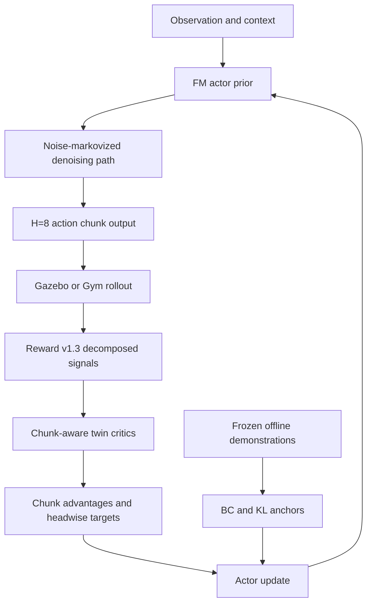
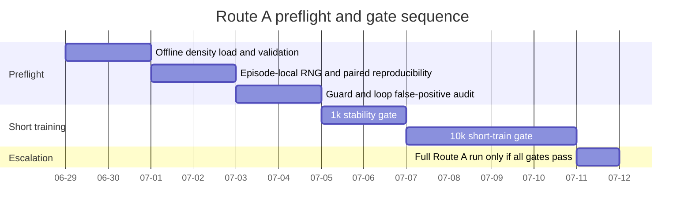

# Route A ReinFlow Style FM RL Deep Research Report

| Field | Content |
|------|------|
| Research date | 2026-06-29 |
| Retrieval window | 2020-01 through 2026-06; English-language primary papers, official arXiv abstracts/pages, and the uploaded iDP3-UAV project brief |
| Project | iDP3-UAV |
| Current stage | Reward v1.3 `PASS_TO_ROUTE_A_DESIGN` fileciteturn0file0 |

Suggested save locations: save this report as `C:\Users\cjj\Desktop\IDP3\论文\研究报告\2026-06-29_routeA_reinflow_fm_rl_deep_research.md`. Save actually adopted paper PDFs, arXiv abstract pages, and metadata under `C:\Users\cjj\Desktop\IDP3\论文\被参考\` and `C:\Users\cjj\Desktop\IDP3\论文\被参考\metadata\`. The project facts, constraints, and current metrics below are taken from the uploaded brief. fileciteturn0file0

## Executive Summary

- [FACT] Route B was not closed for instability; it was closed because the current low-rank DSRL-SAC branch remained stable yet failed to exceed the BC/FM policy on the project’s important comparisons, including support, default, Z35, canonical paired evaluation, and the final k=32 test. That is strong evidence that frozen-latent steering is too weak for the three Route A goals and that the policy body itself needs adaptation. fileciteturn0file0
- [FACT] Reward v1.3 has passed its short evaluation gate and already exposes the diagnostics needed for Route A, including `onset_distance`, `onset_time`, `future_clearance_softmin`, `trap_recovery_rate`, `deadend_dwell_steps`, `out_of_support_rate`, `successful_low_density_coverage`, `path_length_ratio`, `loop_detected_rate`, and clearance-distribution statistics. However, `support` is currently ineffective until offline density is loaded, and paired evaluation remains noisy until SynthPointCloud uses episode-local RNG. fileciteturn0file0
- [JUDGMENT] The best default Route A is a ReinFlow-style direct fine-tune of the flow-matching actor, not another latent-side RL branch. ReinFlow is the most directly relevant public method because it fine-tunes flow policies by injecting learnable noise into the deterministic flow path, converting sampling into a discrete-time Markov process with exact tractable likelihoods for policy-gradient updates, even at very few denoising steps. citeturn13view0turn21academia2
- [JUDGMENT] FQL is highly relevant, but it should be treated as a design influence rather than the default Route A algorithm. Public FQL avoids directly RL-updating the iterative flow by instead training an expressive one-step policy, precisely to avoid unstable recursive backpropagation; that is philosophically close to critic-guided flow control, but it is misaligned with iDP3-UAV’s requirement that the deployed policy remain the H=8, 11d-per-step chunked FM executor. citeturn20view0turn20view4
- [JUDGMENT] The critic should be chunk-aware and temporal. The most defensible design is a twin chunk critic that consumes the full H=8 action sequence through a temporal encoder, uses H-step chunk backups, and exposes auxiliary heads aligned with Route A targets such as `Q_total`, `Q_onset`, `Q_future_clearance`, `Q_trap_recovery`, and `Q_support`. Q-chunking, sequence-conditioned critics, and AC3 all point in this direction. citeturn25view0turn14view2turn14view4turn14view5
- [JUDGMENT] Head-only updates are unlikely to be enough. The project already has direct evidence that restricted latent steering did not create new anticipatory and dense-obstacle abilities. The safer default is adapter or LoRA updates across the FM vector-field blocks plus full updates for the anchor head and any internal noise/guidance module, with optional later unfreezing of the full FM trunk if gains plateau. This preserves BC structure better than immediate full unfreeze, while still modifying the policy core rather than only a thin head. fileciteturn0file0 citeturn13view0turn17academia0turn17academia2
- [FACT] DPPO is the strongest public diffusion-policy fine-tuning baseline in this family because it shows that policy-gradient fine-tuning of generative policies can be efficient and can induce structured, on-manifold exploration. But deterministic FM policies do not inherit the same likelihood machinery automatically, so DPPO cannot be ported literally; it needs a stochasticized or path-space formulation. Recent path-space PPO work supports proximal regularization in generation trajectory space and reports that penalty-style objectives are often more stable than literal clipping for generative policies. citeturn24view0turn15academia2turn13view0
- [JUDGMENT] Hierarchical steering is acceptable only if it remains an internal conditioning mechanism for the FM policy, such as a discrete mode token, risk token, or anchor preference token. It is not acceptable if it becomes a hidden external planner, a post-hoc corridor generator, or a trajectory editor. Therefore it should be Route A.5, not the default. fileciteturn0file0
- [FACT] The UAV and robot-navigation literature consistently favors longer-horizon, anticipatory decision signals over purely instantaneous clearance. High-speed end-to-end flight, perception-aware replanning, random-yaw omnidirectional avoidance, and memory-enhanced clutter navigation all emphasize early observation, temporal context, and non-myopic risk. That strongly supports making `onset_*`, `future_clearance_*`, `trap_*`, and full-space support metrics central Route A gates. citeturn4academia0turn4academia2turn4academia1turn5academia0turn23academia3
- [JUDGMENT] The decisive Route A evaluation change is to gate on capability metrics rather than broad reward alone. A branch that improves average reward but does not move avoidance onset earlier, widen x/y/z successful support, or raise dense-clutter recovery is not a success for this project. Reward v1.3 already makes that separation possible, and the final design should exploit it aggressively. fileciteturn0file0

## Project Status and Design Implications

The uploaded brief establishes five hard constraints for Route A: the FM/diffusion policy must remain the policy core; the output chunk is the executable trajectory and must not be post-hoc rewritten; safety gains must come from training loss, RL reward, or internal guidance rather than trajectory projection or external planning; the dataset is frozen; and causal attribution must remain inside the policy rather than being rescued by an external planner or safety shield. Those constraints immediately rule out many common “robot RL” tricks and force Route A toward integrated policy fine-tuning instead of external correction. fileciteturn0file0

Route B’s closure is highly informative. The project brief reports that low-rank SAC variants were numerically stable, but did not beat BC on the metrics that matter: support averages stayed in the BC range or worse, default averages remained extremely low, Z35 curriculum did not help, canonical paired evaluation favored BC, and the final k=32 branch only matched BC on support while underperforming on default. The brief’s own interpretation is that “freezing FM latent steering cannot reliably produce new capability” and that policy-body fine-tuning should be investigated next. That conclusion is fully consistent with the external literature: generative policies gain most when the generative dynamics themselves are adapted, not just a thin latent steering layer. fileciteturn0file0 citeturn13view0turn24view0

Reward v1.3 is already good enough to drive Route A, but it is not yet good enough to validate all three goals. The brief states that the reward implementation passes tests and short evaluations, and that it contains eight terms: `base`, `pbrs`, `onset`, `future_clearance`, `trap`, `flip`, `support`, and `guard`. However, it also states that offline density is not loaded, making the `support` term all zero, and that the current point-cloud generator uses global NumPy randomness, which means identical seeds and identical policies can still diverge in paired evaluation. Those are not cosmetic issues. They directly block trustworthy measurement of full-space support expansion and cause noise contamination in precisely the paired comparisons needed to judge Route A against BC. fileciteturn0file0

A useful design distinction follows from potential-based reward shaping theory. PBRS preserves the optimal policy only when the shaping term is of the potential-difference form \( \gamma \Phi(s') - \Phi(s) \); recent PBRS work continues to emphasize that this policy-invariance guarantee is specific and does not automatically extend to arbitrary shaping terms. Therefore, among Reward v1.3’s eight terms, only the `pbrs` component should be interpreted as policy-invariant in principle. The others such as `onset`, `future_clearance`, `trap`, `support`, and `guard` are better viewed as intentionally task-changing reward design, which is acceptable here because the project explicitly wants new anticipatory, dense-obstacle, and support-expansion behaviors, but it means anti-hacking diagnostics must remain first-class evaluation outputs. citeturn8academia1turn7academia2 fileciteturn0file0

The reward terms can be mapped cleanly onto the three Route A goals:

| Reward v1.3 term | Primary Route A goal served | Why it matters |
|------|------|------|
| `onset` | Anticipatory avoidance | Rewards or diagnoses avoiding earlier instead of waiting until late obstacle proximity. fileciteturn0file0 |
| `future_clearance` | Anticipatory avoidance; dense clutter | Encodes ahead-of-time navigability better than instant clearance alone in cluttered motion. fileciteturn0file0 |
| `trap` | Dense-obstacle ceiling | Directly targets dead-end, local minimum, and recovery behavior. fileciteturn0file0 |
| `support` | Full-space support expansion | Intended to reward success outside the narrow historical support domain, but currently disabled until offline density loads. fileciteturn0file0 |
| `guard` | Anti-hacking across all goals | Helps prevent unsafe exploitation, loops, or degenerate edge behavior. fileciteturn0file0 |
| `flip` | Safety and stability | Guards against dynamically bad or sign-flipped behavior during attempted recovery. fileciteturn0file0 |
| `base` and `pbrs` | General progress and shaping | Preserve task progress signal and provide dense progress shaping. fileciteturn0file0 |

The net implication is straightforward: Route A must be designed as **policy-core adaptation with chunk-aware credit assignment under reproducible paired evaluation**, not as another stable-but-inert latent controller. fileciteturn0file0

## External Literature Evidence

The table below focuses only on papers that directly shaped the design judgment in this report.

| Paper | Year and ID | Core contribution | Transferable point for iDP3-UAV | Main non-transferable point or risk |
|------|------|------|------|------|
| *Flow Matching for Generative Modeling* citeturn10academia3 | 2022, arXiv:2210.02747 | Introduces simulation-free FM training for CNFs over chosen probability paths. | Gives the clean continuous-time generative foundation for an FM actor and explains why few-step ODE sampling is plausible. | It is not itself an RL paper, so it does not solve likelihood, actor-critic, or exploration issues. |
| *Improving and Generalizing Flow-Based Generative Models with Minibatch Optimal Transport* citeturn11academia0 | 2023, arXiv:2302.00482 | Introduces generalized CFM and OT-CFM; OT paths can be simpler and more stable. | Directly relevant because iDP3-UAV already uses OT-CFM; supports preserving that core. | Still generative training, not online control fine-tuning. |
| *Rectified Flow: A Marginal Preserving Approach to Optimal Transport* citeturn12academia0 | 2022, arXiv:2209.14577 | Straightens transport paths, motivating fast few-step inference. | Supports the project’s emphasis on 4-step Euler ODE sampling. | Does not address RL, reward shaping, or UAV-specific partial observability. |
| *Riemannian Flow Matching Policy for Robot Motion Learning* citeturn17academia0 | 2024, arXiv:2403.10672 | Shows FM policies are viable robot policies with smooth actions and low inference cost. | Supports keeping FM as the policy core rather than replacing it with a standard Gaussian actor. | Primarily imitation learning rather than online RL. |
| *Fast and Robust Visuomotor Riemannian Flow Matching Policy* citeturn17academia2 | 2024, arXiv:2412.10855 | Adds robustness/stability arguments around RFMP variants. | Strengthens confidence that FM policies can remain performant under realistic robotic constraints. | Task domain is manipulation, not UAV clutter navigation. |
| *ReinFlow: Fine-tuning Flow Matching Policy with Online Reinforcement Learning* citeturn13view0turn21academia2 | 2025, arXiv:2505.22094 | Injects learnable Gaussian noise along a deterministic flow path, making a discrete-time Markov process with exact tractable likelihood for policy gradient. | Best default Route A template for direct FM fine-tuning at few denoising steps; exploration is built into the policy itself. | Benchmarks are locomotion/manipulation, not UAV obstacle avoidance; public evidence on dense 3D clutter is still limited. |
| *Flow Q-Learning* citeturn20view0turn20view4 | 2025, arXiv:2502.02538 | Uses flow policies in offline and offline-to-online RL by training an expressive one-step policy to avoid unstable recursive backprop through iterative flow generation. | Strong evidence that critic-guided flow control can work and that recursive backprop through iterative generation is risky. | Public method sidesteps direct iterative FM actor RL; that makes it an imperfect fit for keeping iDP3’s H=8 FM chunk executor as the deployed actor. |
| *Learning a Diffusion Model Policy from Rewards via Q-Score Matching* citeturn22academia0 | 2023, arXiv:2312.11752 | Links policy score structure to action gradients of Q and proposes Q-score matching updates. | Useful conceptual template for a Q-guided FM auxiliary loss that preserves multimodality better than vanilla deterministic Q-gradient ascent. | Derived for diffusion score models; direct FM transfer is not automatic. |
| *Diffusion Policy Policy Optimization* citeturn24view0turn14view6 | 2024, arXiv:2409.00588 | Shows policy-gradient fine-tuning of diffusion policies can be strong and efficient, with structured on-manifold exploration and robustness. | Strong evidence that generative policies can benefit from on-policy proximal fine-tuning rather than only Q-guided actor-critic updates. | Diffusion-chain likelihood machinery does not port directly to deterministic FM ODE policies. |
| *Proximal Policy Optimization in Path Space* citeturn15academia2 | 2026, arXiv:2603.21621 | Formulates PPO-style optimization in generation trajectory space; reports penalty-style path-space regularization is more stable than clip-style. | Suggests any FM-DPPO hybrid should regularize in path space and likely prefer a penalty/KL view over literal ratio clipping. | Not specialized to robotic FM actors or chunked UAV control. |
| *Reinforcement Learning with Action Chunking* citeturn25view0 | 2025, arXiv:2507.07969 | Runs RL directly in chunked action space, yielding temporally coherent exploration and unbiased n-step backups. | Extremely relevant because iDP3-UAV already acts in H=8 chunks; supports chunk-space RL rather than collapsing to single-step control. | Does not itself solve FM likelihood or policy-gradient issues. |
| *Chunking the Critic* citeturn14view2turn14view3 | 2025, arXiv:2503.03660 | Uses a sequence-conditioned Transformer critic and aggregated N-step targets for long-horizon RL. | Strong support for a temporal chunk critic over a flat 88d critic. | Developed around SAC rather than FM actors, so actor integration is still a design step. |
| *AC3: Actor-Critic for Continuous Action Chunks* citeturn14view4turn14view5 | 2025, arXiv:2508.11143 | Stabilizes chunk RL with asymmetric actor updates from successful trajectories and intra-chunk n-step critic targets. | Useful for sparse or rare-success settings such as dense clutter recovery, and for assigning credit within a chunk. | Manipulation domain; “successful trajectories only” may be too restrictive if used naively in UAV training. |
| *CGPO: Sample-Efficient Diffusion-based RL with Critic Guidance* citeturn22academia1 | 2026, arXiv:2605.30056 | Uses critic guidance inside denoising, then distills guided actions through regression. | Good inspiration for **training-time only** guidance or target-generation inside Route A. | The project explicitly disallows making inference-time guidance the only main result. |
| *Learning High-Speed Flight in the Wild* citeturn4academia0 | 2021, arXiv:2110.05113 | End-to-end policy maps onboard sensing directly to collision-free receding-horizon trajectories and transfers zero-shot to real flight. | Strong support for end-to-end trajectory-output control instead of pipeline decomposition, which matches MC-1 and MC-2. | Uses privileged training and an imitation route rather than FM RL fine-tuning. |
| *RAPTOR* citeturn4academia2 | 2020, arXiv:2007.03465 | Perception-aware replanning emphasizes observing relevant unknown space earlier and avoiding in time. | Supports anticipatory avoidance metrics and the importance of future-looking risk rather than instant clearance alone. | It is an external planner, which iDP3-UAV cannot use as a post-hoc fix. |
| *MAVRL* citeturn5academia0 | 2024, arXiv:2402.08381 | RL obstacle avoidance with varying speed and memory-augmented latent state from depth. | Supports temporal memory and adaptive behavior in clutter; aligns with chunk critics and trap recovery emphasis. | Action space and architecture differ from iDP3’s FM chunk trajectory output. |
| *Fly360* citeturn4academia1 | 2026, arXiv:2603.06573 | Omnidirectional avoidance benchmark with fixed random-yaw training for arbitrary obstacle directions. | Strong evidence that direction bias matters and that random heading exposure helps full-space support. | It uses a two-stage panoramic system and body-frame velocities, not a chunked FM trajectory actor. |
| *CaMeRL* citeturn23academia3 | 2026, arXiv:2605.14810 | Collision-aware memory-enhanced RL for multi-scale obstacle environments. | Supports explicit treatment of partial observability, small-obstacle sensitivity, and large-obstacle occlusion in clutter benchmarks. | Not an FM policy and not a chunk-trajectory method. |
| *Improving the Effectiveness of Potential-Based Reward Shaping* citeturn8academia1 | 2025, arXiv:2502.01307 | Reaffirms PBRS policy invariance and analyzes practical effectiveness limits. | Clarifies which reward terms can claim invariance and which must be treated as intentional task changes with anti-hacking diagnostics. | Does not tell you which dense-clutter shaping terms to use; only clarifies their theoretical status. |

## Candidate Route A Architectures

The comparison below is written against the project’s explicit constraints, not generic RL preference.

| Branch | Algorithm structure | Critic design | Reward v1.3 interface | Expected effect on the three Route A goals | Main risk | MC-1 to MC-5 status |
|------|------|------|------|------|------|------|
| ReinFlow-style direct FM online fine-tune | Keep the FM actor as the deployed H=8 chunk generator; inject learnable stochasticity along denoising steps so the few-step FM path becomes a tractable Markov policy; update FM parameters directly with policy gradient plus BC/KL anchoring. citeturn13view0 | Twin chunk critics with temporal chunk encoder; H-step chunk TD target; multi-head decomposition. Supported by ReinFlow on actor side and by chunk-critic literature on value side. citeturn13view0turn14view2turn14view4 | Natural fit to all eight terms, especially `onset`, `future_clearance`, `trap`, `support`, and `guard`, because policy-gradient fine-tuning can directly exploit non-myopic reward shaping. fileciteturn0file0 | Best default candidate for anticipatory avoidance, support expansion, and dense-clutter recovery because it updates the actual policy dynamics, not just a proxy. | Q overestimation or drift off the BC manifold if anchoring/noise schedules are poor. | Fully compliant if the guidance is internal and no post-hoc editing is used. fileciteturn0file0 |
| FQL or Q-guided flow actor | Keep FM-like expressive action representations but train with critic guidance or distillation rather than direct pathwise policy gradient. Public FQL trains an expressive one-step policy to avoid unstable recursive backprop; QSM provides a critic-gradient score-matching template. citeturn20view0turn22academia0 | Strong critic is central; can use chunk critic plus decomposed heads. | Good for exploiting dense reward signals and off-policy replay. | Likely good on support expansion and dense clutter if the critic is accurate; less obviously good on anticipatory timing unless the critic captures chunk-level future risk well. | Risk of optimizing a proxy actor that is not exactly the deployed FM chunk sampler; also critic bias can erase multimodality. | Conditionally compliant; acceptable only if the deployed actor remains the FM chunk generator. |
| DPPO-style on-manifold policy-gradient fallback | Treat generative sampling as a stochastic policy and optimize with proximal policy gradient in sample-path space; for FM, this requires explicit stochasticization or path-space likelihood construction rather than direct diffusion transfer. citeturn24view0turn15academia2turn13view0 | Usually value baseline plus on-policy advantage estimation; a chunk-value or chunk-advantage baseline is still needed for H=8. | Works with Reward v1.3, but sample efficiency may be lower than off-policy actor-critic variants in sparse dense-clutter tasks. | Strong for on-manifold exploration and catastrophic-forgetting control; weaker than the default on exploiting rare dense-recovery events unless collection is wide enough. | Native FM likelihood is the hard part. Literal diffusion DPPO is not plug-and-play here. | Compliant if implemented inside the FM policy and without external trajectory editing. |
| Hierarchical steering Route A.5 | Add an internal discrete mode, corridor, or risk token as extra conditioning to the FM actor. Upper policy chooses mode; lower FM still outputs the final executed chunk. | Mode-conditioned chunk critic or option-value heads. | Can map reward heads to mode usefulness, especially `trap`, `future_clearance`, and `support`. | Most promising when dense clutter is multimodal and BC is trapped in one dominant mode. | Attribution becomes harder; can silently become an external planner if the upper layer does too much route construction. | Compliant only if the upper layer does not output a rewritten path and the FM lower layer remains the sole executor. fileciteturn0file0 |

The best-supported branch is the first one. ReinFlow is the only public result in this set that directly addresses **online RL fine-tuning of flow policies** rather than diffusion policies or one-step distillations, and it explicitly targets the few-step regime that resembles iDP3-UAV’s current 4-step Euler FM actor. citeturn13view0turn21academia2

FQL is still important because it highlights the central technical danger: backpropagating RL objectives through iterative generative sampling can be unstable, which is one reason to prefer exact-likelihood policy-gradient on a stochasticized FM path or else a carefully distilled critic-guided auxiliary route. That makes FQL more valuable as a **warning and auxiliary design reference** than as the literal default algorithm. citeturn20view0turn20view4

DPPO belongs in the fallback column. Its strongest transferable lesson is not “use diffusion,” but rather “generative policies can benefit from structured, on-manifold policy-gradient fine-tuning if the policy is made stochastic in a principled way and regularized proximally.” For FM, the closest mathematically defensible port is therefore a ReinFlow-like stochasticized path plus path-space proximal regularization, not a literal reuse of diffusion-policy code paths. citeturn24view0turn15academia2turn13view0

Hierarchical steering should remain conditional. In dense clutter, multimodal route choices such as “pass left,” “pass right,” “climb then slip,” or “slow probe then escape” are genuinely helpful. But the project’s attribution constraint means hierarchy should be introduced only if direct FM fine-tuning fails to make progress while staying reproducible. When that happens, the hierarchy must be an **internal condition signal**, not a post-hoc path generator. fileciteturn0file0

## Recommended Default Branch

The recommended default branch is:

**ReinFlow-style direct online fine-tuning of the FM actor, using chunk-aware twin critics, BC/KL anchoring, and event-aware replay.**

The core reason is simple. The project’s own evidence says latent-side SAC steering was stable but not capability-creating. ReinFlow, in contrast, updates the flow policy itself and provides a concrete way to make a few-step FM actor trainable with exact policy-gradient likelihoods by adding learnable stochasticity to the denoising path. That is the closest available public recipe to the actual iDP3-UAV architecture and the least conflicting with MC-1 through MC-5. fileciteturn0file0 citeturn13view0turn21academia2

A recommended iDP3-UAV instantiation is:

\[
a_{k+1} = a_k + \Delta \tau_k \, v_\theta(\tau_k, a_k, o_t, c_t) + \sigma_\phi(\tau_k, a_k, o_t, c_t)\,\epsilon_k,\quad \epsilon_k \sim \mathcal N(0,I),
\]

where \(a_k\) is the chunk trajectory state at FM denoising step \(k\), \(v_\theta\) is the current FM vector field, \(c_t\) includes existing conditioning such as the anchor head and any internal guidance context, and \(\sigma_\phi\) is a lightweight learnable noise network in the ReinFlow spirit. The executed action remains the final H=8, 11d-per-step chunk after the last Euler step, so MC-1 is preserved. This equation is a project-specific adaptation of ReinFlow’s general idea rather than a quotation of their exact implementation. citeturn13view0

The actor loss should combine policy improvement with explicit imitation anchoring:

\[
\mathcal L_{\text{actor}}
=
-\mathbb E\!\left[\log \pi_{\theta,\phi}(A_t \mid o_t)\,\hat A^{\text{chunk}}_t\right]
+ \lambda_{\text{BC}}\mathcal L_{\text{BC-anchor}}
+ \lambda_{\text{KL}} D_{\text{KL}}\!\left(\pi_{\theta,\phi}\,\|\,\pi_{\text{BC}}\right)
+ \lambda_{\text{cons}}\mathcal L_{\text{step-consistency}}.
\]

The first term is the ReinFlow-style policy gradient, the second and third terms keep the actor near the frozen BC/FM prior, and the final consistency term is optional but useful when 4-step sampling is pushed aggressively. BC/KL anchoring is not an admission of weakness; it is the main mechanism that keeps on-manifold exploration while still permitting improvement. DPPO’s robustness story, ReinFlow’s regularized few-step fine-tuning, and Q-chunking’s temporally coherent exploration all support that combination. citeturn24view0turn13view0turn25view0

The critic should **not** be a flat MLP over \((s, \operatorname{vec}(A_{t:t+7}))\) alone. That representation discards the temporal structure inside the chunk and makes onset and trap credit assignment harder than necessary. A better default is:

- a state encoder for current observation and short recent context,
- a chunk encoder over the full H=8 sequence, preferably Transformer or temporal-conv style,
- twin critics to reduce overestimation,
- one shared latent with multiple heads: `Q_total`, `Q_progress`, `Q_onset`, `Q_future_clearance`, `Q_trap_recovery`, `Q_support`,
- optional auxiliary predictions for `path_length_ratio`, `loop_detected_rate`, and support-domain classification.

This is strongly consistent with Q-chunking’s chunk-space RL, Chunking-the-Critic’s sequence-conditioned critic, and AC3’s intra-chunk n-step target design. citeturn25view0turn14view2turn14view4turn14view5

A sensible chunk target is:

\[
y_t^{\text{total}}
=
\sum_{i=0}^{H-1}\gamma^i r_{t+i}^{\text{total}}
+
\gamma^H \min_{j\in\{1,2\}} \bar Q_j\!\left(s_{t+H}, A'_{t+H:t+2H-1}\right),
\]

with the same structure for each reward head using the corresponding decomposed reward channel. This respects the fact that the environment actually executes a chunk and that Reward v1.3’s dense terms are not equally attributable to every instant inside that chunk. Using H-step chunk targets is much more natural here than pretending the actor is single-step. fileciteturn0file0 citeturn25view0turn14view2turn14view5

The replay buffer should be **tri-partitioned**, not monolithic:

| Buffer slice | Contents | Why |
|------|------|------|
| Frozen offline prior | Original FM/BC demonstrations only | Preserves the support manifold and stabilizes the BC anchor. |
| Recent on-policy | Last-N episodes from current actor | Ensures critic tracks the current policy’s state-action distribution. |
| Frontier event buffer | Rare chunks from early avoidance wins, support-expansion successes, dense-clutter recoveries, and hard failures | Prevents the critic from averaging away the exact events Route A cares about. |

This structure is a judgment call, but it is well supported by the mismatch between the project’s three target capabilities and generic average-reward RL. Dense-clutter recovery events are rare and need over-representation; otherwise, the training signal collapses toward “stay near BC.” Q-chunking’s offline-to-online framing and AC3’s success-aware actor update both support non-uniform treatment of rare successful trajectories. citeturn25view0turn14view4

Exploration should remain **on-manifold by construction**, through four mechanisms used together:

| Mechanism | Recommended use |
|------|------|
| Learnable FM-path noise | Primary exploration driver, per ReinFlow. citeturn13view0 |
| BC/KL anchor to frozen policy | Keeps exploration near executable trajectories already supported by the prior. citeturn24view0turn13view0 |
| Chunk-space actions | Preserves temporal coherence and discourages per-step jitter. citeturn25view0 |
| Rare-event replay and headwise critics | Makes unusual but important success patterns learnable without letting the policy collapse to them everywhere. |

The quickest route to repeating Route B’s failure is to make the optimization target “be stable and stay near BC.” Route A needs to stay near BC **only where BC is already good**, and depart from it where the new reward heads clearly indicate missed anticipatory turns, out-of-support hesitation, or trap persistence. In practice, that means the RL-improvement term should be strongest on top-advantage chunks and rare success-frontier chunks, while the BC anchor remains active everywhere. AC3’s asymmetry and QSM’s critic-guided multimodality are useful inspirations here, though iDP3-UAV should not copy them blindly. citeturn14view4turn22academia0

The update scope should be **adapter-first, not head-only and not immediately full-unfreeze**:

| Component | Default update policy | Rationale |
|------|------|------|
| FM vector-field trunk | LoRA/adapters across major residual/attention blocks | Enough capacity to change actual policy dynamics while lowering catastrophic forgetting risk. |
| Anchor head | Fully trainable | The branch that already encodes discrete anchor preferences should remain adaptable. |
| Noise network and internal guidance modules | Fully trainable | They are the prime exploration-control interface. |
| Perception backbone if present | Freeze initially; unfreeze only if action-side adaptation saturates | Keeps Route A focused on trajectory-policy adaptation first. |
| Full FM unfreeze | Stage-2 escalation only after passing stability gate and plateauing | Gives a controlled capacity ramp rather than immediate policy drift. |

This is the best compromise between “must modify the policy core” and “must avoid blowing up a good BC prior.” Head-only updating is too weak for the evidence you already have. Immediate full-unfreeze is probably too aggressive for a frozen-data, dense-clutter UAV project. fileciteturn0file0 citeturn13view0turn17academia2

## Preflight Tasks and Evaluation Gates

Before any full Route A training run, four P0 tasks from the brief should be treated as blockers, not “nice to have” improvements. fileciteturn0file0

| P0 task | Why it is blocking | Acceptance standard |
|------|------|------|
| Offline density loading for `support` | Without it, the `support` term is zero, so Route A cannot honestly claim full-space support expansion. fileciteturn0file0 | In a support-focused eval slice, `support` rewards and `out_of_support_rate` diagnostics must be non-zero and scenario-sensitive; at least one support-related metric should differ meaningfully across in-support and out-of-support rollouts. |
| Episode-local RNG for SynthPointCloud | The brief reports 20–30% trajectory differences even under identical seeds and policy, which invalidates paired evaluation. fileciteturn0file0 | Re-running the same policy with the same environment seed should produce either bitwise-identical trajectory logs or an explicitly documented numerically negligible tolerance; practical target: ≥ 99% paired identity in key metrics and zero route-branching discrepancies. |
| `guard` and loop-penalty false-positive audit | Anti-hacking terms are necessary, but they can also suppress legitimate early-avoidance detours and trap escapes if mis-tuned. fileciteturn0file0 | On a hand-audited eval set, false-positive penalty firing on clearly desirable detours should be low enough that the sign of policy ranking does not change when those terms are ablated; practical target: < 5% of successful recovery episodes flagged as loops or guard violations. |
| Short-train gate before long runs | Route A is likely to create visible failure modes early; long runs before short-gating waste time and muddy attributions. fileciteturn0file0 | Every branch must pass the 1k and 10k gates below before any longer schedule is authorized. |

The proposed short-run schedule is below. Dates are illustrative relative to the report date.

The evaluation gates should explicitly track the three real Route A objectives, not only reward and success rate.

| Gate | Suggested threshold or range | Why this threshold is defensible |
|------|------|------|
| 1k stability gate | No NaN/Inf; invalid observation rate = 0; no critic explosion; action-chunk norms within a sane envelope relative to BC; paired reproducibility intact. | Mirrors the project’s successful Route B stability practice, but adds action-distribution sanity because Route A changes the policy core. fileciteturn0file0 |
| 10k short-train gate | Support performance not worse than BC by more than 3–5 points; canonical paired result not worse than BC by more than 3 points; no catastrophic rise in collision rate; no reward-hacking flags. | A short run need not beat BC strongly yet, but it must show no early collapse. Route B shows “stable but not better” is easy; Route A should at least avoid early regression. fileciteturn0file0 |
| Canonical paired eval gate | Mean success on the exact same paired episodes should exceed the BC baseline by at least +5 absolute points before a branch is called promising. | The brief’s canonical paired setup is your cleanest causal comparison and already showed Route B lagging BC. fileciteturn0file0 |
| Support, default, dense, random-stress gate | A promising branch should improve at least two of the three target regimes: support, default, dense. Suggested first-pass targets are support +3–5 points, default +4–6 points, dense +5–10 points over BC or current FM baseline, without worsening collisions. | Support-only improvement is insufficient; the project explicitly wants full-space and dense-clutter gains, not only higher-z or easy-zone gains. fileciteturn0file0 |
| Anticipatory avoidance gate | `onset_distance` or `onset_time` should improve by at least 10–15% over BC on matched episodes, while `future_clearance_softmin` also improves and `path_length_ratio` stays under roughly 1.15–1.20 on successful episodes. | This prevents “earlier avoidance” from being faked by huge timid detours. RAPTOR and high-speed flight literature both support early perception and non-myopic avoidance. citeturn4academia2turn4academia0 |
| Full-space support expansion gate | Successful trajectory coverage should increase along x, y, and z simultaneously; suggested trigger is at least +10% in high-percentile successful span on each axis, plus a drop in `out_of_support_rate`. | The project explicitly forbids counting “fly higher” alone as support expansion. fileciteturn0file0 |
| Dense-obstacle ceiling gate | `trap_recovery_rate` up by ≥ 15%, `deadend_dwell_steps` down by ≥ 20%, and dense-scenario success up by ≥ 5 points while `loop_detected_rate` does not rise. | Dense clutter is precisely where simple BC imitation tends to fail and where chunk-wise non-myopic control should matter most. fileciteturn0file0 citeturn23academia3turn18academia0 |
| Reward-hacking detection gate | Reject any branch with large success gains if it also shows path inflation, altitude-only escape, loop rise, or guard-trigger inflation. Suggested flags: `path_length_ratio` > 1.25, abrupt z-only coverage growth with flat x/y, or materially higher `loop_detected_rate`. | Because most v1.3 terms other than `pbrs` are task-changing, anti-hacking diagnostics are mandatory. citeturn8academia1 fileciteturn0file0 |

## Compliance Check and Risks

The recommended default branch is compliant with the project’s method constraints as long as it is implemented as described.

| Constraint | Compliance assessment |
|------|------|
| MC-1 trajectory output equals execution trajectory | Compliant. The deployed action remains the FM actor’s H=8 chunk. No smoothing, projection, truncation, or rewrite is introduced. fileciteturn0file0 |
| MC-2 FM policy remains the core | Compliant. ReinFlow-style stochasticization modifies the policy *inside* the FM sampling path instead of replacing it with a different policy class. citeturn13view0 |
| MC-3 safety learned through loss, reward, or internal guidance | Compliant. Safety enters via Reward v1.3 heads, critic structure, and internal stochastic/guidance modules rather than post-hoc repair. fileciteturn0file0 |
| MC-4 frozen EGO data | Compliant. The design uses the frozen dataset as an anchor buffer and adds online RL in simulation; it does not require recollection of the frozen dataset. fileciteturn0file0 |
| MC-5 separable attribution | Compliant, provided any hierarchical extension remains internal conditioning and not external path planning. The default branch preserves clear causal attribution to actor update, reward heads, critic design, and replay design. fileciteturn0file0 |

The main failure modes and monitoring plan should be explicit from day one.

| Failure mode | Detection signal | Likely cause | Response strategy |
|------|------|------|------|
| Critic collapse or Q overestimation | Divergent twin-critic gap, exploding target values, unstable actor jumps, paired eval regressions | High-dimensional chunk critic without enough temporal inductive bias | Use twin critics, H-step chunk targets, slower target updates, lower UTD, and distributional or variance-aware critics if needed. Chunking-the-Critic and DSAC-style refinements are the most relevant public evidence. citeturn14view2turn2academia1 |
| Policy leaves the BC manifold | Sudden rise in collisions, implausible chunk shapes, poor support despite reward gains | RL term dominates BC/KL anchor | Increase anchor weight, constrain noise scale, strengthen offline-prior sampling, and revert to adapter-only updates before considering deeper unfreeze. citeturn13view0turn24view0 |
| Reward hacking | Better scalar reward with worse `path_length_ratio`, worse loops, z-only escape, or worse true success | Over-emphasis on task-changing shaping terms without anti-hack checks | Keep guard diagnostics, add evaluation vetoes, and inspect decomposed reward-head values before accepting gains. PBRS theory makes clear these terms are not automatically policy-invariant. citeturn8academia1 fileciteturn0file0 |
| Catastrophic forgetting | Support or canonical performance collapses while dense subset improves | Too much online drift; too little replay from frozen prior | Increase BC/KL anchor, maintain mixed replay, and delay any full-trunk unfreeze. citeturn24view0turn13view0 |
| Support term still ineffective | `support` remains zero or non-discriminative; support metrics do not correlate with coverage | Offline density never actually loaded or validated | Block all support-expansion claims and do not proceed to full training until the P0 validation passes. fileciteturn0file0 |
| Paired eval noise contaminates conclusions | Same seed still yields path variation or incomparable episode geometry | RNG contamination in environment generation | Treat results as non-decisive until episode-local RNG reproducibility is confirmed. fileciteturn0file0 |
| Dense obstacle still shows no gain | `trap_recovery_rate`, dense success, and `deadend_dwell_steps` do not improve despite training stability | Critic underweights rare recovery events; actor remains too close to BC | Increase frontier-event replay, use asymmetric or top-advantage actor weighting, and consider Route A.5 only after the direct branch has a fair reproducible short run. citeturn14view4turn18academia0 |
| Internal guidance becomes the de facto main result | Performance exists only when extra denoising guidance is turned on at inference | Over-reliance on CGPO-like or guidance-only mechanisms | Guidance is acceptable as training scaffolding, but the deployed policy must stand on its learned parameters. citeturn22academia1 fileciteturn0file0 |

One additional risk deserves emphasis. Many of the most relevant action-chunk and generative-policy RL papers are from 2025–2026, and several are recent arXiv papers or newly accepted conference papers rather than long-established baselines. That does not make them unusable, but it does mean Route A should be engineered with stronger ablations and clearer gates than would be necessary for a mature canonical algorithm. citeturn25view0turn14view3turn14view4

## Design Document Recommendations

The correct document order is:

| Recommended document | Should it be written now | Why |
|------|------|------|
| `RouteA_Preflight_Fixes` | Yes, first | Because offline density loading and episode-local RNG reproducibility are true blockers for two of the three Route A goals and for paired evaluation integrity. fileciteturn0file0 |
| `RouteA_ReinFlow_FM_RL_Design_v1.0` | Yes, immediately after preflight spec exists | Because the default branch is now sufficiently well justified: direct FM fine-tune, chunk-aware critics, BC/KL anchor, event-aware replay, and explicit gates. |
| `RouteA5_Hierarchical_Steering_Design_v0.x` | Yes, but as a separate fallback document | Because hierarchy is promising for multimodal dense clutter, yet too easy to let drift into an external planner and too costly for attribution if introduced prematurely. fileciteturn0file0 |

The recommended writing sequence is therefore:

1. **Write `RouteA_Preflight_Fixes` first.**  
   It should specify offline density loading, RNG locality, guard or loop false-positive audit, and the exact reproducibility contract for paired evaluation. Without that document, any stronger Route A design will still rest on unreliable evaluation. fileciteturn0file0

2. **Then write `RouteA_ReinFlow_FM_RL_Design_v1.0`.**  
   That document should center the default algorithm described here: ReinFlow-style stochasticized FM actor, adapter-first policy-core fine-tuning, chunk-aware twin critics, decomposed reward heads matching Reward v1.3, and the 1k or 10k gating protocol. The report above is meant to be directly reusable as its theory and design-rationale section. citeturn13view0turn25view0turn14view2turn14view4

3. **Keep hierarchy split into Route A.5.**  
   The trigger to activate it should be explicit: if the default direct-FM branch passes stability and reproducibility but still fails to beat BC on the canonical paired gate *and* fails at least one of the anticipatory or dense-ceiling gates, then a small internal mode-conditioning hierarchy becomes justified. Until then, the cost in attribution complexity is not worth it. fileciteturn0file0

My bottom-line recommendation is therefore:

**Proceed with Route A as a ReinFlow-style policy-core FM fine-tune, using a sequence-aware chunk critic and strict preflight reproducibility fixes. Do not default to FQL, DPPO, or hierarchy. Use those as side references, fallback mechanisms, or later ablations—not as the first branch.** citeturn13view0turn20view0turn24view0