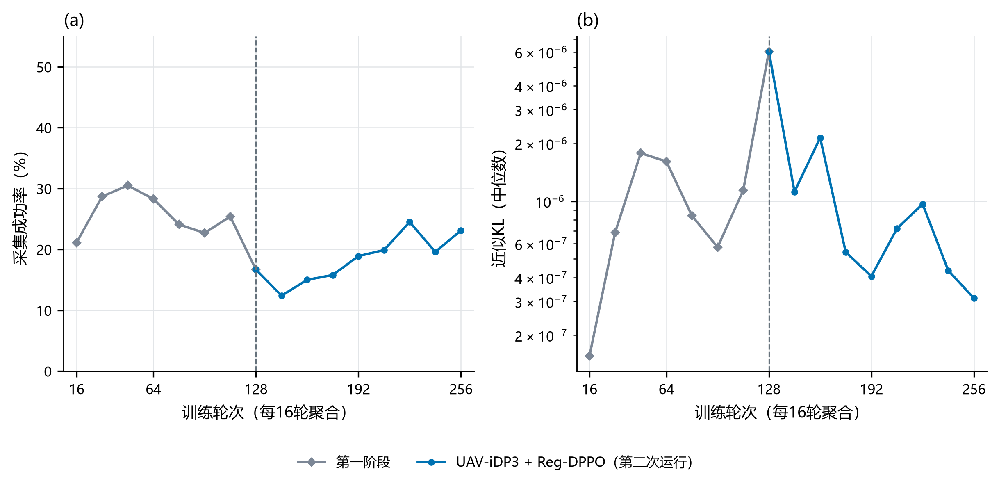

# 补充材料

> 工作稿说明（不进入正文）：方法细节已全部并入正文第 3 章（11-09），补充材料只含补充结果：S1 0.5m 成功标准下的结果（表 S1）；S2 第二次训练运行（表 S2、图 S1）；S3 运动学评价任务（表 S3）；S4 Gazebo 评价任务（表 S4、表 S5）。正文不引用补充材料。数字来自 `研究报告/2026-11-08_论文数据表.xlsx`；去除清单见 `研究报告/analysis_20261108/oprime/exclusions.json` 与 `gazebo/exclusions.json`。

## S1 0.5m成功标准下的结果

正文以碰撞前进入目标1.5m范围为成功。表S1给出以进入目标0.5m范围为成功（与训练到达奖励半径相同）时运动学环境中的结果，任务与统计口径同正文表4。进入1.5m范围后在目标附近超时的飞行在此计为超时，进入1.5m范围后发生碰撞的飞行计为碰撞。本文方法在两种标准下成功率均为最高。

**表S1　0.5m标准下测试场景上的结果**

| 方法 | 成功率 总体(%) | 稀疏(%) | 适中(%) | 密集(%) | 碰撞率(%) | 超时率(%) |
| --- | ---: | ---: | ---: | ---: | ---: | ---: |
| UAV-iDP3 | 27.9 | 42.4 | 25.4 | 17.2 | 35.3 | 36.8 |
| Reg-DPPO w/o Stage II | 42.1 | 61.0 | 38.8 | 28.1 | 32.6 | 25.3 |
| Single-stage DPPO | 35.3 | 57.6 | 25.4 | 25.0 | 34.7 | 30.0 |
| Reg-DPPO w/o BC reg. | 42.1 | 67.8 | 37.3 | 23.4 | 38.4 | 19.5 |
| 本文方法 | **48.9** | **72.9** | **44.8** | **31.2** | 33.2 | **17.9** |

## S2 第二次训练运行

以不同随机种子重复第一阶段微调与本文方法的完整训练，评价设置同正文。表S2给出1.5m标准下的结果，训练过程见图S1。第二次运行中，本文方法的任务成功率与UAV-iDP3相当（48.9%对47.4%），第一阶段策略低于UAV-iDP3；从第二次运行的第一阶段策略出发，第二阶段使成功率提高22.1个百分点。微调的结果对训练随机性较为敏感，正文第5章将其列为局限。

**表S2　第二次训练运行的结果（1.5m标准）**

| 方法 | 成功率 总体(%) | 稀疏(%) | 适中(%) | 密集(%) | 碰撞率(%) | 超时率(%) |
| --- | ---: | ---: | ---: | ---: | ---: | ---: |
| Reg-DPPO w/o Stage II（第二次运行） | 26.8 | 47.5 | 22.4 | 12.5 | 27.4 | 45.8 |
| 本文方法（第二次运行） | 48.9 | 72.9 | 38.8 | 37.5 | 27.9 | 23.2 |

表注：任务与统计口径同正文表4。

**图S1　第二次训练运行的训练采集成功率与近似KL散度。** 每16轮汇总，格式同正文图7。

## S3 运动学评价任务

运动学评价共进行了42个场景的199个任务，每个任务5次。正文表3、表4的统计不含其中9个任务，均为cul_de_sac_trap类场景（000021中1个、000114中4个、000115中2个、000116中2个），其中000115的任务全部去除；这些任务在评价完成后从统计中去除。正文按任务统计（5次中至少3次成功即记该任务成功），并以进入目标1.5m范围为成功，二者均在评价完成后确定；评价前确定的标准为每次评价单独统计、进入目标0.5m范围为成功（与训练到达奖励半径相同，预先登记的判定按此标准作出）。表S3给出全部199个任务按评价前标准的结果。

**表S3　运动学评价中全部199个任务按评价前标准（每次评价、0.5m）的结果**

| 方法 | 成功率 总体(%) | 稀疏(%) | 适中(%) | 密集(%) | 碰撞率(%) | 超时率(%) |
| --- | ---: | ---: | ---: | ---: | ---: | ---: |
| UAV-iDP3 | 27.2 | 43.4 | 25.1 | 15.7 | 38.5 | 34.3 |
| Reg-DPPO w/o Stage II | 40.6 | 60.3 | 39.1 | 25.4 | 34.5 | 24.9 |
| Single-stage DPPO | 35.2 | 58.0 | 26.3 | 24.9 | 36.4 | 28.4 |
| Reg-DPPO w/o BC reg. | 40.1 | 67.1 | 36.6 | 20.9 | 40.7 | 19.2 |
| 本文方法 | 45.7 | 70.5 | 43.4 | 27.1 | 35.3 | 19.0 |

表注：每种方法995次评价；稀疏、适中、密集类分别为295、350、350次。

## S4 Gazebo评价任务

Gazebo飞行共进行了48个任务（来自31个场景，稀疏12、适中18、密集18），每个任务2次。正文表5的统计不含其中8个任务：cul_de_sac_trap_000115与cul_de_sac_trap_000116两个场景的4个任务，initial_yaw_offset_corridor_000015、s_turn_multi_obstacle_000119、s_turn_multi_obstacle_000117三个场景各1个任务，以及mixed_3d_low_density_route_000173中的1个任务。这些任务在全部飞行完成后从统计中去除。正文按任务统计（两次飞行中至少一次成功即记该任务成功），成功范围与运动学评价相同（1.5m），均在飞行完成后确定。表S4给出全部48个任务按同一口径的结果，表S5给出正文40个任务按每次飞行统计的结果。

**表S4　Gazebo中全部48个任务的结果（按任务统计）**

| 难度 | 方法 | 成功率(%) | 碰撞率(%) | 超时率(%) |
| --- | --- | ---: | ---: | ---: |
| 总体 | UAV-iDP3 | 60.4 | 31.2 | 8.3 |
|  | 本文方法 | 62.5 | 35.4 | 2.1 |
|  | EGO-Planner | 75.0 | 18.8 | 6.2 |
| 稀疏 | UAV-iDP3 | 91.7 | 0.0 | 8.3 |
|  | 本文方法 | 100.0 | 0.0 | 0.0 |
|  | EGO-Planner | 100.0 | 0.0 | 0.0 |
| 适中 | UAV-iDP3 | 61.1 | 33.3 | 5.6 |
|  | 本文方法 | 61.1 | 38.9 | 0.0 |
|  | EGO-Planner | 77.8 | 11.1 | 11.1 |
| 密集 | UAV-iDP3 | 38.9 | 50.0 | 11.1 |
|  | 本文方法 | 38.9 | 55.6 | 5.6 |
|  | EGO-Planner | 55.6 | 38.9 | 5.6 |

表注：稀疏、适中、密集类分别为12、18、18个任务。

**表S5　Gazebo中正文40个任务按每次飞行统计的结果**

| 难度 | 方法 | 成功率(%) | 碰撞率(%) | 超时率(%) |
| --- | --- | ---: | ---: | ---: |
| 总体 | UAV-iDP3 | 56.2 | 31.2 | 12.5 |
|  | 本文方法 | 60.0 | 36.2 | 3.8 |
|  | EGO-Planner | 68.8 | 12.5 | 18.8 |
| 稀疏 | UAV-iDP3 | 95.5 | 0.0 | 4.5 |
|  | 本文方法 | 95.5 | 4.5 | 0.0 |
|  | EGO-Planner | 100.0 | 0.0 | 0.0 |
| 适中 | UAV-iDP3 | 57.1 | 35.7 | 7.1 |
|  | 本文方法 | 57.1 | 42.9 | 0.0 |
|  | EGO-Planner | 67.9 | 10.7 | 21.4 |
| 密集 | UAV-iDP3 | 26.7 | 50.0 | 23.3 |
|  | 本文方法 | 36.7 | 53.3 | 10.0 |
|  | EGO-Planner | 46.7 | 23.3 | 30.0 |

表注：每种方法80个回合；稀疏、适中、密集类分别为22、28、30个回合。
