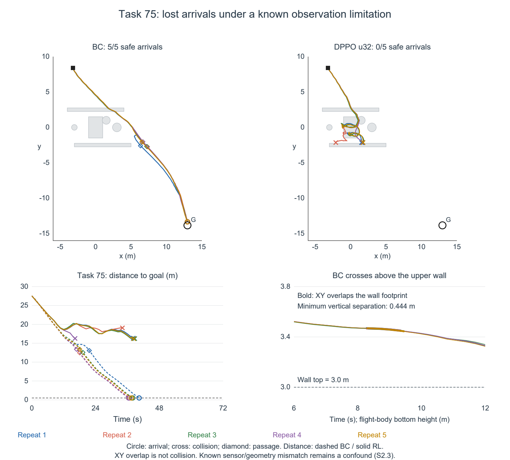
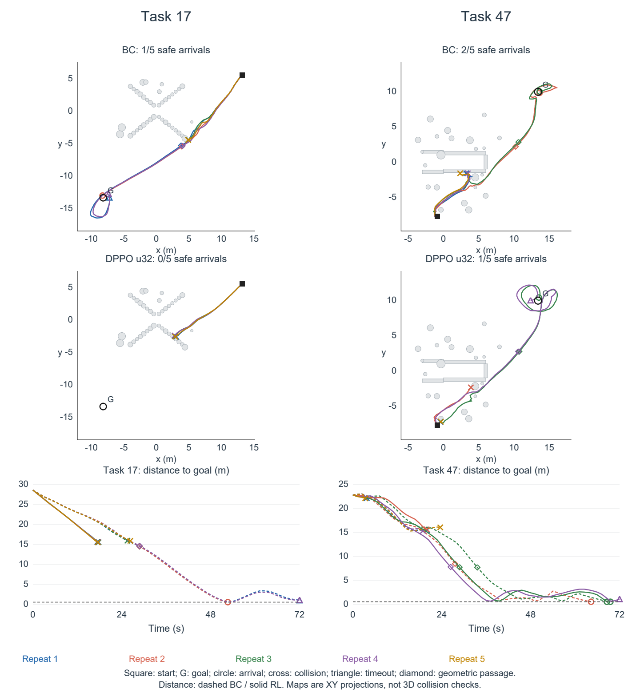
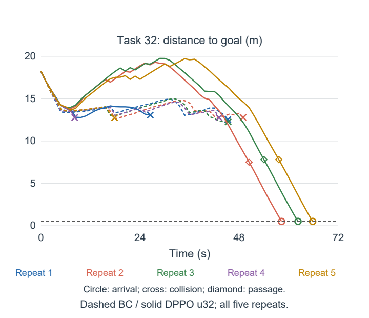

# 补充材料

本文件与《论文大稿》配套，包含方法与设置、原任务结果，以及有限新任务和共同初态续飞的协议与完整附表；全部结果沿用固定BC与后训练u32，不包含新增训练。

## S1 方法与优化参数

### S1.1 网络与后训练设置

以下参数从正文原表1移入，数值未调整。关键任务条件、训练预算、输入输出及执行协议仍保留在正文表1。

| 类别 | 设置项 | 本文采用值或约定 |
|---|---|---|
| 预训练策略 | 条件表示 | 几何128＋状态64，每帧192，三帧576维 |
| 后训练 | LoRA秩与缩放 | \(r_L=8\)，\(\alpha_L=8\) |
| 后训练 | 价值网络 | 两层256维隐藏层，输入三帧特征及\(\beta_t\) |
| 后训练 | 优化器 | AdamW；weight decay 0.01 |
| 后训练 | actor学习率 | 按384轮由\(2\times10^{-5}\)线性衰减至\(10^{-5}\) |
| 后训练 | critic学习率 | \(10^{-3}\) |
| 后训练 | 环境折扣/GAE/去噪折扣 | 0.99 / 0.95 / 0.8 |
| 后训练 | 每轮环境转移/样本复用遍数 | 1024 / 5 |
| 后训练 | 优化批/微批样本数 | 1280 / 128；每轮40次参数更新 |
| 后训练 | 采样/似然标准差下限 | 0.1 / 0.1 |
| 后训练 | PPO截断调度 | 基础0.001、上限0.1、指数速率3 |
| 后训练 | 价值损失系数/熵系数 | 0.5 / 0；无BC教师损失 |

策略网络与价值网络分别优化。正文式（12）的逐元素对数概率截断与均值归约是实际代理目标的一部分，仍在正文披露，不以补充参数表代替方法说明。第32次外层更新后的模型来自完整384轮预算运行，不能按独立32轮训练解释其学习率时程。

### S1.2 碰撞辅助预训练的可核实范围

共同初始策略使用过几何碰撞辅助继续训练。归档训练入口、策略源码和非空日志支持总损失由BC重建与已加权碰撞辅助项组成；日志中的collision_loss已含权重，不能再次乘权重。正文式（6）—（7）说明近邻软距离、带上限的softplus惩罚及归一化时域加权的计算关系，不将源码默认参数当作全部历史启动实参。

辅助计算将机体系点云按偏航及位置变换至轨迹点坐标系，并累计完整16元素的位置增量。归档接口使用前三帧作为条件，使用序列末帧构造辅助几何；按可重建的16帧接口，两者对应索引2与15。原训练时的数据集代码快照和完整启动参数未全部保留，因此不能将这一接口推导无条件等同于原运行所有样本的裁切方式，也不能将13个记录索引换算为未经核实的物理时长。

时间对应关系与坐标配准关系需分别判断。在静态环境及正确共同坐标变换下，不同时刻采集的同一障碍可以保持一致位置；帧间差别可能来自局部覆盖、遮挡、采样及位姿误差，时间不同本身不证明几何失准。归档几何损失对完整16元素加权，没有排除0—1对齐元素的几何掩码；该时域权重不是H4执行风险权重。BC与后训练共用该初始化，其独立效果未通过重新训练或单项消融评估。

表S1.2区分计算关系的可核实性与历史运行参数的可恢复性。辅助开关位于训练入口，完整启动命令未保留；部分源码参数可被命令行覆盖，因此默认值不作为原训练实参。

**表S1.2　共同BC几何辅助训练的复现范围**

| 项目 | 可核实内容 | 尚未恢复的内容 |
|---|---|---|
| 辅助项使用 | 训练入口、策略实现和非零辅助损失日志相互支持 | 完整原始启动命令 |
| 辅助权重 | 运行目录与日志支持所用初始化来自λ=0.5训练；日志辅助损失已加权 | 不能仅由日志恢复其余可覆盖参数 |
| 近邻距离 | 坐标变换、近邻选择及归一化软最小计算可恢复 | 原运行近邻数及软最小锐度实参 |
| 距离惩罚 | 有上限的softplus形式可恢复 | 原运行安全距离及过渡锐度实参 |
| 时域加权 | 完整16元素采用归一化指数权重 | 原运行时域衰减常数实参 |
| 观测与辅助几何 | 接口取前三帧构造条件、末帧构造辅助几何 | 原数据集裁切代码、所有样本的实际时间对应 |

在给定共同BC检查点及其归一化信息的条件下，本文后训练与评价协议可与重新进行BC预训练分别复现；前者仍需本文所述环境、配置及模型文件，不能仅凭网络结构重建。当前证据不足以保证从示范数据重新训练得到同一BC初始化。该缺口限定完整训练链的复现范围，而BC与后训练策略在已记录评价中使用同一初始化的比较关系保持不变。

### S1.3 参数化与批内优化

LoRA线性映射写为\(W=W_0+(\alpha_L/r_L)BA\)，其中\(W_0\)冻结，\(A\in\mathbb R^{r_L\times d_{\rm in}}\)、\(B\in\mathbb R^{d_{\rm out}\times r_L}\)可训练。一维卷积采用降秩卷积与核长为1的升维卷积，降秩卷积保留原核长、步长和填充；升维参数初始化为0。BC比较使用原始策略，后训练策略在采样、概率计算及评价中均启用适配参数。

价值特征先进行逐帧层归一化及可学习时间位置编码，再拼接输入两层MLP；\(\beta_t\)经线性映射加入第一隐藏层。回归目标为未标准化GAE优势加采集时价值，固定于该批优化期间；该配置未启用价值预测截断。价值损失系数见S1.1。

| 转移类型 | 价值自举\(m_t^b\) | 优势递推\(m_t^c\) |
|---|---|---|
| 回合内普通转移 | 1 | 1 |
| 到达、碰撞等回合终止 | 0 | 0 |
| 时间限制截断 | 1 | 0 |
| 未发生回合终止的采集批边界 | 1 | 0 |

PPO截断宽度为\(\varepsilon_j=\varepsilon_{\min}+(\varepsilon_{\max}-\varepsilon_{\min})[\exp(\kappa j/(K-1))-1]/[\exp(\kappa)-1]\)，本配置\(K=10\)，数值参数见S1.1。环境转移与去噪转移组成优化样本；在完整优化批内计算优势统计量，各微批累积梯度后统一提交一次参数更新。优势分位边界0和1不额外删除批内极端值。

### S1.4 原任务配对与终止标签核查

BC与所选后训练策略各有420条有效完整轨迹。按任务编号和重复编号核对，重置种子、初始观测哈希、任务条件及障碍几何均一致；双方共同存在的12,502个决策序号的动作采样种子一致。该核查支持种子配对协议，不证明两条闭环轨迹后续状态相同，也不将相同种子等同于所有随机操作逐项相同。

原始终止字段中BC为到达116、障碍碰撞131、期限耗尽173；后训练策略为到达125、障碍碰撞158、期限耗尽137。两者触地均为0；评价代码将障碍碰撞与触地设为不同标签，不存在把触地并入上述碰撞计数的转换。正文结果表应披露零触地，避免三类合计与事件定义表面冲突。

### S1.5 模型选择范围及案例依赖

本文模型为事后指定的研究对象，而非按事前登记的选优规则自动选出的最优策略。现有取材记录在2026-10-18已指定fresh运行的u32，后续研究任务书固定BC与该模型作为主要比较。没有可据以恢复事前指标权重、优先级或平局裁决的选择规则；因此不将事后排名写成选择算法。

指定模型时已有的统一开发比较包括BC及13个RL检查点。A0包含三个训练种子的u256；原R1包含三个种子的u32与u256；fresh运行包含u32、u128、u256、u384。它们来自不同训练方案或时程，不能合并为同一方法的13个独立训练种子。下面以存档标识列出可核查范围；这不是对所有保存检查点或全部历史实验的穷尽搜索声明。

| 存档模型标识 | 到达/420 | 直连受阻到达/145 |
|---|---:|---:|
| a0_seed202609201_u256 | 32 | 0 |
| a0_seed202609202_u256 | 71 | 12 |
| a0_seed202609203_u256 | 59 | 8 |
| bc | 116 | 18 |
| r1_seed202609201_u256 | 11 | 1 |
| r1_seed202609201_u32 | 47 | 3 |
| r1_seed202609202_u256 | 0 | 0 |
| r1_seed202609202_u32 | 97 | 15 |
| r1_seed202609203_u256 | 101 | 10 |
| r1_seed202609203_u32 | 125 | 19 |
| rl_2f3f9914db78_u128 | 59 | 8 |
| rl_2f3f9914db78_u256 | 43 | 4 |
| rl_2f3f9914db78_u32 | 125 | 20 |
| rl_2f3f9914db78_u384 | 16 | 0 |

所选模型为`rl_2f3f9914db78_u32`。其总体到达125与原R1种子202609203的u32并列最高；受阻到达20在上述集合中最高。这些数值与其作为局部行为研究对象相容，但没有证据把它们重构为事先规定的选择规则，也不代表安全、效率等所有指标同时最优。

研究取材随后保留该模型在task20、task30、task32中的受阻新增到达，并要求展示各任务全部5次重复与完整配对统计。上述任务和检查点都来自同一开发评价；案例分析用于解释已观察到的变化，不构成独立验证。现有记录不足以完全排除具体案例表现参与模型选择，故按存在选择依赖披露，不将这些任务用于确认预先固定的无偏效应。

## S2 原任务结果与案例完整性

### S2.1 全任务与场景家族分布

[P2数据附表](图表/P2_data_tables.md)逐项列出84个任务的BC及后训练到达计数、直连受阻标记，并给出九个生成家族的完整到达、碰撞和超时计数。各任务包含双方各五次重复，未删除零变化或负变化任务。源家族名称只用于标识生成条件：例如`mid_impulse_recovery`在本批评价中仍关闭扰动，不能据其名称声称验证了扰动恢复能力。

密集来源受阻子集的125个配对单元中，共同成功6次、仅后训练成功9次、仅BC成功2次、共同失败108次。其外的20个受阻单元中，BC到达10次、后训练到达5次。这解释了为何子集到达净增7次，而完整受阻集合只净增2次；不应仅凭子集结果代替全部受阻评价。

### S2.2 正向案例的全部重复

三个正向案例覆盖全部9次受阻新增成功，表S1保留其所有终点。逐重复的路长、时长、最近及终点目标距离见[P2数据附表](图表/P2_data_tables.md)；原始轨迹路径和哈希见[P2结果数据](图表/P2_results.json)。最近距离取连续执行线段至目标的最小距离；图3距离曲线只连接决策端点，因此图上折线最小值不必等于连续执行最近距离。目标入球以原始连续事件标签裁决，不根据舍入后的0.500m重新分类。

**表S1　三项正向案例的全部终点**

| 任务 | 策略 | 重复1 | 重复2 | 重复3 | 重复4 | 重复5 |
|---|---|---|---|---|---|---|
| 30 | BC | 超时 | 超时 | 超时 | 超时 | 超时 |
| 30 | 后训练 | 到达 | 到达 | 超时 | 到达 | 到达 |
| 20 | BC | 超时 | 超时 | 超时 | 超时 | 超时 |
| 20 | 后训练 | 超时 | 超时 | 到达 | 到达 | 超时 |
| 32 | BC | 碰撞 | 碰撞 | 碰撞 | 碰撞 | 碰撞 |
| 32 | 后训练 | 碰撞 | 到达 | 到达 | 碰撞 | 到达 |

任务30重复3的连续最近距离为0.513799m，执行折线顶点的最近距离为0.518720m；两者均未进入目标球，终点距离1.414m。该重复不按“接近成功”计入到达数。任务20的三次后训练超时均在接近目标后发生再次远离，仍保留原超时结果。这里没有按恢复机会设定阈值或统计恢复率，也没有把较大外绕自动等同于必要退让。

### S2.3 流失案例与观测限制

任务75是29个受阻任务中配对成功流失次数最多的任务，五次BC均到达而五次后训练均碰撞。图S1展示全部重复。该任务位于`xy_z_combined_bypass__000009`世界；既有观测核查发现该世界物理悬空箱体被合成器按落地箱体表示。两种策略共享初始条件并不消除该缺陷：后续不同访问状态可能与观测误差产生不同交互。因此，图S1说明当前观测协议下存在明确的结果流失，不将其解释为排除观测因素后的策略退化因果证据。缺陷关联和完整结果同时保留，不以删除该任务改善总数。

**图S1　受阻成功流失最多的任务75。**上行并列展示双方全部五次轨迹，左下为目标距离，符号同图3。右下给出BC通过上方墙体时的机体底部高度（位置高度减既有0.1m半高代理），粗线仅标识各重复实际线段与墙体水平轮廓重叠的区间；墙顶为3.0m，五次最小垂直间隔均为正，整体最小约0.444m，解释该处二维重叠为何不等于碰撞。该高度局部核查不等于整条路径或全部观测无误。本世界存在已知物理悬空箱体与合成点云表示不一致，图不独立识别缺陷与策略更新的贡献。

任务20、30、32分别属于`bottleneck_corridor__000027`、`cul_de_sac_trap__000019`、`cul_de_sac_trap__000033`，均不属于上述已知错误世界。该排除仅针对已知缺陷关联，不能代替全观测链正确性的验证。

除任务75外，全部受阻流失还包括任务17重复2和任务47重复2。为避免仅用已知异常世界解释负向结果，图S2纳入这两个任务双方各五次重复，而不另按路径形状选取单条路线。

| 任务 | 策略 | 重复1 | 重复2 | 重复3 | 重复4 | 重复5 |
|---|---|---|---|---|---|---|
| 17 | BC | 超时 | 到达 | 碰撞 | 超时 | 碰撞 |
| 17 | 后训练u32 | 碰撞 | 碰撞 | 碰撞 | 碰撞 | 碰撞 |
| 47 | BC | 碰撞 | 到达 | 到达 | 碰撞 | 碰撞 |
| 47 | 后训练u32 | 碰撞 | 碰撞 | 到达 | 超时 | 碰撞 |

任务17属于`bottleneck_corridor__000026`，任务47属于`cul_de_sac_trap__000036`，均不同于已识别的悬空箱体错误世界。任务17的后训练路线均在到达目标前碰撞；任务47既有早期碰撞，也有到达和近目标超时。后者重复4最近目标距离0.535m、终点1.082m，不能因BC原重复4也失败而忽略其失败过程。这些轨迹展示非单一的负向结局，不据此断言编码器或优化器是共同原因。

**图S2　任务17和47的全部重复执行结果。**显示方式及符号同图3。它们覆盖任务75以外的全部两次受阻成功流失，并保留各任务其他成功与失败重复。“不属于已知错误世界”仅排除特定已知缺陷关联，不等于已获得无观测误差的对照。

任务17配对流失重复2的后训练碰撞发生于17.618s、零起始决策14的第3个执行线段，终止位置为(2.813, −2.440, 1.756)m，邻接圆柱`funnel_out_l_4`。终止位置到圆柱侧面的水平间隔约0.100m，与本批碰撞代理半径一致；同时刻插值得到BC位置为(8.421, −0.877, 1.728)m，它已访问不同空间位置。因此，本核查定位了首次记录的碰撞事件，不能把该时刻称为两策略“首次关键动作差异”，更不能作为同中间状态下的动作因果对照。任务47流失重复2在19.930s碰撞；重复4的近目标超时并非原成功流失，须与其分开解释。

### S2.4 终点配对矩阵与路线差值

下表按同一任务—重复配对，行表示BC结果，列表示所选后训练u32结果。单元格是两种策略在对应配对单元中的终点组合，不表示同一回合内部的事件转移，也不是机制因果效应。

| BC结果／后训练u32结果 | 到达 | 碰撞 | 超时 | BC合计 |
|---|---:|---:|---:|---:|
| 到达 | 57 | 32 | 27 | 116 |
| 碰撞 | 8 | 95 | 28 | 131 |
| 超时 | 60 | 31 | 82 | 173 |
| 后训练u32合计 | 125 | 158 | 137 | 420 |

碰撞净变化为(32+31)−(8+28)=27；到达净变化为(8+60)−(32+27)=9；超时净变化为(27+28)−(60+31)=−36。边际变化不能代替表内实际配对去向。

57对共同成功的差值统一取后训练u32减BC，四分位数采用线性插值。下表同时给出Q1、Q3和IQR宽度，不将四分位区间与其宽度混用；正负计数按未舍入数值判断。

| 配对指标 | 均值差 | 中位差 | Q1 | Q3 | IQR宽度 | 增加／减少／相等 |
|---|---:|---:|---:|---:|---:|---|
| 执行路长（m） | 5.655 | 0.942 | 0.053 | 10.263 | 10.210 | 52／5／0 |
| 仿真时长（s） | 6.068 | −0.619 | −3.348 | 18.986 | 22.334 | 26／31／0 |

两组各自的中位数之差不等于配对差值的中位数，均值差与中位数差不一致也不足以独立判断分布形态。本次配对统计显示时长均值增加而多数配对时长缩短，故只报告平均代价和配对分布，不能笼统称所有或多数共同成功任务变慢。此表为已有记录的描述性重算，不增加独立样本数量。

### S2.5 几何通过事件与案例对应

复用已有三维几何分析：令单位向量e沿起点s指向目标g。以原连续碰撞代理识别阻挡初始线段的障碍集合B，求这些障碍沿e的最远投影边界加0.1m余量，记为b。动作前位置p满足(p−s)·e>b，且p至g的连续直连通过同一碰撞代理检查时，记录为越过初始阻挡物。箱体投影计入偏航和三维尺寸，圆柱计入半径与高度，不使用二维轨迹投影判断。条件不依赖回合最终成功；未满足也不证明不能通过其他侧绕或上绕路径完成任务。

| 后训练u32任务 | 满足事件的重复 | 首次满足时距目标（m） | 最终结果 |
|---|---|---|---|
| 30 | 1、2、3、4、5 | 7.364、7.134、7.208、7.287、6.651 | 4到达、1超时 |
| 20 | 1、2、3、4、5 | 11.550、11.583、11.508、11.561、11.525 | 2到达、3超时 |
| 32 | 2、3、5 | 7.507、7.810、7.813 | 3到达；另两重复未满足前碰撞 |

任务20五次事件均出现在零起始决策索引20的动作前状态，即20个完整1.2s周期之后的24s。此后所有记录的动作前决策状态直连目标均畅通；这不等于每段实际路径或整个视野均无障碍。两次成功的实际时长为67.772s与68.323s，名义72s期限的剩余裕度分别为4.228s与3.677s。

最近距离仍取连续执行线段的极小值，而通过事件只在实际决策状态检查，因此图中菱形不是精确连续穿越边界时刻。图3末端含首次到达/碰撞处截短后的状态，不能将终止周期错误理解为又完整执行了H4。

### S2.6 通过后的目标距离往返与配对解释

任务20下表采用实际决策端点，取几何通过后首次局部距离极小值，以及其后至终止的最大端点距离。它们用于描述既有路线的时间顺序，不是恢复判据或新设近目标阈值；连续线段最近距离仍按S2.3计算。

| 重复 | 首次局部极小值时刻（s） | 当时距离（m） | 后续最大值时刻（s） | 后续最大距离（m） | 最终结果 |
|---|---:|---:|---:|---:|---|
| 1 | 43.2 | 1.134 | 57.6 | 4.184 | 超时 |
| 2 | 43.2 | 1.165 | 57.6 | 4.351 | 超时 |
| 3 | 44.4 | 1.093 | 57.6 | 5.941 | 到达 |
| 4 | 44.4 | 1.178 | 57.6 | 5.741 | 到达 |
| 5 | 43.2 | 1.128 | 57.6 | 4.006 | 超时 |

五次重复均在24s通过初始阻挡物，随后经历接近、再次远离和重新接近；不能把共有的距离往返直接定性为造成超时的机制。任务47重复4在37.2s端点距目标0.612m，随后最大端点距离为62.4s的3.122m，最终72s超时（连续最近距离0.535m）。该重复的BC终点为碰撞，而非成功，因此它只补充相似行为现象，不是近目标往返造成成功流失的配对证据。任务47重复3也有端点距离回升但最终成功，进一步限制了这种归因。

图3将任务32的距离面板移到此处，保留完整过程可查，同时把正文空间用于任务30接近阈值后的末端差异。

**图S3　任务32的完整目标距离过程。**全部五次重复，虚线为BC、实线为后训练，颜色及事件符号同图3。数据为执行周期端点与实际终止点，未平滑；其主要作用是提供时间过程索引，不额外主张独立的失效机制。

### S2.7 正向任务的实际执行三维几何与碰撞代理余量

从P2原任务T20、T30、T32及P3有限新任务N09、N13提取两种策略的全部五次重复，共50条已执行轨迹。水平侧偏离是轨迹点到起终点水平轴的最大绝对有向距离；高度范围是执行路径最大与最小高度之差。两者均按任务内五次重复取中位数，不以成功重复替代全体。连续线段余量仅在机体垂直区间与障碍高度区间重叠时，计算该段至箱体/圆柱水平表面的最小间隔，再减去环境0.1m碰撞阈值；表中余量为后训练**到达重复的最小值**，并非全任务均值。未发生垂直重叠的障碍不参与这一水平余量；它不能解释为三维欧氏最近净距。

| 任务 | 安全到达 BC→后训练 | 最大水平侧偏离中位数 BC→后训练（m） | 高度范围中位数 BC→后训练（m） | 后训练到达重复的最小碰撞代理余量（m） | 后训练五次中从障碍投影上方经过的次数 |
|---|---:|---:|---:|---:|---:|
| T20 | 0/5→2/5 | 11.40→6.98 | 0.97→2.32 | 0.753 | 0/5 |
| T30 | 0/5→4/5 | 6.66→9.26 | 0.44→1.31 | 0.274 | 0/5 |
| T32 | 0/5→3/5 | 4.88→10.30 | 0.74→1.35 | 0.898 | 5/5 |
| N09 | 0/5→5/5 | 1.90→0.66 | 0.18→0.58 | 0.260 | 0/5 |
| N13 | 0/5→5/5 | 3.43→4.20 | 0.54→0.93 | 1.742 | 5/5 |

“从障碍投影上方经过”仅表示执行折线的一部分进入某障碍的水平投影，且机体底部始终高于该障碍顶面；T32每次至少经过`trap_scatter_12`，N13每次经过`trap_scatter_20`。T32和N13五次重复的最高高度均位于起点，不能把这一事件描述为主动爬升；T32的两次碰撞重复也出现上方经过，说明该单一事件不是成功的充分条件。T20的BC侧偏离大于后训练却五次超时，侧偏离幅度亦不能直接解释导航效率。全部逐重复终点、数值、原迹路径与SHA256见`研究报告/2026-10-24_P4B成功轨迹三维几何分析.json`；分析入口为`../chengxu/Improved-3D-Diffusion-Policy/scripts/analyze_paper_success_geometry.py`。这是对既有原迹的离线复算，没有新增策略评价。

## S3 有限新任务与共同初态续飞

### S3.1 新任务构造与来源边界

固定后训练检查点后，在既有12世界候选库中，逐世界采用固定随机命名空间`paper-task-v1/20261020`生成起终点候选，最多检查128个有效候选。每个世界选择首个满足初始直连受阻条件的任务及首个与其不同的普通任务；普通任务不强制直连未受阻。最终得到24任务，其中13个受阻、11个未受阻，每任务五次配对评价。任务选择仅依据几何与任务有效性，不按本轮策略结果挑选。

候选库与训练池共享生成模板，且存在历史BC准入与旧pilot使用；其中走廊世界`test000015`与训练世界`train000012`几何完全重复。正文以11个不同几何世界为主分层，另列重复几何对照及全体结果。此分层依据实际几何对应关系，不把目录中的test标签等同于独立盲测。

世界聚类描述性区间先计算每个世界的配对到达率差，再对世界等概率有放回抽样2000次，每次取与原世界数相同的世界，计算均值并取2.5%与97.5%分位数；固定随机种子20261009。正文的11世界集合各世界均有2任务、10次重复，因此世界等权均值与110条件总体差一致。该区间保留世界内关联，但不消除共享模板、候选库历史使用或单次训练运行的限制；它不代表跨训练种子的可靠性区间。全12世界的区间为[−17.50，25.00]个百分点。

完整逐任务终点见[全部24新任务与24共同初态附表](图表/P3_data_tables.md)。N为本批新任务编号，T为旧开发任务编号，两者不混用。新任务新增20次、流失16次；其中不同几何新增20次、流失11次，重复几何新增0次、流失5次。受阻新增10次与流失10次抵消；其余新增集中于未受阻N08和N18，各0/5→5/5，不能因为场景名称含瓶颈或S形就将其计为初始受阻收益。

### S3.2 共同初态的分组与统计

24状态来自20个旧开发任务、14个世界，分为P01—P06既有规划与近目标诊断状态、P07—P12绕障后状态、P13—P18保守无障碍视野候选状态、P19—P24可见障碍但通道畅通状态。后三组各含三个成功轨迹来源状态和三个失败轨迹来源状态；“成功/失败”指来源轨迹，不预设本次续飞结局。附表保留原分组字段以便追溯，其中含有的延期、能力流失等标签是取样背景，不能作为本轮机制定因。

每状态对BC与u32使用50组配对实际初噪，前5组续飞至原任务终止事件或原剩余期限，合计每策略1200条开环样本、120条续飞。全体实际执行7769个续飞周期，预算上限10280个周期并非要求用满。续飞过程中重新观测并规划；共同初态不意味着沿途状态固定。u384仅是部分状态来源，不是本批比较策略，不能把本批结果写成u32与u384的同状态比较。

令状态s的到达率差为d_s=(n_RL,s−n_BC,s)/5，来源任务t包含的状态集合为S_t。状态等权差为Σ_s d_s/24=−4.17个百分点；任务等权差为Σ_t[Σ_(s∈S_t)d_s/|S_t|]/20=0。T08提供三个状态，T30和T80各提供两个，其余任务各一个。两项统计回答不同加权下的固定样本表现，均不作为总体恢复概率。图4保留全部24状态，不按结果排序。

### S3.3 图5的案例选择与解释边界

图5展示P02、P05、P14三个具有前序偏离或推进不足、且后训练到达改善的状态，并展示与P14同属保守无障碍视野候选组的流失状态P13。选择在读取结果后进行，用于解释过程；全部状态结果另在图4及附表完整报告。P15虽由0/5提高至3/5，但来源轨迹仍持续推进，未将其列为恢复实例。

| 状态 | 来源任务 | 冻结前五周期的目标距离变化 | 本次BC→后训练到达 | 本图承担的问题 |
|---|---|---|---|---|
| P02 | T56 | 7.610→9.564m | 0/5→4/5 | 已远离后，是否重新推进并到达 |
| P05 | T06 | 13.542→13.518m | 0/5→5/5 | 净推进很小时，是否在原期限内完成 |
| P14 | T64 | 3.925→6.558m；此前最近1.493m | 1/5→5/5 | 再次远离后，暂时退让与最终到达是否并存 |
| P13 | T68 | 作为同类状态流失对照，不用前序距离筛选 | 5/5→0/5 | 相同诊断类别和首段接近是否保证到达 |

五周期窗口是描述手段，不是预注册的停滞或恢复判据。每面板保留两策略各五次实际执行轨迹，横轴沿原执行时长累加，末周期按实际终止时刻截短；不绘制未执行规划尾段、不平滑数据、不把目标距离回升一概认定为错误。距离曲线连接折线顶点，其作用是显示接近过程，不能代替连续线段的解析最近距离或首次事件检测。

实际续飞安全到达按连续首次进入0.5m球裁决。87次到达的浮点存储终点距目标约0.499999642—0.500000358m，已复核为事件插值舍入；不能仅按存储末点严格比较而重新分类，也未扩大到达半径。闭环总终点为87到达、19碰撞、134超时，与正文每策略统计一致。

