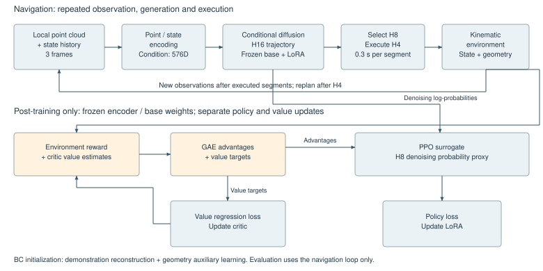
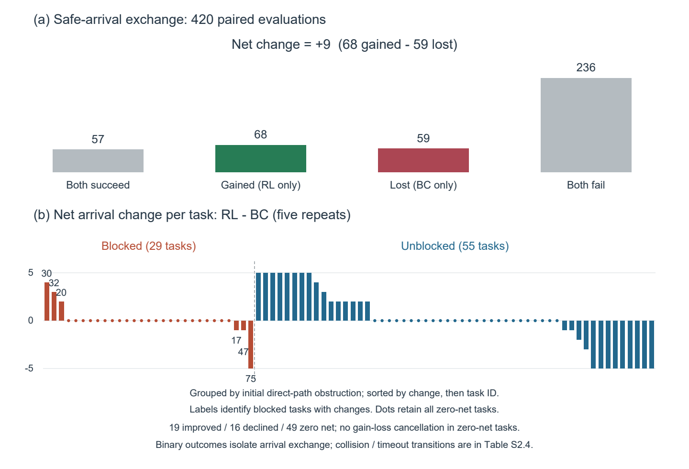
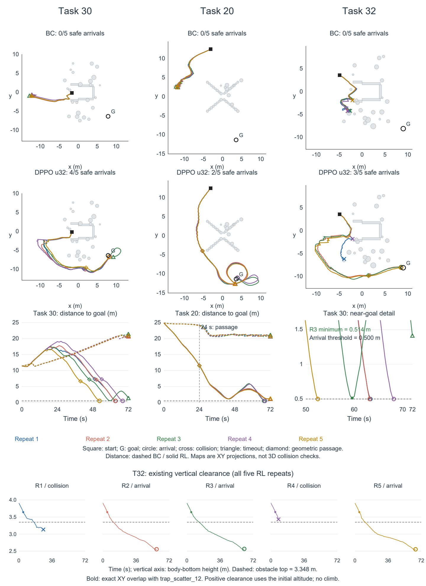
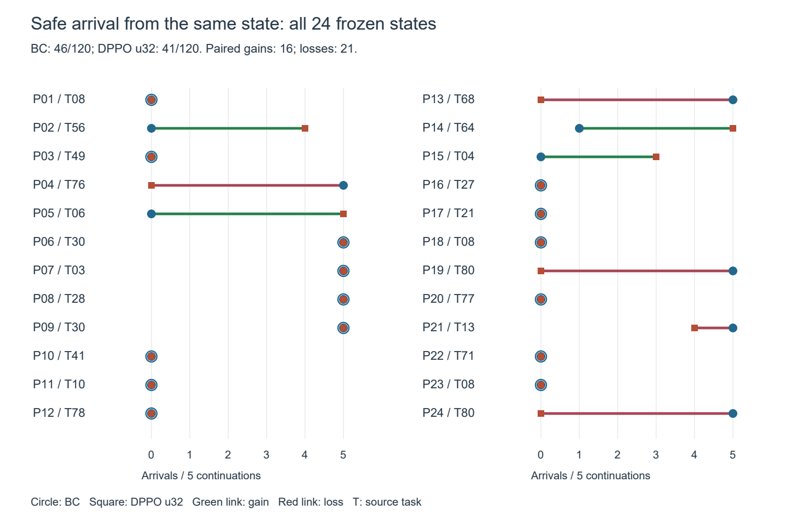
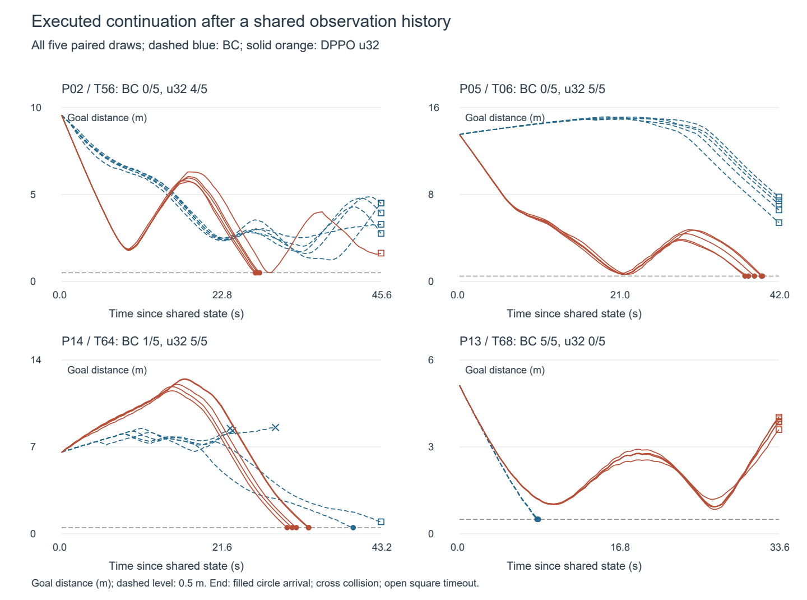

# 面向无人机自主避障导航的点云条件扩散策略与强化学习后训练

## 1 引言

自主避障导航要求无人机在获取环境信息的同时，选择能够绕开障碍并通向目标的运动路线。在未知静态三维环境中，局部感知只能描述当前位置附近的可见几何，导航决策因而需要随观测更新持续调整。障碍密集、通道受限或目标方向受到阻挡时，直接朝向目标运动未必可行，暂时远离目标也可能成为完成绕行的一部分。如何将有限观测转化为可持续执行的避障轨迹，是无人机自主导航需要解决的基本问题[1,2,3]。

围绕这一问题，现有研究形成了基于在线优化与基于学习生成的轨迹规划方法。前者利用几何信息构造碰撞代价和运动约束，后者从示范中学习观测与轨迹之间的映射，并可与在线优化结合处理可行性[1,2]。扩散策略进一步通过条件去噪表示动作序列分布，为不同绕行方向提供生成式表达，并采用滚动执行利用新的观测反馈[4]；点云编码则将这一思路扩展至三维视觉策略[5,6]。然而，示范拟合主要约束训练数据所覆盖的状态和动作，导航策略执行后所遇到的状态仍取决于自身的路线选择。强化学习后训练由此引入环境交互回报，将最终任务结果纳入策略调整[7,8,9,10]。

近期研究已验证扩散规划及其后训练在导航中的可行性，进一步的应用研究需要区分后训练带来的路线变化与完整任务收益。CGD研究约束引导下的无人机轨迹生成，AeroDiffusion研究动态环境中的闭环扩散规划，GRPO-MDP将强化学习与安全过滤用于无人机导航，Beyond Imitation与X-NavDP则报告了导航适应及绕行行为的改善[3,8,9,10,11]。这些成果同时表明，导航表现来自策略生成、环境反馈与执行约束的共同作用。对于采用局部点云生成三维参考序列、且执行时不设置外部安全过滤的策略，需要具体检验的是：后训练能否使原本未完成的受阻任务形成通向目标的路线，这种变化发生于障碍通过之前还是之后，以及新增到达是否伴随原有成功流失。仅比较到达率净差或展示少量成功路径，无法区分这些不同的应用效果。

本文面向静态三维障碍环境，研究点云条件扩散策略与强化学习后训练的自主导航应用。方法以点云和状态历史为条件，通过行为克隆（behavior cloning，BC）与几何辅助学习建立初始轨迹策略，采用扩散策略策略优化（diffusion policy policy optimization，DPPO）及低秩适配（low-rank adaptation，LoRA）引入导航任务反馈，并通过短前缀滚动执行构成闭环。在统一运动学环境中，研究依次比较完整任务结局、实际路线与障碍几何的关系，以及相同中间状态下的后续导航，分别识别任务收益、成功过程和局部响应。

本文的主要成果包括导航流程的应用实现和受阻任务中的行为证据。所选后训练策略在部分BC未完成的任务中建立了侧向通行及外围返回路线；对全部重复的分析进一步区分了通过障碍前的碰撞与通过后的目标完成差异。相同中间状态下也出现了偏离或停滞后的新增到达，但首段平均目标推进增强并未对应整体续飞优势。这些发现使后训练的作用能够落实到具体导航阶段：路线展开的价值取决于其能否连接可通行空间与目标，短时推进的价值则取决于后续执行。这些结果从空间通行与时序完成两个层面刻画了后训练的实际作用，说明其应用价值取决于具体障碍条件及安全代价。

本文其余章节安排如下：第2章综述局部感知轨迹规划、扩散策略及强化学习后训练的相关研究；第3章给出导航问题定义与方法设计；第4章介绍实验设置，分析导航结果与典型行为，并讨论研究发现及局限；第5章总结全文并提出后续研究方向。

## 2 相关工作

### 2.1 基于局部感知的无人机轨迹规划

局部感知轨迹规划需要同时处理障碍几何与连续运动。现有方法的主要区别在于，几何可行性由在线优化直接求解，还是由学习模型预测后再进行约束处理。这一区别决定了轨迹生成器与执行约束各自承担的作用，也影响对系统实验结果的解释。

Zhou等提出EGO-Planner，通过无碰撞引导路径构造不依赖欧氏有符号距离场的碰撞代价，结合时间调整与轨迹细化实现局部规划，并在基准及实机实验中验证了其性能[1]。Marino等利用点云和定位信息预测初始轨迹与神经碰撞约束，再结合优化处理连续性和执行限制，在静态及动态障碍条件下验证了多无人机分布式规划[2]。两者分别体现了显式几何优化与学习辅助优化的路径：网络可以减少部分在线推理负担，但最终轨迹表现仍包含约束求解的作用。

生成式方法将候选轨迹表示为条件分布，研究重点相应扩展至轨迹采样与约束执行的协同。Kondo等提出CGD，将路径生成与时间参数化分解，通过去噪引导和二次规划处理约束，并验证了训练之外约束变化下的适应性[3]。Wang等的AeroDiffusion面向动态环境中的四旋翼闭环扩散规划，报告了仿真及室内飞行中的避障与机载重规划结果[11]。这些工作使扩散轨迹规划的研究从候选生成推进至约束处理和闭环执行，为考察学习策略在持续导航中的作用奠定了基础。

本文采用EGO生成的既有示范建立轨迹先验，执行时由策略直接输出参考序列，不再调用EGO优化器或外部安全过滤。研究重点因而转向这种执行条件下的学习策略：当局部观测不足以直接指示一条完整绕行路线时，环境交互后的策略能否在多次反馈中将局部轨迹连接为安全到达过程。本文以共同BC为比较基线，考察环境交互后训练带来的增量变化。

### 2.2 扩散轨迹策略及其强化学习后训练

Diffusion Policy将机器人动作生成表示为条件去噪过程，并结合视觉条件与滚动时域执行处理动作序列预测[4]。在三维观测下，DP3利用紧凑点云表示，在仿真及实机操控中验证了少示范策略学习[5]；iDP3进一步面向含噪三维观测和类人机器人操控，报告了跨场景技能执行结果[6]。本文继承条件序列扩散、点云编码和滚动执行的基本思想，将动作表示与评价对象落实为无人机三维参考轨迹及其导航结局。

环境反馈如何作用于多步去噪，是扩散策略后训练的关键问题。Ren等提出DPPO，将环境决策和去噪转移构成两层决策过程，通过价值估计与策略梯度优化示范初始化的策略，并在连续控制及机器人操控中验证了后训练效果[7]。这一框架允许以任务回报调整序列生成，但用于滚动导航时，还需明确回报对应已执行前缀还是未执行计划，以及两者如何共同参与更新。

导航后训练已有直接先例。Sheng等在Beyond Imitation中冻结视觉编码器，采用组相对优化更新部分解码器与动作头，在未见场景PointGoal任务中报告了成功率和路径效率改善[8]。Yang等提出组内Q分数重加权匹配方法，通过行为扰动训练X-NavDP，报告跨具身导航结果并展示死胡同脱离及长障碍绕行[9]。Liu等提出GRPO-MDP，将扩散采样、组相对优化、失败轨迹重标记和控制屏障函数过滤结合，用分环境评价、组件消融与计算性能分析检验无人机导航系统[10]。这些工作支持利用交互反馈调整示范策略，也说明新增行为需要与完整任务表现共同验证。

上述方法对导航约束的处理方式并不相同。CGD主要通过生成引导与在线优化获得约束满足；GRPO-MDP将学习更新与执行时安全过滤结合；Beyond Imitation和X-NavDP以视觉导航策略的适应及行为扩展为重点；DPPO则提供基于价值估计的扩散策略优化框架[3,7,8,9,10]。这些区别意味着，解释后训练效果需要同时考虑学习更新与在线约束各自承担的作用。本文采用几何辅助预训练、任务回报和低秩更新，在不设置在线安全过滤的条件下检验其组合效果；独立组件收益属于另需对照回答的问题。

本文将研究范围限定为固定BC及其后训练策略的导航变化，以互补证据区分几种容易混合的结果。任务配对识别总体净差背后的新增与流失，路线与障碍几何对照解释新增成功发生于何种通行过程，共同初态续飞则考察相同起点之后的响应。相对于仅以总体性能概括所选策略，这一分析能够定位收益在路线建立、障碍通过和目标完成各阶段的表现，从而明确不同受阻条件下的应用收益与限制。

## 3 问题定义与方法

### 3.1 问题定义与整体框架

系统以参考轨迹序列连接局部感知与运动执行，由点云条件生成、任务反馈后训练和滚动执行构成（图1）。示范预训练学习局部观测到轨迹的映射，几何辅助项对预测位置施加近障碍惩罚；后训练在冻结感知编码与基础权重的条件下，通过DPPO更新低秩参数。每次生成完整序列后，执行端选取八段规划窗口，仅推进前四段，再依据新观测重新规划。序列表示为拟合与风险评价提供共同的几何对象，短前缀执行则保留利用观测反馈调整路线的机会；独立价值网络参与训练，导航时仅调用策略网络。

**图1　局部轨迹生成通过短前缀执行与观测反馈构成导航闭环。** 上层为导航过程，下层为训练时使用的反馈与更新支路；H16、H8和H4分别表示完整预测、规划窗口和执行前缀。环境奖励与价值估计形成GAE优势及价值回归目标，去噪概率代理与优势用于更新LoRA，价值目标独立用于更新critic。全局障碍几何仅参与训练奖励与评价，不输入策略；评价时移除下层更新支路。

考虑静态三维障碍环境中的单无人机目标导航。为表示依赖任务历史的奖励和有限期限，定义扩展环境状态\(x_t=(\xi_t,g,\mathcal G,D_0,b_t,n_t)\)：\(\xi_t\)包括无人机物理状态及影响状态转移的环境内部量，\(g\)与\(\mathcal G\)分别为目标和障碍几何，\(D_0\)为初始目标距离，\(b_t\)为截至当前的历史最优目标距离，\(n_t\)为剩余决策预算。\(b_t\)随已执行路径更新，\(n_t\)每周期递减；二者使进展奖励和期限裁决能由扩展状态及本周期转移确定。

该任务表示为部分可观测马尔可夫决策过程（partially observable Markov decision process，POMDP）\(\mathcal M=(\mathcal X,\mathcal A,\mathcal P,\mathcal O,\Omega,r,\gamma)\)，其中\(\mathcal P,\Omega,r,\gamma\)分别表示转移、观测模型、奖励和折扣因子。扩展状态用于任务形式化，不等于网络实际输入：actor仍只接收下述有限观测历史；critic额外使用\(b_t/D_0\)，未显式接收\(D_0\)或剩余预算\(n_t\)。因此，有限历史条件和critic输入均不被假定为完整马尔可夫状态；3.4保留实际训练所用的期限自举约定。

以\(t\)表示规划决策序号，\(\tau\)表示执行段结束后的观测更新序号。单帧观测记为\(o_\tau=(P_\tau,s_\tau)\)，点集\(P_\tau=\{p_{\tau,i}^{b}\}_{i=1}^{N}\)由机体坐标系中的局部三维点构成。状态向量为

$$
s_\tau=\big[p_\tau^{o},\;g_\tau^{b},\;\|g-p_\tau\|_2,\;\sin\psi_\tau,\;\cos\psi_\tau\big]\in\mathbb R^9. \tag{1}
$$

上标\(o\)和\(b\)分别表示共同的位置参考坐标系与机体坐标系；数据增强时，位置与目标采用一致的坐标变换。目标相对向量满足\(g_\tau^b=(R_\tau^{o\leftarrow b})^\top(g^o-p_\tau^o)\)，其中\(R_\tau^{o\leftarrow b}\)为由偏航角\(\psi_\tau\)确定的旋转矩阵。式（1）的距离在同一位置参考系计算，亦等于\(\|g_\tau^b\|_2\)；后文的\(g,p\)在距离运算中均指该共同坐标系下的位置。若\(\tau_t\)为第\(t\)次决策前的最新观测序号，则策略输入最近三帧\((o_{\tau_t-2},o_{\tau_t-1},o_{\tau_t})\)。观测在每个执行段后更新，轨迹重新规划发生在执行前缀结束后。输入不包含全局障碍地图或上一轮完整预测轨迹。

策略输出完整序列\(Z_t\in\mathbb R^{16\times11}\)，每个元素包含位置增量\(\Delta p\)、速度参考\(v^{\mathrm{ref}}\)、加速度参考\(a^{\mathrm{ref}}\)、偏航增量\(\Delta\psi\)和偏航角速度参考\(\dot\psi^{\mathrm{ref}}\)。位置与偏航由增量累计，速度与加速度直接作为参考量。将完整序列经固定窗口选择得到的八段轨迹定义为环境决策层动作\(a_t=S_8(Z_t)\in\mathcal A\)；该动作的前四段决定本周期状态转移，后四段仅参与当前规划的风险评价。去噪链中的变量仍是完整16元素序列，与环境动作层级不同。

以下使用零起始索引说明各窗口。BC重建覆盖完整序列的有效元素，DPPO的对数概率代理仅在规划窗口归约。

| 完整序列索引 | 角色 | 当前周期状态推进 | 直接进入DPPO概率代理 |
|---|---|---|---|
| 0—1 | 观测—动作对齐元素 | 否 | 否 |
| 2—5 | H8内的H4执行前缀 | 是，遇终止事件提前结束 | 是 |
| 6—9 | H8内未执行的规划尾段 | 否，非终止周期计算尾段风险 | 是 |
| 10—15 | 规划窗口之外的六个预测元素 | 否，不参与当前规划风险 | 否 |

完整预测、规划窗口和执行前缀分别简称H16、H8和H4。规划窗口外的六个元素仍参与完整序列去噪和BC重建，但不直接产生本周期的执行后果或规划风险；共享网络仍可使不同序列位置相互影响。H4执行结束后根据更新的观测重新生成完整序列，旧H8尾段不被承诺在下一周期执行。这构成滚动时域执行（receding-horizon execution）：较长的规划窗口提供候选路线和风险评价范围，较短的执行前缀允许在继续运动前利用反馈。本文沿用既定H8/H4配置，其时域划分是方法设置，不作为已由对照实验确定的最优选择。

本文采用按参考位置和偏航更新状态的运动学评价环境。安全到达指在期限内进入目标球，且到达先于障碍碰撞或触地，具体阈值与事件优先级见4.1。后文“已执行轨迹”均指运动学环境中用于推进状态的轨迹段，区别于未执行的预测尾段；其表现不包含四旋翼动力学及飞控跟踪误差。

### 3.2 点云条件扩散轨迹生成与几何辅助学习

局部点云描述可见障碍表面，状态向量提供位置、目标方向和偏航信息，点云编码表示局部障碍几何，状态编码表示目标相对位置与姿态。本文沿用三维扩散策略的编码思路[5,6]，通过几何与状态双分支形成生成条件，并用有限观测历史表示近期变化。PointNet类点云编码器提取几何特征\(e_\tau^p=f_p(P_\tau)\in\mathbb R^{128}\)，多层感知机（multilayer perceptron，MLP）提取状态特征\(e_\tau^s=f_s(s_\tau)\in\mathbb R^{64}\)。两分支输出拼接为单帧表示\(e_\tau=[e_\tau^p,e_\tau^s]\)，再按时间顺序拼接三帧表示，得到条件向量

$$
c_t=[e_{\tau_t-2},e_{\tau_t-1},e_{\tau_t}]\in\mathbb R^{576}. \tag{2}
$$

轨迹生成器采用条件一维U-Net，以轨迹时序为卷积维度，通过下采样编码、瓶颈处理、上采样解码和跳跃连接恢复轨迹表示。扩散时间步经正弦位置嵌入与MLP映射后，与\(c_t\)共同构成残差块的调制条件。特征线性调制（feature-wise linear modulation，FiLM）由条件向量生成通道尺度与偏置，并对卷积特征作仿射变换，使几何信息、目标状态和噪声时间共同参与轨迹预测。选择条件扩散的依据是其对动作序列分布的建模方式：对于存在不同绕行方向的观测，模型可以通过不同初始噪声产生候选序列，而不预先固定唯一轨迹形态。

设\(\bar Z_t^0\)为归一化后的示范动作块，训练时在噪声时间\(k\)构造

$$
\bar Z_t^k=\sqrt{\bar\alpha_k}\bar Z_t^0+\sqrt{1-\bar\alpha_k}\epsilon,
\qquad \epsilon\sim\mathcal N(0,I). \tag{3}
$$

预训练策略采用无噪声样本预测（\(x_0\)-prediction）参数化，即网络\(f_\theta(\bar Z_t^k,k,c_t)\)直接预测归一化轨迹\(\bar Z_t^0\)。记有效元素掩码为\(M\)，行为克隆（behavior cloning，BC）的重建损失为

$$
\mathcal L_{\mathrm{BC}}=
\mathbb E\!\left[
\frac{1}{16\cdot11}\sum_{h,d}M_{h,d}
\big(f_\theta(\bar Z_t^k,k,c_t)_{h,d}-\bar Z^0_{t,h,d}\big)^2
\right]. \tag{4}
$$

式（4）的归约分母固定为\(16\cdot11\)，不按有效元素数重新归一化。推理采用去噪扩散隐式模型（denoising diffusion implicit model，DDIM）采样[12]，从高斯噪声逐步生成轨迹并进行反归一化。计算去噪转移的策略概率时，将无噪声样本预测转换为等价噪声预测：

$$
\widehat\epsilon_\theta=
\frac{\bar Z_t^k-\sqrt{\bar\alpha_k}\,f_\theta(\bar Z_t^k,k,c_t)}
{\sqrt{1-\bar\alpha_k}}. \tag{5}
$$

BC重建使输出接近示范序列，但其误差函数不直接度量预测位置与障碍表面的间隔。为使预训练目标包含这一几何关系，共同初始策略采用碰撞辅助项，对预测轨迹接近局部点云的程度施加软惩罚。将反归一化后的位置增量累积为轨迹点，并将点云按观测位姿变换到相同坐标系；设第\(h\)个轨迹点的\(k_n\)个近邻距离为\(d_{h,l}\)，归一化软最小距离为

$$
\widetilde d_h=\max\left\{0,-\frac{1}{\eta}\log\left[\frac{1}{k_n}\sum_{l=1}^{k_n}\exp(-\eta d_{h,l})\right]\right\}. \tag{6}
$$

其中\(\eta>0\)控制软最小值的锐度。对近邻指数项取均值，可消除未归一化求和引入的\(\log k_n/\eta\)偏移，近邻等距时软距离与该距离相同。以\(d_s\)为中心构造随距离增大而衰减的softplus平滑惩罚；距离超过\(d_s\)后该惩罚仍为正，并逐渐趋近于零。归一化指数权重\(w_h\propto\exp(-h/\tau_w)\)提高完整预测序列中较早元素的相对权重：

$$
\begin{aligned}
\mathcal L_{\rm geo}
&=\mathbb E\left[\sum_{h=0}^{15}w_h\,
\min\left\{2d_s,\frac{\operatorname{softplus}\!\left(\zeta\min\{d_s-\widetilde d_h,2d_s\}\right)}{\zeta}\right\}\right],\\
\mathcal L_{\rm pre}&=\mathcal L_{\rm BC}+\lambda_{\rm geo}\mathcal L_{\rm geo}.
\end{aligned} \tag{7}
$$

式中\(\zeta>0\)控制惩罚过渡，\(\lambda_{\rm geo}\)为辅助项权重，上限截断限制单点惩罚幅度。几何辅助覆盖\(h=0,\ldots,15\)，包括索引0—1的对齐元素，因此其时域权重与H4执行风险不同。该项在学习目标中引入局部几何偏好，而不构成连续路径的硬安全约束；训练后轨迹的安全性仍由闭环评价检验。

式（6）—（7）的几何辅助参与共同BC的继续训练，后训练从该固定检查点初始化。可核实实现以三帧观测构造条件、以序列末帧点云计算辅助几何，但历史数据裁切与完整启动参数未全部保留。补充材料S1.2分别列出已恢复的计算关系及未能确定的历史实参，并区分固定检查点上的后训练与评价复现、从示范重新构建同一BC这两种范围。

### 3.3 任务回报设计

后训练的反馈需覆盖示范重建误差之外的导航结果：轨迹能否在期限内安全到达，以及执行过程中是否取得进展、接近障碍或消耗时间。奖励函数因此由终止奖励、历史最优目标距离改进、碰撞风险惩罚与时间惩罚组成。采用历史最优距离而非对每次接近重复给奖，是为了使进展项对应此前未达到的位置；规划风险则将当前执行前缀之外的候选线段纳入安全反馈。设初始目标距离为\(D_0\)，执行前已达到的最小目标距离为\(b_t\)，当前执行前缀的连续路径为\(\mathcal E_t\)。执行后的历史最优距离为\(b_{t+1}=\min\{b_t,\min_{p\in\mathcal E_t}\|p-g\|_2\}\)。单个决策周期的奖励为

$$
r_t=T_t+10\frac{b_t-b_{t+1}}{D_0}-\rho_t-0.05. \tag{8}
$$

安全到达时，终止奖励\(T_t=100\)；碰撞、触地、无效状态及训练中的人工空间边界越界取\(-50\)；未终止周期与期限耗尽时取0。人工空间边界用于产生本文权重的训练，评价时关闭，其差异见4.1。目标距离改进仅依据实际执行路径更新，因此重复到达既往最近位置不会再次获得进展奖励。

风险项分别考察已执行前缀与尚未执行的规划尾段。对一条线段，记\(d_o\)为到障碍物的最小几何净距，\(d_g\)为最低点到地面的高度，定义

$$
B(d;d_w,d_c)=\left[\operatorname{clip}\!\left(\frac{d_w-d}{d_w-d_c},0,1\right)\right]^2,
\qquad
q_m=\frac{w_m}{2}\left[B(d_{o,m};0.45,0.10)+B(d_{g,m};1.0,0.20)\right], \tag{9}
$$

其中距离单位为m，\(m=1,\ldots,8\)按规划窗口内的顺序编号；第1—4段为执行前缀，第5—8段为未执行规划段。相应权重为\(w_m=1\)和\(w_m=2^{-(m-4)/4}\)。执行风险取已执行线段上的最大\(q_m\)；非终止周期另计算未执行规划段的最大风险，\(\rho_t\)取二者较大值。回合在执行前缀中终止时，只计算执行风险。环境几何用于构造训练奖励，策略的观测输入仍为局部点云与状态。

式（8）的进展项奖励历史最近距离的刷新，绕行中的暂时远离和未刷新纪录的重新接近不获得该项即时奖励；这些运动的长期价值由后续回报与价值估计传递。式（9）将当前执行与未执行尾段的近障碍风险合并，使任务反馈同时包含实际后果与规划风险。二者共同定义了本文所检验的导航优化目标。

回报按决策周期计算，目标进展与终止事件依据已执行前缀，期限耗尽不另加负终止奖励。未执行尾段仅是当前计划的风险对象，下一周期可由重规划替换。

### 3.4 DPPO后训练与滚动执行

在BC初始化后，训练目标由拟合给定示范转为优化环境交互回报。本文采用扩散策略策略优化（diffusion policy policy optimization，DPPO）框架[7]，将环境决策与条件去噪组织为两层过程，使3.3的决策级回报能够经价值估计形成优势，并用于该次轨迹采样所包含的去噪转移。为在既有感知表示上调整轨迹生成，后训练冻结观测编码器与原始去噪参数，仅优化低秩适配（low-rank adaptation，LoRA）增量[13]。增量以零初始化，使优化起点与BC一致；这一选择限定了可训练参数空间，但不等于对原有导航能力施加保持约束。参数化和梯度累积细节见补充材料S1。

H8更新与H4执行采用共享决策信用：同一决策优势作用于H8窗口的去噪概率代理，前四段已作用于环境，后四段的即时反馈仅来自非终止周期的计划风险。尾段可能在下周期被替换，故这一信用并不对应每段动作独立的执行收益。当前实验沿用该协议，未单独比较H8与H4更新的贡献。

价值网络\(V_\phi\)与策略网络独立，输入为三帧编码特征\(c_t\)和归一化历史最优距离\(\beta_t=b_t/D_0\)，输出决策级折扣回报估计。\(\beta_t\)仅供价值估计使用，编码处理与网络尺寸见补充材料S1。

环境交互的优势函数采用广义优势估计（generalized advantage estimation，GAE）[14]。令\(V_\phi\)为价值函数，\(m_t^b\)表示是否使用下一状态价值自举（bootstrapping），\(m_t^c\)表示是否继续优势递推，则

$$
\delta_t=r_t+\gamma m_t^bV_\phi(c_{t+1},\beta_{t+1})-V_\phi(c_t,\beta_t),
\qquad
\widehat A_t=\delta_t+\gamma\lambda m_t^c\widehat A_{t+1}. \tag{10}
$$

普通转移保留价值自举与优势递推；到达或安全事件终止时二者均停止。时间限制截断保留下一状态价值，但不跨回合递推；采集批末端亦停止批内递推。该时间限制处理与严格有限期限终止目标存在差异，掩码表见补充材料S1。

价值回归目标由采集时的价值估计与未标准化GAE优势相加得到：
     
$$
\widehat G_t=V_{\phi_{\rm old}}(c_t,\beta_t)+\widehat A_t,\qquad
\mathcal L_V=\mathbb E_t\!\left[\left(V_\phi(c_t,\beta_t)-\operatorname{stopgrad}(\widehat G_t)\right)^2\right]. \tag{11}
$$

其中\(\phi_{\rm old}\)表示采集该批数据时的价值参数，\(\widehat G_t\)在该批优化过程中固定，不由去噪转移概率产生。式（10）的价值估计均使用采集时参数；策略优势的标准化与去噪折扣在回归目标构造之后进行。

优势按优化批标准化。优势分位边界设为0和1，即批内最小值和最大值，不额外裁除极端优势。令\(K\)为去噪转移数，\(j=0,\ldots,K-1\)为去噪转移序号，得到\(\widetilde A_{t,j}=\gamma_d^{K-j-1}\operatorname{Norm}(\widehat A_t)\)。

对第\(j\)个去噪转移，记观测条件下逐动作元素的对数概率为\(\ell_{\theta,t,j,h,d}\)。先截断逐维对数概率，再对规划窗口内的轨迹位置和动作维度求均值：

$$
L_{\theta,t,j}=\frac{1}{8\cdot11}
\sum_{h=2}^{9}\sum_{d=1}^{11}
\operatorname{clip}(\ell_{\theta,t,j,h,d},-5,2),
\qquad
R_{t,j}=\exp\big(L_{\theta,t,j}-L_{{\rm old},t,j}\big). \tag{12}
$$

其中\(h=2,\ldots,9\)为规划窗口的零起始索引，旧策略采用相同归约。该计算是本文使用的优化近似：未触发逐元素截断时，\(R_{t,j}\)相当于窗口内逐元素密度比的几何平均；触发截断后，对数概率极端值的影响被压缩。因此，后续截断限制的是这一代理的变化，不是完整动作联合密度比或完整轨迹的KL距离。策略损失采用近端策略优化（proximal policy optimization，PPO）的截断形式[15]：

$$
\mathcal L_{\pi}=-\mathbb E_{t,j}\!\left[
\min\!\left(R_{t,j}\widetilde A_{t,j},
\operatorname{clip}(R_{t,j},1-\varepsilon_j,1+\varepsilon_j)\widetilde A_{t,j}\right)
\right]. \tag{13}
$$

截断宽度\(\varepsilon_j\)随去噪序号变化，调度及参数见补充材料S1。交互优势驱动LoRA改变BC初始化的条件动作分布，使其可以偏离示范行为；策略目标没有BC重建或固定参考策略约束，PPO代理截断也不直接约束相对初始BC的累计偏移。因此，原成功行为的保持属于需要评价的结果，而非该目标的保证。策略与价值网络分别优化。

每轮采集固定数量的环境转移，将其与去噪转移组合后重复优化；评价时固定策略参数，并按3.1执行H4前缀与重规划流程。

## 4 实验、结果分析与讨论

### 4.1 实验设置与评价协议

#### 4.1.1 数据、环境与比较策略

预训练采用固定的EGO专家示范集，共988个示范回合、60151帧。后训练使用运动学环境交互数据，专家示范集保持不变。环境根据障碍几何、无人机位姿及传感器配置生成局部点云，并依据碰撞几何检测连续路径上的安全事件。关键设置汇总于表1，完整优化参数见[补充材料S1](补充材料.md#s1-方法与优化参数)。

比较对象为预训练BC策略与强化学习后训练策略。后训练策略取自随机种子202609203的一次384轮运行，采用第32次外层更新后的模型（u32），对应32768条环境转移；学习率按完整384轮预算衰减。该检查点在查看开发评价后确定，没有事前登记的选优规则，亦非独立的32轮预算实验。已归档比较涵盖BC与13个RL检查点，所选u32的总体到达数并列最高、受阻到达数最高；这说明其选择依赖开发结果。候选范围、后期表现及案例取材关系见补充材料S1.5，本文结果按所选固定策略的描述性比较解释。

原任务评价使用训练所用21种障碍几何上的84个固定起终点任务，每个任务运行5个采样重复，形成420个“任务—重复”配对单元。评价关闭训练扰动和人工空间边界终止，保留碰撞、触地与任务期限裁决；训练中的人工空间边界仍参与失败处理。任务集用于模型开发，评价几何与训练几何未隔离。

**表1　预训练策略、后训练与原任务评价设置**

| 类别 | 设置项 | 本文采用值或约定 |
|---|---|---|
| 预训练策略 | 示范集 | 988回合，60151帧，固定数据集 |
| 预训练策略 | 输入历史与点数 | 3帧，每帧4096个XYZ点及9维状态 |
| 预训练策略 | 轨迹维度与时域 | 16×11；规划时域8段，执行时域4段 |
| 预训练策略 | 扩散训练/采样步数 | 50 / 10；无噪声样本预测 / DDIM采样 |
| 后训练 | 适配范围 | 去噪网络14个线性层及33个一维卷积层；编码器和原始权重冻结 |
| 后训练 | 总预算/所选模型 | 384次外层更新 / 第32次更新后的模型（u32） |
| 原任务评价 | 几何、任务及重复 | 21几何、84任务、每任务5次，共420个配对单元 |
| 原任务评价 | 执行间隔与期限 | 每段0.3s，每周期最多4段，最多60周期、名义72s |
| 原任务评价 | 终点与安全事件 | 连续执行路径首次进入0.5m目标球且先于真实安全事件；同时发生按安全事件优先 |
| 原任务评价 | 扰动与空间终止 | 扰动关闭；人工空间终止关闭 |

表注：BC为行为克隆，DDIM为去噪扩散隐式模型，LoRA为低秩适配。外层更新指一次环境样本采集及其后的优化过程，区别于该轮内的参数更新。

实现使用Python与PyTorch。实验采用运动学闭环评价，不包含PX4/Gazebo或实飞验证；名义执行间隔不作为实测推理延迟或飞控实时性能。

#### 4.1.2 原任务评价流程

配对评价共享障碍几何、起终点、初始偏航和初始观测，并以相同任务、重复及决策序号控制采样种子。两种策略执行后可以访问不同状态，配对控制初始条件与采样协议，不固定后续轨迹；种子构造及原始记录核对见补充材料S1.4。

每次规划将位置增量累计为参考线段，逐段推进状态并更新观测历史；若在前缀内发生到达或安全事件，则在首次事件处结束。目标球进入、障碍碰撞和触地均在连续线段上裁决，同一时刻发生安全事件与到达时按安全事件优先。期限内未出现上述终止事件的回合记为超时。

已执行轨迹用于判定终点与分析行为，未执行规划段仅作为计划信息记录。原任务评价比较共同初始条件下的完整闭环结果；中间状态比较另行固定观测历史、环境状态及剩余期限，其协议见4.1.4。

#### 4.1.3 评价指标与统计单位

安全到达为主要终点，以到达回合数除以有效回合数计算到达率。终点标签互斥地区分到达、障碍碰撞、触地与超时；两种策略均无触地，表中报告其余三类并在表注注明零触地。

配对新增成功指同一任务—重复中BC失败而后训练策略到达，流失成功则相反；两者都是固定采样协议下的结果变化，不意味着确定性能力的获得或丧失。每次重复是一次策略采样评价，五次重复不是五个训练种子。任务内重复共享几何与起终点，同一世界中的任务亦有关联，因此420回合不能作为420个独立环境样本用于总体推断。

本文采用任务与世界分层的描述性比较。原任务结果用于分析所选检查点的开发表现，不能通过区间估计消除检查点选择偏差；有限新任务的区间采用4.1.4所述世界聚类重采样。两类结果均以单次训练所得策略为条件，不估计跨训练运行的变异。

几何分层依据起点至目标的三维连续直连线段是否触发环境碰撞代理，采用与评价相同的水平0.1m安全阈值及直立半高0.1m。直连未受阻只表示该线段可通行，不表示环境没有障碍、传感器视野空旷或策略实际路线安全。密集场景来源子集由瓶颈通道、U形陷阱与S形多障碍三个生成家族组成；该来源标签不作为跨家族统一难度等级。

共同成功为两种策略在同一配对单元中均安全到达。成功保持比例以BC成功回合为分母，新增成功比例以BC失败回合为分母；任务层变化则比较每个任务五次重复的到达计数。路线长度为实际执行三维折线各段长度之和，任务时长为执行段累计仿真时间，包含首次终止事件处的截短时间。路线代价仅在双方共同成功的配对单元中比较，避免将提前碰撞产生的短路径解释为效率优势。

“恢复”限定为已偏离目标推进或陷入停滞后，重新形成有效推进并最终安全到达。本文通过具体状态的前序距离变化与续飞结局描述此类行为，不以一般绕行、单次目标距离下降或几何通过代替恢复，也不据选取的状态估计总体恢复率。

#### 4.1.4 有限新任务评价与共同初态续飞

为检查开发任务之外是否仍出现局部变化，在固定所选检查点后，依据几何规则构造12个世界、每世界2个起终点任务的评价集，每任务进行5次配对评价，共120个配对单元。任务选择不使用本轮策略结果；24个任务中13个初始直连受阻，11个未受阻。该候选库与训练场景共享生成模板，且此前用于BC准入和早期试验，不能作为全新结构的盲测集。其中1个世界与训练世界几何完全重复，因此分别报告11个不同几何世界、1个重复几何世界及全部结果。新任务编号N01—N24与原任务编号T01—T84区分，采样规则和来源关系见补充材料S3。执行期限与首次安全到达裁决沿用原任务协议。

共同初态比较采用预先冻结的24个中间状态，来自20个原任务、14个世界。状态来源涵盖BC、所选u32及同次训练的晚期u384轨迹；u384仅提供部分待比较状态，不作为本节续飞策略。每个状态同时恢复三帧观测、环境内部状态和原任务时钟，两种策略使用相同的50组实际初始噪声生成动作样本，再对前5组分别进行闭环续飞，共2400条开环样本和240条续飞。续飞保留原任务剩余期限，最多补足原60个决策周期，不另加短窗口、不重置任务时钟；到达与安全事件仍在实际执行线段上裁决。共同初态控制比较起点，并不要求执行后的观测和路径保持相同。

24个状态按既有诊断目的选取，覆盖近目标与规划过程、绕障后、保守无障碍视野候选和可见障碍但通道畅通等情形，不是对全部飞行状态的随机抽样。“保守无障碍视野候选”依据地图、相机几何与有效射线命中确定，不等于逐点确认点云仅含地面。正文同时展示全部状态和正负向案例，避免只报告续飞改善的状态。

新任务到达率差采用以世界为单位重采样的描述性95%区间，保留世界内部任务与重复的关联。共同初态结果同时报告24状态等权汇总和20个来源任务等权结果：后者先在每个来源任务内部平均状态到达率差，再对来源任务取平均。重复采样和多个来源状态均不作为独立训练重复；上述比较只反映所选检查点在固定任务与状态集合中的表现。

### 4.2 总体与分层性能比较

后训练的应用效果首先体现为相同任务条件下能否安全到达，以及这种变化出现在哪些障碍配置中。本节由完整终点比较总体效果，再通过几何分层和任务配对识别新增成功的来源，并在固定检查点后的有限新任务上考察是否出现类似表现。原任务结果属于开发评价，新任务的几何来源及历史使用关系见4.1.4；实际路线的形成过程在4.3分析。

#### 4.2.1 总体终点与几何分层

表2给出了全部420个配对条件及几何分层结果。后训练策略安全到达125次，BC为116次，到达率由27.62%增至29.76%，净增2.14个百分点；碰撞由131次增至158次，增加6.43个百分点，超时由173次降至137次。总体变化表现为任务完成和碰撞同时增加，说明所选后训练策略改变了导航结局，但其到达收益伴随安全代价。仅依据超时减少或到达增加，均不足以概括这一变化。

**表2　原任务评价的完整终点与几何分层结果**

| 评价集合 | 任务数 | 每策略回合数 | BC到达 | 后训练到达 | BC碰撞 | 后训练碰撞 | BC超时 | 后训练超时 |
|---|---:|---:|---:|---:|---:|---:|---:|---:|
| 全部任务 | 84 | 420 | 116（27.62%） | 125（29.76%） | 131 | 158 | 173 | 137 |
| 初始直连受阻 | 29 | 145 | 18（12.41%） | 20（13.79%） | 100 | 94 | 27 | 31 |
| 初始直连未受阻 | 55 | 275 | 98（35.64%） | 105（38.18%） | 31 | 64 | 146 | 106 |
| 受阻内部：密集场景来源 | 25 | 125 | 8（6.40%） | 15（12.00%） | 90 | 84 | 27 | 26 |
| 受阻内部：其余来源 | 4 | 20 | 10（50.00%） | 5（25.00%） | 10 | 10 | 0 | 5 |

表注：括号内为对应行每策略回合数下的到达率；两种策略触地计数均为0。受阻与未受阻合计420个配对单元，最后两行仅将145个受阻单元分为互斥的125与20，不再次计入总数。“密集来源”是生成家族标签。后训练指事后选定的u32，全部结果属于训练几何上的开发评价。

分层结果揭示了总体计数掩盖的条件差异。密集来源受阻子集的到达由8次增至15次、碰撞由90次降至84次，是所测受阻导航中较集中的正向结果；计入其余受阻任务后，到达仅净增2次、碰撞减少6次、超时增加4次。相比之下，未受阻集合到达净增7次，却增加33次碰撞，构成总体碰撞增长的主要来源。初始直连可通行描述的是任务几何，执行路线仍由策略逐周期产生，因此两者的安全性不能等同。上述差异提示，应依据具体阻挡条件分析后训练效果，而不能用单一场景家族标签推断难度或收益；九个家族的完整终点见补充材料S2。

双方均成功的57个配对单元进一步反映了路线代价。后训练执行路长平均增加5.66m，其中52对增加、5对缩短，配对差中位数为0.94m；仿真时长平均增加6.07s，但31对缩短、26对增加，中位差为−0.62s。路长在多数共同成功条件下增加，时长却并非普遍增加，说明路线长度与完成时长具有不同变化。均值与中位数的差别表明，单一平均值不足以描述多数任务的代价变化。该比较限于双方共同成功的条件，不能据此估计新增绕障路线的效率；完整分布见补充材料S2.4。

#### 4.2.2 配对到达变化与任务分布

图2将净变化分解为相同任务—重复中的成功获得与流失。420个配对单元中，共同成功57次、仅后训练成功68次、仅BC成功59次、共同失败236次。BC原116次成功中有57次保持到达，配对保持比例为49.14%；原304次失败中有68次转为到达，配对新增比例为22.37%。因此，净增9次的背后是较大范围的任务结局变化，后训练收益并非仅叠加在全部原有成功之上。

完整配对矩阵显示，60次BC超时转为后训练到达，是新增成功的主要来源；另一方面，32次BC到达转为后训练碰撞。前者说明后训练在部分原本未能于期限内完成的任务中建立了有效到达过程，后者说明这种行为调整同时改变了原有安全路线。其余终点转换见补充材料S2.4。

**图2　BC与后训练策略的配对到达变化。**（a）全部420个任务—重复单元的四类成功配对结果，绿色和暗红色分别突出68次新增与59次流失；完整碰撞/超时转换见S2.4。（b）84个任务各五次重复的到达数差值，先按初始直连受阻/未受阻分组，组内按差值降序、再按原任务编号排序。橙色表示29个受阻任务，蓝色表示55个未受阻任务；圆点保留零差值任务，标注六个发生净变化的受阻任务原编号。横向位置不表示原编号或难度顺序。

按任务聚合，19个任务到达数增加，16个减少，49个不变，后者没有新增与流失的逐重复内部抵消。受阻条件的9次新增全部来自任务20、30、32，7次流失来自任务17、47、75；其中密集来源受阻子集新增9次、流失2次，其余受阻子集的5次流失均来自任务75。任务75所在世界存在已知观测表示不一致（补充材料S2.3），因此家族间比较还存在观测条件不一致这一混杂因素。本节保留完整任务分母，以具体任务定位收益，不据该分层结果推断对某类环境的普遍偏好。

受阻任务中的新增成功为后续行为分析提供了明确对象：任务20、30、32分别包含两次、四次和三次原BC未完成的安全到达。其余59次新增发生于初始直连未受阻任务，应解释为任务完成的改善而非统一归为绕障增益。4.3据此分析三个受阻任务的全部执行轨迹，考察新增到达对应的空间路线与时间过程。

#### 4.2.3 有限新任务上的表现

表3考察固定策略在新构造任务中的表现。在11个不同几何世界的110个配对条件中，安全到达由17次增至26次，配对新增20次、流失11次，到达率差为8.18个百分点；世界聚类描述性95%区间为[−13.64，30.91]个百分点，表明该差值的估计范围较宽。碰撞由47次减少至28次，超时由46次增加至56次，与原开发集合中的碰撞增长呈不同方向。两组结果共同说明，后训练的安全与完成表现依赖评价任务组成，不能由单个集合的净增推定稳定总体优势。

**表3　有限新任务评价的终点与几何分层**

| 评价集合 | 任务数 | 每策略回合数 | BC到达 | 后训练到达 | BC碰撞 | 后训练碰撞 | BC超时 | 后训练超时 |
|---|---:|---:|---:|---:|---:|---:|---:|---:|
| 全部12世界 | 24 | 120 | 22 | 26 | 51 | 33 | 47 | 61 |
| 其中：11个不同几何世界 | 22 | 110 | 17 | 26 | 47 | 28 | 46 | 56 |
| 其中：1个重复几何世界 | 2 | 10 | 5 | 0 | 4 | 5 | 1 | 5 |
| 不同几何内部：初始直连受阻 | 12 | 60 | 11 | 11 | 29 | 28 | 20 | 21 |
| 全部世界内部：初始直连受阻 | 13 | 65 | 11 | 11 | 33 | 33 | 21 | 21 |

表注：各行分母为每策略回合数；后两行是前述集合的受阻子集，不能与前面各行相加。两种策略触地计数均为0。不同几何仍与训练场景共享模板，候选库具有历史使用记录，不称独立盲测。

受阻任务中的正向结果集中于N09与N13，二者均由0/5增至5/5，且同属U形陷阱家族。N09的BC轨迹以碰撞为主，N13的BC五次均超时且最近目标距离仍为14.82—14.91m；后训练在这两种不同的基线失败表现下均完成到达。相较原开发任务，这些结果提供了新的起终点与几何条件下的成功实例，说明已观察到的受阻导航收益不只对应原来三个任务。

但该收益具有任务选择性。在11个不同几何世界的60个受阻条件中，新增10次与流失10次抵消，两种策略均到达11次；流失集中于N01、N21，均由5/5降至0/5。这两个任务的后训练轨迹均通过初始阻挡物后超时，连续执行路径最近目标距离分别为0.556—0.902m和1.947—2.111m，表明部分限制出现在绕障之后的目标完成阶段。另一个重复几何世界流失BC原有的5次到达，使全体120条件仅净增4次。由此，新任务结果支持特定条件下的有效导航表现，尚未形成受阻集合的整体净收益；全部任务配对计数见补充材料S3。

### 4.3 受阻任务的成功导航过程分析

受阻任务中的新增到达包含两项相互联系的行为：建立可通行路线，以及沿该路线继续完成目标导航。图3展示原任务中全部出现新增成功的三个受阻任务，每个任务保留BC与后训练的全部五次执行。T30、T20、T32的BC均未到达，后训练分别到达4次、2次和3次。以下结合这30条轨迹及新任务N09、N13的20条轨迹，分析路线形成、空间通行与最终到达之间的关系；案例取自已观察到的改善任务，完整任务分布见4.2。

为定位导航阶段，采用独立于最终成败的几何通过判据：当前位置沿起终点轴的投影超过全部初始阻挡物的最远投影边界及0.1m余量，且当前位置至目标的连续直连通过原碰撞代理检查。该判据是通过初始阻挡的保守充分条件，图中标出首次满足条件的动作前决策状态。连续线段几何复算及逐重复数值见补充材料S2.5—S2.7。

**图3　后训练的新增成功体现为有效通行路线与后续目标接近的结合。** 前两行依次比较T30、T20和T32的全部BC与后训练水平路径，同一任务采用相同等比例坐标。灰色为障碍投影，方块为起点，G为目标；圆圈、叉号、三角分别表示到达、碰撞和超时，菱形为几何通过事件，五种颜色对应重复编号。第三行左、中为T30、T20的目标距离时序，虚线表示BC，实线表示后训练；右图放大T30的近目标过程，绿色点标记重复3的连续路径最近距离。底部高度剖面补充T32实际路径与同一低矮圆柱（trap_scatter_12）顶面的关系，粗线仅表示路径水平投影进入所标障碍占地的区间。高度与距离均以m计，时间以s计；所有路线均来自已执行线段。

#### 4.3.1 从空间展开到有效通行路线

外围移动是否能够接续目标方向，是T30中两种策略的主要区别。BC五次均从U形障碍开口附近向外移动，随后持续远离目标并超时；后训练同样先向外移动，但五次均形成返回目标方向的外围路线，其中四次安全到达。后训练五次路径相对于起终点轴的最大水平侧向偏离中位数为9.26m。空间展开、距离先增后减以及最终到达共同说明，本例的改善来自外移之后建立了返回路线，而不是仅增加了偏离幅度。

T32中的有效路线同样表现为侧向展开，但成功差异首先发生在障碍通过阶段。BC五次均碰撞，后训练三次沿障碍群侧外方通过并到达，两次在满足几何通过条件之前碰撞；后训练五次路径的最大水平侧向偏离中位数为10.30m。与T30相比，T32的成功重复不仅改变了目标接近过程，也避免了原路线在阻挡区域内的碰撞。这两类任务表明，后训练可以在所测条件下建立BC未完成的通行连接，但其形成阶段和重复一致性并不相同。

空间展开本身并非有效导航的充分指标。T20中BC的最大水平侧向偏离中位数为11.40m，高于后训练的6.98m，却五次均未到达；N09、N13的后训练对应值分别为0.66m和4.20m，仍均完成五次到达。大幅外绕与较小偏离都可能构成成功路线，因而应以路径是否通过阻挡、能否接续目标来解释行为，而不将“更大运动范围”直接等同于更强避障能力。

#### 4.3.2 三维通行关系与成功路线的几何间隔

水平投影需要结合高度关系解释。T32与N13的部分后训练路径经过低矮障碍的水平投影区域，但机体处于障碍顶面之上，实际通行利用了垂直净空。T32的高度剖面见图3，N13及全部重复的几何记录见S2.7。两项任务的路径最高位置均为起点，因此这些结果体现已有高度条件下的空间利用，未出现据以认定主动爬升的证据。单独观察水平图中的投影交叉，会将这类通行误读为碰撞。

成功路线还具有可量化的几何间隔。T20、T30、T32、N09、N13中后训练安全到达路径的最小水平碰撞代理余量分别不低于0.753、0.274、0.898、0.260和1.742m。该余量仅在机体与障碍的高度区间重叠时，沿连续执行线段计算水平表面间隔，再减去0.1m碰撞阈值；它描述当前运动学碰撞判据下的间隔，不代表三维欧氏净距或飞控跟踪裕度。结合路线形态可知，所分析的成功既包括外围返回，也包括利用已有垂直净空的通行，并非都依赖同一种空间绕行方式。

#### 4.3.3 障碍通过后的目标完成

T20清楚地区分了障碍通过收益与最终到达收益。BC五次超时，最近目标距离仍超过20m；后训练五次均在24s满足几何通过条件，此后继续接近目标，但仅两次最终安全到达。由此可见，后训练在全部五次重复中均建立了穿越初始阻挡并继续导航的路线，完整任务收益则取决于通过之后的执行。五次重复在接近目标后均经历再次远离与返回，成功和超时并不由“是否发生往返”直接区分；两次成功都出现在原期限后段，逐重复时序见S2.6。

T30呈现相似的后期分化。五次后训练重复均已形成外围返回路线，未到达的重复3最近距目标0.514m，随后再次远离并超时，其余四次进入0.5m目标球。结合T32可将所选案例中的结果差异定位为两类：T32的失败发生在通过阻挡之前，T20和T30的未完成重复则已取得几何通过与目标接近。这样的阶段区分使成功率之外的应用效果得以明确，也为后续验证区分通行安全与末段目标完成提供了依据。

新任务中的成功与反向变化进一步支持这一阶段划分。N09、N13在新的起终点与几何条件下均出现完整到达，而N01、N21的后训练重复虽然通过初始阻挡，却全部在后续阶段超时；原任务T17、T47还出现了原BC到达转为后训练碰撞的情况。完整计数与路线保留于4.2及补充材料。上述结果说明，本文观察到的正向成果是特定条件下的有效通行及其后续导航，不能以通过障碍替代安全到达，也不能以个别成功路线推定所有任务均有收益。下一节固定中间状态，进一步检验偏离或停滞之后的导航响应。

### 4.4 共同初态下的行为与到达比较

#### 4.4.1 全部状态的续飞结局

共同初态比较用于考察：从相同观测历史、环境状态和剩余期限出发，后训练是否仍能产生有效的后续导航。表4与图4展示全部24个状态，每种策略各续飞120次；BC到达46次，后训练到达41次，配对新增16次、流失21次、共同成功25次、共同失败58次。碰撞由7次增至12次，两者均有67次超时。总体计数未显示续飞优势，但新增与流失同时存在，说明有必要进一步分析状态之间的响应差异。

**表4　共同初态续飞的完整终点与配对结果**

| 指标 | BC | 后训练 |
|---|---:|---:|
| 安全到达 | 46/120 | 41/120 |
| 碰撞 | 7/120 | 12/120 |
| 超时 | 67/120 | 67/120 |
| 配对共同成功 | 25 | 25 |
| 仅本策略成功 | 21 | 16 |
| 配对共同失败 | 58 | 58 |

表注：前3行为互斥终点，触地均为0；后3行为同一120配对单元的另一种分解，共同项不重复计入样本总数。每个状态5次续飞保留原任务剩余期限。

**图4　全部24个共同初态的续飞到达差异。** P为冻结状态编号，T为来源任务编号；同一任务可提供多个状态。每行比较相同状态下五次续飞的到达数，蓝色圆点为BC，橙色方块为后训练，绿色连接表示增加、红色表示减少；重合符号表示计数相同。两列按状态编号连续排列，不按结果筛选或排序。图中展示状态间差异，而非把24状态解释为独立任务。

状态间的到达变化并不一致：4个状态增加、5个减少、15个不变。24状态等权的平均到达率差为−4.17个百分点，而对20个来源任务等权时为0；差异来自各任务提供的状态数量不同，例如T80的两个状态均由5/5降至0/5。因此，正向续飞集中于部分状态，未形成该集合的整体收益。完整来源及配对计数见补充材料S3。

预设绕障后组的6个状态中，3个两种策略均为5/5，另3个均为0/5。因此，这组状态没有显示后训练特有的到达收益。结合4.3可见，完整任务中的绕行成功与任意绕障后状态上的续飞优势不是同一命题；前者包含进入该状态之前的路线选择，后者仅比较固定起点之后的响应。

#### 4.4.2 局部续飞过程与短时轨迹响应

图5分析P02、P05和P14中的正向续飞过程，考察后训练能否从已有偏离或停滞的状态继续完成任务，同时以同属保守无障碍视野候选组的P13作为反向对照。案例根据前序过程和到达差异选取，各自展示全部五次配对续飞，用于解释具体状态响应，而不估计总体恢复率。

**图5　共同初态后的实际执行过程及正负向对照。** 各面板显示同一状态的全部五次配对续飞，蓝色虚线为BC、橙色实线为后训练。横轴为从共同初态开始的实际执行时间，范围为该状态原剩余期限；纵轴为三维目标距离（m），不同面板采用各自量程。曲线依据实际执行折线顶点绘制，不含未执行计划；灰色水平虚线为0.5m到达阈值，实心圆、叉号、空心方块分别表示真实到达、碰撞与期限耗尽。曲线相互重合时仍保留全部重复。P02、P05、P14说明局部偏离或停滞后的到达，P13显示同类状态中的反向结果；距离曲线用于说明时间过程，不独立证明几何通道、安全净空或绕行必要性。

P02来自T56，冻结前五个执行周期中目标距离由7.610m增至9.564m；从共同状态续飞，BC五次均未到达，后训练4次到达。P05来自T6，前五周期距离仅由13.542m降至13.518m，后训练在原剩余期限内五次均到达，BC均未到达。P14来自T64，前五周期距离由3.925m增至6.558m，且此前曾接近至1.493m；续飞到达由BC的1次增至后训练的5次。三项结果表明，所选后训练策略在部分近期推进有限或再次远离的状态下，仍能形成最终安全到达的后续过程。前序变化用于描述这些状态的导航经历，暂时远离也可能属于绕行过程。

正向续飞的形成并不总是从第一段开始单调接近。P14的后训练先进一步远离，再持续接近并到达；P05也在再次远离后完成任务。这与4.3外围绕行中的非单调距离过程一致：在局部观测导航中，阶段性移动应结合后续路线及终点解释。反向状态P13则呈现两种策略起初均接近目标、但BC五次到达而后训练全部超时的差异，说明相似的初始推进或诊断类别并不对应相同的闭环结果。

开环采样进一步显示后训练改变了相同状态下的短时轨迹响应。全部24状态、每策略1200条配对样本中，首个H4前缀的平均目标距离减少量由0.355m增至0.593m，正推进样本由851条增至1000条，18个状态的平均推进量增加。因此，在该状态集合上，后训练生成的首段轨迹更倾向于减小目标距离。但实际续飞的后训练样本中，首段正推进的100次最终36次到达、52次超时、12次碰撞，首段非正推进的20次仍有5次到达。短时推进改善与全部续飞到达下降同时存在，说明该几何量不能单独作为导航质量指标。

共同初态结果将两类响应区别开来：P02、P05和P14的改善体现在原剩余期限内形成完整到达过程，开环平均推进增加则只描述首段输出。在相同起点上二者并未一致变化，说明本文所测策略的局部生成变化仍需由后续导航检验；其应用条件也不能仅由首段距离或状态类别确定。

### 4.5 综合讨论

本文的应用成果首先体现于原有策略未完成的受阻导航过程。外围移动后能够返回目标、侧向路线能够避开原碰撞区域，以及既有高度条件能够提供垂直通行空间，分别对应不同的成功方式。它们与Beyond Imitation报告的导航适应及X-NavDP展示的绕行、脱困结果在行为层面具有一致性[8,9]。本文补充的是固定三维点云策略下的阶段证据：将新增到达与全部执行重复联系起来，可以区分“路线尚未建立”和“已经通过障碍但未完成目标”两类结果。该区分使正向成果具有具体的应用含义，而不只表现为成功计数增加。

路线几何与目标完成之间的联系是这些发现的重要解释。T30的外移只有在形成返回路线后才产生到达价值；T20中更大的BC侧向偏离并未带来完成，后训练较小的偏离反而接续了目标方向；N09的成功也不依赖大幅侧移。因此，空间探索范围不宜单独作为避障收益的代理指标。同样，T32和N13的高度关系支持已有垂直净空的利用，而不足以证明策略扩展了可用高度范围。对于后续应用验证，路线与障碍的几何关系应与终点共同报告，以区分有效通行、无效绕远及已有空间条件的利用。

共同初态实验进一步限定了短时生成指标的解释范围。在所选24个状态上，后训练首段平均目标推进由0.355m增至0.593m，但完整续飞到达由46/120变为41/120；P14的成功又包含首段进一步远离后再到达的过程。这组结果支持一个具体的评价建议：若用目标距离减少量衡量生成轨迹，必须同时检查该前缀之后的安全到达与访问状态，不能仅依据首段推进对策略排序。Diffusion Policy已采用滚动执行，AeroDiffusion也研究闭环扩散规划[4,11]，本文不将这一执行原则视为新发现，而是说明在所测后训练策略中，短时指标排序与完整任务排序确实出现了分离。

安全代价需要结合系统中的约束作用位置解释。CGD通过约束引导和在线优化处理轨迹可行性，GRPO-MDP将后训练与控制屏障函数过滤结合[3,10]；本文的几何辅助和规划风险均以软目标参与学习，执行时没有相应的在线安全修正。因此，已观察到的正向路线反映学习策略在当前执行协议下的行为，总体碰撞增加则表明这些软目标尚未形成一致的安全收益。成功案例中的正碰撞代理余量也不能抵消完整评价中的碰撞增长。后续若引入安全过滤，应分别报告过滤前的策略输出和过滤后的执行表现，以辨别策略变化与外部修正各自承担的作用。

现有证据支持完整后训练流程相对于共同BC的条件性效果，尚不能将收益分配给单个组件。两种策略均采用扩散结构与几何辅助初始化，低秩更新限制可训练参数形式但未约束相对BC的累计行为偏移，H8计划风险又与H4执行结果共同形成决策回报。这些设置提供了可检验的设计问题：冻结模型的低秩缩放和采样、执行协议干预可以描述行为敏感性；几何辅助或奖励项的训练作用则需要匹配训练条件的对照。当前结果不区分更新幅度、状态访问变化与末段规划响应对成功流失的相对影响，因而不将任何一项定为主因，也不以缺少因果结论否定已经记录的导航成功。

研究范围由模型选择与评价条件共同限定。本文分析的检查点依据开发表现选定，原任务使用训练几何，有限新任务仍共享生成模板且具有候选库历史使用记录；五次评价重复不能估计跨训练运行的稳定性。共同初态按诊断目的选取，其结论限于所测状态。BC历史裁切与完整辅助启动参数未全部恢复，从示范重建同一初始化仍存在复现缺口。最后，运动学状态推进没有包含动力学跟踪、真实感知误差及端到端推理延迟。因此，本文的结论是特定条件下的自主避障导航应用证据，更广几何范围、组件作用和真实执行性能仍需各自验证。

## 5 结论

本文研究了点云条件扩散策略与强化学习后训练在三维无人机自主避障导航中的应用，构建了局部观测、参考轨迹生成、任务反馈更新与滚动执行相连接的流程。固定BC与后训练策略的比较表明，后训练在部分原BC未完成的受阻任务中形成了有效侧向通行、外围返回及最终安全到达。对全部重复和三维障碍关系的分析进一步表明，收益既涉及路线建立，也涉及通过障碍后的持续目标导航；已有高度净空可以被成功路径利用，但空间偏离增大本身不构成导航改善。

这些成果具有任务与状态条件性。新增成功伴随原成功流失和安全代价，相同中间状态下更强的首段目标推进也未转化为整体续飞优势。因而，所测后训练流程的应用价值应由通行过程、最终安全到达及其代价共同判断。后续研究将围绕固定模型的几何适用范围、匹配条件下的组件作用，以及动力学与感知误差下的执行表现补充验证。

## 参考文献

[1] Zhou X, Wang Z, Ye H, et al. EGO-Planner: An ESDF-Free Gradient-Based Local Planner for Quadrotors. IEEE Robotics and Automation Letters, 2021, 6(2): 478–485. [DOI:10.1109/LRA.2020.3047728](https://doi.org/10.1109/LRA.2020.3047728).

[2] Marino A, Pacchierotti C, Robuffo Giordano P. Multi-UAVs end-to-end Distributed Trajectory Generation over Point Cloud Data. IEEE Robotics and Automation Letters, 2024, 9(9): 7629–7636. [DOI:10.1109/LRA.2024.3426374](https://doi.org/10.1109/LRA.2024.3426374).

[3] Kondo K, Tagliabue A, Cai X, et al. CGD: Constraint-Guided Diffusion Policies for UAV Trajectory Planning. 2024. [arXiv:2405.01758v1](https://arxiv.org/abs/2405.01758v1).

[4] Chi C, Xu Z, Feng S, et al. Diffusion Policy: Visuomotor Policy Learning via Action Diffusion. The International Journal of Robotics Research, 2024. [作者扩展版arXiv:2303.04137v5](https://arxiv.org/abs/2303.04137v5).

[5] Ze Y, Zhang G, Zhang K, et al. 3D Diffusion Policy: Generalizable Visuomotor Policy Learning via Simple 3D Representations. 2024. [arXiv:2403.03954v3](https://arxiv.org/abs/2403.03954v3).

[6] Ze Y, Chen Z, Wang W, et al. Generalizable Humanoid Manipulation with 3D Diffusion Policies. 2024（所引v2更新于2025年）. [arXiv:2410.10803v2](https://arxiv.org/abs/2410.10803v2).

[7] Ren A Z, Lidard J, Ankile L L, et al. Diffusion Policy Policy Optimization. 2024. [arXiv:2409.00588v3](https://arxiv.org/abs/2409.00588v3).

[8] Sheng J, Bai R, Xu K, et al. Beyond Imitation: Reinforcement Learning Fine-Tuning for Adaptive Diffusion Navigation Policies. 2026. [arXiv:2603.12868v1](https://arxiv.org/abs/2603.12868v1).

[9] Yang T, Zeng Y, Cai W, et al. X-NavDP: Generalizing Navigation Diffusion Policy to Novel Behavior and Embodiments with Group Q-score Reweighted Matching. 2026. [arXiv:2607.28560v2](https://arxiv.org/abs/2607.28560v2).

[10] Liu Y, Liu S, Wang Z, et al. Enhancing UAV path planning with diffusion models and group relative policy optimization. Alexandria Engineering Journal, 2026, 140: 33–46. [DOI:10.1016/j.aej.2026.02.024](https://doi.org/10.1016/j.aej.2026.02.024).

[11] Wang H, Zhang S, Meng X, Li G. AeroDiffusion: Real-Time Quadrotor Trajectory Planning in Dynamic Environments via Conditional Diffusion. IEEE Robotics and Automation Letters, 2026, 11(10): 11936–11943. [DOI:10.1109/LRA.2026.3728285](https://doi.org/10.1109/LRA.2026.3728285).

[12] Song J, Meng C, Ermon S. Denoising Diffusion Implicit Models. 2020（所引v4更新于2022年）. [arXiv:2010.02502v4](https://arxiv.org/abs/2010.02502v4).

[13] Hu E J, Shen Y, Wallis P, et al. LoRA: Low-Rank Adaptation of Large Language Models. 2021. [arXiv:2106.09685v2](https://arxiv.org/abs/2106.09685v2).

[14] Schulman J, Moritz P, Levine S, et al. High-Dimensional Continuous Control Using Generalized Advantage Estimation. 2015（所引v6更新于2018年）. [arXiv:1506.02438v6](https://arxiv.org/abs/1506.02438v6).

[15] Schulman J, Wolski F, Dhariwal P, et al. Proximal Policy Optimization Algorithms. 2017. [arXiv:1707.06347](https://arxiv.org/abs/1707.06347).
