# 面向无人机端到端自主避障的三维扩散策略及其强化学习微调

## 摘要

针对局部感知条件下的无人机自主避障问题，本文提出一种端到端三维扩散策略及其强化学习微调方法。首先，在iDP3基础上构建UAV-iDP3，以机体坐标系下的局部点云、无人机状态和目标相对位置为条件生成三维参考轨迹，并以滚动时域方式执行。其次，基于DPPO提出Reg-DPPO，通过闭环交互微调扩散策略，并以策略自身成功轨迹执行段上的自模仿正则约束第二阶段更新，减轻微调中的能力遗忘。在40个测试场景的177个运动学任务上，本文方法将任务成功率由50.3%提高至76.8%，碰撞率由31.9%降至23.5%；与起点和训练预算相同的无正则变体相比，遗忘的任务由37个降至6个。在Gazebo/PX4软件在环仿真中，本文方法完成27/40个任务，较基础策略多2个。

**关键词：**无人机；自主避障；扩散策略；强化学习；点云

## 1 引言

无人机在电力巡检、灾后搜救和林区监测等任务中的应用日益广泛，自主避障已成为其执行此类任务的基础能力。然而，机载传感器提供的点云受视场、量程及遮挡限制，单次观测难以覆盖完整的障碍布局，几何信息因而是不完整的。在此条件下，自主避障的难点不在于判断当前是否存在障碍，而在于依据不完整的几何信息选择后续可执行的绕行路径。任务要求无人机在避障的同时朝目标推进，本文就围绕局部感知条件下的目标导航这一问题进行研究，即策略不使用全局地图，仅依据机载局部点云规划无人机的三维飞行轨迹。

现有无人机局部避障方法大体沿两条路线发展[1]。经典方法采用感知—建图—规划—控制的模块化流程，如EGO-Planner[2]和SUPER[3]，该类方法能够显式处理各类约束，具备良好的可解释性，但级联式架构会引入推理时延，并造成误差沿链路累积[4]。与之相对，端到端方法通过机器学习，直接将机载观测映射为控制指令或短时轨迹[5,6]。

端到端策略通常采用模仿学习训练，将其用于轨迹规划决策时存在两处固有缺陷：一方面，示范数据仅覆盖有限状态空间，闭环部署过程中一旦状态偏离示范分布，误差将持续累积[7]；另一方面，避障决策具有多模态特性，同一观测下存在多条可行绕行路径，而回归范式仅能输出单条轨迹，容易收敛到模态之间的不可行折中解[8]。扩散策略借助条件去噪对轨迹分布建模，天然具备表征这类多模态行为的能力，DP3、iDP3等工作进一步引入三维点云作为条件，提升了扩散策略在未知场景下的泛化能力[9,10]。但iDP3是针对人形机器人操作任务设计的，其观测建模方式与动作块执行机制并不适配目标驱动的三维飞行任务，且该方法性能仍受示范数据覆盖范围的制约。

针对示范数据覆盖不足这一局限，基于强化学习的微调为性能突破提供了可行方案。DPPO将近端策略优化拓展至预训练扩散策略的微调流程中，实现了扩散策略的强化学习优化[11]。但在线微调存在灾难性遗忘问题，即对于训练过程中采样频次较低的状态，策略原有性能容易发生退化[12]，整体任务成功率的提升，可能掩盖部分已掌握任务的性能损失。现有防遗忘方法大多依赖额外示范数据[13]或参数层面的正则化约束[14]。在不引入新增示范的条件下，如何维持策略原有的规划与避障能力，仍缺少针对性的算法设计。

为此，本文提出由UAV-iDP3和Reg-DPPO组成的两阶段轨迹策略学习框架。本文的主要贡献如下：

（1）在iDP3基础上，设计并适配为UAV-iDP3规划策略，明确面向滚动时域执行的观测条件与位置增量轨迹表示。

（2）提出Reg-DPPO强化学习方法，基于DPPO框架，加入LoRA[15]对UAV-iDP3进行微调，针对滚动时域导航场景设计复合任务回报，同时通过对策略原有成功轨迹的自模仿正则约束训练，在强化规划避障能力的同时抑制已有能力的遗忘。

（3）构建运动学仿真与Gazebo/PX4软件在环仿真两级测试平台，与三种模块化规划器对比并开展分阶段训练消融，以逐任务配对分析区分微调中能力的保持、遗忘与新增，并评价碰撞、路径效率与最小障碍净距。

本文其余部分安排如下：第2节综述相关工作；第3节给出问题定义与方法；第4节报告实验结果并讨论局限性；第5节总结全文。

## 2 相关工作

### 2.1 无人机局部避障轨迹规划

经典局部规划通常将运动规划分解为前端路径搜索与后端轨迹优化两个层次[16]：前端在环境表征上搜索可行路径，后端利用四旋翼微分平坦性，将路径优化为光滑且动力学可行的轨迹[17]。在未知环境中，规划器需要根据新增观测持续重规划。Fast-Planner[18]、EGO-Planner[2]及其集群扩展方案[19]、SUPER[3]均采用局部重规划框架，提升了复杂环境下的飞行速度与可靠性。

与之相对，端到端学习策略以数据驱动模型替代上述级联规划流程[1]。监督学习方向，早期工作利用单目图像预测转向角与碰撞概率[20]；Loquercio等利用特权专家轨迹训练深度图至无碰撞轨迹的映射，实现野外高速飞行[5]；YOPO以运动基元为锚点，借助轨迹代价梯度直接训练单阶段规划网络[6]。强化学习方向，策略通过环境交互优化任务目标，已在无人机竞速[21]、杂乱环境避障[22]等任务中得到验证；可微物理仿真也为视觉飞行策略的直接优化提供了新路径[4]。两类范式各有优劣，模仿学习与从零训练的强化学习分别受限于示范分布与交互样本开销，因此结合预训练与闭环微调的混合范式得到广泛关注。

### 2.2 扩散策略与轨迹生成

扩散模型通过学习渐进去噪过程拟合复杂数据分布[23]，为多模态动作与轨迹的建模提供了新的策略参数化方案。Diffuser通过迭代去噪生成状态-动作轨迹[24]；Diffusion Policy把视觉运动策略建模为动作序列的条件去噪过程[8]；DP3引入三维点云作为条件输入[9]，iDP3进一步提升三维条件策略在未知场景的泛化能力[10]。在导航任务中，NoMaD利用目标掩码统一建模目标导向导航与无目标探索[25]；NavDP基于仿真特权信息联合训练轨迹生成与评价模块[26]；面向无人机平台，AeroDiffusion将条件扩散用于四旋翼实时轨迹规划[27]。

上述工作验证了扩散模型在多模态轨迹生成上的潜力，但其任务设置、观测条件与执行方式和无人机滚动时域导航存在明显差异。其一，DP3与iDP3面向操作任务设计，观测条件中不包含导航目标，动作块以开环方式执行，与需要逐周期依据新观测重规划的目标驱动飞行并不匹配。其二，这些方法主要依靠模仿学习训练，性能上限仍受示范数据质量与覆盖范围的制约；CGD等借助在线优化满足约束的方法能够修正单次输出，却不能改变策略本身的生成分布。因此，有必要在模仿学习之后通过闭环交互进一步改进扩散策略。

### 2.3 扩散策略的强化学习微调

针对示范数据覆盖不足的问题，强化学习微调成为扩散策略性能提升的重要途径。早期研究将去噪过程建模为多步决策，直接以强化学习优化生成流程[28]。DPPO将去噪过程嵌入环境交互回路，构建双层马尔可夫决策过程，实现PPO对预训练扩散策略的直接微调[11]。另一类方案不更新扩散主干网络：ResiP在冻结的预训练策略之上训练残差策略[29]；DSRL则在扩散策略的隐噪声空间内完成强化学习优化[30]。导航领域中，Liu等融合扩散模型与组相对策略优化开展无人机路径规划[31]。现有方法大多以提升任务总体成功率为优化目标，较少针对滚动时域逐段执行的特性设计回报与对齐机制。

### 2.4 微调中的灾难性遗忘与行为正则

强化学习在线微调过程中，预训练策略容易发生能力退化。Wolczyk等证实，灾难性遗忘是制约微调效果的关键因素，策略会在微调阶段采样稀疏的状态区域丢失预训练习得的能力[12]。在持续学习领域，弹性权重固化通过约束重要参数的更新幅度缓解遗忘[14]。策略层面的正则约束一般依据参考来源分为三类：基于外部示范的约束[13]、基于参考分布的约束[32]、复用策略自身高回报经验的自模仿学习[33]。总体而言，现有行为保持方案大多依赖外部示范，或是面向离线强化学习、单步动作策略开发。

综上，现有方法尚无法同时解决滚动时域下扩散导航的任务适配、时序对齐与遗忘抑制问题，这构成了本文的研究出发点。

## 3 问题定义与方法

### 3.1 问题定义

在静态障碍环境下，开展无地图的无人机目标导航，其核心难点在于机载传感器带来的局部不完备感知，这也是本文研究的出发点。受视场、探测量程以及障碍物遮挡的共同影响，机载深度传感器仅能够输出机体坐标系下的局部点云，无法获取完整的全局环境几何信息。受该感知条件制约，无人机无法一次性求解完整全局飞行轨迹，必须采用滚动时域规划完成序贯决策，即在每一个决策时刻依据最新局部观测生成一段短时可行轨迹，执行部分片段后结合新采集的传感器数据迭代更新规划结果，最终实现无碰撞抵达目标区域。上述仅依靠局部观测的闭环导航任务，可以形式化为部分可观测马尔可夫决策过程（Partially Observable Markov Decision Process, POMDP）。

在该POMDP框架内，直接输出单步控制指令难以刻画复杂避障任务中的连续绕行机动，因此本研究将策略输出定义为多步参考轨迹。为区分观测采样与重规划的时序，记$\tau$为观测帧采样时刻，$t$表示策略的决策周期。在决策周期$t$，观测$o_{\tau}$由机体坐标系下的局部点云$P_{\tau}$与状态向量$s_{\tau}$共同构成，即$o_{\tau}=(P_{\tau},s_{\tau})$，其中状态向量为：

$$
s_{\tau}=\left[p_{\tau}^{o},\ g_{\tau}^{b},\ \|g-p_{\tau}^{o}\|_2,\ \sin\psi_{\tau},\ \cos\psi_{\tau}\right]\tag{1}
$$

选择机体坐标系表征点云与目标相对位置，能够消除无人机自身位姿变化带来的观测偏移，使网络聚焦学习障碍物、无人机与目标之间的相对空间关系。状态向量中，无人机位置$p_{\tau}^{o}$取自里程计坐标系；目标相对位置$g_{\tau}^{b}$在机体坐标系中表达；偏航角$\psi_{\tau}$采用正弦-余弦对编码，用以规避角度周期缠绕带来的数值歧义。为缓解单帧点云的信息缺失问题，本文策略将最近连续三帧的历史观测作为条件注入，借助时序观测补充环境几何线索。策略输出为包含位置增量、速度、加速度、偏航增量、偏航角速度的多步三维轨迹。上述问题建模与执行约束为后续扩散策略设计与强化学习回报构建提供基础。

### 3.2 方法总体框架

将iDP3这类面向机器人操作任务的三维扩散策略直接迁移至无人机导航场景会面临两层现实障碍。第一，原始iDP3未显式引入导航目标作为条件观测，并且采用开环执行模式，无法适配无人机导航所需的滚动时域重规划范式；第二，即便完成模仿学习预训练，直接依托DPPO开展闭环强化学习微调，会产生灾难性遗忘现象，策略在提升部分场景性能的同时会退化预训练阶段习得的避障能力，而现有防遗忘方案大多依赖额外外部示范样本，难以直接适配本任务。

针对上述局限，本文构建由UAV-iDP3与Reg-DPPO共同组成的两阶段轨迹策略学习框架，整体架构如图1所示。第一阶段为策略预训练，即UAV-iDP3，在iDP3[10]的基础上加入导航目标条件与位置增量的轨迹表示，以机体坐标系局部点云、无人机状态、目标相对位置作为条件输入，通过学习专家示范轨迹，输出三维参考轨迹。第二阶段为强化学习闭环微调，即Reg-DPPO，基于DPPO框架开展环境交互优化；采用LoRA低秩适配实现参数高效更新，并在训练过程中施加自模仿正则，以此抑制灾难性遗忘。预训练阶段建立初步的多模态轨迹生成能力，强化学习微调阶段依托闭环交互进一步提升策略的避障导航性能，并通过正则保留原有能力。

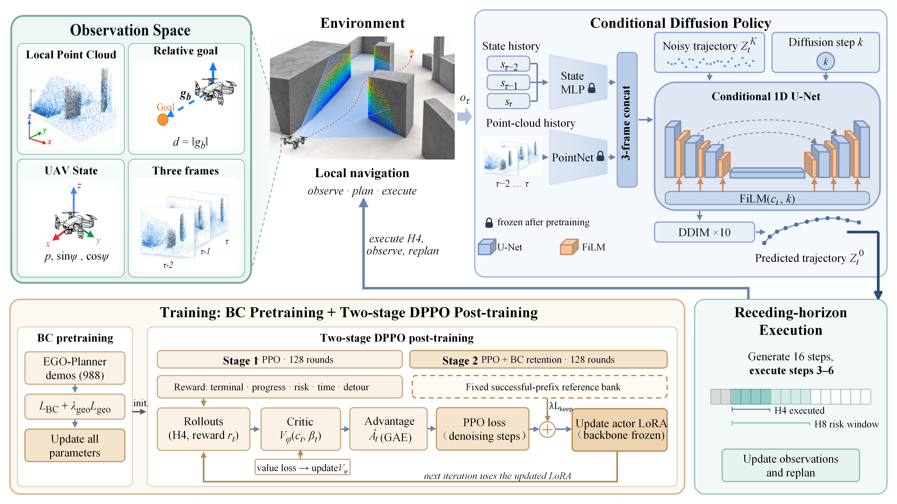

**图1　**UAV-iDP3与Reg-DPPO总体框架。UAV-iDP3利用专家轨迹进行预训练，Reg-DPPO通过环境交互进行强化学习微调。第二阶段以成功轨迹的自模仿正则约束策略更新；执行时依据新观测重新规划。

### 3.3 UAV-iDP3三维扩散策略

为适配无人机目标驱动的滚动时域导航任务，UAV-iDP3在iDP3[10]的点云编码器与条件扩散网络基础上，新增导航目标信息作为条件输入，实现局部障碍几何、无人机机体状态、目标相对方位三者的联合条件建模，完整网络数据流如图2所示。

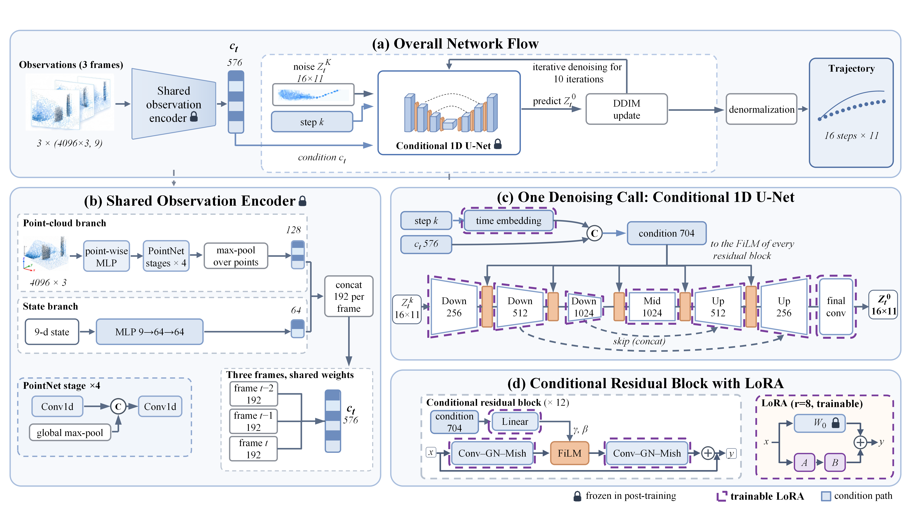

**图2　**UAV-iDP3网络结构。三帧点云与状态分别经PointNet编码器和状态MLP提取特征，拼接为576维条件向量，与128维时间步嵌入一起经FiLM调制条件一维U-Net（通道256、512、1024），输出16×11的轨迹序列。紫色虚线框为强化学习微调加入LoRA的层，锁形标记为微调中冻结的部分。

点云经PointNet类编码器[34]提取几何特征，无人机状态向量经由多层感知机完成特征映射，将连续三帧提取的特征向量拼接得到条件向量$c_t$。该条件向量结合扩散时间步嵌入，经由FiLM层[35]对条件一维U-Net各个残差块实施特征调制，网络接收带噪轨迹，完成去噪回归。

UAV-iDP3按去噪扩散概率模型[23]训练。对归一化后的示范轨迹$Z_t^{0}$，向其叠加高斯噪声，得到第$k$个扩散步的带噪样本：

$$
Z_t^{k}=\sqrt{\bar{\alpha}_k}\,Z_t^{0}+\sqrt{1-\bar{\alpha}_k}\,\epsilon,\qquad \epsilon\sim\mathcal{N}(0,I)\tag{2}
$$

其中$\bar{\alpha}_k$为噪声调度的累积系数。网络$f_{\theta}(Z_t^{k},k,c_t)$以带噪轨迹、扩散步$k$与条件向量为输入，预测无噪声轨迹$Z_t^{0}$。推理阶段，模型从$Z_t^{K}\sim\mathcal{N}(0,I)$出发，使用去噪扩散隐式模型（DDIM）[36]经$K$步确定性去噪，输出可供执行的三维参考轨迹$Z_t=Z_t^{0}$。

仅依靠示范轨迹的重建损失只能复刻专家行为模式，当遇到示范数据未覆盖的障碍构型时，生成轨迹无法显式保障与障碍物之间的安全距离。为此本文引入可微几何碰撞代价作为辅助训练信号，利用KS（Kreisselmeier-Steinhauser）函数[37]对预测轨迹点到局部点云的障碍距离做可微近似，对距离低于安全阈值的轨迹施加惩罚。综合扩散重建损失与几何碰撞代价，得到预训练阶段的完整损失函数：

$$
\mathcal{L}_{\mathrm{pre}}=\underbrace{\mathbb{E}\left[\|f_{\theta}(Z_t^{k},k,c_t)-Z_t^{0}\|_2^2\right]}_{\mathcal{L}_{\mathrm{diff}}}+\lambda_{\mathrm{geo}}\underbrace{\mathbb{E}\left[\sum_{h=0}^{15}w_h\,\phi(\tilde{d}_h)\right]}_{\mathcal{L}_{\mathrm{geo}}}\tag{3}
$$

式中，$\mathcal{L}_{\mathrm{diff}}$为扩散模型的轨迹重建损失，$\mathcal{L}_{\mathrm{geo}}$为碰撞代价损失，$\lambda_{\mathrm{geo}}$为两项损失之间的平衡权重；$\tilde{d}_h$为第$h$个预测轨迹点到局部点云距离的KS近似，$\phi(\cdot)$在距离低于安全阈值时取正值。时域权重$w_h$采用指数衰减设计，对即将被执行的轨迹片段赋予更高惩罚权重，对远期未执行规划片段降低约束强度。$\lambda_{\mathrm{geo}}$的取值见4.1.4节。

完成预训练的UAV-iDP3可以根据局部观测生成候选三维轨迹，但性能上限受限于专家示范数据的覆盖范围，因此需要后续强化学习微调进一步优化闭环表现。

### 3.4 任务回报设计

经过预训练的UAV-iDP3，其能力上限受专家示范分布约束，在闭环导航遇到分布外状态时缺少有效的优化信号。与此同时，滚动时域导航场景下直接使用通用强化学习回报会存在两处明显缺陷：一方面，直接以相邻决策周期的目标距离差构造奖励，会对避障所必需的暂时远离目标的绕行机动施加负反馈；另一方面，碰撞属于回合终止事件，惩罚信号存在明显滞后，只在碰撞发生之后生效，无法提前约束高风险的未执行规划片段。为此本文构建了复合任务回报，每个决策周期$t$对应的总回报定义为：

$$
r_t=T_t+10\,\frac{b_t-b_{t+1}}{D_0}-\rho_t-0.05-C_t\tag{4}
$$

各回报分量的具体含义如表1所示。其中，终止奖励$T_t$、进展奖励、风险惩罚$\rho_t$、时间惩罚与绕行代价$C_t$共同构成多维度反馈信号，兼顾导航成功率、趋近效率与飞行安全性；$D_0$为起点$p_s$到目标点$g$的距离，用于归一化进展奖励；$\mathcal{E}_t$为第$t$个决策周期的执行路径。

**表1　回报组成**

| 回报项 | 取值 | 说明 |
|---|---|---|
| 终止奖励$T_t$ | 进入目标0.5 m范围：+100；碰撞、触地、飞出空间边界、超出高度上限或状态无效：−50 | 成功抵达目标给予正向奖励，碰撞、越界等失败情形施加负向奖励 |
| 进展奖励 | $b_{t+1}=\min\{b_t,\min_{p\in\mathcal{E}_t}\|p-g\|_2\}$ | 基于历史最优距离刷新机制，仅在刷新最小目标距离时获得正向反馈 |
| 风险惩罚$\rho_t$ | 见式(5) | 对当前周期生成轨迹的执行段与未执行规划段评估碰撞风险 |
| 时间惩罚 | 每周期−0.05 | 每决策周期施加，激励策略快速完成导航 |
| 绕行代价$C_t$ | $\frac{1}{T_{\max}}\int_{\mathcal{E}_t}\max\left\{0,1-\frac{D_0}{\|p-p_s\|_2+\|p-g\|_2}\right\}\mathrm{d}s$ | 抑制不必要的大范围迂回机动 |

本文设计的进展奖励依赖历史最优目标距离$b_t$：仅在无人机实际执行后，目标距离小于本回合此前记录的最小距离时，策略获得正向奖励。与以相邻周期目标距离之差作为进展奖励的常见做法[40]不同，如图3(a)所示，该设计允许策略为躲避障碍物暂时远离目标，不会因此收到负向奖励；同时，避免无人机通过原地往复运动反复获取奖励，规避奖励滥用问题。

针对碰撞反馈滞后的问题，风险惩罚$\rho_t$同时评估当前周期生成轨迹的执行段与未执行规划段。对第$m$个子轨迹段，其风险值$q_m$以及风险惩罚$\rho_t$定义为：

$$
q_m=\frac{w_m}{2}\left[B(d_{o,m};0.45,0.10)+B(d_{g,m};1.0,0.20)\right],\quad B(d;d_w,d_c)=\left[\mathrm{clip}\left(\frac{d_w-d}{d_w-d_c},0,1\right)\right]^2,\quad \rho_t=\max_m q_m\tag{5}
$$

其中$d_{o,m}$为子段与障碍物的最小距离，$d_{g,m}$为离地高度；$w_m$为子段对应的时序权重。如图3(b)所示，该式分别评估子轨迹段与障碍物、地面之间的最小距离；执行段的权重为1，未执行规划段的权重随时序向后衰减；最终风险惩罚由全部子段风险取最大值得到。若回合在本周期提前终止，则仅统计已经执行的部分。时间惩罚用于激励策略尽快完成导航任务；绕行代价则用于抑制无意义的大范围迂回飞行。整套回报为Reg-DPPO的强化学习微调提供完整的任务反馈信号。

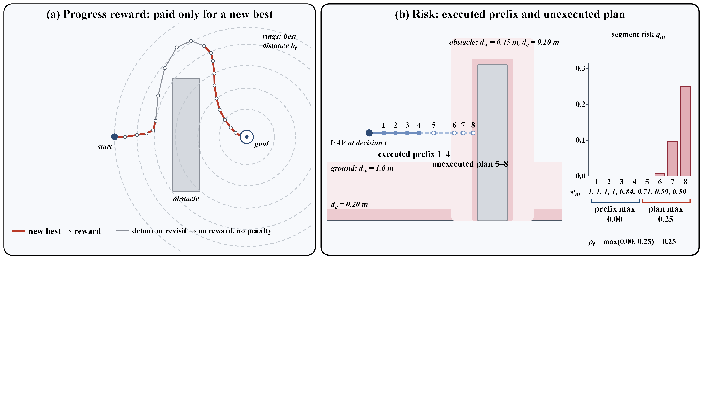

**图3　**进展奖励与前瞻风险评估示意。（a）进展奖励只在执行路径刷新历史最优目标距离时给出；（b）风险惩罚同时评价本周期执行段与未执行规划段，后者按时间衰减，（b）中第$m$段对应生成序列的第$m+2$步。

### 3.5 Reg-DPPO强化学习算法

DPPO将扩散策略的去噪过程嵌入环境交互回路，将一次轨迹生成建模为外层环境决策与内层去噪决策构成的两层马尔可夫决策过程[11]。外层决策在每个决策周期$t$依据条件$c_t$生成一条轨迹并接收环境回报，内层则将去噪过程视为$K$步高斯转移：从$Z_t^{K}$出发，第$k$步由$Z_t^{k}$得到$Z_t^{k-1}$，最终输出$Z_t=Z_t^{0}$。给定条件$c_t$时，策略对轨迹$Z_t$的对数似然可分解为：

$$
\log\pi_{\theta}(Z_t\mid c_t)=\sum_{k=1}^{K}\log\mathcal{N}\left(Z_t^{k-1};\,\mu_{\theta}(Z_t^{k},k,c_t),\,\sigma_k^2 I\right)\tag{6}
$$

其中$\mu_{\theta}$为DDIM更新给出的均值，$K=10$。基于该分解，策略梯度可以按去噪步计算新旧策略的概率比，直接作用于去噪网络。

若直接更新网络全部参数，不仅计算开销大，还可能破坏UAV-iDP3在模仿学习阶段获得的感知与轨迹生成能力。为此，本算法冻结预训练的点云编码器、状态编码器以及去噪网络主干，仅在去噪网络的卷积与线性层插入LoRA低秩适配器[15]，更新后的权重表示为$W=W_0+\frac{\alpha_L}{r_L}BA$，其中$W_0$为冻结的预训练权重，$B$、$A$为可训练的低秩矩阵，$r_L$与$\alpha_L$分别为秩与缩放系数。适配器采用零初始化，使微调初始时刻的策略行为与预训练模型一致。LoRA将可训练参数降低至网络总参数量的1.43%，限制了策略的更新幅度，而策略需要保留的具体行为，由下文的自模仿正则进一步约束。

优势函数由独立价值网络通过广义优势估计（GAE）[41]计算。价值网络$V_{\phi}(c_t,e_t)$除条件向量$c_t$外还输入任务进度$e_t$，以提升不同任务阶段下优势估计的准确性。策略采用截断近端策略优化目标[42]更新：

$$
\mathcal{L}_{\pi}=-\mathbb{E}_{t,k}\left[\min\left(R_{t,k}\hat{A}_{t,k},\ \mathrm{clip}(R_{t,k},1-\delta_k,1+\delta_k)\,\hat{A}_{t,k}\right)\right]\tag{7}
$$

其中$R_{t,k}$为第$k$个去噪步对应的新旧策略概率比，$\hat{A}_{t,k}$为第$k$个去噪步使用的优势值，$\delta_k$为第$k$个去噪步的PPO截断宽度。

仅依靠上述目标更新极易引发灾难性遗忘，而引入外部示范数据又会带来额外的数据采集成本。受自模仿学习[33]启发，Reg-DPPO复用策略自身交互产生的成功经验构造正则信号，以行为克隆损失的形式约束策略输出，本文称之为自模仿正则。它在不引入外部示范的前提下保留预训练与第一阶段习得的避障能力。

Reg-DPPO将训练过程分为两个阶段。第一阶段采用标准DPPO训练，按式(7)更新策略；第一阶段结束后，收集预训练策略与第一阶段策略在训练任务上的成功回合，提取观测与轨迹的执行段，构建固定参考集$\mathcal{D}_{\mathrm{ref}}$。

区别于常规自模仿学习对整条生成轨迹施加监督，本文的滚动时域执行方式在每个决策周期仅执行生成轨迹的一部分就进入重规划。因此，自模仿正则仅作用于回合中真正发生状态转移的执行段，它们直接决定了闭环交互的结果。第二阶段训练的总损失定义为：

$$
\mathcal{L}=\mathcal{L}_{\pi}+\lambda\,\mathbb{E}_{(c_t,Z_t^{\mathrm{ref}})\sim\mathcal{D}_{\mathrm{ref}},\,k}\left[\frac{1}{L}\left\|\sqrt{M_t}\odot\left(f_{\theta}(Z_t^{\mathrm{ref},k},k,c_t)-Z_t^{\mathrm{ref}}\right)\right\|_2^2\right]\tag{8}
$$

其中$Z_t^{\mathrm{ref},k}$由$Z_t^{\mathrm{ref}}$按式(2)加噪得到，$L=16$为轨迹时域长度，$M_t$为与输出轨迹维度16×11对齐的非负权重矩阵，仅对执行段的位置与偏航增量施加约束，以此限定自模仿损失的监督范围。针对任务在规划时域内提前完成的情形，位置分量按实际执行步数占规划时域比例的平方加权，对偏航增量不施加约束；未执行规划段不参与损失计算。权重$M_t$以$\sqrt{M_t}$的形式置于L2范数内，故该正则项即逐元素加权平方误差。各分量求和后除以轨迹时域长度$L$，再对参考样本取均值，而不按有效分量数重新归一化，使$\lambda$的含义不随任务完成时刻改变，无需逐样本重新标定。

**算法1　Reg-DPPO训练流程**

输入：预训练UAV-iDP3策略$\theta_0$，训练任务集$\mathcal{T}$，阶段轮数$j_1$、$j_2$，正则系数$\lambda$

输出：微调后的扩散策略$\theta=\theta_0+\theta_L$

1：冻结$\theta_0$的编码器与扩散主干网络；初始化LoRA参数$\theta_L$、价值网络参数$\phi$

2：for $j=1,\cdots,j_1$ do　//第一阶段：标准DPPO微调

3：　在$\mathcal{T}$上采集环境与去噪转移样本

4：　按式(4)、(5)计算回报，以GAE估计优势，按式(7)更新$\theta_L$与$\phi$

5：end for

6：基于$\theta_0$与第一阶段策略的成功回合，构建固定参考集$\mathcal{D}_{\mathrm{ref}}$

7：for $j=j_1+1,\cdots,j_1+j_2$ do　//第二阶段：加入自模仿正则

8：　采集环境交互样本，从$\mathcal{D}_{\mathrm{ref}}$采样参考轨迹

9：　计算回报与优势，按式(8)优化联合损失，更新$\theta_L$与$\phi$

10：end for

11：return $\theta_0+\theta_L$

## 4 实验与结果分析

### 4.1 实验设置

本文搭建运动学仿真与Gazebo/PX4软件在环仿真两级平台。运动学仿真用于强化学习训练和主要性能评价；Gazebo/PX4软件在环仿真引入多旋翼飞行动力学、PX4飞控与深度相机仿真，用于检验方法在控制跟踪条件下的迁移效果。所有方法在相同的任务、初始条件与判定标准下测试。

#### 4.1.1 测试环境与任务

所有训练与测试场景均以Gazebo场景文件构建，包含箱体、圆柱体等不同类型的静态障碍，分布于25 m×25 m×5 m的空间区域内，每个场景中随机分布1～40个数量不等的障碍。运动学仿真读取同一场景文件，按策略输出的参考轨迹推进无人机，依据障碍几何、无人机位姿与深度相机配置合成局部点云，并加入深度噪声与点缺失以模拟真实传感器特性，同时沿执行路径判定碰撞、触地与到达。Gazebo/PX4软件在环仿真中，参考轨迹由PX4位置控制器跟踪，点云来自仿真深度相机。

根据强化学习训练、验证和测试的需要，共设置21个训练场景、20个验证场景和40个测试场景，每个场景随机选取若干起终点作为飞行任务。强化学习训练时，在部分训练回合施加随机位置扰动，或对起点位置与初始偏航施加随机扰动，以扩大状态覆盖。运动学仿真实验在40个测试场景中选取177个固定起终点任务，Gazebo/PX4软件在环仿真实验选取40个固定任务。

为分析不同避障难度下各方法的表现，根据航线附近障碍物的空间占比将测试任务分为稀疏、适中和密集三类。对每个任务，以起终点连线的水平投影为中线，取左右各宽1 m的竖直长方体区域$R$，其高度范围为无人机沿直线飞向目标时所需高度上下各延伸1 m，且最低高度不低于0.2 m。以$R$内被障碍占据的体积比例作为航线障碍占据率：

$$
\chi=\frac{V(R\cap\mathcal{O})}{V(R)}\tag{9}
$$

其中$\mathcal{O}$表示场景中全部障碍物所占空间。$\chi=0$表示直线航线附近没有障碍，$\chi$越大，直线通过越困难，越需要策略的绕行避障能力。以训练任务中$\chi$的中位数（0.046）为参照，将$0\le\chi\le0.02$、$0.02<\chi\le0.06$和$\chi>0.06$的任务分别记为稀疏、适中和密集任务。两类仿真平台测试集的难度构成如表2所示。

**表2　测试任务与难度组成**

| 难度 | 运动学任务数 | 运动学场景数 | 起终点距离/m | Gazebo/PX4任务数 |
|---|---|---|---|---|
| 稀疏 | 56 | 31 | 11.8（3.1—31.1） | 11 |
| 适中 | 64 | 34 | 20.3（10.3—33.2） | 14 |
| 密集 | 57 | 29 | 17.0（7.2—31.4） | 15 |
| 总体 | 177 | 40 | 16.1（3.1—33.2） | 40 |

#### 4.1.2 对比方法

对比方法分为消融变体与模块化规划器两类。消融变体用于检验Reg-DPPO各组成部分的作用，包括：预训练的UAV-iDP3；仅完成第一阶段标准DPPO微调的Reg-DPPO w/o Stage II；与本文方法共享第一阶段策略与训练预算、仅在第二阶段去除自模仿正则的Reg-DPPO w/o BC reg.；不划分阶段、以相同配置连续训练256轮的Single-stage DPPO。模块化规划器选取三种基于优化的局部规划器EGO-Planner-Swarm[19]、Fast-Planner[18]的kino模式（下文记为Fast-Planner kino）与SUPER[3]，均采用官方公开实现与默认参数，以同一深度相机的观测在线建图与规划。图中以Proposed表示本文方法。

#### 4.1.3 评价指标

每次飞行的结局分为三类：在发生碰撞之前进入目标1.5 m范围记为安全到达；运动学仿真中机体与障碍物接触或触地记为碰撞，Gazebo/PX4软件在环仿真中以机体坠地或翻覆判定碰撞；在单次飞行期限（运动学仿真为60个决策周期，Gazebo/PX4为240 s）内二者均未发生记为超时。训练回报采用更严格的0.5 m到达范围（表1）。

任务成功率为核心指标。运动学仿真中每个任务重复飞行5次，至少2次安全到达记为任务成功；Gazebo/PX4中每个任务重复飞行2次，至少1次安全到达记为任务成功。碰撞率与超时率按单次飞行统计。

轨迹质量以路径效率与最小障碍净距评价。路径效率定义为：

$$
\eta=\frac{\|g-p_s\|_2}{L_a+\|p_a-g\|_2}\tag{10}
$$

其中$L_a$为从起点到首次进入目标范围的执行路径长度，$p_a$为首次进入目标范围的位置；$1/\eta-1$即超出直线距离的路径长度比例。最小障碍净距定义为：

$$
d_{\min}=\min_{p\in\Gamma}\ \min_i\ \mathrm{dist}(p,\mathcal{O}_i)-r_b\tag{11}
$$

其中$\Gamma$为首次进入目标范围之前的执行路径，$\mathcal{O}_i$为第$i$个障碍物占据的空间，$r_b$为无人机碰撞半径。两项指标在每个任务的成功飞行上取中位数，并只在参与比较的方法均成功的任务上配对比较。

任务成功率及其配对差的95%置信区间按测试场景聚类自助重采样20000次得到；路径效率与最小障碍净距配对差的置信区间按任务自助重采样得到；能力保持率采用Wilson区间。置信区间不含零时称差异显著。

#### 4.1.4 实现细节

UAV-iDP3预训练以EGO-Planner[2]为专家，在59个Gazebo仿真场景中以随机起终点飞行采集988条轨迹构建示范数据集，按9∶1划分训练集与验证集。训练过程中采用点云抖动、深度噪声与随机旋转三类数据增强，以提升模型对感知扰动与视角变化的鲁棒性。预训练采用AdamW优化器，初始学习率为$10^{-4}$，采用余弦退火调度，批次大小为60，共训练301轮，碰撞代价损失的权重$\lambda_{\mathrm{geo}}=0.5$。

Reg-DPPO训练共256轮，每轮采集1024个决策转移样本，复用5次。前128轮为第一阶段，使用标准DPPO训练；后128轮为第二阶段，依据固定参考集$\mathcal{D}_{\mathrm{ref}}$加入自模仿正则。正则系数$\lambda=0.0106$，按正则项梯度范数约为策略梯度范数0.1倍的原则在第二阶段开始时标定。训练时各去噪步按标准差下限0.1随机采样，测试时采用确定性DDIM采样。主要超参数如表3所示。

**表3　主要超参数**

| 模块 | 参数 | 取值 |
|---|---|---|
| 观测与动作 | 历史帧数/每帧点数/状态维度/轨迹维度 | 3/4096/9/16×11 |
| 策略网络 | 几何特征/状态特征/条件向量维度 | 128/64/576 |
| 策略网络 | U-Net各级通道/卷积核/时间步嵌入 | 256、512、1024/5/128 |
| 扩散模型 | 训练扩散步/DDIM去噪步$K$ | 50/10 |
| 执行 | 规划窗口/执行段/最大决策次数 | 8段/4段/60 |
| LoRA | 秩$r_L$/缩放$\alpha_L$ | 8/8 |
| 价值网络 | 隐藏层/激活 | 256、256/SiLU |
| 优化 | 策略初始学习率/价值学习率 | $2\times10^{-5}$/$10^{-3}$ |
| 优化 | 折扣$\gamma$/$\lambda_{\mathrm{GAE}}$/去噪折扣$\gamma_d$ | 0.99/0.95/0.8 |
| 优化 | PPO截断宽度$\delta_k$ | $10^{-3}$—0.1 |
| 正则约束 | 正则系数$\lambda$/每次抽样数 | 0.0106/32 |

### 4.2 运动学仿真主要结果

经Reg-DPPO微调，本文方法的任务成功率由UAV-iDP3的50.3%提高至76.8%（图4(a)），配对差为26.6个百分点，95%置信区间为[19.1, 33.9]。与模块化规划器相比，本文方法与EGO-Planner-Swarm的差异不显著（−5.1个百分点，[−11.7, 1.7]），低于Fast-Planner kino与SUPER（分别为−5.1个百分点，[−9.6, −0.6]；−9.0个百分点，[−15.5, −2.7]）。强化学习微调使不依赖全局地图的端到端扩散策略接近了模块化规划器的成功率。

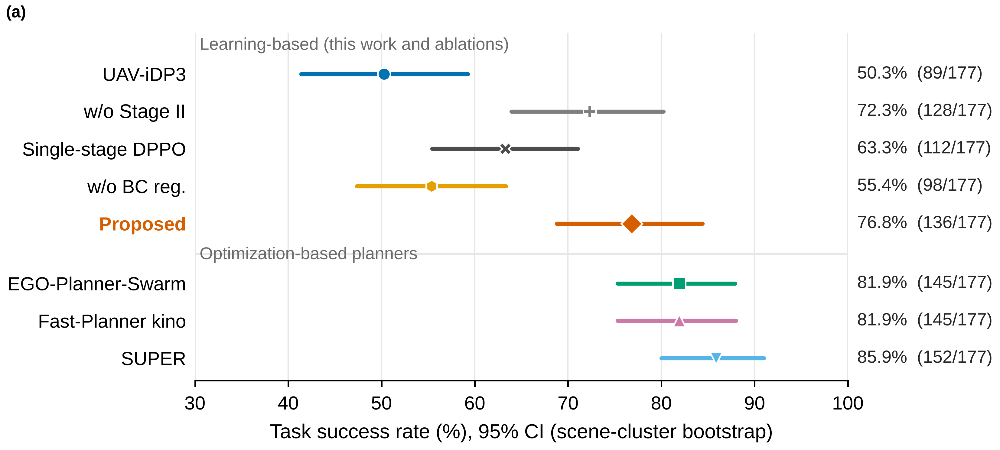

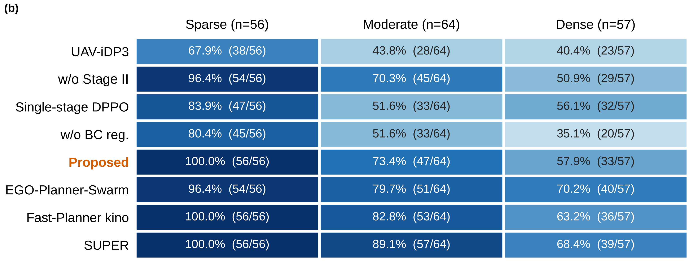

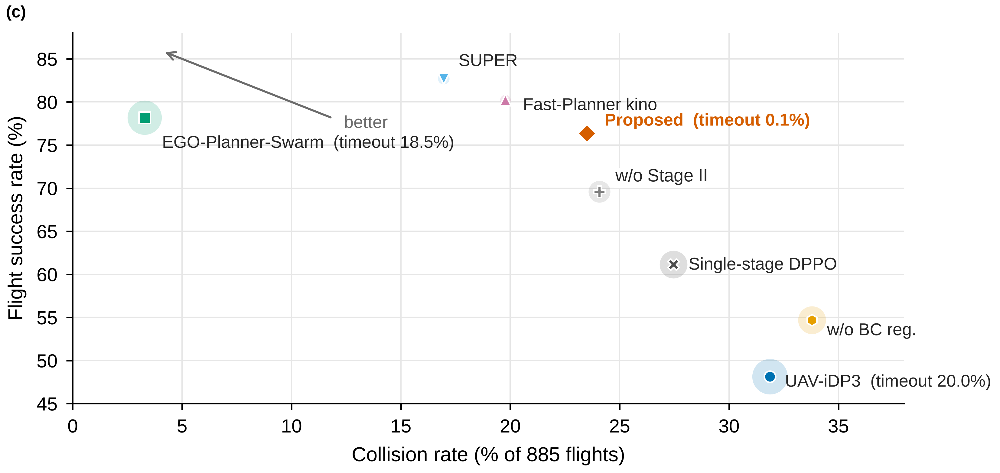

**图4　**运动学仿真中各方法的结果（177个任务）。（a）任务成功率，横线为按测试场景聚类自助重采样得到的95%置信区间；（b）分难度任务成功率，格内为成功率与成功任务数/任务数；（c）逐次飞行的成功率与碰撞率（每种方法885次飞行），浅色圆的大小表示超时率，左上方为更优。

提升覆盖全部三类难度，与模块化规划器的剩余差距出现在需要绕行的任务上（图4(b)）。本文方法完成全部56个稀疏任务，在适中和密集任务上较UAV-iDP3分别提高29.7和17.5个百分点。稀疏任务中各方法均完成全部或几乎全部任务；在适中和密集任务上，本文方法分别比三种模块化规划器低6.3—15.6和5.3—12.3个百分点。

本文方法几乎消除了超时，剩余失败表现为碰撞，而模块化规划器以不同方式失败（图4(c)）。微调使逐次飞行的超时率由UAV-iDP3的20.0%降至0.1%（885次飞行中1次），碰撞率由31.9%降至23.5%。EGO-Planner-Swarm的碰撞率仅为3.3%，但有18.5%的飞行超时；Fast-Planner kino与SUPER的失败以碰撞为主，碰撞率分别为19.8%和16.9%，均低于本文方法。图5给出密集任务中的两个执行示例。图5(a)中，UAV-iDP3在绕过障碍时与其接触，本文方法从同一侧绕过障碍并到达目标；图5(b)中，障碍沿航线连续分布，本文方法在进入障碍带时与障碍接触。

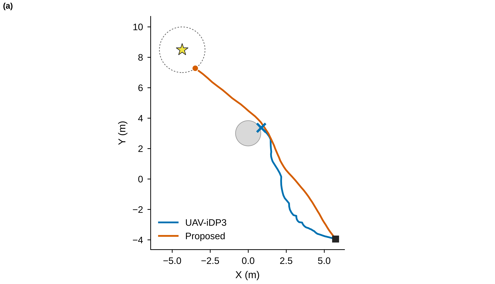

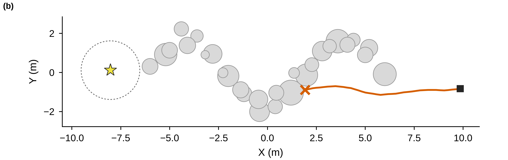

**图5　**密集任务中的执行示例（俯视）。（a）同一任务中UAV-iDP3的碰撞与本文方法的到达；（b）本文方法在另一密集任务中的碰撞。方块、星号、圆点与叉号分别表示起点、目标、到达点与碰撞点，虚线圆为1.5 m到达范围。

在各方法均成功的任务上，成功率的提高没有以更长的路径或更小的障碍净距为代价（图6）。在五种方法均成功的69个任务上，本文方法超出直线距离的路径长度中位数为1.87%，低于UAV-iDP3的3.59%，69个任务中有51个位于图6(a)的等值线下方；路径效率的配对差中位数为1.14个百分点（[0.31, 1.96]，图6(b)）。与模块化规划器相比，本文方法的路径效率较EGO-Planner-Swarm和Fast-Planner kino分别低1.13和0.87个百分点，与SUPER相当（0.02个百分点，[−0.70, 0.28]）。各方法之间最小障碍净距的配对差中位数均在±0.03 m以内（图6(c)）。

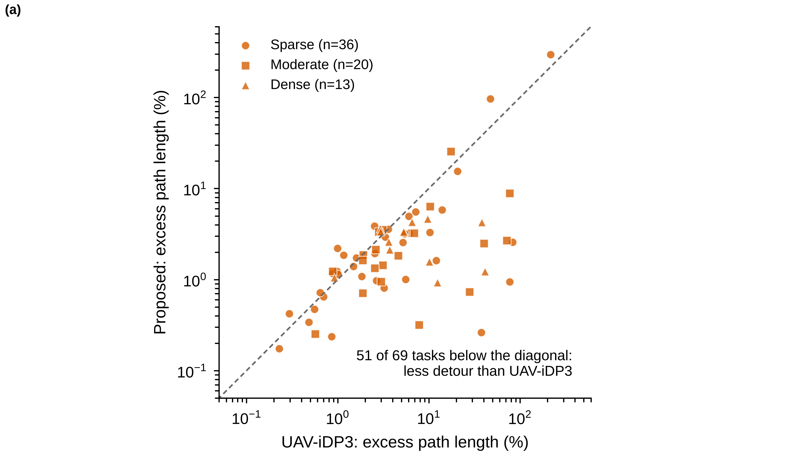

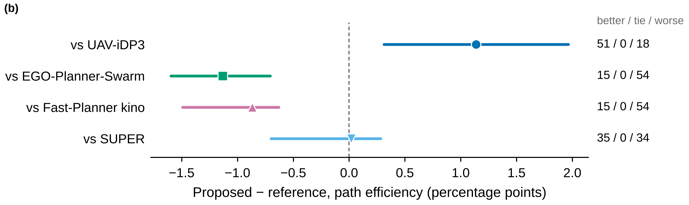

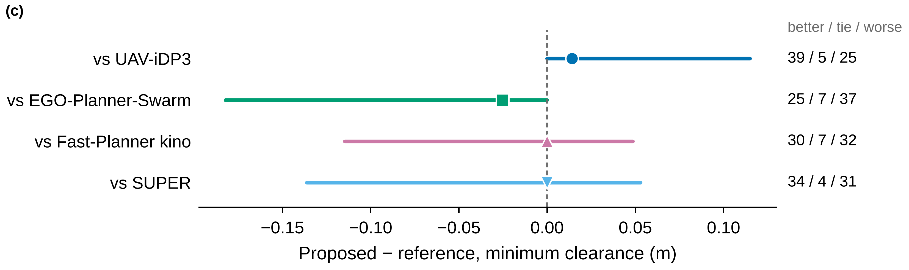

**图6　**五种方法均成功的69个任务上的路径效率与最小障碍净距。（a）本文方法与UAV-iDP3逐任务超出直线距离的路径长度（双对数轴），每点为一个任务成功飞行的中位数，标记形状表示难度，虚线为等值线；（b）路径效率与（c）最小障碍净距的逐任务配对差（本文方法减参照方法），点为中位数，横线为按任务自助重采样的95%置信区间，右侧为本文方法更优/持平/更差的任务数。

### 4.3 消融实验

消融实验检验Reg-DPPO的两个组成部分：强化学习微调本身，以及第二阶段的自模仿正则与分阶段训练。各变体的总体与分难度结果见图4。

强化学习微调的收益主要来自新增完成的任务，已有能力基本保持（图7）。按UAV-iDP3与本文方法的成功状态将177个任务配对分类，本文方法保持了UAV-iDP3 89个成功任务中的83个，并在其未完成的88个任务中新增完成53个，由成功转为失败的仅6个，净增47个。新增完成的任务在稀疏、适中和密集类别中分别为18、21和14个，微调在三类难度上都扩展了策略能完成的任务；两者均未完成的35个任务中有20个为密集任务。按阶段看，第一阶段将成功任务数由89个增至128个（Reg-DPPO w/o Stage II，72.3%），第二阶段再增至136个。

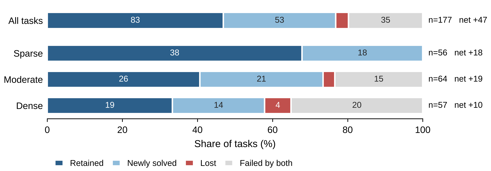

**图7　**UAV-iDP3到本文方法的逐任务成功状态转移（177个运动学任务）。各段依次为保持成功、新增完成、由成功转为失败与两者均未完成的任务，段内数字为任务数，右侧为任务数与净增任务数。

自模仿正则使第二阶段训练保持了第一阶段获得的能力（图8）。以第一阶段策略完成的128个任务为参照，本文方法在第二阶段后保持122个、遗忘6个，另新增完成14个；Reg-DPPO w/o BC reg.遗忘37个、新增7个；Single-stage DPPO遗忘25个、新增9个。对应的保持率分别为95.3%（[90.2, 97.8]）、71.1%（[62.7, 78.2]）和80.5%（[72.8, 86.4]），本文方法的区间与两种变体均不重叠。两种无正则变体最终完成的任务数（98和112个）均少于第一阶段的128个，即不加约束的继续训练抵消了第一阶段的部分收益。Reg-DPPO w/o BC reg.与本文方法的起点和训练预算相同，二者成功率相差21.5个百分点（[13.3, 29.9]），本文方法多完成的38个任务中，31个来自遗忘的减少，7个来自新增的增加。相对第一阶段，本文方法净增8个任务（4.5个百分点，[−0.6, 9.8]）。因此，第二阶段的作用主要在于保持已有能力，这一作用来自自模仿正则。

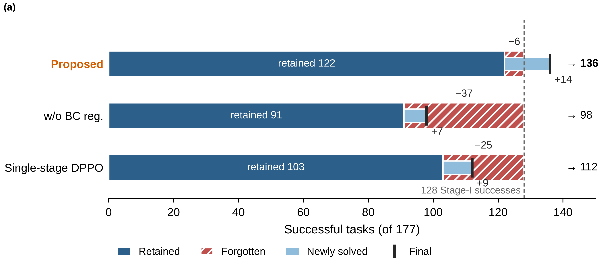

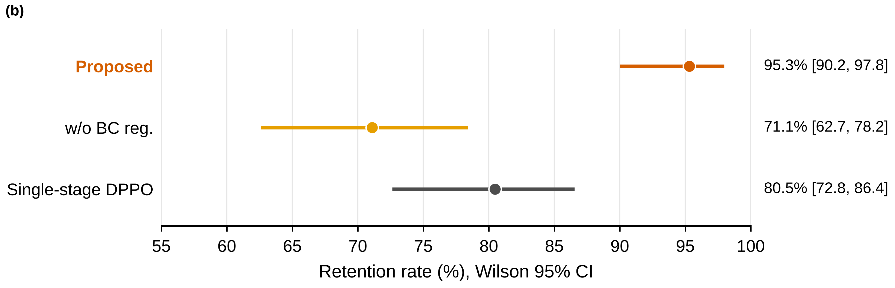

**图8　**第一阶段完成的128个任务在第二阶段后的去向。（a）各方法保持、遗忘与新增完成的任务数，虚线为128个参照任务，右侧为最终完成的任务数；（b）保持率及其Wilson 95%置信区间。各方法与第一阶段均未完成的任务（35、42和40个）未绘出。

训练过程中的策略变化与上述结果一致（图9）。第一阶段结束后，Reg-DPPO w/o BC reg.在第208轮出现近似KL散度尖峰（4.7×10⁻⁵，约为同期本文方法的60倍），训练采集成功率同步降至21.1%；Single-stage DPPO的采集成功率逐步降至25.6%；本文方法的近似KL散度保持平稳，采集成功率维持在36.6%—43.3%。

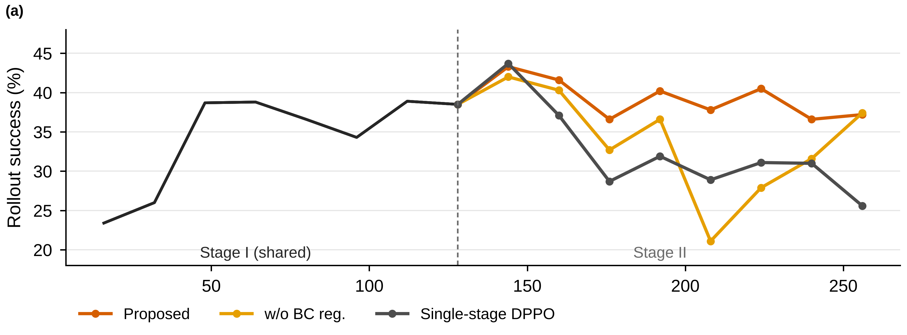

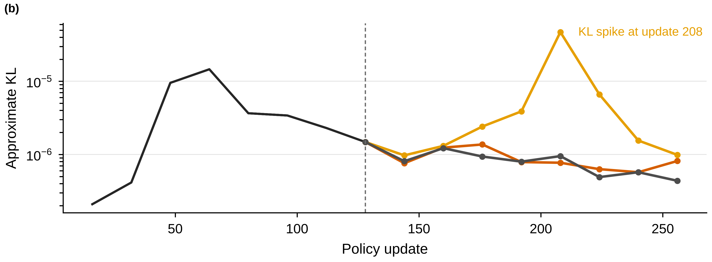

**图9　**强化学习微调的训练过程。（a）训练采集成功率；（b）近似KL散度（对数轴）。数值按每16轮汇总，竖虚线为第一阶段结束的第128轮，黑线为各方法共享的第一阶段记录。

### 4.4 Gazebo/PX4软件在环验证

运动学仿真按参考轨迹理想推进无人机，Gazebo/PX4软件在环仿真则由PX4位置控制器跟踪参考轨迹。对学习策略，每次决策提交执行段的4个路径点，并在该段轨迹时长的70%处触发下一次推理。

在Gazebo/PX4中，本文方法保持了UAV-iDP3完成的全部任务，但提升缩小至2个任务（图10）。本文方法完成27/40个任务（67.5%），与Fast-Planner kino和SUPER相同，低于EGO-Planner的31个。UAV-iDP3完成的25个任务全部保持，新增的2个分别来自适中与密集类别（图10(a)）。各方法均完成全部稀疏任务，差异集中在密集任务：EGO-Planner完成10/15个，SUPER完成8/15个，本文方法与Fast-Planner kino各完成6/15个（图10(b)）。两种学习策略的失败均以碰撞为主，逐次飞行碰撞率分别为31.2%（UAV-iDP3）和35.0%（本文方法）；本文方法的超时率由12.5%降至5.0%，与运动学中超时减少的结果一致（图10(c)）。相对UAV-iDP3的提升由运动学中的26.6个百分点缩小至5.0个百分点。

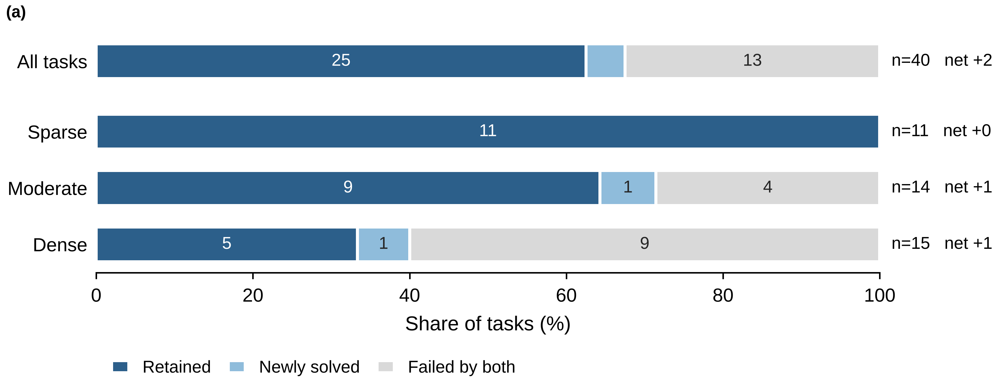

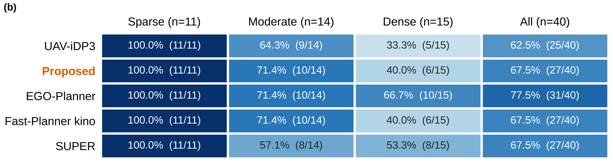

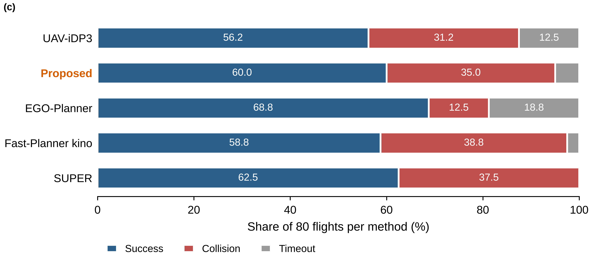

**图10　**Gazebo/PX4软件在环仿真结果（40个任务）。（a）UAV-iDP3到本文方法的逐任务成功状态转移，任务以2次飞行中至少1次安全到达判为成功；（b）分难度任务成功率，格内为成功率与成功任务数/任务数；（c）每种方法80次飞行的结局构成（%）。

提升缩小源于学习策略参考轨迹的跟踪偏差（图11）。在三种方法均成功的同一任务中，两种学习策略的参考位置与实际位置之差呈周期性波动，均方根值分别为0.51 m（UAV-iDP3）和0.57 m（本文方法），峰值接近1 m，而EGO-Planner仅为0.08 m（图11(a)）。幅度谱显示，两种学习策略偏差的主周期分别为1.10 s和1.23 s，与重规划周期对应，EGO-Planner的偏差无明显周期成分（图11(b)）。学习策略每次重规划生成的参考轨迹与上一段轨迹在衔接处不连续，PX4位置控制器在每个周期内追赶这一跳变，形成与重规划同步的偏差。运动学仿真按参考轨迹精确推进，策略在其中习得的避障动作以精确执行为前提；在跟踪偏差下，这些动作更易演变为与障碍的擦碰并导致失稳，这与本文方法在Gazebo/PX4中碰撞率上升而超时率继续下降相符。

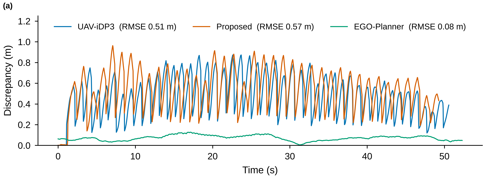

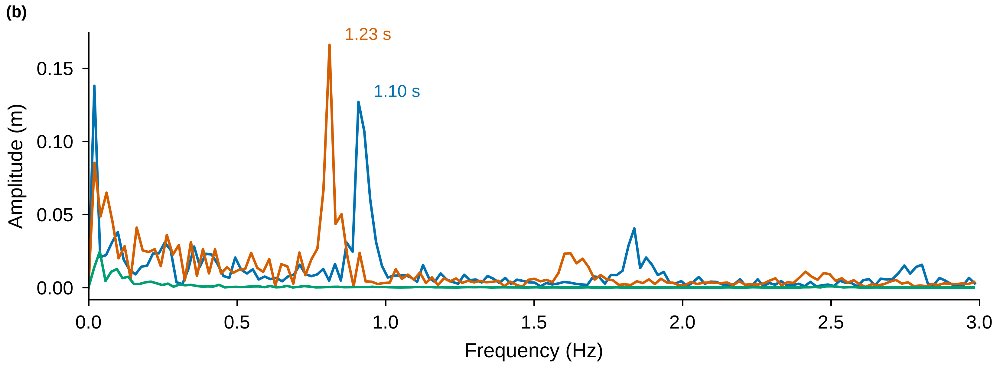

**图11　**Gazebo/PX4中参考位置与实际位置的偏差（三种方法均成功的同一任务、同一次飞行）。（a）偏差随时间的变化，图例中为全程均方根值；（b）去均值偏差的幅度谱，标注为主峰对应的周期。

### 4.5 讨论

强化学习微调对超时与碰撞的作用并不对称：超时几乎被消除，碰撞率只由31.9%降至23.5%。超时的消除与回报设计相符。进展奖励只在刷新历史最优目标距离时给出，时间惩罚持续累积，悬停、往复或在障碍前停滞都得不到回报，策略因而学会持续推进。碰撞则受观测条件限制。策略仅以最近三帧局部点云为条件，当障碍沿航线连续分布时（图5(b)），可通过的间隙常位于当前视场之外，策略只能依据可见部分选择方向；强化学习能够改进策略在给定观测下的选择，却不能补充观测中缺失的几何信息。模块化规划器依据逐帧累积的局部地图规划，在密集任务中碰撞更少；其中EGO-Planner-Swarm的失败以超时为主，表现为保守等待。两类方法由此呈现相反的失败形式：本文方法持续推进而在障碍间隙处碰撞，模块化规划器停留等待而超时。分析认为，本文方法与模块化规划器在适中与密集任务上的差距，主要来自对障碍布局缺乏记忆，而非轨迹生成能力本身。

自模仿正则的作用与微调中遗忘的来源相对应。在线微调只优化当前策略采集到的状态，对采集中稀少的状态缺少维持信号，Wolczyk等[12]将其确认为微调中能力丢失的主要原因。本文中，去除正则的变体在第二阶段出现KL散度尖峰，并遗忘了37个第一阶段已完成的任务。自模仿正则在固定的成功轨迹上持续约束策略输出，为这些状态提供了不依赖当前采集分布的监督；由于约束仅作用于执行段，未执行的规划部分仍可随回报调整。但参考集在第二阶段开始前固定，只包含UAV-iDP3与第一阶段已经具备的行为，第二阶段因此以保持为主，净增有限。将第二阶段新获得的成功轨迹在线加入参考集，有望使正则在保持已有能力的同时支持能力继续扩展。

Gazebo/PX4结果表明，运动学训练中“参考轨迹被精确执行”的假设是迁移中的主要缺口。参考轨迹在重规划衔接处的跳变经控制器跟踪后放大为周期性偏差，而策略在训练中从未经历这种偏差。在训练中引入控制器跟踪模型或执行误差，或约束相邻两次参考轨迹在衔接处连续，是缩小这一差距的直接途径。

本文仍存在以下局限。其一，进展奖励与前瞻风险评估未分别消融，二者各自的贡献尚未量化，后续将以相邻周期距离差替代历史最优进展、去除未执行规划段的风险项，分别评估其作用。其二，本文结果来自一次完整训练，以另一随机种子重复的完整训练未取得同等提升，Reg-DPPO对训练随机性的敏感程度需要通过多次独立训练进一步评估。其三，实验限于静态障碍的仿真环境，后续将引入更长的观测记忆或局部空间表示以应对连续密集障碍，并扩展至动态障碍场景与实机飞行验证。

## 5 结论

本文针对局部感知条件下的无人机自主避障问题，提出了端到端三维扩散策略UAV-iDP3及其强化学习微调方法Reg-DPPO。UAV-iDP3在iDP3基础上引入导航目标条件与位置增量轨迹表示，使三维扩散策略能够以滚动时域方式完成目标驱动的飞行；Reg-DPPO以复合任务回报和LoRA微调扩散策略，并以执行段上的自模仿正则约束第二阶段更新。运动学仿真表明，强化学习微调将任务成功率由50.3%提高至76.8%，收益主要来自新增完成的任务，并几乎消除了超时；自模仿正则使第二阶段遗忘的任务由37个降至6个，是微调中保持已有能力的关键。在Gazebo/PX4软件在环仿真中，本文方法保持了基础策略的全部成功任务，但提升受参考轨迹跟踪偏差的限制而明显缩小。本文方法与模块化规划器的差距集中在需要绕行的适中与密集任务上。后续工作将引入更长的观测记忆或局部空间表示，在训练中建模控制跟踪误差，并开展动态障碍与实机飞行验证。

## 参考文献

[1] XIAO J, ZHANG R, ZHANG Y, et al. Vision-Based Learning for Drones: A Survey[EB/OL]. 2023[2026-11-16]. https://arxiv.org/abs/2312.05019.

[2] ZHOU X, WANG Z, YE H, et al. EGO-Planner: An ESDF-Free Gradient-Based Local Planner for Quadrotors[J]. IEEE Robotics and Automation Letters, 2021, 6(2): 478-485. DOI:10.1109/lra.2020.3047728.

[3] REN Y, ZHU F, LU G, et al. Safety-assured high-speed navigation for MAVs[J]. Science Robotics, 2025, 10(98): eado6187. DOI:10.1126/scirobotics.ado6187.

[4] ZHANG Y, HU Y, SONG Y, et al. Learning vision-based agile flight via differentiable physics[J]. Nature Machine Intelligence, 2025.

[5] LOQUERCIO A, KAUFMANN E, RANFTL R, et al. Learning high-speed flight in the wild[J]. Science Robotics, 2021, 6(59): eabg5810. DOI:10.1126/scirobotics.abg5810.

[6] LU J, ZHANG X, SHEN H, et al. You Only Plan Once: A Learning-Based One-Stage Planner With Guidance Learning[J]. IEEE Robotics and Automation Letters, 2024, 9(7): 6083-6090. DOI:10.1109/lra.2024.3399589.

[7] ROSS S, GORDON G, BAGNELL D. A Reduction of Imitation Learning and Structured Prediction to No-Regret Online Learning[C]//Proceedings of the Fourteenth International Conference on Artificial Intelligence and Statistics. PMLR, 2011, 15: 627-635.

[8] CHI C, XU Z, FENG S, et al. Diffusion policy: Visuomotor policy learning via action diffusion[J]. The International Journal of Robotics Research, 2025, 44(10-11): 1684-1704. DOI:10.1177/02783649241273668.

[9] ZE Y, ZHANG G, ZHANG K, et al. 3D Diffusion Policy: Generalizable Visuomotor Policy Learning via Simple 3D Representations[C]//Proceedings of Robotics: Science and Systems, 2024. DOI:10.15607/rss.2024.xx.067.

[10] ZE Y, CHEN Z, WANG W, et al. Generalizable Humanoid Manipulation with 3D Diffusion Policies[C]//2025 IEEE/RSJ International Conference on Intelligent Robots and Systems (IROS), 2025: 2873-2880. DOI:10.1109/iros60139.2025.11246340.

[11] REN A Z, LIDARD J, ANKILE L L, et al. Diffusion Policy Policy Optimization[C]//International Conference on Learning Representations. 2025.

[12] WOLCZYK M, CUPIAŁ B, OSTASZEWSKI M, et al. Fine-tuning Reinforcement Learning Models is Secretly a Forgetting Mitigation Problem[C]//Proceedings of the 41st International Conference on Machine Learning. PMLR, 2024, 235: 53039-53078.

[13] RAJESWARAN A, KUMAR V, GUPTA A, et al. Learning Complex Dexterous Manipulation with Deep Reinforcement Learning and Demonstrations[C]//Robotics: Science and Systems XIV, 2018. DOI:10.15607/rss.2018.xiv.049.

[14] KIRKPATRICK J, PASCANU R, RABINOWITZ N, et al. Overcoming catastrophic forgetting in neural networks[J]. Proceedings of the National Academy of Sciences, 2017, 114(13): 3521-3526. DOI:10.1073/pnas.1611835114.

[15] HU E J, SHEN Y, WALLIS P, et al. LoRA: Low-Rank Adaptation of Large Language Models[C]//International Conference on Learning Representations. 2022.

[16] QUAN L, HAN L, ZHOU B, et al. Survey of UAV motion planning[J]. IET Cyber-Systems and Robotics, 2020, 2(1): 14-21. DOI:10.1049/iet-csr.2020.0004.

[17] MELLINGER D, KUMAR V. Minimum snap trajectory generation and control for quadrotors[C]//2011 IEEE International Conference on Robotics and Automation (ICRA), 2011: 2520-2525. DOI:10.1109/icra.2011.5980409.

[18] ZHOU B, GAO F, WANG L, et al. Robust and Efficient Quadrotor Trajectory Generation for Fast Autonomous Flight[J]. IEEE Robotics and Automation Letters, 2019, 4(4): 3529-3536. DOI:10.1109/lra.2019.2927938.

[19] ZHOU X, WEN X, WANG Z, et al. Swarm of micro flying robots in the wild[J]. Science Robotics, 2022, 7(66): eabm5954. DOI:10.1126/scirobotics.abm5954.

[20] LOQUERCIO A, MAQUEDA A I, DEL-BLANCO C R, et al. DroNet: Learning to Fly by Driving[J]. IEEE Robotics and Automation Letters, 2018, 3(2): 1088-1095. DOI:10.1109/lra.2018.2795643.

[21] KAUFMANN E, BAUERSFELD L, LOQUERCIO A, et al. Champion-level drone racing using deep reinforcement learning[J]. Nature, 2023, 620(7976): 982-987. DOI:10.1038/s41586-023-06419-4.

[22] KULKARNI M, ALEXIS K. Reinforcement Learning for Collision-free Flight Exploiting Deep Collision Encoding[C]//2024 IEEE International Conference on Robotics and Automation (ICRA), 2024: 15781-15788. DOI:10.1109/icra57147.2024.10610287.

[23] HO J, JAIN A, ABBEEL P. Denoising Diffusion Probabilistic Models[C]//Advances in Neural Information Processing Systems. 2020, 33: 6840-6851.

[24] JANNER M, DU Y, TENENBAUM J B, et al. Planning with Diffusion for Flexible Behavior Synthesis[C]//Proceedings of the 39th International Conference on Machine Learning. PMLR, 2022, 162: 9902-9915.

[25] SRIDHAR A, SHAH D, GLOSSOP C, et al. NoMaD: Goal Masked Diffusion Policies for Navigation and Exploration[C]//2024 IEEE International Conference on Robotics and Automation (ICRA), 2024.

[26] CAI W, PENG J, YANG Y, et al. NavDP: Learning Sim-to-Real Navigation Diffusion Policy with Privileged Information Guidance[EB/OL]. 2025[2026-11-16]. https://arxiv.org/abs/2505.08712.

[27] WANG H, ZHANG S, MENG X, et al. AeroDiffusion: Real-Time Quadrotor Trajectory Planning in Dynamic Environments via Conditional Diffusion[J]. IEEE Robotics and Automation Letters, 2026, 11(10): 11936-11943. DOI:10.1109/lra.2026.3728285.

[28] BLACK K, JANNER M, DU Y, et al. Training Diffusion Models with Reinforcement Learning[C]//International Conference on Learning Representations. 2024.

[29] ANKILE L, SIMEONOV A, SHENFELD I, et al. From Imitation to Refinement: Residual RL for Precise Assembly[EB/OL]. 2024[2026-11-16]. https://arxiv.org/abs/2407.16677.

[30] WAGENMAKER A, NAKAMOTO M, ZHANG Y, et al. Steering Your Diffusion Policy with Latent Space Reinforcement Learning[C]//Proceedings of the 9th Conference on Robot Learning. PMLR, 2025, 305: 258-282.

[31] LIU Y, LIU S, WANG Z, et al. Enhancing UAV path planning with diffusion models and group relative policy optimization[J]. Alexandria Engineering Journal, 2026, 140: 33-46. DOI:10.1016/j.aej.2026.02.024.

[32] GAO C, WU C, CAO M, et al. Behavior-Regularized Diffusion Policy Optimization for Offline Reinforcement Learning[C]//Proceedings of the 42nd International Conference on Machine Learning. PMLR, 2025, 267: 18630-18657.

[33] OH J, GUO Y, SINGH S, et al. Self-Imitation Learning[C]//Proceedings of the 35th International Conference on Machine Learning. PMLR, 2018, 80: 3878-3887.

[34] QI C R, SU H, MO K, et al. PointNet: Deep Learning on Point Sets for 3D Classification and Segmentation[C]//2017 IEEE Conference on Computer Vision and Pattern Recognition (CVPR), 2017: 652-660. DOI:10.1109/cvpr.2017.16.

[35] PEREZ E, STRUB F, DE VRIES H, et al. FiLM: Visual Reasoning with a General Conditioning Layer[C]//Proceedings of the AAAI Conference on Artificial Intelligence, 2018, 32(1): 3942-3951. DOI:10.1609/aaai.v32i1.11671.

[36] SONG J, MENG C, ERMON S. Denoising Diffusion Implicit Models[C]//International Conference on Learning Representations. 2021.

[37] KREISSELMEIER G, STEINHAUSER R. Systematische Auslegung von Reglern durch Optimierung eines vektoriellen Gütekriteriums[J]. at - Automatisierungstechnik, 1979, 27(1-12): 76-79. DOI:10.1524/auto.1979.27.112.76.

[38] NG A Y, HARADA D, RUSSELL S. Policy Invariance under Reward Transformations: Theory and Application to Reward Shaping[C]//Proceedings of the Sixteenth International Conference on Machine Learning. 1999: 278-287.

[39] ZUCKER M, RATLIFF N, DRAGAN A D, et al. CHOMP: Covariant Hamiltonian Optimization for Motion Planning[J]. The International Journal of Robotics Research, 2013, 32(9-10): 1164-1193. DOI:10.1177/0278364913488805.

[40] TAI L, PAOLO G, LIU M. Virtual-to-real deep reinforcement learning: Continuous control of mobile robots for mapless navigation[C]//2017 IEEE/RSJ International Conference on Intelligent Robots and Systems (IROS), 2017: 31-36.

[41] SCHULMAN J, MORITZ P, LEVINE S, et al. High-Dimensional Continuous Control Using Generalized Advantage Estimation[C]//International Conference on Learning Representations. 2016.

[42] SCHULMAN J, WOLSKI F, DHARIWAL P, et al. Proximal Policy Optimization Algorithms[EB/OL]. 2017[2026-11-10]. https://arxiv.org/abs/1707.06347.
