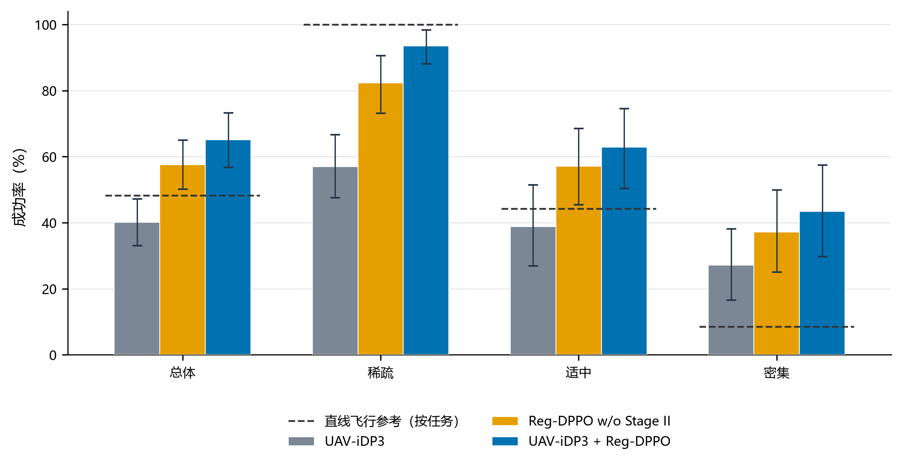
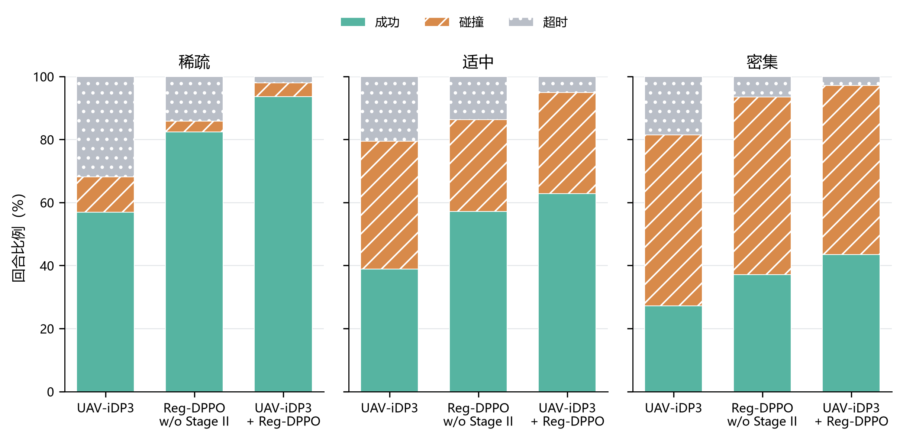
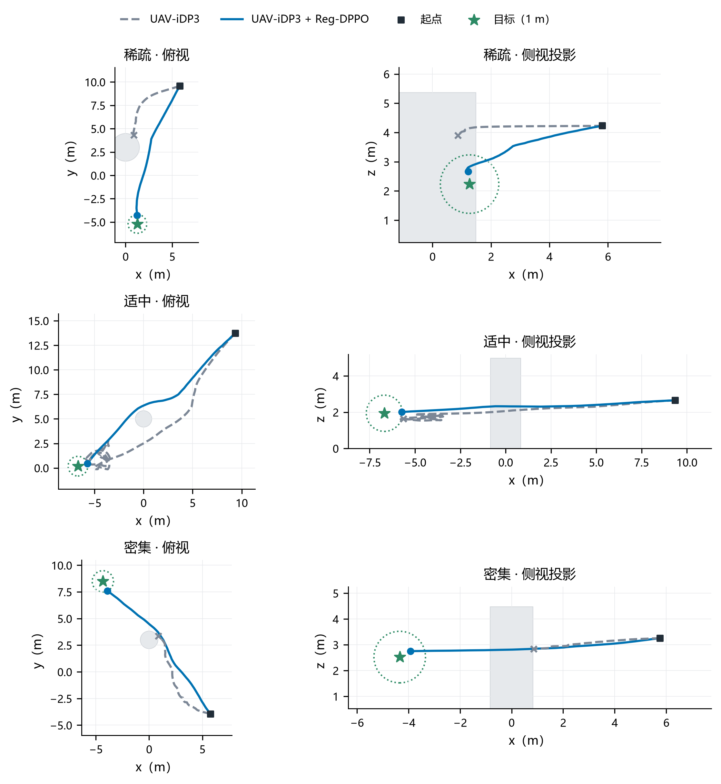

# 面向无人机端到端自主避障的UAV-iDP3扩散策略及其两阶段DPPO后训练

> 工作稿说明（不进入正文）：结构依据[论文写作大纲_v5](论文写作大纲_v5.md)、[论文数据展示规划_v1_1](论文数据展示规划_v1_1.md)与研究任务书 v3.4（D10 成功以碰撞前进入目标 1 m 计；D11 展示简化；D12 命名；D13 实现细节）。题目加"端到端"（用户 11-08 定）。运动学数字来自 `研究报告/2026-11-08_论文数据表.xlsx`，Gazebo 数字来自 `研究报告/analysis_20261108/gazebo/`（`gazebo_analysis.py`）；Codex 数字台账需按本版重建。实现细节依据 `jindu/2026-11-08_论文数据索取逐项回复与交接_v1_0.md`。【待补】：路径效率（表 3、表 4，等执行轨迹包上传后按 1 m 重算）。参考文献已按首次引用顺序编号（11-08）。

## 摘要

针对仅依靠机载局部感知的无人机在未知三维障碍环境中自主避障导航的问题，提出一种点云条件扩散轨迹策略及其两阶段强化学习后训练方法。策略在iDP3的基础上针对无人机轨迹规划进行适配（UAV-iDP3），以三帧局部点云、自身状态与目标位置为条件，经条件去噪生成三维轨迹并滚动执行，无需全局地图。后训练在扩散策略策略优化（DPPO）的基础上设计两阶段算法Reg-DPPO：仅以低秩适配更新去噪网络，回报以历史最优目标距离计算进展并将未执行的规划段纳入风险评价，第二阶段加入成功轨迹行为克隆正则以约束策略更新。在42个未参与训练的世界上，按航线附近障碍的多少将199个任务分为稀疏、适中与密集三类，每种方法评价995个回合。本文方法使成功率由40.1%提高至65.1%，三类任务分别提高至93.6%、62.9%和43.4%，超时率由23.2%降至3.4%；成功轨迹行为克隆正则使第二阶段训练保持平稳，并使成功率在第一阶段的基础上继续提高。在Gazebo与PX4软件在环仿真中，本文方法的成功率由44.8%提高至53.1%，超时率由21.9%降至4.2%，稀疏任务成功率由58.3%提高至87.5%。

**关键词：** 无人机；端到端轨迹规划；扩散策略；强化学习后训练；点云

## 1 引言

随着无人机在电力巡检、灾后搜救和林区监测等领域的应用不断深入，其作业环境正从开阔空域扩展到建筑群、林地和废墟等障碍密集的复杂场景[1]。这类场景通常缺少可供预先规划的环境地图，无人机需要依靠机载传感器在飞行中感知环境，自主生成避开障碍的飞行轨迹并安全到达目标。深度相机体积小、功耗低，是小型无人机常用的感知手段，但其视场和探测距离有限，每一时刻只能获得前方局部区域的点云，无人机往往需要在障碍全貌尚不可见时决定绕行方向，这使局部感知条件下的三维自主避障导航成为一个困难问题[2,3]。

围绕这一问题，现有研究主要形成了基于搜索与优化的规划方法和基于学习的方法两类技术路线。前者依据环境地图或在线构建的局部地图求解无碰撞轨迹，轨迹质量高、过程可解释，但依赖地图构建与人工设计的代价函数，在凹形或密集障碍中容易陷入局部极小[4,5,6]。后者以模仿学习为主，从专家示范中直接学习观测到轨迹的映射，无需显式建图即可实现端到端导航，但能力受示范数据覆盖范围的限制，进入示范未覆盖的状态后误差会不断累积[2,7,8]。扩散策略以条件去噪过程生成动作序列，能够表示绕行方向不唯一时的多模态轨迹分布，并已扩展到点云条件的三维策略学习和无人机轨迹规划[3,9,10,11,12]，但其训练仍以示范学习为主，避障能力同样受示范数据约束。

以强化学习对示范学习得到的扩散策略进行后训练，可以通过环境交互突破示范数据的限制，这一思路已在连续控制、地面导航和无人机路径规划中取得进展[13,14,15,16]。然而，现有研究主要面向地面导航或以低维障碍特征为输入的规划，尚未处理以三维点云为条件、滚动执行的无人机轨迹扩散策略。对这类策略进行后训练面临四个尚未解决的问题：扩散策略经多步去噪生成动作，难以直接计算动作似然；对完整网络进行强化学习更新代价高，并会破坏示范学习获得的感知与轨迹生成能力；导航回报稀疏，而绕行障碍常需暂时远离目标；长时间后训练在获得新成功的同时，会丢失策略原本已掌握的成功行为[17]。

本文的研究目的是在不新增示范数据、不依赖全局地图的条件下，提高无人机在三维障碍环境中的安全到达能力。为此，本文在iDP3[11]的基础上针对无人机轨迹规划进行适配，记为UAV-iDP3：策略以局部点云、自身状态和目标位置为条件生成三维轨迹并滚动执行；在DPPO[13]的基础上设计两阶段后训练算法Reg-DPPO：仅以低秩适配（LoRA）[18]更新去噪网络，以历史最优目标距离计算进展并将未执行的规划段纳入风险评价，并在第二阶段加入成功轨迹行为克隆正则。研究思路是先以示范学习获得基础避障能力，再以第一阶段后训练突破示范限制，最后以行为克隆正则约束第二阶段的更新，并在按障碍密集程度分类的训练外世界上系统评价。本文的主要贡献如下：

1. 构建了仅依赖机载点云、自身状态与目标位置的扩散轨迹规划策略UAV-iDP3，结合几何辅助学习与滚动时域执行，实现了无全局地图条件下的端到端三维避障导航。
2. 提出了两阶段后训练算法Reg-DPPO，设计了以历史最优目标距离计算进展、并将未执行规划段纳入风险评价的任务回报，使策略在不新增示范的条件下突破示范数据的限制；在第二阶段引入成功轨迹行为克隆正则，以已有的成功执行片段约束策略更新。
3. 在42个训练外世界上验证了该方法，成功率由40.1%提高至65.1%，稀疏、适中、密集三类任务均显著提高；在Gazebo与PX4软件在环仿真中，成功率由44.8%提高至53.1%，并与专家规划器EGO-Planner进行了比较。

在理论上，本文将两层决策过程的后训练框架用于以点云为条件、滚动执行的三维轨迹扩散策略，并针对延长后训练对已有飞行方式的改变，给出以策略自身固定的成功轨迹做行为克隆正则的方法；在实践上，该方法无需新增示范数据和全局地图即可提高无人机在障碍环境中的成功率，适用于传感与计算资源受限的小型无人机。

本文其余部分安排如下：第2章综述相关研究；第3章给出问题定义与方法；第4章介绍实验设置并分析结果；第5章总结全文。

## 2 相关工作

### 2.1 基于搜索与优化的无人机轨迹规划

基于搜索与优化的方法以环境地图为基础，通过图搜索、随机采样或数值优化求解无碰撞轨迹。Hart等[4]提出的A*算法以启发式代价引导图搜索，可求得栅格地图中的最短路径；LaValle[19]提出的快速扩展随机树（RRT）以随机采样扩展搜索树，适用于高维状态空间。Zhou等[5]提出的Fast-Planner结合动力学路径搜索与B样条优化，实现了四旋翼在未知环境中的快速飞行；Zhou等[6]提出的EGO-Planner以无碰撞引导路径构造碰撞代价，免去了欧氏有符号距离场的构建，降低了计算开销；Zhou等[20]进一步以时空联合优化同步调整轨迹形状与时间分配，实现了微型无人机集群在密林中仅依靠机载传感的自主飞行；Vanneste等[21]提出的3DVFH+将八叉树地图投影为极坐标直方图选择飞行方向，可实现实时三维避障。这类方法依赖地图质量与代价设计，局部优化在凹形和密集障碍中容易停滞于局部极小。

### 2.2 基于模仿学习与扩散模型的轨迹生成

基于学习的方法直接从数据中学习观测到动作或轨迹的映射。Loquercio等[7]以特权规划器为专家训练深度图像导航策略，实现了从仿真到真实林地的零样本迁移；Marino等[2]以点云预测初始轨迹与神经碰撞约束，实现了多无人机的分布式轨迹生成；Ross等[8]指出模仿学习策略会因进入示范外状态而累积误差，并以迭代数据聚合加以缓解。扩散模型为多模态动作的表示提供了新途径：Chi等[9]提出的Diffusion Policy以条件去噪生成动作序列，在多项操控任务中优于行为克隆方法；Ze等[10,11]提出的DP3与iDP3以点云为条件，在少量示范下实现了跨场景的操控与类人机器人技能执行；Kondo等[3]提出的CGD以约束引导处理轨迹约束，提升了无人机策略对约束变化的适应能力；Wang等[12]提出的AeroDiffusion实现了四旋翼在动态环境中的实时扩散规划。这类方法摆脱了显式建图，但策略能力仍由示范数据决定。

### 2.3 基于强化学习的导航与扩散策略后训练

强化学习通过环境交互优化策略，可在示范之外获得新的行为。Kaufmann等[22]以深度强化学习训练的四旋翼竞速策略在真实赛道上战胜了人类冠军；Song等[23]的对比表明，强化学习能够直接优化任务级目标，在竞速任务中优于基于最优控制的方法；Kulkarni等[24]以深度碰撞编码将深度图像压缩为低维隐变量，再以强化学习训练无碰撞飞行策略，实现了狭窄环境中的避障飞行。在扩散模型与强化学习的结合上，Wang等[25]在离线强化学习中以扩散模型表示策略，以动作价值引导扩散训练；Black等[26]将去噪过程视为多步决策问题，以策略梯度直接优化扩散模型的下游目标；Ren等[13]提出的DPPO将环境决策与去噪过程构成两层马尔可夫决策过程，使策略梯度方法能够直接优化扩散策略；Sheng等[14]冻结视觉编码器、以组相对策略优化后训练扩散导航策略，提高了未见场景中的导航成功率；Yang等[15]提出的X-NavDP以组内Q分数重加权训练导航扩散策略，实现了跨具身导航；Liu等[16]提出的GRPO-MDP结合扩散动作生成、组相对策略优化与控制屏障函数安全过滤，提升了无人机在动态环境中的路径规划成功率。在后训练的能力保持方面，Rajeswaran等[27]在策略梯度目标中加入示范行为克隆项以加速学习，Gao等[28]将行为正则扩展到离线强化学习中的扩散策略，以沿去噪链累积的KL散度约束策略接近数据中的行为策略，Wolczyk等[17]指出强化学习微调会丢失预训练能力，并表明知识保持方法可以缓解这一问题。这些研究尚未面向以三维点云为条件、滚动执行的无人机轨迹扩散策略；BDPO[28]面向离线数据，约束对象是数据中的整体行为分布，而在线后训练中需要保持的是策略已获得的成功行为，以策略自身的成功轨迹约束扩散策略在线更新的方法仍有待研究。

### 2.4 研究评述

综上，基于搜索与优化的方法依赖地图与代价设计，在凹形和密集障碍中易陷入局部极小；基于模仿学习与扩散模型的方法摆脱了建图，但能力受示范数据限制；扩散策略的强化学习后训练能够突破示范限制，但尚未用于三维点云条件、滚动执行的无人机轨迹策略，且后训练在获得新能力的同时如何保留已有成功行为仍缺少面向扩散策略在线后训练的方法。因此，有必要研究面向此类策略、兼顾能力提升与已有能力保持的后训练方法。

## 3 问题定义与方法

### 3.1 问题定义

本文研究静态三维障碍环境中的单无人机目标导航问题。无人机从起点飞往目标点$$g$$，飞行中只依据机载深度相机获得的局部点云和自身状态进行决策，不获取全局障碍地图。飞行中未发生碰撞且进入目标1m范围即为成功；训练时到达奖励在进入目标0.5m范围时给出（表2）。

该问题建模为部分可观测马尔可夫决策过程（POMDP）$$\mathcal M=(\mathcal X,\mathcal A,\mathcal P,\mathcal O,\Omega,r,\gamma)$$，策略只接收局部观测，全局障碍几何仅用于计算奖励和判定终止。单帧观测$$o_\tau=(P_\tau,s_\tau)$$由机体坐标系下的局部点云$$P_\tau$$（4096个点）和9维状态向量组成：

$$
s_\tau=\big[p_\tau^{o},\;g_\tau^{b},\;\|g-p_\tau\|_2,\;\sin\psi_\tau,\;\cos\psi_\tau\big]\in\mathbb R^9, \tag{1}
$$

其中$$p_\tau^{o}$$为无人机在参考坐标系中的位置，$$g_\tau^{b}$$为机体坐标系下的目标相对向量，$$\psi_\tau$$为偏航角。策略以最近三帧观测为输入，以描述近期运动变化。

策略每次决策生成16步轨迹序列$$Z_t\in\mathbb R^{16\times11}$$，每步为11维轨迹表示（位置增量、速度参考、加速度参考、偏航增量和偏航角速度参考），对应0.3s的执行段。沿用扩散策略的滚动时域执行[9]，无人机执行其中4步后重新规划，称为执行前缀；执行前缀与其后4步合称规划窗口，后4步不执行，只用于评价当前规划的风险（3.4节）。序列与执行的对应关系见图4(a)。回合在成功、碰撞、触地或决策次数达到60次（72s）时终止。

### 3.2 方法总体框架

本文在iDP3[11]的基础上针对无人机轨迹规划进行适配，记为UAV-iDP3（3.3节）；在DPPO[13]的基础上设计两阶段后训练算法，记为Reg-DPPO（3.4—3.5节）。本文方法即以Reg-DPPO后训练的UAV-iDP3，由导航闭环和三个训练阶段组成，整体框架如图1所示。导航时，点云编码器与状态编码器分别提取三帧观测的几何特征与状态特征并拼接为条件向量，条件扩散模型从高斯噪声出发经去噪生成轨迹序列；无人机执行完执行前缀后获取新观测并再次生成轨迹，形成滚动时域闭环。训练依次包括三个阶段：示范预训练以行为克隆损失与几何辅助损失训练完整策略；第一阶段后训练冻结编码器与原始网络参数，采用DPPO更新去噪网络中的低秩适配参数；第二阶段后训练从第一阶段策略继续训练，并在DPPO目标中加入成功轨迹行为克隆正则。价值网络只在后训练中使用，导航时只调用策略网络。后训练流程见算法1。


**图1　方法总体框架。** 上部为导航闭环：局部点云与状态经冻结编码器形成条件，条件一维U-Net由噪声去噪生成轨迹，执行完执行前缀后更新观测并重新规划。下部为训练：示范预训练优化完整策略；两阶段后训练依据奖励与价值估计计算优势，仅更新LoRA参数，第二阶段加入成功轨迹行为克隆正则。

**算法1　Reg-DPPO后训练**

```text
输入：预训练策略θ₀，价值网络φ，两阶段轮数J₁、J₂，成功轨迹库𝒟_ref，正则系数λ
1: 在去噪网络中加入零初始化的LoRA参数θ_L，冻结θ₀与编码器
2: for j = 1, …, J₁ + J₂ do
3:     滚动执行策略，采集决策转移，记录各去噪步的样本与对数概率
4:     按式(5)—(6)计算奖励，按式(8)计算价值与优势
5:     for 每个小批量 do
6:         按式(9)—(10)计算策略损失，并计算价值损失
7:         if j > J₁ then 按式(11)计算行为克隆正则损失，以λ加权加入策略损失
8:         更新θ_L与φ
9:     end for
10: end for
输出：后训练策略θ₀ + θ_L
```

### 3.3 UAV-iDP3点云条件扩散轨迹策略

**选用依据与网络结构。** 面对前方障碍，从左侧、右侧或上方绕行往往都可行，专家示范中也包含不同的绕行方式。以单模态分布拟合这类示范会把不同方向平均，生成朝向障碍的轨迹。扩散模型通过条件去噪表示动作序列分布，能在同一观测下采样出不同的绕行方案[9]；点云直接保留障碍的三维几何与高度信息，便于判断侧向与上方的可通行空间。因此，本文在iDP3[11]的点云条件扩散策略基础上，将输出改为无人机的16步轨迹序列，并在预训练中加入几何辅助学习，构成UAV-iDP3。网络结构如图2所示：PointNet类编码器[29]将每帧点云编码为128维几何特征，多层感知机将状态向量编码为64维特征，三帧特征按时间顺序拼接为576维条件向量$$c_t$$；去噪网络为条件一维U-Net，以轨迹时序为卷积维度，扩散时间步嵌入与$$c_t$$拼接后通过特征线性调制（FiLM）[30]调制各残差块，使障碍几何、目标状态与噪声水平共同影响轨迹生成。


**图2　点云条件扩散策略网络结构。** 三帧点云与状态分别经PointNet编码器和状态MLP提取特征，拼接为576维条件向量，经FiLM调制条件一维U-Net（通道256、512、1024），输出16×11的轨迹序列。橙色虚线为后训练加入LoRA的层。

**扩散训练与采样。** 设$$\bar Z^0$$为归一化的示范轨迹，训练时按去噪扩散概率模型[31]的前向过程，在噪声时间步$k$按下式加噪：

$$
\bar Z^k=\sqrt{\bar\alpha_k}\,\bar Z^0+\sqrt{1-\bar\alpha_k}\,\epsilon,\qquad \epsilon\sim\mathcal N(0,I), \tag{2}
$$

其中$$\bar\alpha_k$$为累积噪声系数。网络$$f_\theta(\bar Z^k,k,c_t)$$直接预测无噪声样本，行为克隆损失为

$$
\mathcal L_{\mathrm{BC}}=\mathbb E\big[\|f_\theta(\bar Z^k,k,c_t)-\bar Z^0\|_2^2\big]. \tag{3}
$$

训练采用50个扩散步，推理采用去噪扩散隐式模型（DDIM）[32]以10步去噪。后训练需要每个去噪转移的似然，为此将网络的样本预测换算为等价的噪声预测（补充材料S1.6）。

**几何辅助学习。** 行为克隆损失只度量预测轨迹与示范轨迹的差异，不反映轨迹与障碍的距离关系。为使策略在预训练阶段即倾向于远离障碍，本文对预测轨迹点靠近局部点云的程度施加软惩罚：以KS（Kreisselmeier–Steinhauser）函数计算各轨迹点到点云近邻的平滑最小距离$$\widetilde d_h$$，在其小于安全距离$$d_s$$时施加有上限的平滑惩罚$$\phi(\widetilde d_h)$$（补充材料S1.1）。预训练总损失为

$$
\mathcal L_{\rm pre}=\mathcal L_{\rm BC}+\lambda_{\rm geo}\,\mathbb E\Big[\sum_{h=0}^{15}w_h\,\phi(\widetilde d_h)\Big], \tag{4}
$$

其中权重$$w_h\propto\exp(-h/\tau_w)$$提高较早轨迹点的权重。

### 3.4 任务回报设计

后训练的目标是提高成功率，回报同时考虑任务结果、导航进展、碰撞风险与时间消耗。单个决策周期的奖励为

$$
r_t=T_t+10\,\frac{b_t-b_{t+1}}{D_0}-\rho_t-0.05-C_t, \tag{5}
$$

其中$T_t$为终止奖励，第二项为进展奖励，$\rho_t$为风险惩罚，0.05为时间惩罚，$C_t$为绕行代价，各项组成与设计依据见表1。

**表1　回报组成**

| 回报项 | 取值 | 设计依据 |
| --- | --- | --- |
| 终止奖励$T_t$ | 安全到达+100；碰撞、触地−50 | 直接对应安全到达这一任务目标 |
| 进展奖励 | $$b_{t+1}=\min\{b_t,\min_{p\in\mathcal E_t}\lVert p-g\rVert_2\}$$ | 只在刷新历史最优目标距离时给奖，绕行中暂时远离目标不受惩罚 |
| 风险惩罚$\rho_t$ | 见式（6） | 将尚未执行的规划段纳入风险评价，促使策略在接近障碍前调整轨迹 |
| 时间惩罚 | 每周期−0.05 | 鼓励尽早完成任务 |
| 绕行代价$C_t$ | $$\frac{1}{T_{\max}}\int_{\mathcal E_t}\max\Big\{0,1-\frac{D_0}{\lVert p-p_s\rVert_2+\lVert p-g\rVert_2}\Big\}dt$$ | 惩罚执行路径偏离以起点$$p_s$$和目标为焦点的椭球，限制无目的的远距离绕行 |

进展奖励以历史最优目标距离$$b_t$$为基准，$$\mathcal E_t$$为本周期实际执行的连续路径。与按每步目标距离减小量给奖相比，该设计不惩罚绕行中的暂时远离，也不会因反复接近同一位置而重复得奖；绕行后重新接近目标的价值通过后续回报与价值估计传递。

风险惩罚分别考察执行前缀与未执行规划段（图3）。对规划窗口中第$m$段（$$m=1,\ldots,8$$），记$$d_{o,m}$$为其到障碍物的最小净距，$$d_{g,m}$$为其最低点离地高度，定义

$$
q_m=\frac{w_m}{2}\big[B(d_{o,m};0.45,0.10)+B(d_{g,m};1.0,0.20)\big],
\qquad
B(d;d_w,d_c)=\Big[\operatorname{clip}\Big(\frac{d_w-d}{d_w-d_c},0,1\Big)\Big]^2, \tag{6}
$$

其中距离单位为m；第1—4段为执行前缀，$$w_m=1$$；第5—8段为未执行规划段，$$w_m=2^{-(m-4)/4}$$随距当前时刻的远近衰减。$$\rho_t$$取执行前缀最大风险与未执行规划段最大风险中的较大值，回合在本周期终止时只计执行前缀。这样，策略规划出朝障碍靠近的轨迹时，即使尚未执行到危险位置也会受到惩罚。


**图3　进展奖励与规划风险评价示意。** (a)进展奖励只在执行路径刷新历史最优目标距离时给出；(b)风险惩罚同时评价执行前缀与规划窗口中未执行的部分，后者按时间衰减。

### 3.5 Reg-DPPO两阶段后训练

**两层决策过程。** 扩散策略经多步去噪生成动作，无法像高斯策略那样直接给出动作似然。DPPO将环境决策过程与去噪过程构成两层马尔可夫决策过程[13]：外层为环境层（图4(a)），每次决策输出一条轨迹并获得环境奖励；内层为去噪层（图4(b)），每个去噪步是一次以高斯分布描述的状态转移。整条去噪链的对数似然分解为各步高斯对数似然之和，从而可用策略梯度方法更新扩散策略。本文以DDIM采样的$$K=10$$个去噪转移构成内层过程。

**低秩适配。** 为降低更新代价并保护预训练获得的感知与轨迹生成能力，后训练冻结点云编码器、状态编码器和去噪网络的原始参数，只在去噪网络的线性层和一维卷积层中引入低秩适配（LoRA）[18]：

$$
W=W_0+\frac{\alpha_L}{r_L}BA, \tag{7}
$$

其中$$W_0$$为冻结的原始权重，$$A$$、$$B$$为可训练矩阵，秩为$$r_L$$。$$B$$初始化为零，后训练从预训练策略出发，可训练参数占策略网络的1.43%。

**价值估计与优势计算。** 价值网络$$V_\phi$$与策略网络相互独立，以条件向量$$c_t$$与任务进度信息$$e_t$$（历史最优目标距离、初始目标距离、起点偏移与剩余决策次数，补充材料S1.3）为输入。优势采用广义优势估计（GAE）[33]：

$$
\delta_t=r_t+\gamma m^b_tV_\phi(c_{t+1},e_{t+1})-V_\phi(c_t,e_t),
\qquad
\widehat A_t=\delta_t+\gamma\lambda_{\rm GAE}m^c_t\widehat A_{t+1}, \tag{8}
$$

其中$$m^b_t$$与$$m^c_t$$分别表示是否以下一状态价值自举和是否继续优势递推，在到达、碰撞、触地和期限截断处均为0；采集批次在回合中途结束时只停止递推，仍以下一状态价值自举（补充材料S1.3）。价值网络以采集时的价值与优势之和为回归目标。

**策略优化目标。** 优势在批内标准化后按去噪步序号$j$施加去噪折扣，得到$$\widetilde A_{t,j}=\gamma_d^{K-j-1}\operatorname{Norm}(\widehat A_t)$$，使接近最终输出的去噪步获得更大的更新权重。新旧策略的概率比在规划窗口上计算（图4(c)）：

$$
R_{t,j}=\exp\big(L_{\theta,t,j}-L_{{\rm old},t,j}\big),\qquad
L_{\theta,t,j}=\frac{1}{8\cdot11}\sum_{h\in\mathcal W}\sum_{d=1}^{11}\ell_{\theta,t,j,h,d}, \tag{9}
$$

其中$$\mathcal W$$为规划窗口的8步，$$\ell_{\theta,t,j,h,d}$$为逐元素对数概率，取平均前截断至$$[-5,2]$$以避免个别元素主导概率比。以规划窗口而非仅以执行前缀计算概率比，使风险惩罚所评价的未执行规划段同样受到策略更新的约束。策略损失采用近端策略优化（PPO）[34]的截断形式：

$$
\mathcal L_{\pi}=-\mathbb E_{t,j}\Big[\min\big(R_{t,j}\widetilde A_{t,j},\ \operatorname{clip}(R_{t,j},1-\varepsilon_j,1+\varepsilon_j)\widetilde A_{t,j}\big)\Big], \tag{10}
$$

其中截断宽度$$\varepsilon_j$$随去噪步递增[13]（补充材料S1.4）。

**成功轨迹行为克隆正则。** 强化学习更新以当前回报为导向，策略在获得新成功的同时，会改变原本已能完成任务的状态下的行为[17]。在策略梯度中加入行为克隆损失作为正则项是约束这种改变的常用做法[27]；自模仿学习则以智能体自身过去的成功经验作为模仿对象[35]。本文结合两者，在第二阶段后训练中加入成功轨迹行为克隆正则：模仿对象是策略自身过去的成功轨迹，而非专家示范，且在训练开始前固定，不随训练更新。成功轨迹库$$\mathcal D_{\rm ref}$$由预训练策略与第一阶段策略在训练任务上的成功回合构成，每个样本包含决策时刻的观测与该次决策实际执行的轨迹前缀$$Z^{\rm ref}$$（构建方式见补充材料S1.5）。正则损失即在成功轨迹上的行为克隆损失：

$$
\mathcal L_{\rm reg}=\mathbb E_{(o,Z^{\rm ref})\sim\mathcal D_{\rm ref},\,k}\Big[\frac{1}{16}\sum_{h=1}^{16}\sum_{d=1}^{11}\omega_{h,d}\big(f_\theta(\bar Z^k,k,c)_{h,d}-\bar Z^{\rm ref}_{h,d}\big)^2\Big], \tag{11}
$$

其中$$\bar Z^k$$由成功轨迹的执行前缀按式（2）加噪得到，$$k$$在DDIM的去噪时刻中均匀抽取；权重$$\omega_{h,d}$$只在实际执行的执行前缀的位置与偏航通道上非零。第二阶段的策略损失为$$\mathcal L_\pi+\lambda\mathcal L_{\rm reg}$$，正则系数$$\lambda=0.0106$$在第二阶段开始时一次性标定（补充材料S1.5），训练中不再调整。该正则只约束成功轨迹库覆盖的状态与实际执行的部分，其余状态仍由回报自由优化；成功轨迹库同时纳入两类策略各自独有的成功，使第二阶段既保留示范学习获得的行为，也保留第一阶段新获得的行为。


**图4　两层决策过程与信用分配。** (a)环境层：16步生成序列中，第1—2步与历史观测对齐，第3—6步为执行前缀，第3—10步为规划窗口；执行前缀每个0.3s执行段后更新观测，执行4段后重新决策；(b)去噪层：每次决策内的10步去噪链，各去噪步为一次高斯转移；(c)信用分配：各回报项求和后经价值估计得到优势，优势经批内标准化与去噪折扣后，与逐去噪步的概率比一起进入截断PPO损失；第二阶段另加成功轨迹行为克隆正则。

### 3.6 实现细节

**示范数据。** 预训练采用EGO-Planner[6]在仿真环境中生成的专家示范，共988个成功回合、60151帧，每帧包含局部点云、状态、轨迹动作与目标位置，按9:1划分训练集与验证集。训练时对点云施加随机下采样、坐标抖动与深度噪声，并对点云、状态与动作同时施加偏航旋转增强。

**仿真平台。** 训练与第4章的主要评价在运动学闭环仿真环境中进行，场景取自Gazebo世界文件，障碍包括箱体与圆柱体。环境按策略输出的参考位置与偏航推进无人机，依据障碍几何、无人机位姿与深度相机配置合成机体坐标系下的局部点云，并检测碰撞、触地与到达。深度相机分辨率为320×240，水平视场角60°，探测距离0.05—10m，合成时加入乘性深度噪声与随机点缺失。后训练在21个训练世界中进行，并在部分回合中施加位置扰动、从回合中间状态初始化，以增加状态覆盖。高保真验证在Gazebo与PX4软件在环仿真中进行。方法基于Python与PyTorch实现，后训练在单块NVIDIA GeForce RTX 4060 Laptop GPU上以单环境串行采集进行，第二阶段128轮用时约12.6h。

**训练设置。** 预训练采用AdamW优化器，学习率$$10^{-4}$$，余弦调度，批大小60，训练301轮。第一阶段后训练从预训练策略出发训练128轮；第二阶段从第一阶段第128轮的策略、价值网络与优化器状态继续训练128轮，并加入行为克隆正则。每轮采集1024个决策转移，样本复用5遍。主要超参数见表2。

**表2　主要超参数**

| 模块 | 参数 | 取值 |
| --- | --- | --- |
| 观测与动作 | 历史帧数 / 每帧点数 / 状态维度 / 轨迹维度 | 3 / 4096 / 9 / 16×11 |
| 策略网络 | 几何特征 / 状态特征 / 条件向量维度 | 128 / 64 / 576 |
| 策略网络 | U-Net各级通道 / 卷积核 / 时间步嵌入 | 256、512、1024 / 5 / 128 |
| 扩散模型 | 训练扩散步 / DDIM采样步 | 50 / 10 |
| 预训练 | 几何辅助损失权重$\lambda_{\rm geo}$ | 0.5 |
| 执行 | 执行段时长 / 规划窗口 / 执行前缀 / 最大决策次数 | 0.3s / 8段 / 4段 / 60 |
| 执行 | 训练到达奖励半径 / 碰撞体半径 | 0.5m / 0.1m |
| LoRA | 秩$r_L$ / 缩放$\alpha_L$ | 8 / 8 |
| 价值网络 | 隐藏层 / 激活 | 256、256 / SiLU |
| 优化 | 策略学习率 / 价值学习率 | $2\times10^{-5}$线性衰减至$10^{-5}$ / $10^{-3}$ |
| 优化 | 折扣$\gamma$ / GAE $\lambda_{\rm GAE}$ / 去噪折扣$\gamma_d$ | 0.99 / 0.95 / 0.8 |
| 优化 | PPO截断宽度$\varepsilon_0$ / $\varepsilon_{\max}$ | $10^{-3}$ / 0.1 |
| 优化 | 每轮决策转移数 / 样本复用遍数 / 每轮参数更新次数 | 1024 / 5 / 20 |
| 训练 | 第一阶段 / 第二阶段轮数 | 128 / 128 |
| 行为克隆正则 | 成功轨迹库任务数 / 样本数 / 每次抽样数 | 47 / 549 / 32 |
| 行为克隆正则 | 正则系数$\lambda$ / 标定目标梯度比 | 0.0106 / 0.1 |
| 后训练 | 采集环境数 / 总决策转移数 | 1 / 262144 |
| 评价 | 采样 / 去噪截断 / 成功范围 | 确定性 / ±2.0 / 目标1m |

## 4 实验与结果分析

### 4.1 实验设置

**评价环境。** 实验在3.6节所述的运动学闭环仿真环境中进行。后训练使用21个训练世界，方法开发使用另外20个验证世界，最终评价使用42个未参与训练与开发的世界，共199个固定起终点任务。障碍分布在20m×20m的区域内，每个世界含1—40个障碍（中位数8）；起终点直线距离为3.1—33.2m（中位数16.2m），目标高度为1.5—4.5m。每个任务评价5次，每种方法共995个回合。所有方法共享场景、起终点、初始偏航与初始观测；评价时关闭训练中的扰动，采用确定性采样（表2）。

**任务分类。** 按航线附近障碍的多少将任务分为稀疏、适中和密集三类，以起终点连线两侧1m范围内障碍占据的体积比例为准，界限取训练世界任务的中位数，在评价之前固定。三类任务分别为59、70和70个；沿起终点直线飞行时，三类任务的成功比例依次为100%、44.3%和8.6%。

**对比方法。** 以示范预训练得到的UAV-iDP3为基础策略，与本文方法（UAV-iDP3+Reg-DPPO）比较。消融实验包括：Reg-DPPO w/o Stage II，只进行第一阶段128轮后训练；Reg-DPPO w/o BC reg.，从第一阶段策略继续训练128轮但不加行为克隆正则；Single-stage DPPO，不分阶段、不加正则，连续训练256轮。后两者与本文方法的训练预算相同，Reg-DPPO w/o BC reg.与本文方法还共享父策略与随机种子，只差行为克隆正则一项。与EGO-Planner[6]等规划器的比较在Gazebo仿真中进行（4.3节）。

**评价指标。** 飞行中未发生碰撞且进入目标1m范围即为成功，在期限内既未碰撞也未成功为超时。采用成功率、碰撞率、超时率与路径效率四项指标，路径效率为起终点直线距离与成功回合路径长度之比，路径长度计至进入目标1m范围的位置并加上该点到目标的距离，在成功回合上取中位数。以进入目标0.5m范围为成功的结果见补充材料S2。

### 4.2 结果与分析

**总体性能。** 表3与图5给出训练外世界上的结果。本文方法的成功率为65.1%，UAV-iDP3为40.1%，同一任务同一次重复配对的差值为25.0个百分点（按世界聚类自助法的95%区间为18.4—31.6）。三类任务的成功率均提高，稀疏、适中、密集类分别由56.9%、38.9%、27.1%提高至93.6%、62.9%、43.4%。总体碰撞率没有增加（36.7%对31.5%），超时率由23.2%降至3.4%。

**表3　训练外世界上的性能比较**

| 难度 | 方法 | 成功率(%) | 碰撞率(%) | 超时率(%) | 路径效率 |
| --- | --- | ---: | ---: | ---: | ---: |
| 总体 | UAV-iDP3 | 40.1 | 36.7 | 23.2 | 【待算】 |
| | Reg-DPPO w/o Stage II | 57.6 | 31.1 | 11.4 | |
| | 本文方法 | **65.1** | 31.5 | 3.4 | |
| 稀疏 | UAV-iDP3 | 56.9 | 11.2 | 31.9 | |
| | Reg-DPPO w/o Stage II | 82.4 | 3.4 | 14.2 | |
| | 本文方法 | **93.6** | 4.4 | 2.0 | |
| 适中 | UAV-iDP3 | 38.9 | 40.6 | 20.6 | |
| | Reg-DPPO w/o Stage II | 57.1 | 29.1 | 13.7 | |
| | 本文方法 | **62.9** | 32.0 | 5.1 | |
| 密集 | UAV-iDP3 | 27.1 | 54.3 | 18.6 | |
| | Reg-DPPO w/o Stage II | 37.1 | 56.3 | 6.6 | |
| | 本文方法 | **43.4** | 53.7 | 2.9 | |

表注：42个训练外世界、199个任务，每种方法995个回合；稀疏、适中、密集类分别为295、350、350个回合。



**图5　训练外世界各难度任务上的成功率。** 误差线为按世界聚类自助法的95%区间；虚线为沿起终点直线飞行的成功比例。

**结局分析。** 图6给出各难度任务的结局构成。后训练主要把超时转为成功：UAV-iDP3在稀疏类中有31.9%的回合超时，本文方法降至2.0%，成功率相应提高至93.6%。在适中类中，碰撞率由40.6%降至32.0%，超时率由20.6%降至5.1%。在密集类中，碰撞率与UAV-iDP3相当，剩余的失败主要是碰撞，这也是直线飞行几乎无法通过、需要明显绕行的一类任务。



**图6　训练外世界各难度任务上的结局构成。**

**两阶段训练的作用。** 图7给出后训练过程中训练采集的成功率与近似KL散度，每16轮汇总。第一阶段中，采集成功率在前48轮由23.4%升至38.7%，此后保持平稳。第128轮之后，三种继续训练方式的过程明显不同：本文方法在第二阶段保持在36.6%—43.3%，近似KL散度与第一阶段末期相当；同一策略不加行为克隆正则继续训练时，第193—208轮采集成功率降至21.1%，近似KL散度升至第一阶段末期的约30倍；不分阶段连续训练时，采集成功率由第129—144轮的43.7%逐渐降至第241—256轮的25.6%。行为克隆正则使第二阶段的更新保持平稳。


**图7　后训练过程中的训练采集成功率与近似KL散度。** 每16轮汇总；第129轮起为三种继续训练方式。训练采集包含位置扰动与随机任务，其成功率与确定性评价不可直接比较。

**消融分析。** 表4给出消融结果。第一阶段后训练使成功率由40.1%提高至57.6%，是提升的主体；加入行为克隆正则的第二阶段使成功率继续提高7.5个百分点，达到65.1%。不加正则时，继续训练没有带来提高：Reg-DPPO w/o BC reg.为48.1%，Single-stage DPPO为51.1%，均低于只进行第一阶段的结果。以不同随机种子重复训练时，第一阶段与完整方法的结果低于本节（补充材料S3）。

**表4　消融结果（训练外世界）**

| 方法 | 总体(%) | 稀疏(%) | 适中(%) | 密集(%) | 路径效率 |
| --- | ---: | ---: | ---: | ---: | ---: |
| UAV-iDP3 | 40.1 | 56.9 | 38.9 | 27.1 | 【待算】 |
| Reg-DPPO w/o Stage II | 57.6 | 82.4 | 57.1 | 37.1 | |
| Single-stage DPPO | 51.1 | 73.6 | 40.6 | 42.6 | |
| Reg-DPPO w/o BC reg. | 48.1 | 77.6 | 41.7 | 29.7 | |
| 本文方法 | **65.1** | **93.6** | **62.9** | **43.4** | |

表注：各列为成功率；回合数同表3。

**避障行为。** 图8给出三类任务中UAV-iDP3与本文方法在同一任务上的执行轨迹。UAV-iDP3在稀疏与密集任务中沿接近直线的路线飞行并撞上航线上的障碍，在适中任务中绕过障碍后在目标附近反复调整，直至期限仍未进入目标范围；本文方法在接近障碍之前即偏离航线绕行，并直接飞向目标。



**图8　稀疏、适中、密集任务中UAV-iDP3与本文方法的执行轨迹。** 左为俯视，右为侧视投影；×为UAV-iDP3回合结束位置，虚线圆为目标1m范围。

### 4.3 高保真仿真验证与规划器比较

为检验运动学环境中的结果在含飞行动力学与控制跟踪的条件下是否成立，在Gazebo与PX4软件在环仿真中比较UAV-iDP3、本文方法与EGO-Planner[6]。从训练外世界的三类任务中分层抽取48个任务（稀疏12个、适中18个、密集18个，来自31个世界），每个任务飞行2次，每种方法96个回合。两种学习策略输出的轨迹由PX4位置控制器跟踪；EGO-Planner以同一深度相机在线构建局部地图并优化轨迹，地图分辨率0.1m、障碍膨胀0.3m、最大速度0.5m/s。成功、碰撞与超时的定义同4.1节，单个回合的期限为240s。

**表5　Gazebo与PX4软件在环仿真中的性能比较**

| 难度 | 方法 | 成功率(%) | 碰撞率(%) | 超时率(%) |
| --- | --- | ---: | ---: | ---: |
| 总体 | UAV-iDP3 | 44.8 | 33.3 | 21.9 |
| | 本文方法 | 53.1 | 42.7 | 4.2 |
| | EGO-Planner | 66.7 | 15.6 | 17.7 |
| 稀疏 | UAV-iDP3 | 58.3 | 0.0 | 41.7 |
| | 本文方法 | 87.5 | 12.5 | 0.0 |
| | EGO-Planner | 100.0 | 0.0 | 0.0 |
| 适中 | UAV-iDP3 | 50.0 | 38.9 | 11.1 |
| | 本文方法 | 47.2 | 50.0 | 2.8 |
| | EGO-Planner | 72.2 | 11.1 | 16.7 |
| 密集 | UAV-iDP3 | 30.6 | 50.0 | 19.4 |
| | 本文方法 | 36.1 | 55.6 | 8.3 |
| | EGO-Planner | 38.9 | 30.6 | 30.6 |

表注：每种方法96个回合；稀疏、适中、密集类分别为24、36、36个回合。本文方法有1个回合飞出边界，计入碰撞。

表5给出结果。本文方法的成功率为53.1%，UAV-iDP3为44.8%，同一任务同一次飞行配对的差值为8.3个百分点（95%区间−2.2—18.9）。变化的方向与运动学环境一致：超时率由21.9%降至4.2%，UAV-iDP3的21个超时回合中有13个在本文方法下成功；稀疏类成功率由58.3%提高至87.5%。在适中与密集类中，两种策略的成功率相近，本文方法的碰撞率较高，原本超时的回合有一部分在Gazebo中转为碰撞。EGO-Planner依靠在线建图与轨迹优化，总体成功率为66.7%，碰撞率明显较低；在密集类中，本文方法与其成功率相当（36.1%对38.9%），超时更少。

### 4.4 讨论

实验表明，Reg-DPPO能够在不新增示范数据的条件下显著提高点云条件扩散轨迹策略的成功率，提升在三类难度的训练外世界上均成立。这与Sheng等[14]、Yang等[15]在地面扩散导航策略上的结果一致，说明以强化学习突破示范限制的思路同样适用于三维点云条件、滚动执行的无人机轨迹策略。与GRPO-MDP[16]和CGD[3]依靠控制屏障函数过滤或在线约束优化保证轨迹可行性不同，本文在执行时不设置外部安全修正，成功率的提高来自策略本身。

成功轨迹行为克隆正则与以原始示范约束策略的做法[27,17]不同，它只约束成功轨迹库覆盖的状态和实际执行的部分，保留了策略在其余状态上的改进空间。实验中，不加约束的继续训练出现采集成功率下降与更新幅度突增，评价成功率也低于只进行第一阶段的策略；加入正则后，第二阶段平稳并继续提高成功率。

本文方法的不足主要在于碰撞。运动学环境中，密集任务的成功率为43.4%，碰撞仍是主要失败形式；Gazebo中，适中与密集任务的碰撞率高于UAV-iDP3，也高于以在线地图做显式避障的EGO-Planner。这类任务通常需要较大幅度的绕行，仅凭三帧局部观测难以判断绕行方向，且运动学环境中的动作执行没有跟踪误差。更长的观测记忆或显式的局部空间表示，以及在后训练中引入跟踪误差与动力学扰动，可能有助于改善。

## 5 结论

本文针对局部感知条件下的无人机三维自主避障导航，在iDP3的基础上构建了点云条件扩散轨迹策略UAV-iDP3，并在DPPO的基础上提出了两阶段后训练算法Reg-DPPO。策略以局部点云、自身状态与目标位置为条件生成轨迹并滚动执行，无需全局地图；后训练以低秩适配更新去噪网络，以历史最优目标距离计算进展、将未执行规划段纳入风险评价，并在第二阶段以成功轨迹行为克隆正则约束策略更新。在42个训练外世界上，本文方法使成功率由40.1%提高至65.1%，稀疏、适中、密集三类任务分别达到93.6%、62.9%和43.4%，超时率由23.2%降至3.4%；行为克隆正则使第二阶段训练保持平稳，并在第一阶段的基础上继续提高成功率。在Gazebo与PX4软件在环仿真中，成功率由44.8%提高至53.1%，超时率由21.9%降至4.2%。

本文的局限在于：后训练结果对训练随机性较为敏感，以不同随机种子重复训练时提升幅度较小（补充材料S3），这也是深度强化学习中普遍存在的问题[36]；适中与密集障碍中的碰撞仍较多，在Gazebo中与专家规划器仍有差距；验证尚限于仿真。后续工作将研究降低后训练对随机性敏感程度的方法，引入更长的观测记忆与跟踪误差建模以减少碰撞，并在实机平台上开展验证。

---

### 图表与数据说明（不进入正文）

全部结果图由脚本从数据生成，配图规范见[论文配图方案_v4](图表/论文配图方案_v4_20261101.md)；数据依赖与待回传项见任务书§5。

---

## 参考文献

[1] Shakhatreh H, Sawalmeh A H, Al-Fuqaha A, et al. Unmanned Aerial Vehicles (UAVs): A Survey on Civil Applications and Key Research Challenges. IEEE Access, 2019, 7: 48572–48634. [DOI:10.1109/ACCESS.2019.2909530](https://doi.org/10.1109/ACCESS.2019.2909530).

[2] Marino A, Pacchierotti C, Robuffo Giordano P. Multi-UAVs end-to-end Distributed Trajectory Generation over Point Cloud Data. IEEE Robotics and Automation Letters, 2024, 9(9): 7629–7636. [DOI:10.1109/LRA.2024.3426374](https://doi.org/10.1109/LRA.2024.3426374).

[3] Kondo K, Tagliabue A, Cai X, et al. CGD: Constraint-Guided Diffusion Policies for UAV Trajectory Planning. 2024. [arXiv:2405.01758v1](https://arxiv.org/abs/2405.01758v1).

[4] Hart P E, Nilsson N J, Raphael B. A Formal Basis for the Heuristic Determination of Minimum Cost Paths. IEEE Transactions on Systems Science and Cybernetics, 1968, 4(2): 100–107. [论文链接](https://www.cs.auckland.ac.nz/courses/compsci709s2c/resources/Mike.d/astarNilsson.pdf).

[5] Zhou B, Gao F, Wang L, et al. Robust and Efficient Quadrotor Trajectory Generation for Fast Autonomous Flight. IEEE Robotics and Automation Letters, 2019, 4(4): 3529–3536. [论文链接](https://doi.org/10.1109/LRA.2019.2927938).

[6] Zhou X, Wang Z, Ye H, et al. EGO-Planner: An ESDF-Free Gradient-Based Local Planner for Quadrotors. IEEE Robotics and Automation Letters, 2021, 6(2): 478–485. [DOI:10.1109/LRA.2020.3047728](https://doi.org/10.1109/LRA.2020.3047728).

[7] Loquercio A, Kaufmann E, Ranftl R, et al. Learning High-Speed Flight in the Wild. Science Robotics, 2021, 6(59): eabg5810. [论文链接](https://doi.org/10.1126/scirobotics.abg5810).

[8] Ross S, Gordon G, Bagnell D. A Reduction of Imitation Learning and Structured Prediction to No-Regret Online Learning. Proceedings of the Fourteenth International Conference on Artificial Intelligence and Statistics, PMLR, 2011, 15: 627–635. [论文链接](https://proceedings.mlr.press/v15/ross11a.html).

[9] Chi C, Xu Z, Feng S, et al. Diffusion Policy: Visuomotor Policy Learning via Action Diffusion. The International Journal of Robotics Research, 2024. [作者扩展版arXiv:2303.04137v5](https://arxiv.org/abs/2303.04137v5).

[10] Ze Y, Zhang G, Zhang K, et al. 3D Diffusion Policy: Generalizable Visuomotor Policy Learning via Simple 3D Representations. 2024. [arXiv:2403.03954v3](https://arxiv.org/abs/2403.03954v3).

[11] Ze Y, Chen Z, Wang W, et al. Generalizable Humanoid Manipulation with 3D Diffusion Policies. 2024（所引v2更新于2025年）. [arXiv:2410.10803v2](https://arxiv.org/abs/2410.10803v2).

[12] Wang H, Zhang S, Meng X, Li G. AeroDiffusion: Real-Time Quadrotor Trajectory Planning in Dynamic Environments via Conditional Diffusion. IEEE Robotics and Automation Letters, 2026, 11(10): 11936–11943. [DOI:10.1109/LRA.2026.3728285](https://doi.org/10.1109/LRA.2026.3728285).

[13] Ren A Z, Lidard J, Ankile L L, et al. Diffusion Policy Policy Optimization. 2024. [arXiv:2409.00588v3](https://arxiv.org/abs/2409.00588v3).

[14] Sheng J, Bai R, Xu K, et al. Beyond Imitation: Reinforcement Learning Fine-Tuning for Adaptive Diffusion Navigation Policies. 2026. [arXiv:2603.12868v1](https://arxiv.org/abs/2603.12868v1).

[15] Yang T, Zeng Y, Cai W, et al. X-NavDP: Generalizing Navigation Diffusion Policy to Novel Behavior and Embodiments with Group Q-score Reweighted Matching. 2026. [arXiv:2607.28560v2](https://arxiv.org/abs/2607.28560v2).

[16] Liu Y, Liu S, Wang Z, et al. Enhancing UAV path planning with diffusion models and group relative policy optimization. Alexandria Engineering Journal, 2026, 140: 33–46. [DOI:10.1016/j.aej.2026.02.024](https://doi.org/10.1016/j.aej.2026.02.024).

[17] Wolczyk M, Cupiał B, Ostaszewski M, et al. Fine-tuning Reinforcement Learning Models is Secretly a Forgetting Mitigation Problem. Proceedings of the 41st International Conference on Machine Learning, PMLR 235, 2024: 53039–53078. [论文链接](https://proceedings.mlr.press/v235/wolczyk24a.html).

[18] Hu E J, Shen Y, Wallis P, et al. LoRA: Low-Rank Adaptation of Large Language Models. 2021. [arXiv:2106.09685v2](https://arxiv.org/abs/2106.09685v2).

[19] LaValle S M. Rapidly-Exploring Random Trees: A New Tool for Path Planning. Technical Report TR 98-11, Iowa State University, 1998. [论文链接](https://msl.cs.illinois.edu/~lavalle/papers/Lav98c.pdf).

[20] Zhou X, Wen X, Wang Z, et al. Swarm of Micro Flying Robots in the Wild. Science Robotics, 2022, 7(66): eabm5954. [DOI:10.1126/scirobotics.abm5954](https://doi.org/10.1126/scirobotics.abm5954).

[21] Vanneste S, Bellekens B, Weyn M. 3DVFH+: Real-Time Three-Dimensional Obstacle Avoidance Using an Octomap. Proceedings of the 1st International Workshop on Model-Driven Robot Software Engineering (MORSE), 2014. [论文链接](https://discuss.px4.io/uploads/default/original/2X/e/e64129217d296873b1f71cbb31f49702ff3994a3.pdf).

[22] Kaufmann E, Bauersfeld L, Loquercio A, et al. Champion-Level Drone Racing Using Deep Reinforcement Learning. Nature, 2023, 620: 982–987. [论文链接](https://doi.org/10.1038/s41586-023-06419-4).

[23] Song Y, Romero A, Müller M, et al. Reaching the Limit in Autonomous Racing: Optimal Control versus Reinforcement Learning. Science Robotics, 2023, 8(82): eadg1462. [DOI:10.1126/scirobotics.adg1462](https://doi.org/10.1126/scirobotics.adg1462).

[24] Kulkarni M, Alexis K. Reinforcement Learning for Collision-free Flight Exploiting Deep Collision Encoding. IEEE International Conference on Robotics and Automation (ICRA), 2024. [arXiv:2402.03947](https://arxiv.org/abs/2402.03947).

[25] Wang Z, Hunt J J, Zhou M. Diffusion Policies as an Expressive Policy Class for Offline Reinforcement Learning. International Conference on Learning Representations, 2023. [arXiv:2208.06193](https://arxiv.org/abs/2208.06193).

[26] Black K, Janner M, Du Y, et al. Training Diffusion Models with Reinforcement Learning. International Conference on Learning Representations, 2024. [arXiv:2305.13301](https://arxiv.org/abs/2305.13301).

[27] Rajeswaran A, Kumar V, Gupta A, et al. Learning Complex Dexterous Manipulation with Deep Reinforcement Learning and Demonstrations. Proceedings of Robotics: Science and Systems, 2018. [DOI:10.15607/RSS.2018.XIV.049](https://doi.org/10.15607/RSS.2018.XIV.049).

[28] Gao C, Wu C, Cao M, et al. Behavior-Regularized Diffusion Policy Optimization for Offline Reinforcement Learning. Proceedings of the 42nd International Conference on Machine Learning, 2025. [arXiv:2502.04778](https://arxiv.org/abs/2502.04778).

[29] Qi C R, Su H, Mo K, Guibas L J. PointNet: Deep Learning on Point Sets for 3D Classification and Segmentation. Proceedings of the IEEE Conference on Computer Vision and Pattern Recognition, 2017: 652–660. [论文链接](https://openaccess.thecvf.com/content_cvpr_2017/html/Qi_PointNet_Deep_Learning_CVPR_2017_paper.html).

[30] Perez E, Strub F, de Vries H, et al. FiLM: Visual Reasoning with a General Conditioning Layer. Proceedings of the AAAI Conference on Artificial Intelligence, 2018, 32(1). [DOI:10.1609/aaai.v32i1.11671](https://doi.org/10.1609/aaai.v32i1.11671).

[31] Ho J, Jain A, Abbeel P. Denoising Diffusion Probabilistic Models. Advances in Neural Information Processing Systems, 2020, 33: 6840–6851. [论文链接](https://proceedings.neurips.cc/paper/2020/hash/4c5bcfec8584af0d967f1ab10179ca4b-Abstract.html).

[32] Song J, Meng C, Ermon S. Denoising Diffusion Implicit Models. 2020（所引v4更新于2022年）. [arXiv:2010.02502v4](https://arxiv.org/abs/2010.02502v4).

[33] Schulman J, Moritz P, Levine S, et al. High-Dimensional Continuous Control Using Generalized Advantage Estimation. 2015（所引v6更新于2018年）. [arXiv:1506.02438v6](https://arxiv.org/abs/1506.02438v6).

[34] Schulman J, Wolski F, Dhariwal P, et al. Proximal Policy Optimization Algorithms. 2017. [arXiv:1707.06347](https://arxiv.org/abs/1707.06347).

[35] Oh J, Guo Y, Singh S, Lee H. Self-Imitation Learning. Proceedings of the 35th International Conference on Machine Learning, PMLR, 2018, 80: 3878–3887. [论文链接](https://proceedings.mlr.press/v80/oh18b.html).

[36] Henderson P, Islam R, Bachman P, et al. Deep Reinforcement Learning That Matters. Proceedings of the AAAI Conference on Artificial Intelligence, 2018, 32(1): 3207–3214. [DOI:10.1609/aaai.v32i1.11694](https://doi.org/10.1609/aaai.v32i1.11694).
