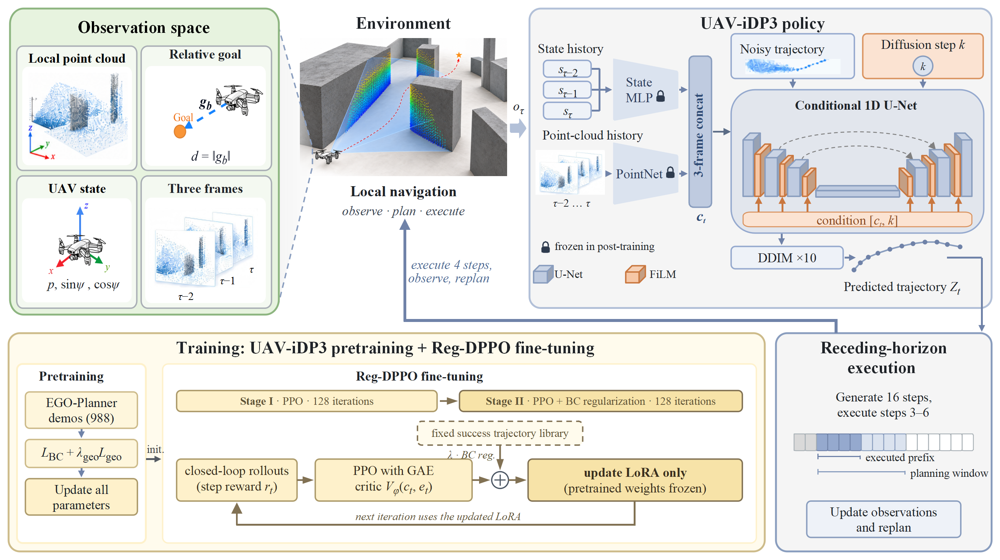
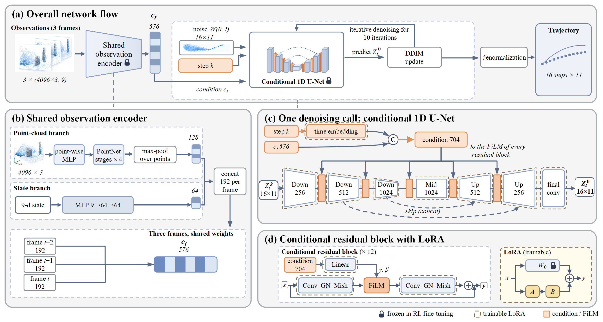
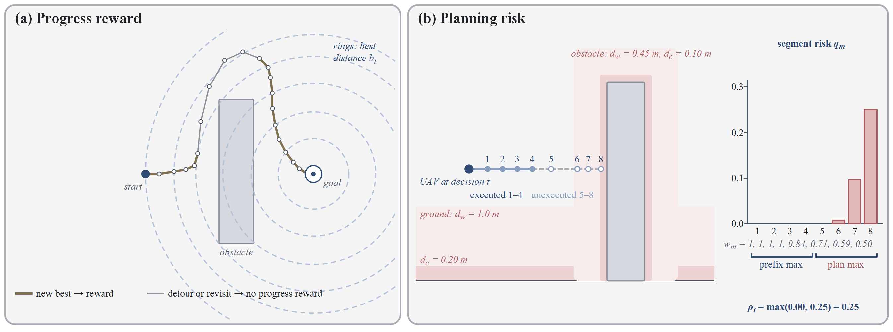
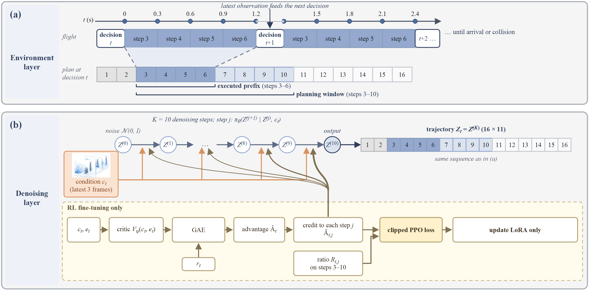
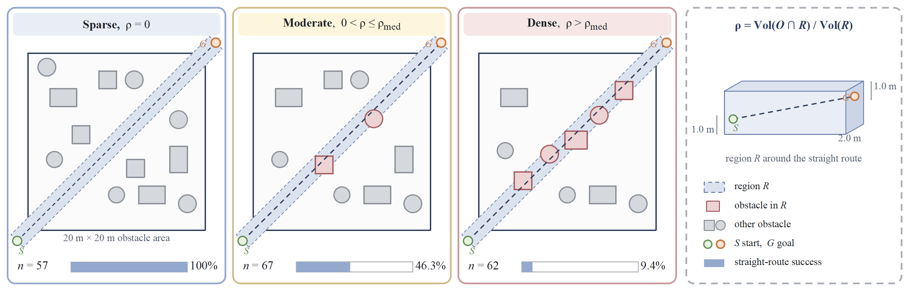
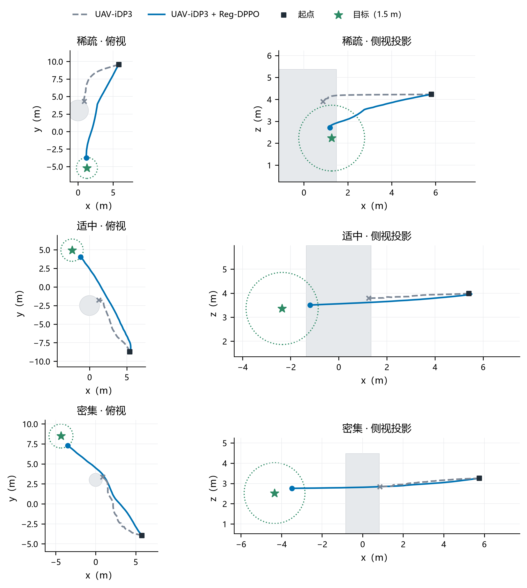
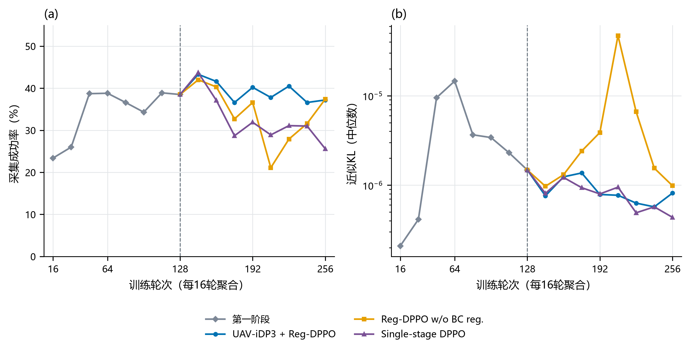

# 面向无人机端到端自主避障的UAV-iDP3扩散策略及其强化学习后训练

> 工作稿说明（不进入正文）：依据研究任务书 v3.10（成功以碰撞前进入目标 1.5 m 计；按任务统计；方法章只用二级标题；正文不引用补充材料）。图号按方法图审视 §10（11-10）：图1—4 方法图、图5 任务难度分类、图6 典型轨迹、图7 后训练过程；图片路径 `图表/定稿/` 为占位，定稿文件由制图对话从 `图表/pptx_figs/` 导出。3.1 节未按审视 §10.3 第 6 条引图4(a)，避免图号先于图1 出现。数字来自 `研究报告/2026-11-08_论文数据表.xlsx`；数字台账、图6 重出与中文稿核对交 Codex。

## 摘要

针对仅依靠机载局部感知的无人机在未知三维障碍环境中自主避障导航的问题，提出一种点云条件扩散轨迹策略及其强化学习后训练方法。策略在iDP3的基础上针对无人机轨迹规划进行适配（UAV-iDP3），以三帧局部点云、自身状态与目标位置为条件，经条件去噪生成三维轨迹并滚动执行，无需全局地图。为突破模仿学习的能力限制，同时不破坏策略已学会的行为，在扩散策略策略优化（DPPO）的基础上提出后训练算法Reg-DPPO：以面向安全到达的任务回报优化去噪网络中的低秩适配参数，并以策略自身的成功轨迹作为行为克隆正则约束更新。在41个未参与训练的世界、190个按障碍密集程度分为三类的任务上，本文方法使任务成功率由47.4%提高至72.1%，三类任务均有提高，超时率由19.5%降至0.5%；对UAV-iDP3已能完成的任务，本文方法保持了91.1%，不加正则时为81.1%。在Gazebo与PX4软件在环仿真中，本文方法的任务成功率由62.5%提高至67.5%。

**关键词：** 无人机；端到端轨迹规划；扩散策略；强化学习后训练；点云

## 1 引言

随着无人机在电力巡检、灾后搜救和林区监测等领域的应用不断深入，其作业环境正从开阔空域扩展到建筑群、林地和废墟等障碍密集的复杂场景[1]。这类场景通常缺少可供预先规划的环境地图，无人机需要依靠机载传感器在飞行中感知环境，自主生成避开障碍的飞行轨迹并安全到达目标。深度相机体积小、功耗低，是小型无人机常用的感知手段，但其视场和探测距离有限，每一时刻只能获得前方局部区域的点云，无人机往往需要在障碍全貌尚不可见时决定绕行方向，这使局部感知条件下的三维自主避障导航成为一个困难问题[2,3]。

围绕这一问题，现有研究主要形成了基于搜索与优化的规划方法和基于学习的方法两类技术路线。前者依据环境地图或在线构建的局部地图求解无碰撞轨迹，轨迹质量高、过程可解释，但依赖地图构建与人工设计的代价函数，在凹形或密集障碍中容易陷入局部极小[4,5,6]。后者以模仿学习为主，从专家示范中直接学习观测到轨迹的映射，无需显式建图即可实现端到端导航，但能力受示范数据覆盖范围的限制，进入示范未覆盖的状态后误差会不断累积[2,7,8]。扩散策略以条件去噪过程生成动作序列，能够表示绕行方向不唯一时的多模态轨迹分布，并已扩展到点云条件的三维策略学习和无人机轨迹规划[3,9,10,11,12]，但其训练仍以示范学习为主，避障能力同样受示范数据约束。

以强化学习对示范学习得到的扩散策略进行后训练，可以通过环境交互突破示范数据的限制，这一思路已在连续控制、地面导航和无人机路径规划中取得进展[13,14,15,16]。然而，现有研究主要面向地面导航或以低维障碍特征为输入的规划，尚未处理以三维点云为条件、滚动执行的无人机轨迹扩散策略。对这类策略进行后训练需要解决两个问题。第一，如何有效地以强化学习优化扩散策略：扩散策略经多步去噪生成动作，难以直接计算动作似然；导航回报稀疏，而绕行障碍又常需暂时远离目标。第二，如何在获得新能力的同时不破坏已学会的行为：对完整网络进行更新代价高，且强化学习在获得新成功的同时，会改变策略原本已能完成任务时的行为[17]。

针对上述问题，本文在不新增示范数据、不依赖全局地图的条件下，提出点云条件扩散轨迹策略UAV-iDP3及其后训练算法Reg-DPPO。UAV-iDP3在iDP3[11]的基础上针对无人机轨迹规划进行适配，以局部点云、自身状态和目标位置为条件生成三维轨迹并滚动执行。Reg-DPPO在DPPO[13]的两层决策过程基础上，以低秩适配（LoRA）[18]更新去噪网络，以历史最优目标距离计算进展并将未执行的规划段纳入风险评价，用于解决第一个问题；以策略自身固定的成功轨迹作为行为克隆正则约束更新，用于解决第二个问题。本文的主要贡献如下：

1. 构建了仅依赖机载点云、自身状态与目标位置的扩散轨迹策略UAV-iDP3，结合几何辅助学习与滚动时域执行，实现了无全局地图条件下的端到端三维避障导航。
2. 提出了后训练算法Reg-DPPO，设计了容许绕行并评价规划风险的任务回报，使策略在不新增示范的条件下突破示范数据的限制；提出以策略自身成功轨迹为对象的行为克隆正则，使后训练在获得新成功的同时保持已学会的行为。
3. 在41个训练外世界和Gazebo与PX4软件在环仿真中验证了该方法：任务成功率由47.4%提高至72.1%，UAV-iDP3已能完成的任务中91.1%得到保持；在软件在环仿真中，任务成功率由62.5%提高至67.5%，并与专家规划器EGO-Planner进行了比较。

本文其余部分安排如下：第2章综述相关研究；第3章给出问题定义，介绍UAV-iDP3与Reg-DPPO；第4章在运动学仿真与软件在环仿真中检验后训练对避障能力的提升和对已学会行为的保持；第5章总结全文。

## 2 相关工作

### 2.1 基于搜索与优化的无人机轨迹规划

基于搜索与优化的方法以环境地图为基础，通过图搜索、随机采样或数值优化求解无碰撞轨迹。Hart等[4]提出的A*算法以启发式代价引导图搜索，可求得栅格地图中的最短路径；LaValle[19]提出的快速扩展随机树（RRT）以随机采样扩展搜索树，适用于高维状态空间。Zhou等[5]提出的Fast-Planner结合动力学路径搜索与B样条优化，实现了四旋翼在未知环境中的快速飞行；Zhou等[6]提出的EGO-Planner以无碰撞引导路径构造碰撞代价，免去了欧氏有符号距离场的构建，降低了计算开销；Zhou等[20]进一步以时空联合优化同步调整轨迹形状与时间分配，实现了微型无人机集群在密林中仅依靠机载传感的自主飞行；Vanneste等[21]提出的3DVFH+将八叉树地图投影为极坐标直方图选择飞行方向，可实现实时三维避障。这类方法依赖地图质量与代价设计，局部优化在凹形和密集障碍中容易停滞于局部极小。

### 2.2 基于模仿学习与扩散模型的轨迹生成

基于学习的方法直接从数据中学习观测到动作或轨迹的映射。Loquercio等[7]以特权规划器为专家训练深度图像导航策略，实现了从仿真到真实林地的零样本迁移；Marino等[2]以点云预测初始轨迹与神经碰撞约束，实现了多无人机的分布式轨迹生成；Ross等[8]指出模仿学习策略会因进入示范外状态而累积误差，并以迭代数据聚合加以缓解。扩散模型为多模态动作的表示提供了新途径：Chi等[9]提出的Diffusion Policy以条件去噪生成动作序列，在多项操控任务中优于行为克隆方法；Ze等[10,11]提出的DP3与iDP3以点云为条件，在少量示范下实现了跨场景的操控与类人机器人技能执行；Kondo等[3]提出的CGD以约束引导处理轨迹约束，提升了无人机策略对约束变化的适应能力；Wang等[12]提出的AeroDiffusion实现了四旋翼在动态环境中的实时扩散规划。这类方法摆脱了显式建图，但策略能力仍由示范数据决定。

### 2.3 基于强化学习的导航与扩散策略后训练

强化学习通过环境交互优化策略，可在示范之外获得新的行为。Kaufmann等[22]以深度强化学习训练的四旋翼竞速策略在真实赛道上战胜了人类冠军；Song等[23]的对比表明，强化学习能够直接优化任务级目标，在竞速任务中优于基于最优控制的方法；Kulkarni等[24]以深度碰撞编码将深度图像压缩为低维隐变量，再以强化学习训练无碰撞飞行策略，实现了狭窄环境中的避障飞行。在扩散模型与强化学习的结合上，Wang等[25]在离线强化学习中以扩散模型表示策略，以动作价值引导扩散训练；Black等[26]将去噪过程视为多步决策问题，以策略梯度直接优化扩散模型的下游目标；Ren等[13]提出的DPPO将环境决策与去噪过程构成两层马尔可夫决策过程，使策略梯度方法能够直接优化扩散策略；Sheng等[14]冻结视觉编码器、以组相对策略优化后训练扩散导航策略，提高了未见场景中的导航成功率；Yang等[15]提出的X-NavDP以组内Q分数重加权训练导航扩散策略，实现了跨具身导航；Liu等[16]提出的GRPO-MDP结合扩散动作生成、组相对策略优化与控制屏障函数安全过滤，提升了无人机在动态环境中的路径规划成功率。在后训练的能力保持方面，Rajeswaran等[27]在策略梯度目标中加入示范行为克隆项以加速学习，Gao等[28]将行为正则扩展到离线强化学习中的扩散策略，以沿去噪链累积的KL散度约束策略接近数据中的行为策略，Wolczyk等[17]指出强化学习微调会丢失预训练能力，并表明知识保持方法可以缓解这一问题。这些研究尚未面向以三维点云为条件、滚动执行的无人机轨迹扩散策略；BDPO[28]面向离线数据，约束对象是数据中的整体行为分布，而在线后训练中需要保持的是策略已获得的成功行为，以策略自身的成功轨迹约束扩散策略在线更新的方法仍有待研究。

### 2.4 研究评述

综上，基于搜索与优化的方法依赖地图与代价设计，在凹形和密集障碍中易陷入局部极小；基于模仿学习与扩散模型的方法摆脱了建图，但能力受示范数据限制；扩散策略的强化学习后训练能够突破示范限制，但尚未用于三维点云条件、滚动执行的无人机轨迹策略，且缺少在线后训练中保持已学会行为的方法。这两点分别对应引言中提出的两个问题，也是第3章方法设计的出发点。

## 3 问题定义与方法

### 3.1 问题定义

本文研究静态三维障碍环境中的单无人机目标导航问题。无人机从起点$$p_s$$飞往目标点$$g$$，飞行中只依据机载深度相机获得的局部点云和自身状态进行决策，不获取全局障碍地图；飞行中未发生碰撞且进入目标1.5m范围即为成功。由于每一时刻只能观测到局部环境，该问题建模为部分可观测马尔可夫决策过程（POMDP）：策略只接收局部观测，全局障碍几何仅用于计算奖励和判定终止。

单帧观测$$o_\tau=(P_\tau,s_\tau)$$由机体坐标系下的局部点云$$P_\tau$$和9维状态向量组成：

$$
s_\tau=\big[p_\tau^{o},\;g_\tau^{b},\;\|g-p_\tau\|_2,\;\sin\psi_\tau,\;\cos\psi_\tau\big], \tag{1}
$$

状态包含无人机在参考坐标系中的位置$$p_\tau^{o}$$、机体坐标系下的目标相对向量$$g_\tau^{b}$$、目标距离与偏航角$$\psi_\tau$$的正余弦。策略以最近三帧观测为输入，以感知近期的运动变化。

策略的动作是一段轨迹而非单步控制量。每次决策生成16步轨迹序列$$Z_t\in\mathbb R^{16\times11}$$，每步包含位置增量、速度、加速度、偏航增量和偏航角速度等11维参考量，对应0.3s的执行段。沿用扩散策略的滚动时域执行[9]，无人机只执行序列中的4步（称为执行前缀）后即重新规划；执行前缀与其后4步合称规划窗口，后4步不执行，只用于评价当前规划的风险（3.4节）。这样，策略在每次决策时都对未来约2.4s的飞行作出规划，又能根据新的观测及时修正。

### 3.2 方法总体框架

无人机在局部感知条件下避障，一方面，同一观测下往往存在多种可行的绕行方式，单模态策略容易把它们平均成朝向障碍的轨迹；另一方面，仅靠模仿专家示范，策略的能力受示范覆盖范围限制，而以强化学习继续优化时，又面临引言所述的两个问题：如何有效地优化扩散策略，以及如何不破坏已学会的行为。

为此，本文提出由扩散轨迹策略UAV-iDP3与后训练算法Reg-DPPO组成的方法，整体框架如图1所示。UAV-iDP3以点云条件扩散模型生成多模态的三维轨迹，并在专家示范上预训练，获得基础的避障能力（3.3节）。Reg-DPPO在DPPO的基础上，以容许绕行并评价规划风险的任务回报（3.4节）优化去噪网络，使策略突破示范数据的限制；同时只更新去噪网络中的低秩适配参数，并以策略自身的成功轨迹作为行为克隆正则约束更新，保证已学会的行为不被破坏（3.5节）。导航时只调用策略网络，以滚动时域方式闭环执行。后训练流程见算法1。



**图1　方法总体框架。** 上部为导航闭环：局部点云与状态经编码器形成条件，条件一维U-Net由噪声去噪生成轨迹，执行完执行前缀后更新观测并重新规划。下部为训练：示范预训练优化完整策略；后训练依据奖励与价值估计计算优势，仅更新LoRA参数，并以成功轨迹行为克隆正则约束更新。

**算法1　Reg-DPPO后训练**

```text
输入：预训练策略θ₀，价值网络φ，轮数J₁、J₂，成功轨迹库𝒟_ref，正则系数λ
1: 在去噪网络中加入零初始化的LoRA参数θ_L，冻结θ₀与编码器
2: for j = 1, …, J₁ + J₂ do
3:     滚动执行策略，采集决策转移，记录各去噪步的样本与对数概率
4:     按式(4)—(5)计算奖励，以广义优势估计计算优势
5:     for 每个小批量 do
6:         按式(7)计算策略损失，并计算价值损失
7:         if j > J₁ then 按式(8)加入成功轨迹行为克隆正则
8:         更新θ_L与φ
9:     end for
10: end for
输出：后训练策略θ₀ + θ_L
```

### 3.3 UAV-iDP3扩散轨迹策略

面对前方障碍，从左侧、右侧或上方绕行往往都可行，专家示范中也包含不同的绕行方式。扩散模型以条件去噪表示动作序列分布，能够在同一观测下保留不同的绕行方案[9]；点云则直接保留障碍的三维几何与高度信息，便于判断侧向与上方的可通行空间。iDP3[11]将二者结合，在类人机器人操控中实现了以点云为条件的扩散策略。本文在iDP3的基础上，将输出改为无人机的16步轨迹序列，并在预训练中加入几何辅助学习，构成UAV-iDP3。

网络结构如图2所示。PointNet类编码器[29]将每帧点云编码为几何特征，多层感知机将状态向量编码为状态特征，三帧特征按时间顺序拼接为条件向量$$c_t$$。去噪网络为条件一维U-Net，以轨迹时序为卷积维度；扩散时间步嵌入与$$c_t$$一起通过特征线性调制（FiLM）[30]调制各残差块，使障碍几何、目标状态与噪声水平共同决定生成的轨迹。



**图2　点云条件扩散策略网络结构。** 三帧点云与状态分别经PointNet编码器和状态MLP提取特征，拼接为576维条件向量，与128维时间步嵌入一起经FiLM调制条件一维U-Net（通道256、512、1024），输出16×11的轨迹序列。褐色虚线框为后训练加入LoRA的层，锁形标记为后训练中冻结的部分。

策略按去噪扩散概率模型[31]训练。对归一化的示范轨迹$$\bar Z^0$$，在噪声时间步$k$逐步加入高斯噪声：

$$
\bar Z^k=\sqrt{\bar\alpha_k}\,\bar Z^0+\sqrt{1-\bar\alpha_k}\,\epsilon,\qquad \epsilon\sim\mathcal N(0,I), \tag{2}
$$

网络$$f_\theta(\bar Z^k,k,c_t)$$学习从带噪轨迹恢复无噪声轨迹，即以行为克隆的方式拟合示范。推理时，策略从高斯噪声出发，按去噪扩散隐式模型（DDIM）[32]经10步去噪得到轨迹。

行为克隆只要求生成的轨迹接近示范，并不直接约束轨迹与障碍的距离；当示范在障碍附近较少时，策略生成的轨迹可能贴近障碍。为使策略在预训练阶段即倾向于远离障碍，本文加入几何辅助损失：将预测轨迹点与当前局部点云比较，以KS（Kreisselmeier–Steinhauser）函数计算每个轨迹点到近邻点云的平滑最小距离$$\widetilde d_h$$，在其小于安全距离$$d_s$$时施加有上限的平滑惩罚$$\phi(\cdot)$$。预训练损失为

$$
\mathcal L_{\rm pre}=\underbrace{\mathbb E\big[\|f_\theta(\bar Z^k,k,c_t)-\bar Z^0\|_2^2\big]}_{\mathcal L_{\rm BC}}+\lambda_{\rm geo}\underbrace{\mathbb E\Big[\sum_{h=0}^{15}w_h\,\phi(\widetilde d_h)\Big]}_{\mathcal L_{\rm geo}}, \tag{3}
$$

其中$$\mathcal L_{\rm BC}$$为行为克隆损失，$$\mathcal L_{\rm geo}$$为几何辅助损失，权重$$w_h$$随轨迹步序号指数衰减，使即将执行的轨迹点受到更强的约束。平滑最小距离使惩罚对点云中的个别噪点不敏感，惩罚上限则避免辅助项压过行为克隆项。

### 3.4 任务回报设计

后训练的回报需要对应安全到达这一任务目标，同时为绕行提供合理的引导。单个决策周期的奖励为

$$
r_t=T_t+10\,\frac{b_t-b_{t+1}}{D_0}-\rho_t-0.05-C_t, \tag{4}
$$

其中$T_t$为终止奖励，第二项为进展奖励，$\rho_t$为风险惩罚，0.05为时间惩罚，$C_t$为绕行代价，$$D_0$$为起点到目标的直线距离。各项组成与设计依据见表1。

**表1　回报组成**

| 回报项 | 取值 | 设计依据 |
| --- | --- | --- |
| 终止奖励$T_t$ | 进入目标0.5m范围+100；碰撞、触地−50 | 直接对应安全到达这一任务目标 |
| 进展奖励 | $$b_{t+1}=\min\{b_t,\min_{p\in\mathcal E_t}\lVert p-g\rVert_2\}$$ | 只在刷新历史最优目标距离时给奖，绕行中暂时远离目标不受惩罚 |
| 风险惩罚$\rho_t$ | 见式（5） | 将尚未执行的规划段纳入风险评价，促使策略在接近障碍前调整轨迹 |
| 时间惩罚 | 每周期−0.05 | 鼓励尽早完成任务 |
| 绕行代价$C_t$ | $$\frac{1}{T_{\max}}\int_{\mathcal E_t}\max\Big\{0,1-\frac{D_0}{\lVert p-p_s\rVert_2+\lVert p-g\rVert_2}\Big\}dt$$ | 惩罚执行路径偏离以起点和目标为焦点的椭球，限制无目的的远距离绕行 |

绕行是避障导航的核心难点：为绕过障碍，无人机常需要先远离目标。若按每步目标距离的减小量给奖，这种暂时远离会受到惩罚，策略倾向于在障碍前停留；反复靠近同一位置还会重复得奖。为此，进展奖励以历史最优目标距离$$b_t$$为基准，只在本周期的执行路径$$\mathcal E_t$$刷新该距离时给奖（图3(a)），绕行后重新接近目标的价值则由后续回报与价值估计传递。

碰撞惩罚只在碰撞发生时给出，对滚动执行的策略而言反馈太晚。由于每次决策都会生成超出执行前缀的规划，本文利用这部分未执行的规划提前评价风险（图3(b)）。对规划窗口中第$m$段（$$m=1,\ldots,8$$），记$$d_{o,m}$$为其到障碍物的最小净距，$$d_{g,m}$$为最低点离地高度，其风险为

$$
q_m=\frac{w_m}{2}\big[B(d_{o,m};0.45,0.10)+B(d_{g,m};1.0,0.20)\big],
\qquad
B(d;d_w,d_c)=\Big[\operatorname{clip}\Big(\frac{d_w-d}{d_w-d_c},0,1\Big)\Big]^2, \tag{5}
$$

函数$$B$$在距离小于预警距离$$d_w$$时开始增大，到达临界距离$$d_c$$时取最大值（单位为m）。执行前缀的权重$$w_m=1$$；未执行规划段的权重随距当前时刻的远近衰减，$$w_m=2^{-(m-4)/4}$$。$$\rho_t$$取执行前缀与未执行规划段中风险的较大值。这样，策略规划出朝障碍靠近的轨迹时，即使尚未执行到危险位置也会受到惩罚，从而学会在接近障碍之前调整轨迹。



**图3　进展奖励与规划风险评价示意。** (a)进展奖励只在执行路径刷新历史最优目标距离时给出；(b)风险惩罚同时评价执行前缀与规划窗口中未执行的部分，后者按时间衰减，(b)中第m段对应图4序列的第m+2步。

### 3.5 Reg-DPPO后训练

以强化学习优化扩散策略的第一个难点是动作似然。高斯策略可以直接给出动作的概率，扩散策略则经多步去噪生成动作，无法直接计算。DPPO[13]将环境决策过程与去噪过程构成两层马尔可夫决策过程：外层为环境层，每次决策输出一条轨迹并获得环境奖励；内层为去噪层，每个去噪步被视为一次高斯转移（图4）。于是，一次决策的对数似然可以分解为各去噪步高斯对数似然之和：

$$
\log\pi_\theta(Z_t\mid c_t)=\sum_{j=0}^{K-1}\log\mathcal N\big(\bar Z^{(j+1)};\,\mu_\theta(\bar Z^{(j)},j,c_t),\,\sigma_j^2I\big), \tag{6}
$$

其中$$\bar Z^{(j)}$$为第$j$个去噪步的样本，$$\mu_\theta$$为DDIM更新给出的均值，$$K=10$$。由此，策略梯度方法可以直接作用于去噪网络。

为降低更新代价并保护预训练获得的感知与轨迹生成能力，后训练冻结点云编码器、状态编码器和去噪网络的原始参数，只在去噪网络的线性层和卷积层中引入低秩适配（LoRA）[18]（图2(d)），即把权重写为$$W=W_0+\frac{\alpha_L}{r_L}BA$$，其中$$W_0$$冻结，只训练低秩矩阵$$A$$、$$B$$。$$B$$初始化为零，后训练因此从预训练策略出发，可训练参数仅占策略网络的1.43%。

优势由独立的价值网络按广义优势估计（GAE）[33]计算。价值网络$$V_\phi(c_t,e_t)$$除条件向量外还输入任务进度$$e_t$$（历史最优目标距离、初始目标距离、起点相对位置与剩余决策次数），以区分同一局部观测下的不同任务进度与剩余期限。策略按近端策略优化（PPO）[34]的截断目标更新：

$$
\mathcal L_{\pi}=-\mathbb E_{t,j}\Big[\min\big(R_{t,j}\widetilde A_{t,j},\ \operatorname{clip}(R_{t,j},1-\varepsilon_j,1+\varepsilon_j)\widetilde A_{t,j}\big)\Big], \tag{7}
$$

其中$$R_{t,j}$$为第$j$个去噪步新旧策略的概率比，$$\widetilde A_{t,j}$$为经批内标准化和去噪折扣后的优势，截断宽度$$\varepsilon_j$$随去噪步增大[13]，使越接近最终输出的去噪步获得越大的更新。本文在整个规划窗口（含未执行的4步）上计算概率比，使风险惩罚所评价的未执行规划段同样受到策略更新的约束，回报与策略更新的对象保持一致。

第二个难点是保持已学会的行为。强化学习更新以当前回报为导向，策略在获得新成功的同时，会改变原本已能完成任务时的行为[17]，训练也可能因此变得不稳定。在策略梯度中加入示范的行为克隆损失是约束这种改变的常用做法[27]，自模仿学习则以智能体自身过去的成功经验作为模仿对象[35]。本文结合两者，以策略自身的成功轨迹作为行为克隆正则：成功轨迹库$$\mathcal D_{\rm ref}$$由预训练策略与后训练初期策略在训练任务上的成功回合构成，每个样本包含决策时刻的观测与该次决策实际执行的轨迹前缀$$Z^{\rm ref}$$，在加入正则前构建并固定。总损失为

$$
\mathcal L=\mathcal L_\pi+\lambda\,\mathbb E_{(o,Z^{\rm ref})\sim\mathcal D_{\rm ref},\,k}\Big[\big\|\Omega\odot\big(f_\theta(\bar Z^k,k,c)-\bar Z^{\rm ref}\big)\big\|_2^2\Big], \tag{8}
$$

其中$$\bar Z^k$$由$$Z^{\rm ref}$$按式（2）加噪得到，掩码$$\Omega$$只保留实际执行的执行前缀中的位置与偏航分量。与以原始示范约束策略相比，该正则有两个特点：一是模仿对象是策略自己已经做到的成功行为，与当前策略的分布接近，不会把策略拉回示范的能力水平；二是只约束成功轨迹库覆盖的状态与实际执行的部分，其余状态仍由回报自由优化。成功轨迹库同时包含预训练策略与后训练初期策略的成功，因此正则既保留示范学习获得的行为，也保留后训练新获得的行为。由于后者需要先由后训练产生，正则在策略经过一段后训练、取得初步改进后再加入（3.6节）。



**图4　两层决策过程。** (a)环境层：每次决策生成16步序列，执行第3—6步后依据最新观测重新决策，第3—10步为规划窗口；(b)去噪层：一次决策内的10步去噪，各步为一次高斯转移；虚线框内为仅在后训练中使用的部分，优势按去噪步分配（线越粗权重越大），与规划窗口上的概率比一起进入截断PPO损失，只更新LoRA。两层决策过程沿用DPPO[13]。

### 3.6 实现细节

预训练采用EGO-Planner[6]在仿真环境中生成的专家示范，共988个成功回合、60151帧，按9:1划分训练集与验证集。训练时对点云随机下采样并加入坐标抖动与深度噪声，并对点云、状态与动作同时施加±30°的偏航旋转增强。预训练采用AdamW优化器，学习率$$10^{-4}$$，余弦调度，批大小60，训练301轮；几何辅助损失的权重$$\lambda_{\rm geo}=0.5$$。

训练与第4章的主要评价在运动学闭环仿真环境中进行，场景取自Gazebo世界文件，障碍包括箱体与圆柱体。环境按策略输出的参考位置与偏航推进无人机，依据障碍几何、无人机位姿与深度相机配置合成局部点云，并在连续执行路径上检测碰撞、触地与到达。深度相机分辨率为320×240，水平视场角60°，探测距离0.05—10m，合成时加入深度噪声与随机点缺失。后训练在21个训练世界中进行，部分回合施加位置扰动或从中间状态初始化，以增加状态覆盖。

后训练共256轮，每轮采集1024个决策转移，样本复用5遍。前128轮（第一阶段）只以式（7）更新；第128轮时以预训练策略与第一阶段策略在训练任务上的成功回合构建成功轨迹库（47个任务、549个样本），此后128轮（第二阶段）加入正则，正则系数$$\lambda=0.0106$$按正则梯度约为策略梯度0.1倍一次性标定。采集时各去噪步按标准差下限0.1随机采样，评价时采用确定性采样。方法基于Python与PyTorch实现，后训练在单块NVIDIA GeForce RTX 4060 Laptop GPU上进行，后128轮用时约12.6h。主要超参数见表2。

**表2　主要超参数**

| 模块 | 参数 | 取值 |
| --- | --- | --- |
| 观测与动作 | 历史帧数 / 每帧点数 / 状态维度 / 轨迹维度 | 3 / 4096 / 9 / 16×11 |
| 策略网络 | 几何特征 / 状态特征 / 条件向量维度 | 128 / 64 / 576 |
| 策略网络 | U-Net各级通道 / 卷积核 / 时间步嵌入 | 256、512、1024 / 5 / 128 |
| 扩散模型 | 训练扩散步 / DDIM采样步 | 50 / 10 |
| 执行 | 执行段时长 / 规划窗口 / 执行前缀 / 最大决策次数 | 0.3s / 8段 / 4段 / 60 |
| 执行 | 训练到达奖励半径 / 碰撞体半径 | 0.5m / 0.1m |
| LoRA | 秩$r_L$ / 缩放$\alpha_L$ | 8 / 8 |
| 价值网络 | 隐藏层 / 激活 | 256、256 / SiLU |
| 优化 | 策略学习率 / 价值学习率 | $2\times10^{-5}$线性衰减至$10^{-5}$ / $10^{-3}$ |
| 优化 | 折扣$\gamma$ / GAE $\lambda_{\rm GAE}$ / 去噪折扣$\gamma_d$ | 0.99 / 0.95 / 0.8 |
| 优化 | PPO截断宽度$\varepsilon_j$ | $10^{-3}$—0.1 |
| 训练 | 加入正则前 / 后轮数 | 128 / 128 |
| 行为克隆正则 | 正则系数$\lambda$ / 每次抽样数 | 0.0106 / 32 |
| 评价 | 采样 / 成功范围 | 确定性 / 目标1.5m |

## 4 实验与结果分析

本章检验第3章方法能否解决引言提出的两个问题：4.2节检验后训练是否突破示范的限制，4.3节检验后训练是否保持已学会的行为，4.4节在含飞行动力学的软件在环仿真中检验结果能否成立。

### 4.1 实验设置

#### 4.1.1 评价环境与任务

实验在3.6节所述的运动学闭环仿真环境中进行。后训练使用21个训练世界，方法开发使用另外20个验证世界，最终评价使用41个未参与训练与开发的世界，共190个固定起终点任务。障碍分布在20m×20m的区域内，每个世界含1—40个障碍（中位数8），目标高度为1.5—4.5m。每个任务评价5次。所有方法共享场景、起终点、初始偏航与初始观测；评价时关闭训练中的扰动，采用确定性采样（表2）。

按航线附近障碍的多少将任务分为稀疏、适中和密集三类，以起终点连线两侧1m范围内障碍占据的体积比例为准，界限取训练世界任务的中位数，在评价之前固定。各类任务的划分方式见图5，规模见表3；沿起终点直线飞行的成功比例由稀疏类的100%降至密集类的9.4%，说明分类反映了避障难度。



**图5　任务难度分类。** 以起终点直线两侧1.0m内的区域R为准（竖直方向自两端点中较低者以下1.0m、不低于0.2m，至较高者以上1.0m），ρ为R内障碍占据的体积比例，界限ρ_med取训练世界任务的中位数，在评价前固定。条形为沿起终点直线飞行的成功比例。障碍布置为示意。

**表3　训练外评价任务**

| 难度 | 任务数 | 世界数 | 起终点直线距离(m) | 直线飞行成功比例(%) | Gazebo任务数 |
| --- | ---: | ---: | :---: | ---: | ---: |
| 稀疏 | 59 | 32 | 11.9（3.1—31.1） | 100.0 | 11 |
| 适中 | 67 | 34 | 20.4（10.2—33.2） | 46.3 | 14 |
| 密集 | 64 | 30 | 17.0（7.2—31.4） | 9.4 | 15 |
| 总体 | 190 | 41 | 16.1（3.1—33.2） | 50.5 | 40 |

表注：稀疏、适中、密集分别对应ρ=0、0<ρ≤0.04623、ρ>0.04623；距离为中位数（范围）；一个世界可含多类任务。运动学环境中每个任务评价5次，Gazebo中飞行2次（4.4节）。

#### 4.1.2 对比方法

以示范预训练得到的UAV-iDP3为基础策略，与本文方法（UAV-iDP3+Reg-DPPO）比较。本文方法的后训练在前128轮之后加入成功轨迹行为克隆正则（3.6节），下文将前128轮称为第一阶段、其后128轮称为第二阶段。消融实验包括：Reg-DPPO w/o Stage II，只进行第一阶段；Reg-DPPO w/o BC reg.，从第一阶段策略继续训练128轮但不加正则；Single-stage DPPO，不加正则连续训练256轮。后两者与本文方法的训练预算相同，Reg-DPPO w/o BC reg.与本文方法还共享父策略与随机种子，只差行为克隆正则一项。与EGO-Planner[6]的比较在Gazebo仿真中进行（4.4节）。

#### 4.1.3 评价指标

单次飞行中未发生碰撞且进入目标1.5m范围即为成功，在期限内既未碰撞也未成功为超时。每个任务评价5次，至少3次成功即记该任务成功；否则按失败次数较多的一类记为碰撞或超时，两类相同时记为碰撞。采用任务成功率、碰撞率、超时率与路径效率四项指标，路径效率为起终点直线距离与路径长度之比，路径长度计至进入目标1.5m范围的位置并加上该点到目标的距离，在成功任务的成功飞行上取中位数。

### 4.2 后训练对避障能力的提升

本节检验后训练能否使策略突破示范数据的限制。表4给出训练外世界上的结果。本文方法的任务成功率为72.1%，较UAV-iDP3的47.4%提高24.7个百分点（按世界聚类自助法的95%区间为17.8—31.5），三类难度的成功率均有提高。UAV-iDP3未能完成的100个任务中，本文方法完成了55个。提高主要来自超时的减少（19.5%降至0.5%），碰撞率没有增加，路径效率与UAV-iDP3相当，说明后训练使策略在示范未能覆盖的状态下学会了绕行并到达目标，而不是以更冒险或更绕远的飞行换取成功。

**表4　训练外世界上的结果**

| 方法 | 成功率 总体(%) | 稀疏(%) | 适中(%) | 密集(%) | 碰撞率(%) | 超时率(%) | 路径效率 |
| --- | ---: | ---: | ---: | ---: | ---: | ---: | ---: |
| UAV-iDP3 | 47.4 | 66.1 | 41.8 | 35.9 | 33.2 | 19.5 | 0.967 |
| Reg-DPPO w/o Stage II | 65.8 | 94.9 | 61.2 | 43.8 | 28.4 | 5.8 | 0.970 |
| Single-stage DPPO | 57.9 | 83.1 | 47.8 | 45.3 | 30.5 | 11.6 | 0.953 |
| Reg-DPPO w/o BC reg. | 52.6 | 79.7 | 47.8 | 32.8 | 35.3 | 12.1 | 0.940 |
| 本文方法 | **72.1** | **96.6** | **70.1** | **51.6** | 27.4 | **0.5** | **0.975** |

表注：按任务统计，41个世界、190个任务（稀疏、适中、密集类分别为59、67、64个），每个任务评价5次。碰撞率、超时率与路径效率为总体值。

图6给出三类任务中UAV-iDP3与本文方法在同一任务上的执行轨迹。三例中UAV-iDP3都沿接近直线的路线飞行并撞上航线上的障碍；本文方法在接近障碍之前即偏离航线绕行，并直接飞向目标，与规划风险回报鼓励提前调整轨迹的设计一致。



**图6　稀疏、适中、密集任务中UAV-iDP3与本文方法的执行轨迹。** 左为俯视，右为侧视投影；×为UAV-iDP3回合结束位置，虚线圆为目标1.5m范围。

### 4.3 已学会行为的保持

本节检验成功轨迹行为克隆正则能否在后训练中保持已学会的行为。表4的消融结果中，只进行第一阶段后训练时任务成功率为65.8%；加入正则继续训练后提高至72.1%；不加正则继续训练时，Reg-DPPO w/o BC reg.为52.6%，Single-stage DPPO为57.9%，均低于只进行第一阶段的结果。以任务为单位比较可以看出差别来自哪里：对第一阶段策略已能完成的125个任务，本文方法保持了118个（94.4%），Reg-DPPO w/o BC reg.与Single-stage DPPO分别只保持了90个（72.0%）与100个（80.0%）；对UAV-iDP3已能完成的90个任务，本文方法保持了82个（91.1%），Reg-DPPO w/o BC reg.为73个（81.1%）。即不加约束时，继续训练在获得新成功的同时丢失了更多已有的成功。

图7给出后训练过程中训练采集的成功率与近似KL散度。第一阶段中，采集成功率在前48轮由23.4%升至38.7%，此后保持平稳。第128轮之后，加入正则时采集成功率保持在36.6%—43.3%，近似KL散度与第一阶段末期相当；同一策略不加正则继续训练时，第193—208轮采集成功率降至21.1%，近似KL散度升至第一阶段末期的约30倍；不分阶段连续训练时，采集成功率由第129—144轮的43.7%逐渐降至第241—256轮的25.6%。正则使后训练的更新保持平稳，这与上面任务层面的保持结果一致。



**图7　后训练过程中的训练采集成功率与近似KL散度。** 每16轮汇总；第129轮起为三种继续训练方式。训练采集包含位置扰动与随机任务，其成功率与确定性评价不可直接比较。

### 4.4 高保真仿真验证与规划器比较

为检验运动学环境中的结论在含飞行动力学与控制跟踪的条件下是否成立，在Gazebo与PX4软件在环仿真中比较UAV-iDP3、本文方法与EGO-Planner[6]。从训练外评价任务中选取40个任务（表3，来自26个世界），每个任务飞行2次，至少一次成功即记该任务成功；两次均失败时，任一次碰撞记为碰撞，否则记为超时。两种学习策略输出的轨迹由PX4位置控制器跟踪；EGO-Planner以同一深度相机在线构建局部地图并优化轨迹，地图分辨率0.1m、障碍膨胀0.3m、最大速度0.5m/s。成功与超时的定义同4.1节，碰撞以机体坠地或翻覆判定，单个回合的期限为240s。

**表5　Gazebo与PX4软件在环仿真中的结果**

| 难度 | 方法 | 成功率(%) | 碰撞率(%) | 超时率(%) |
| --- | --- | ---: | ---: | ---: |
| 总体 | UAV-iDP3 | 62.5 | 30.0 | 7.5 |
|  | 本文方法 | 67.5 | 30.0 | 2.5 |
|  | EGO-Planner | 77.5 | 15.0 | 7.5 |
| 稀疏 | UAV-iDP3 | 100.0 | 0.0 | 0.0 |
|  | 本文方法 | 100.0 | 0.0 | 0.0 |
|  | EGO-Planner | 100.0 | 0.0 | 0.0 |
| 适中 | UAV-iDP3 | 64.3 | 28.6 | 7.1 |
|  | 本文方法 | 71.4 | 28.6 | 0.0 |
|  | EGO-Planner | 71.4 | 14.3 | 14.3 |
| 密集 | UAV-iDP3 | 33.3 | 53.3 | 13.3 |
|  | 本文方法 | 40.0 | 53.3 | 6.7 |
|  | EGO-Planner | 66.7 | 26.7 | 6.7 |

表注：按任务统计，40个任务；稀疏、适中、密集类分别为11、14、15个任务。

表5给出结果。本文方法的成功率为67.5%，UAV-iDP3为62.5%，超时率由7.5%降至2.5%，变化方向与运动学环境一致。EGO-Planner的总体成功率为77.5%，本文方法在稀疏与适中类中与其相当，在密集类中仍有差距。

### 4.5 讨论

实验结果回答了引言提出的两个问题。对第一个问题，Reg-DPPO在不新增示范数据的条件下显著提高了点云条件扩散轨迹策略的成功率，并完成了UAV-iDP3半数以上未能完成的任务，提升在三类难度和软件在环仿真中均成立。这与Sheng等[14]、Yang等[15]在地面扩散导航策略上的结果一致，说明以强化学习突破示范限制的思路同样适用于三维点云条件、滚动执行的无人机轨迹策略；与GRPO-MDP[16]和CGD[3]依靠控制屏障函数过滤或在线约束优化保证轨迹可行性不同，本文在执行时不设置外部安全修正，成功率的提高来自策略本身。

对第二个问题，成功轨迹行为克隆正则使后训练在继续获得新成功的同时保持了已有的成功。与以原始示范约束策略的做法[27,17]不同，它只约束成功轨迹库覆盖的状态和实际执行的部分，保留了策略在其余状态上的改进空间，因此在保持已有成功的同时，成功率仍能继续提高。

本文方法的不足主要在于碰撞。运动学环境中，密集任务的成功率为51.6%，碰撞仍是主要失败形式；Gazebo中，碰撞率没有随后训练下降，并高于以在线地图做显式避障的EGO-Planner。这类任务通常需要较大幅度的绕行，仅凭三帧局部观测难以判断绕行方向，且运动学环境中的动作执行没有跟踪误差。更长的观测记忆或显式的局部空间表示，以及在后训练中引入跟踪误差与动力学扰动，可能有助于改善。

## 5 结论

本文针对局部感知条件下的无人机三维自主避障导航，提出了点云条件扩散轨迹策略UAV-iDP3及其后训练算法Reg-DPPO。UAV-iDP3以局部点云、自身状态与目标位置为条件生成三维轨迹并滚动执行，无需全局地图；Reg-DPPO以容许绕行并评价规划风险的任务回报优化去噪网络中的低秩适配参数，并以策略自身的成功轨迹作为行为克隆正则约束更新。

实验表明：（1）后训练突破了示范数据的限制，在41个训练外世界上使任务成功率由47.4%提高至72.1%，三类难度均有提高，超时率由19.5%降至0.5%；（2）成功轨迹行为克隆正则保持了已学会的行为，UAV-iDP3已能完成的任务中91.1%得到保持，不加正则时为81.1%，后训练过程也更平稳；（3）在Gazebo与PX4软件在环仿真中，任务成功率由62.5%提高至67.5%，变化方向与运动学环境一致。

本文的局限在于：后训练结果对训练随机性较为敏感，以不同随机种子重复训练时提升幅度较小，这也是深度强化学习中普遍存在的问题[36]；适中与密集障碍中的碰撞仍较多，在Gazebo中与专家规划器仍有差距；验证尚限于仿真。后续工作将研究降低后训练对随机性敏感程度的方法，引入更长的观测记忆与跟踪误差建模以减少碰撞，并在实机平台上开展验证。

---

### 图表与数据说明（不进入正文）

全部结果图由脚本从数据生成，配图规范见[论文配图方案_v4](图表/论文配图方案_v4_20261101.md)；数据依赖与待回传项见任务书§5。

---

## 参考文献

[1] Shakhatreh H, Sawalmeh A H, Al-Fuqaha A, et al. Unmanned Aerial Vehicles (UAVs): A Survey on Civil Applications and Key Research Challenges. IEEE Access, 2019, 7: 48572–48634. [DOI:10.1109/ACCESS.2019.2909530](https://doi.org/10.1109/ACCESS.2019.2909530).

[2] Marino A, Pacchierotti C, Robuffo Giordano P. Multi-UAVs end-to-end Distributed Trajectory Generation over Point Cloud Data. IEEE Robotics and Automation Letters, 2024, 9(9): 7629–7636. [DOI:10.1109/LRA.2024.3426374](https://doi.org/10.1109/LRA.2024.3426374).

[3] Kondo K, Tagliabue A, Cai X, et al. CGD: Constraint-Guided Diffusion Policies for UAV Trajectory Planning. 2024. [arXiv:2405.01758v1](https://arxiv.org/abs/2405.01758v1).

[4] Hart P E, Nilsson N J, Raphael B. A Formal Basis for the Heuristic Determination of Minimum Cost Paths. IEEE Transactions on Systems Science and Cybernetics, 1968, 4(2): 100–107. [论文链接](https://www.cs.auckland.ac.nz/courses/compsci709s2c/resources/Mike.d/astarNilsson.pdf).

[5] Zhou B, Gao F, Wang L, et al. Robust and Efficient Quadrotor Trajectory Generation for Fast Autonomous Flight. IEEE Robotics and Automation Letters, 2019, 4(4): 3529–3536. [论文链接](https://doi.org/10.1109/LRA.2019.2927938).

[6] Zhou X, Wang Z, Ye H, et al. EGO-Planner: An ESDF-Free Gradient-Based Local Planner for Quadrotors. IEEE Robotics and Automation Letters, 2021, 6(2): 478–485. [DOI:10.1109/LRA.2020.3047728](https://doi.org/10.1109/LRA.2020.3047728).

[7] Loquercio A, Kaufmann E, Ranftl R, et al. Learning High-Speed Flight in the Wild. Science Robotics, 2021, 6(59): eabg5810. [论文链接](https://doi.org/10.1126/scirobotics.abg5810).

[8] Ross S, Gordon G, Bagnell D. A Reduction of Imitation Learning and Structured Prediction to No-Regret Online Learning. Proceedings of the Fourteenth International Conference on Artificial Intelligence and Statistics, PMLR, 2011, 15: 627–635. [论文链接](https://proceedings.mlr.press/v15/ross11a.html).

[9] Chi C, Xu Z, Feng S, et al. Diffusion Policy: Visuomotor Policy Learning via Action Diffusion. The International Journal of Robotics Research, 2024. [作者扩展版arXiv:2303.04137v5](https://arxiv.org/abs/2303.04137v5).

[10] Ze Y, Zhang G, Zhang K, et al. 3D Diffusion Policy: Generalizable Visuomotor Policy Learning via Simple 3D Representations. 2024. [arXiv:2403.03954v3](https://arxiv.org/abs/2403.03954v3).

[11] Ze Y, Chen Z, Wang W, et al. Generalizable Humanoid Manipulation with 3D Diffusion Policies. 2024（所引v2更新于2025年）. [arXiv:2410.10803v2](https://arxiv.org/abs/2410.10803v2).

[12] Wang H, Zhang S, Meng X, Li G. AeroDiffusion: Real-Time Quadrotor Trajectory Planning in Dynamic Environments via Conditional Diffusion. IEEE Robotics and Automation Letters, 2026, 11(10): 11936–11943. [DOI:10.1109/LRA.2026.3728285](https://doi.org/10.1109/LRA.2026.3728285).

[13] Ren A Z, Lidard J, Ankile L L, et al. Diffusion Policy Policy Optimization. 2024. [arXiv:2409.00588v3](https://arxiv.org/abs/2409.00588v3).

[14] Sheng J, Bai R, Xu K, et al. Beyond Imitation: Reinforcement Learning Fine-Tuning for Adaptive Diffusion Navigation Policies. 2026. [arXiv:2603.12868v1](https://arxiv.org/abs/2603.12868v1).

[15] Yang T, Zeng Y, Cai W, et al. X-NavDP: Generalizing Navigation Diffusion Policy to Novel Behavior and Embodiments with Group Q-score Reweighted Matching. 2026. [arXiv:2607.28560v2](https://arxiv.org/abs/2607.28560v2).

[16] Liu Y, Liu S, Wang Z, et al. Enhancing UAV path planning with diffusion models and group relative policy optimization. Alexandria Engineering Journal, 2026, 140: 33–46. [DOI:10.1016/j.aej.2026.02.024](https://doi.org/10.1016/j.aej.2026.02.024).

[17] Wolczyk M, Cupiał B, Ostaszewski M, et al. Fine-tuning Reinforcement Learning Models is Secretly a Forgetting Mitigation Problem. Proceedings of the 41st International Conference on Machine Learning, PMLR 235, 2024: 53039–53078. [论文链接](https://proceedings.mlr.press/v235/wolczyk24a.html).

[18] Hu E J, Shen Y, Wallis P, et al. LoRA: Low-Rank Adaptation of Large Language Models. 2021. [arXiv:2106.09685v2](https://arxiv.org/abs/2106.09685v2).

[19] LaValle S M. Rapidly-Exploring Random Trees: A New Tool for Path Planning. Technical Report TR 98-11, Iowa State University, 1998. [论文链接](https://msl.cs.illinois.edu/~lavalle/papers/Lav98c.pdf).

[20] Zhou X, Wen X, Wang Z, et al. Swarm of Micro Flying Robots in the Wild. Science Robotics, 2022, 7(66): eabm5954. [DOI:10.1126/scirobotics.abm5954](https://doi.org/10.1126/scirobotics.abm5954).

[21] Vanneste S, Bellekens B, Weyn M. 3DVFH+: Real-Time Three-Dimensional Obstacle Avoidance Using an Octomap. Proceedings of the 1st International Workshop on Model-Driven Robot Software Engineering (MORSE), 2014. [论文链接](https://discuss.px4.io/uploads/default/original/2X/e/e64129217d296873b1f71cbb31f49702ff3994a3.pdf).

[22] Kaufmann E, Bauersfeld L, Loquercio A, et al. Champion-Level Drone Racing Using Deep Reinforcement Learning. Nature, 2023, 620: 982–987. [论文链接](https://doi.org/10.1038/s41586-023-06419-4).

[23] Song Y, Romero A, Müller M, et al. Reaching the Limit in Autonomous Racing: Optimal Control versus Reinforcement Learning. Science Robotics, 2023, 8(82): eadg1462. [DOI:10.1126/scirobotics.adg1462](https://doi.org/10.1126/scirobotics.adg1462).

[24] Kulkarni M, Alexis K. Reinforcement Learning for Collision-free Flight Exploiting Deep Collision Encoding. IEEE International Conference on Robotics and Automation (ICRA), 2024. [arXiv:2402.03947](https://arxiv.org/abs/2402.03947).

[25] Wang Z, Hunt J J, Zhou M. Diffusion Policies as an Expressive Policy Class for Offline Reinforcement Learning. International Conference on Learning Representations, 2023. [arXiv:2208.06193](https://arxiv.org/abs/2208.06193).

[26] Black K, Janner M, Du Y, et al. Training Diffusion Models with Reinforcement Learning. International Conference on Learning Representations, 2024. [arXiv:2305.13301](https://arxiv.org/abs/2305.13301).

[27] Rajeswaran A, Kumar V, Gupta A, et al. Learning Complex Dexterous Manipulation with Deep Reinforcement Learning and Demonstrations. Proceedings of Robotics: Science and Systems, 2018. [DOI:10.15607/RSS.2018.XIV.049](https://doi.org/10.15607/RSS.2018.XIV.049).

[28] Gao C, Wu C, Cao M, et al. Behavior-Regularized Diffusion Policy Optimization for Offline Reinforcement Learning. Proceedings of the 42nd International Conference on Machine Learning, 2025. [arXiv:2502.04778](https://arxiv.org/abs/2502.04778).

[29] Qi C R, Su H, Mo K, Guibas L J. PointNet: Deep Learning on Point Sets for 3D Classification and Segmentation. Proceedings of the IEEE Conference on Computer Vision and Pattern Recognition, 2017: 652–660. [论文链接](https://openaccess.thecvf.com/content_cvpr_2017/html/Qi_PointNet_Deep_Learning_CVPR_2017_paper.html).

[30] Perez E, Strub F, de Vries H, et al. FiLM: Visual Reasoning with a General Conditioning Layer. Proceedings of the AAAI Conference on Artificial Intelligence, 2018, 32(1). [DOI:10.1609/aaai.v32i1.11671](https://doi.org/10.1609/aaai.v32i1.11671).

[31] Ho J, Jain A, Abbeel P. Denoising Diffusion Probabilistic Models. Advances in Neural Information Processing Systems, 2020, 33: 6840–6851. [论文链接](https://proceedings.neurips.cc/paper/2020/hash/4c5bcfec8584af0d967f1ab10179ca4b-Abstract.html).

[32] Song J, Meng C, Ermon S. Denoising Diffusion Implicit Models. 2020（所引v4更新于2022年）. [arXiv:2010.02502v4](https://arxiv.org/abs/2010.02502v4).

[33] Schulman J, Moritz P, Levine S, et al. High-Dimensional Continuous Control Using Generalized Advantage Estimation. 2015（所引v6更新于2018年）. [arXiv:1506.02438v6](https://arxiv.org/abs/1506.02438v6).

[34] Schulman J, Wolski F, Dhariwal P, et al. Proximal Policy Optimization Algorithms. 2017. [arXiv:1707.06347](https://arxiv.org/abs/1707.06347).

[35] Oh J, Guo Y, Singh S, Lee H. Self-Imitation Learning. Proceedings of the 35th International Conference on Machine Learning, PMLR, 2018, 80: 3878–3887. [论文链接](https://proceedings.mlr.press/v80/oh18b.html).

[36] Henderson P, Islam R, Bachman P, et al. Deep Reinforcement Learning That Matters. Proceedings of the AAAI Conference on Artificial Intelligence, 2018, 32(1): 3207–3214. [DOI:10.1609/aaai.v32i1.11694](https://doi.org/10.1609/aaai.v32i1.11694).
