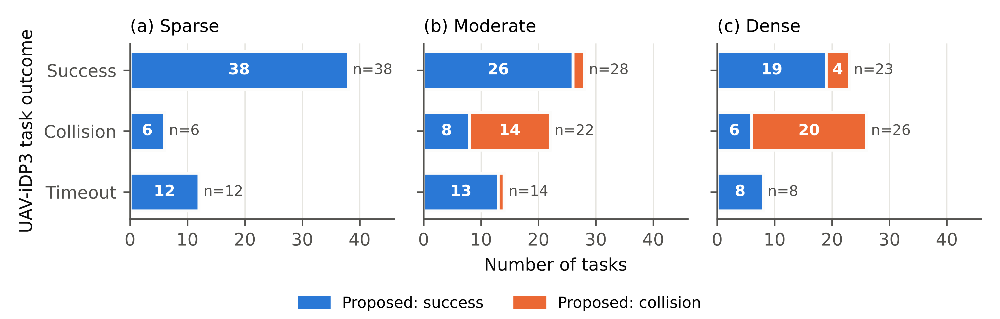
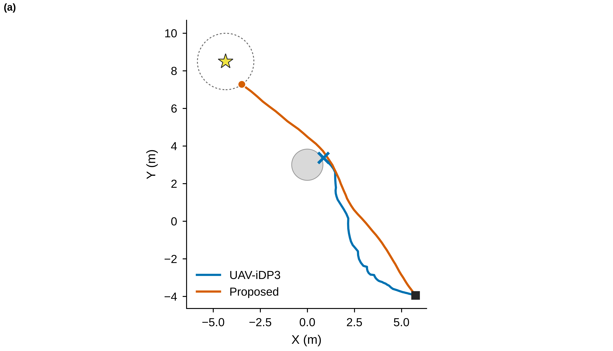
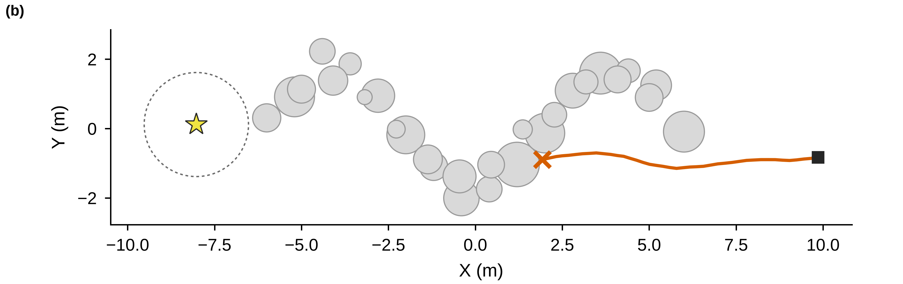
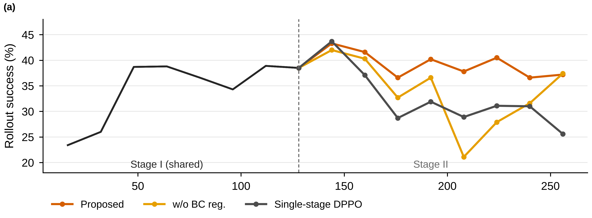
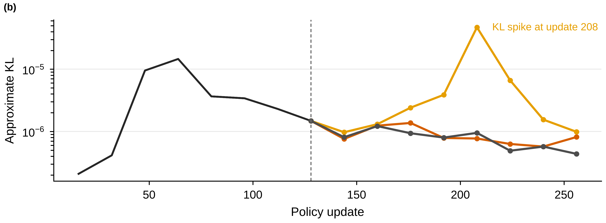
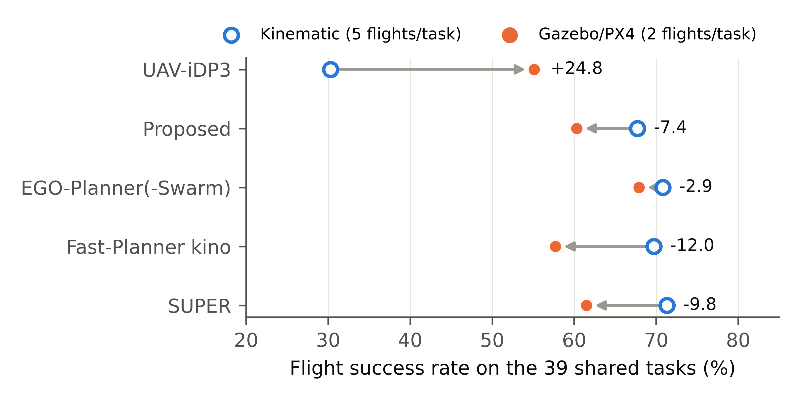

## 4 实验与结果分析

实验围绕三个问题展开：（1）不增加示范数据时，强化学习微调能否提高UAV-iDP3的闭环导航能力，提高来自哪类失效的消除（4.2节）；（2）成功轨迹正则能否在继续训练中保住第一阶段获得的能力（4.3节）；（3）运动学仿真中的提升在包含飞行动力学与飞控跟踪的Gazebo/PX4软件在环仿真中能保留多少，差距从何而来（4.4节）。三种公开实现的模块化规划器作为同一任务上的性能参照。

### 4.1 实验设置

#### 4.1.1 环境、任务与难度

训练与主要评价在运动学闭环仿真环境中进行。场景取自Gazebo场景文件，障碍包括箱体与圆柱体，分布在20 m × 20 m的区域内，每个场景含1—40个障碍（中位数8），目标高度为1.5—4.5 m。环境按策略输出的参考位置与偏航推进无人机，依据障碍几何、无人机位姿与深度相机配置合成局部点云，并在连续执行路径上检测碰撞、触地与到达。深度相机的分辨率为320×240，水平视场角为60°，探测距离为0.05—10 m，合成点云时加入深度噪声与随机点缺失。

场景分为21个训练场景、20个验证场景和40个测试场景。训练场景用于微调，验证场景用于方法开发，测试场景未参与训练。运动学评价包含177个固定起终点任务；Gazebo评价使用来自26个场景的40个固定任务。各方法在同一任务中共享场景、起终点和初始偏航，评价时关闭训练中的位置与偏航扰动。

难度按航线附近的障碍占据率$\chi$划分：以起终点连线两侧1 m范围内的区域为基准，竖直范围由两端高度向上下各扩展1 m，最低不低于0.2 m，$\chi$为该区域内被障碍占据的体积比例。$\chi=0$、$0<\chi\le0.04623$和$\chi>0.04623$分别对应稀疏、适中和密集任务，阈值由训练任务确定并保持固定。稀疏任务的直线航线上没有障碍，适中与密集任务需要绕行。表2给出两种评价集的组成。

**表2　评价任务与难度组成**

| 难度 | 运动学任务数 | 运动学场景数 | 起终点距离/m | Gazebo任务数 |
|---|---|---|---|---|
| 稀疏 | 56 | 31 | 11.8（3.1—31.1） | 11 |
| 适中 | 64 | 34 | 20.3（10.3—33.2） | 14 |
| 密集 | 57 | 29 | 17.0（7.2—31.4） | 15 |
| 总体 | 177 | 40 | 16.1（3.1—33.2） | 40 |

#### 4.1.2 训练与执行

UAV-iDP3的预训练采用EGO-Planner[2]在仿真环境中生成的专家示范，共988个成功回合、60151帧，按9∶1划分训练集与验证集。训练时对点云随机下采样并加入坐标抖动与深度噪声，并对世界坐标系下的位置、偏航与动作施加±30°的绕竖直轴旋转增强，机体坐标系下的点云与目标向量在该变换下保持不变。预训练采用AdamW优化器，学习率为$10^{-4}$，采用余弦调度，批大小为60，共训练301轮；碰撞代价损失的权重$\lambda_{\mathrm{geo}}=0.5$。

微调共256轮，每轮采集1024个决策转移，样本复用5遍。前128轮（第一阶段）只以式（7）更新；第128轮时，以预训练策略与第一阶段策略在训练任务上的成功回合构建成功轨迹参考集（47个任务、549个样本），此后128轮（第二阶段）加入正则。正则系数$\lambda=0.0106$按正则梯度约为策略梯度0.1倍的原则一次性标定。采集数据时各去噪步按标准差下限0.1随机采样，评价时采用确定性采样。方法基于Python与PyTorch实现，微调在单块NVIDIA GeForce RTX 4060 Laptop GPU上进行，后128轮用时约12.6 h。主要超参数见表3。

**表3　主要超参数**

| 模块 | 参数 | 取值 |
|---|---|---|
| 观测与动作 | 历史帧数 / 每帧点数 / 状态维度 / 轨迹维度 | 3 / 4096 / 9 / 16×11 |
| 策略网络 | 几何特征 / 状态特征 / 条件向量维度 | 128 / 64 / 576 |
| 策略网络 | U-Net各级通道 / 卷积核 / 时间步嵌入 | 256、512、1024 / 5 / 128 |
| 扩散模型 | 训练扩散步 / DDIM采样步 | 50 / 10 |
| 执行 | 执行段时长 / 规划窗口 / 执行前缀 / 最大决策次数 | 0.3 s / 8段 / 4段 / 60 |
| 执行 | 训练到达奖励半径 / 碰撞体半径 | 0.5 m / 0.1 m |
| LoRA | 秩$r_L$ / 缩放$\alpha_L$ | 8 / 8 |
| 价值网络 | 隐藏层 / 激活 | 256、256 / SiLU |
| 优化 | 策略学习率 / 价值学习率 | $2\times10^{-5}$线性衰减至$10^{-5}$ / $10^{-3}$ |
| 优化 | 折扣$\gamma$ / GAE $\lambda_{\mathrm{GAE}}$ / 去噪折扣$\gamma_d$ | 0.99 / 0.95 / 0.8 |
| 优化 | PPO截断宽度$\varepsilon_j$ | $10^{-3}$—0.1 |
| 训练 | 加入正则前 / 后轮数 | 128 / 128 |
| 成功轨迹正则 | 正则系数$\lambda$ / 每次抽样数 | 0.0106 / 32 |
| 评价 | 采样 | 确定性 |

#### 4.1.3 对照方法与评价指标

UAV-iDP3为专家示范预训练得到的基础策略，本文方法为其经Reg-DPPO两阶段微调后的策略。分阶段训练消融包含三种变体：Reg-DPPO w/o Stage II只完成第一阶段；Reg-DPPO w/o BC reg.从同一第一阶段策略出发进行128轮第二阶段训练，但不加入式（8）的成功轨迹正则；Single-stage DPPO采用相同回报与LoRA连续训练256轮，不分阶段且不加入该正则。后两种变体与完整方法的训练预算相同，其中Reg-DPPO w/o BC reg.与完整方法的唯一差异是是否加入式（8）的正则。外部对照为三种公开实现的模块化规划器：EGO-Planner-Swarm[19]、Fast-Planner kino[18]和SUPER[3]；Gazebo中的EGO基线记为EGO-Planner，它同时是本文专家示范的来源。

一次飞行在碰撞前进入目标1.5 m范围即为安全到达。运动学中机体与障碍接触或触地即为碰撞；Gazebo中以机体坠地或翻覆判定碰撞，擦碰障碍而未失稳不计为碰撞。在期限内既未到达也未碰撞的飞行记为超时，运动学的期限为60个决策周期（每周期执行4段，共72 s），Gazebo为240 s。运动学每任务重复5次，至少2次安全到达记为任务成功；Gazebo每任务重复2次，至少1次安全到达记为任务成功。失败任务按其失败飞行的多数结局归为碰撞失败或超时失败，票数相同记为碰撞；Gazebo中任一次飞行碰撞即记为碰撞失败。

轨迹质量以路径效率与最小障碍净距评价。路径效率为起终点直线距离除以执行路径长度与终点到目标剩余距离之和，成功飞行的执行路径截断于首次进入1.5 m目标范围；最小障碍净距为执行线段上的机体包络到真实箱体或圆柱表面的最小三维距离，沿连续路径计算。两项指标在五种方法均成功的69个运动学任务上比较，每个任务先对其成功飞行取中位数。

任务成功率配对差的置信区间按测试场景聚类自助重采样20000次得到，随机种子为2026102601；能力保持率给出Wilson 95%置信区间。

### 4.2 运动学仿真结果

强化学习微调使UAV-iDP3的任务成功率由50.3%提高至76.8%（表4），配对提升26.6个百分点（95%置信区间[19.1, 33.9]），使不依赖全局地图的端到端策略接近模块化规划器的水平（81.9%—85.9%）。提升在三类难度上都成立，但随障碍密度增大而减小：稀疏任务由67.9%提高至全部完成，密集任务只提高17.5个百分点。与模块化规划器的差距也落在需要绕行的适中与密集任务上，稀疏任务中各方法均完成或几乎完成全部任务。

**表4　运动学仿真中各方法的任务成功率与失败类型（177个任务）**

| 方法 | 总体/% | 稀疏/% | 适中/% | 密集/% | 碰撞失败 | 超时失败 |
|---|---|---|---|---|---|---|
| UAV-iDP3 | 50.3 | 67.9 | 43.8 | 40.4 | 54 | 34 |
| Reg-DPPO w/o Stage II | 72.3 | 96.4 | 70.3 | 50.9 | 41 | 8 |
| Single-stage DPPO | 63.3 | 83.9 | 51.6 | 56.1 | 46 | 19 |
| Reg-DPPO w/o BC reg. | 55.4 | 80.4 | 51.6 | 35.1 | 58 | 21 |
| 本文方法 | **76.8** | **100** | **73.4** | **57.9** | 41 | **0** |
| EGO-Planner-Swarm | 81.9 | 96.4 | 79.7 | 70.2 | 3 | 29 |
| Fast-Planner kino | 81.9 | 100 | 82.8 | 63.2 | 32 | 0 |
| SUPER | 85.9 | 100 | 89.1 | 68.4 | 25 | 0 |

注：加粗为四种学习策略变体与本文方法中的最优值；失败类型为任务数。

微调的收益主要来自消除“未能到达”的失效，而不是减少碰撞（图4）。UAV-iDP3未完成的88个任务中，以超时告终的34个有33个被本文方法完成，以碰撞告终的54个只完成了20个。这一差别在三类难度上一致，且随障碍密度扩大：碰撞失败任务被完成的比例在稀疏、适中、密集任务中依次为6/6、8/22和6/26，超时失败则几乎全部转为成功。稀疏任务的直线航线上没有障碍，UAV-iDP3在这类任务中的18个失败仍有12个为超时，可见预训练策略的主要缺陷是不能稳定地持续接近目标。回报设计正对这一缺陷：进展奖励只在刷新历史最优目标距离时给出，时间惩罚持续累积，悬停、往复或在障碍前停滞都得不到回报。微调后的策略因此始终保持推进，本文方法在885次飞行中仅有1次超时；碰撞失效的减少则有限，且障碍越密集越难改善。

**图4　**UAV-iDP3到本文方法的任务结局转移（177个运动学任务）。纵轴为UAV-iDP3的任务结局，横条颜色为同一任务上本文方法的结局，数字为任务数。（a）稀疏；（b）适中；（c）密集。

本文方法与模块化规划器的失效方式不同（表4）。本文方法的41个失败任务全部为碰撞；EGO-Planner-Swarm的32个失败任务中29个为超时；Fast-Planner kino与SUPER的失败同样全部为碰撞，但数量更少。规划器把逐帧观测融合进局部地图，在找不到可行轨迹时可以停留等待；本文策略仅以最近三帧点云为条件持续推进，当可通行的间隙不在视场之内时便与障碍接触。图5给出两个密集任务：障碍局部可见时，本文方法完成了UAV-iDP3因碰撞失败的绕行（图5(a)）；障碍沿航线连续分布时，本文方法沿障碍带推进，在进入间隙时发生碰撞（图5(b)）。

**图5　**密集任务中的执行轨迹（俯视）。（a）同一任务中UAV-iDP3碰撞、本文方法到达；（b）本文方法在障碍沿航线连续分布的任务中碰撞。方块、星号、圆点与叉号分别表示起点、目标、到达点与碰撞点，虚线圆为1.5 m到达范围。

成功率的提高没有以更长的路径为代价，但密集任务中本文方法的障碍裕度小于模块化规划器（表5）。在五种方法均成功的69个任务上，本文方法的路径效率高于UAV-iDP3（69个任务中51个更高），与SUPER相当，略低于EGO-Planner-Swarm和Fast-Planner kino。最小障碍净距在总体和适中任务中各方法相近；在密集任务中，本文方法的净距中位数为0.25 m，而三种规划器为0.37—0.42 m。本文方法在密集障碍中贴近障碍完成绕行，这在运动学仿真的精确执行下是安全的，执行存在偏差时裕度更容易耗尽。

**表5　五种方法均成功的69个任务上的轨迹质量**

| 方法 | 路径效率 | 路径效率配对差/百分点 | 净距/m（总体） | 净距/m（适中） | 净距/m（密集） |
|---|---|---|---|---|---|
| UAV-iDP3 | 0.965 | +1.14（51/18） | 1.15 | 0.47 | 0.28 |
| 本文方法 | 0.982 | — | 1.27 | 0.46 | 0.25 |
| EGO-Planner-Swarm | 1.000（0.975—1.000） | −1.13（15/54） | 1.27 | 0.53 | 0.42 |
| Fast-Planner kino | 0.993 | −0.87（15/54） | 1.27 | 0.42 | 0.42 |
| SUPER | 0.985 | +0.02（35/34） | 1.26 | 0.45 | 0.37 |

注：路径效率与最小障碍净距均为中位数，适中与密集分别为20个和13个任务；路径效率配对差为逐任务配对差（本文方法减该方法）的中位数，括号内为本文方法更高/更低的任务数。

### 4.3 消融实验

能力扩展主要在第一阶段完成，第二阶段的作用是巩固（表4、表6）。仅完成第一阶段的策略已完成128个任务，占全部净增47个任务中的39个；第二阶段再净增8个任务（4.5个百分点，95%置信区间[−0.6, 9.8]）。第二阶段新增的14个任务中有8个是第一阶段仍以超时告终的任务，第一阶段遗留的超时失败在第二阶段全部消除。

不加约束的继续训练会破坏第一阶段已获得的能力，成功轨迹正则阻止了这种破坏（表6）。去除正则后，第一阶段完成的128个任务中有37个被遗忘，最终完成的任务数（98个）低于第一阶段本身；不分阶段连续训练遗忘25个，最终为112个。加入正则后仅遗忘6个，保持率95.3%，与两种变体的置信区间不重叠。遗忘的类型说明了正则保住的是什么：两种无正则变体遗忘的任务中各有12个以超时告终，第一阶段已消除的停滞行为重新出现；本文方法遗忘的6个均为碰撞，没有一个回到超时。与起点和预算相同的无正则变体相比，完整方法多完成38个任务（21.5个百分点，[13.3, 29.9]），其中31个来自遗忘的减少，7个来自新增完成，正则的作用在于保持而非探索。

**表6　第一阶段完成的128个任务在第二阶段后的去向**

| 方法 | 保持 | 遗忘为碰撞 | 遗忘为超时 | 新增完成 | 最终完成 | 保持率/%（95%置信区间） |
|---|---|---|---|---|---|---|
| 本文方法 | 122 | 6 | 0 | 14 | 136 | 95.3（90.2—97.8） |
| Reg-DPPO w/o BC reg. | 91 | 25 | 12 | 7 | 98 | 71.1（62.7—78.2） |
| Single-stage DPPO | 103 | 13 | 12 | 9 | 112 | 80.5（72.8—86.4） |

注：新增完成为第一阶段未完成、第二阶段后完成的任务数。

训练过程显示了两种遗忘的发生方式（图6）。去除正则时，遗忘以策略的突发偏移出现：第208轮的近似KL散度约为同期本文方法的60倍，训练采集成功率同时降至21.1%。不分阶段训练没有出现KL散度尖峰，采集成功率在后128轮中由43.7%波动下降至25.6%。本文方法第二阶段的KL散度始终不高于第一阶段末的水平，采集成功率保持在36.6%—43.3%。在线采集的样本由当前策略产生，PPO更新不再访问的状态得不到维持[12]；成功轨迹正则在固定参考集上约束执行段输出，使已经形成的推进与绕行行为在后续更新中保留下来。

**图6　**强化学习微调的训练过程。（a）训练采集成功率；（b）近似KL散度（对数轴）。数值按每16轮汇总，竖虚线为第一阶段结束的第128轮，黑线为各方法共享的第一阶段记录。

### 4.4 Gazebo/PX4软件在环验证

Gazebo/PX4中参考轨迹由PX4位置控制器跟踪。学习策略每次决策提交执行段的4个路径点，并在该段轨迹时长的70%处触发下一次推理。在同一GPU上，本文方法单次决策的端到端耗时中位数为202 ms（95%分位241 ms），UAV-iDP3为153 ms；执行前缀4段共1.2 s，在其70%处触发后至该段结束约有0.36 s，推理可在下一段开始前完成。

在Gazebo/PX4中，本文方法保持了UAV-iDP3完成的全部25个任务，完成27/40个任务，与Fast-Planner kino和SUPER相同，低于EGO-Planner（表7）。相对UAV-iDP3的提升由运动学中的26.6个百分点缩小至5.0个百分点。提升的来源与运动学一致：新增的2个任务都来自UAV-iDP3的超时失败，其12个碰撞失败任务无一转为成功。

**表7　Gazebo/PX4中各方法的任务成功率与失败类型（40个任务）**

| 方法 | 总体/% | 稀疏/% | 适中/% | 密集/% | 碰撞失败 | 超时失败 |
|---|---|---|---|---|---|---|
| UAV-iDP3 | 62.5 | 100 | 64.3 | 33.3 | 12 | 3 |
| 本文方法 | 67.5 | 100 | 71.4 | 40.0 | 12 | 1 |
| EGO-Planner | 77.5 | 100 | 71.4 | 66.7 | 6 | 3 |
| Fast-Planner kino | 67.5 | 100 | 71.4 | 40.0 | 13 | 0 |
| SUPER | 67.5 | 100 | 57.1 | 53.3 | 13 | 0 |

提升缩小是因为UAV-iDP3在Gazebo中的表现明显好于运动学，而不是本文方法丢失了微调的收益（图7）。两个平台的任务成功规则不同，因此在两者共有的39个任务上按单次飞行比较：从运动学到Gazebo，本文方法的飞行成功率下降7.4个百分点，三种规划器下降2.9—12.0个百分点，唯独UAV-iDP3上升24.8个百分点。UAV-iDP3的上升集中在它在运动学中的两类失效上：碰撞飞行由52.3%降至32.1%，超时飞行由17.4%降至12.8%；按任务看，它在运动学中超时失败的7个任务有5个在Gazebo中完成，碰撞失败的20个任务有7个完成。两个平台的判定条件恰好在这两类失效上不同：Gazebo只把坠地或翻覆计为碰撞，单次飞行期限为240 s，而运动学中任何接触即为碰撞，期限为72 s。本文方法在运动学中已经消除了超时，失败只剩碰撞，因而没有从这些条件中获益；它的飞行成功率降幅与模块化规划器相当，说明微调获得的能力在软件在环仿真中得到了保留。

**图7　**两个平台共有的39个任务上各方法的单次飞行成功率。空心点为运动学（每任务5次），实心点为Gazebo/PX4（每任务2次），数字为变化量（百分点）。Gazebo中的EGO基线为EGO-Planner，运动学中为EGO-Planner-Swarm。

### 4.5 讨论

实验结果表明，强化学习微调为UAV-iDP3带来的主要是持续推进的能力。预训练策略的失败有很大一部分是到期仍未到达，而基于历史最优距离的进展奖励与时间惩罚使停滞没有任何回报；这一能力在三类难度上都使超时失败几乎完全转为成功，并在软件在环仿真中继续成立。同一倾向也决定了本文方法的失效方式：当局部观测中看不到可通行的空隙时，策略仍会选择方向前进，结果是碰撞而非等待。模块化规划器的表现正好相反，EGO-Planner-Swarm极少碰撞，失败几乎都以超时告终。对安全要求更高的应用，学习策略需要在观测不足时主动减速或悬停的能力，这可以通过在回报中区分有风险的推进与安全的等待来实现。

碰撞失效改善有限，根源在于观测。碰撞失败任务被完成的比例随障碍密度增大而下降，密集任务中本文方法的障碍裕度也小于模块化规划器。强化学习能够改变策略在给定观测下的选择，却不能补充被遮挡或位于视场之外的障碍几何；规划器以局部地图累积历史观测，在连续障碍中拥有更完整的空间信息。在策略条件中引入更长的观测记忆或局部空间表示，是缩小这一差距的方向。

成功轨迹正则的作用是保持而不是扩展。它使第二阶段不再丢失第一阶段消除停滞的成果，但第二阶段的净增有限。原因在于参考集在第二阶段开始前固定，只包含UAV-iDP3与第一阶段已有的成功行为。若把第二阶段新获得的成功轨迹在线加入参考集，正则有望在保持已有能力的同时支持能力继续扩展。

两级仿真的对比还表明，提升幅度依赖于评价条件。运动学与Gazebo在碰撞判定与飞行期限上的差异，恰好作用于预训练策略的主要失效，使同一方法在两个平台上的相对提升相差五倍以上。比较学习策略在不同平台上的提升时，需要同时报告判定条件与失效类型，否则会把评价条件的变化误读为方法能力的变化。

本文仍存在以下局限。其一，进展奖励与前瞻风险评估未分别消融，二者各自的贡献尚未量化。其二，实验限于静态障碍的仿真环境，尚未开展动态障碍场景与实机飞行验证。
