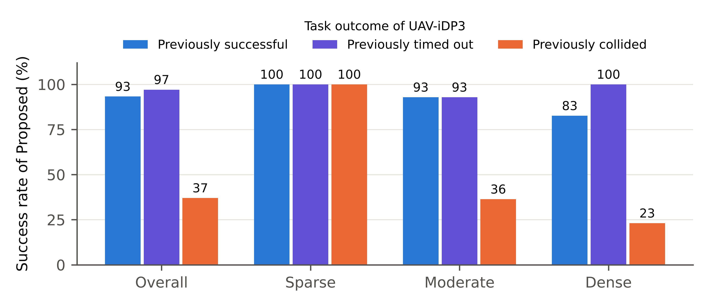
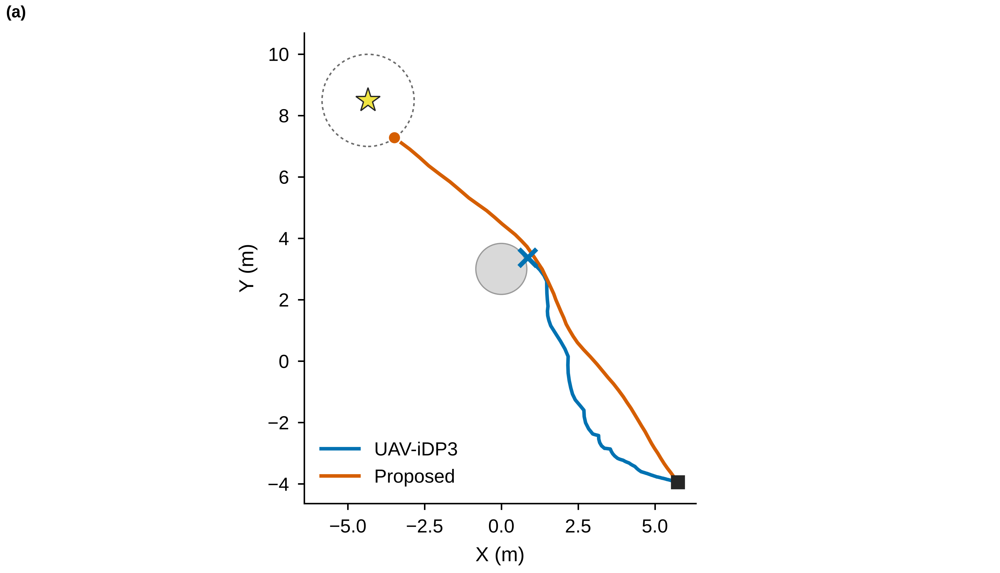
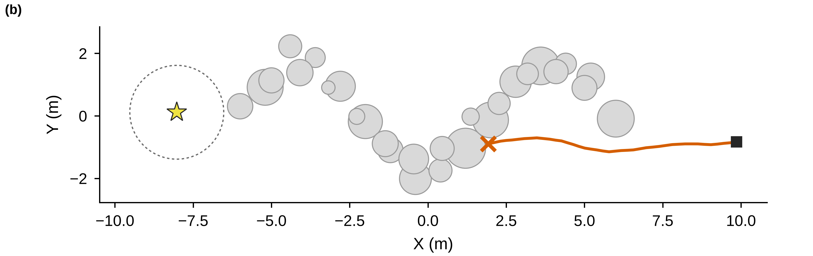
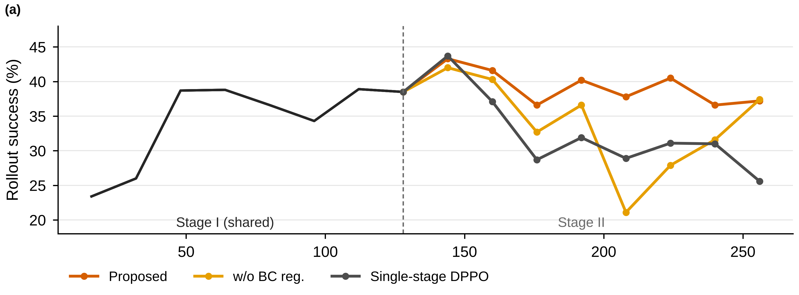
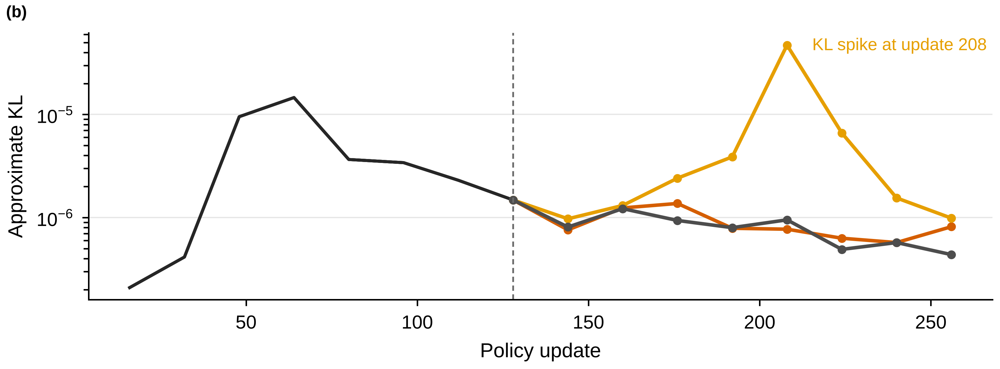
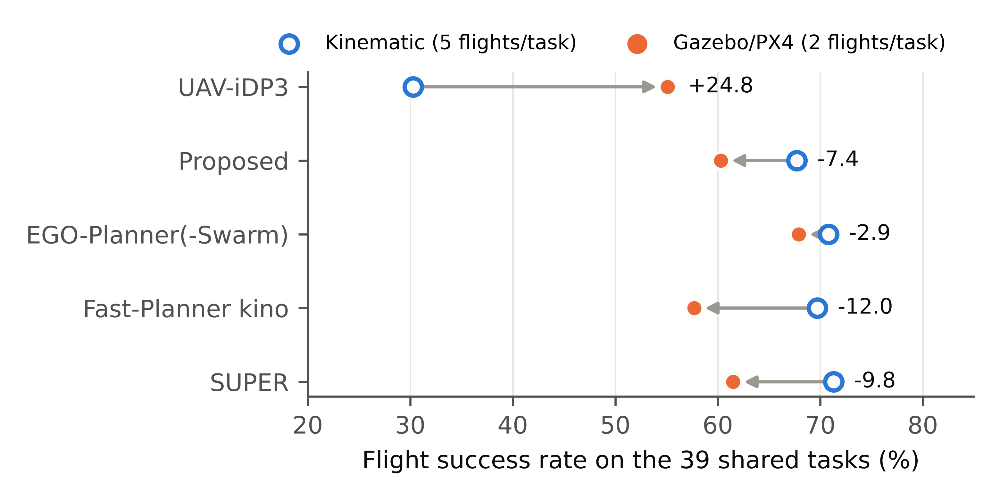

## 4 实验与结果分析

实验围绕引言提出的两个问题与方法的迁移性展开：4.2节检验强化学习微调能否在不增加示范的条件下提高UAV-iDP3的闭环导航能力，并分析提升来自哪类失效的消除；4.3节检验成功轨迹正则能否在继续训练中保持已获得的能力；4.4节检验上述提升在包含飞行动力学与飞控跟踪的Gazebo/PX4软件在环仿真中能否保留。三种公开实现的模块化规划器作为同一任务上的性能参照。

### 4.1 实验设置

#### 4.1.1 环境、任务与难度

训练与主要评价在运动学闭环仿真环境中进行。场景取自Gazebo场景文件，障碍包括箱体与圆柱体，分布在20 m × 20 m的区域内，每个场景含1—40个障碍（中位数8），目标高度为1.5—4.5 m。环境按策略输出的参考位置与偏航推进无人机，依据障碍几何、无人机位姿与深度相机配置合成局部点云，并在连续执行路径上检测碰撞、触地与到达。深度相机的分辨率为320×240，水平视场角为60°，探测距离为0.05—10 m，合成点云时加入深度噪声与随机点缺失。

场景分为21个训练场景、20个验证场景和40个测试场景。训练场景用于微调，验证场景用于方法开发，测试场景未参与训练。运动学评价包含177个固定起终点任务；Gazebo评价使用来自26个场景的40个固定任务。各方法在同一任务中共享场景、起终点和初始偏航，评价时关闭训练中的位置与偏航扰动。

难度按航线附近的障碍占据率$\chi$划分：以起终点连线两侧1 m范围内的区域为基准，竖直范围由两端高度向上下各扩展1 m，最低不低于0.2 m，$\chi$为该区域内被障碍占据的体积比例。$\chi=0$、$0<\chi\le0.04623$和$\chi>0.04623$分别对应稀疏、适中和密集任务，阈值由训练任务确定并保持固定。稀疏任务的直线航线上没有障碍，适中与密集任务需要绕行。表2给出两种评价集的组成。

**表2　评价任务与难度组成**

| 难度 | 运动学任务数 | 运动学场景数 | 起终点距离/m | Gazebo任务数 |
|---|---|---|---|---|
| 稀疏 | 56 | 31 | 11.8（3.1—31.1） | 11 |
| 适中 | 64 | 34 | 20.3（10.3—33.2） | 14 |
| 密集 | 57 | 29 | 17.0（7.2—31.4） | 15 |
| 总体 | 177 | 40 | 16.1（3.1—33.2） | 40 |

#### 4.1.2 训练与执行

UAV-iDP3的预训练采用EGO-Planner[2]在仿真环境中生成的专家示范，共988个成功回合、60151帧，按9∶1划分训练集与验证集。训练时对点云随机下采样并加入坐标抖动与深度噪声，并对世界坐标系下的位置、偏航与动作施加±30°的绕竖直轴旋转增强，机体坐标系下的点云与目标向量在该变换下保持不变。预训练采用AdamW优化器，学习率为$10^{-4}$，采用余弦调度，批大小为60，共训练301轮；碰撞代价损失的权重$\lambda_{\mathrm{geo}}=0.5$。

微调共256轮，每轮采集1024个决策转移，样本复用5遍。前128轮（第一阶段）只以式（7）更新；第128轮时，以预训练策略与第一阶段策略在训练任务上的成功回合构建成功轨迹参考集（47个任务、549个样本），此后128轮（第二阶段）加入正则。正则系数$\lambda=0.0106$按正则梯度约为策略梯度0.1倍的原则一次性标定。采集数据时各去噪步按标准差下限0.1随机采样，评价时采用确定性采样。方法基于Python与PyTorch实现，微调在单块NVIDIA GeForce RTX 4060 Laptop GPU上进行，后128轮用时约12.6 h。主要超参数见表3。

**表3　主要超参数**

| 模块 | 参数 | 取值 |
|---|---|---|
| 观测与动作 | 历史帧数 / 每帧点数 / 状态维度 / 轨迹维度 | 3 / 4096 / 9 / 16×11 |
| 策略网络 | 几何特征 / 状态特征 / 条件向量维度 | 128 / 64 / 576 |
| 策略网络 | U-Net各级通道 / 卷积核 / 时间步嵌入 | 256、512、1024 / 5 / 128 |
| 扩散模型 | 训练扩散步 / DDIM采样步 | 50 / 10 |
| 执行 | 执行段时长 / 规划窗口 / 执行前缀 / 最大决策次数 | 0.3 s / 8段 / 4段 / 60 |
| 执行 | 训练到达奖励半径 / 碰撞体半径 | 0.5 m / 0.1 m |
| LoRA | 秩$r_L$ / 缩放$\alpha_L$ | 8 / 8 |
| 价值网络 | 隐藏层 / 激活 | 256、256 / SiLU |
| 优化 | 策略学习率 / 价值学习率 | $2\times10^{-5}$线性衰减至$10^{-5}$ / $10^{-3}$ |
| 优化 | 折扣$\gamma$ / GAE $\lambda_{\mathrm{GAE}}$ / 去噪折扣$\gamma_d$ | 0.99 / 0.95 / 0.8 |
| 优化 | PPO截断宽度$\varepsilon_j$ | $10^{-3}$—0.1 |
| 训练 | 加入正则前 / 后轮数 | 128 / 128 |
| 成功轨迹正则 | 正则系数$\lambda$ / 每次抽样数 | 0.0106 / 32 |
| 评价 | 采样 | 确定性 |

#### 4.1.3 对照方法与评价指标

UAV-iDP3为专家示范预训练得到的基础策略，本文方法为其经Reg-DPPO两阶段微调后的策略。分阶段训练消融包含三种变体：Reg-DPPO w/o Stage II只完成第一阶段；Reg-DPPO w/o BC reg.从同一第一阶段策略出发进行128轮第二阶段训练，但不加入式（8）的成功轨迹正则，与完整方法的唯一差异即在于该正则；Single-stage DPPO采用相同回报与LoRA连续训练256轮，既不分阶段也不加入正则。后两种变体与完整方法的训练预算相同。外部对照为EGO-Planner-Swarm[19]、Fast-Planner kino[18]和SUPER[3]三种模块化规划器，Gazebo中的EGO基线为EGO-Planner，它也是本文专家示范的来源。

一次飞行在碰撞前进入目标1.5 m范围即为安全到达。运动学中机体与障碍接触或触地即判为碰撞，Gazebo中则以机体坠地或翻覆判定碰撞。在期限内既未到达也未碰撞的飞行记为超时；运动学的期限为60个决策周期，相当于72 s的飞行时间，Gazebo为240 s。运动学中每个任务重复5次，至少2次安全到达即为任务成功；Gazebo中每个任务重复2次，至少1次安全到达即为任务成功。失败任务按失败飞行的多数结局归为碰撞失败或超时失败，碰撞失败率与超时失败率分别为这两类任务占全部任务的比例。

轨迹质量以路径效率与最小障碍净距评价，在五种方法均成功的69个运动学任务上比较。路径效率为起终点直线距离与实际飞行距离之比，实际飞行距离截至首次进入目标范围；最小障碍净距为执行路径上机体包络到障碍表面的最小距离。这两项指标在任务间分布偏斜，且少数绕行很远或贴近障碍的飞行会明显拉动均值，因此以中位数汇总。

任务成功率差值的95%置信区间按测试场景聚类自助重采样得到，能力保持率的置信区间采用Wilson区间。

### 4.2 运动学仿真结果

如表4所示，强化学习微调使UAV-iDP3的任务成功率由50.3%提高至76.8%，提升26.6个百分点，95%置信区间为19.1～33.9个百分点。微调后的策略不依赖全局地图，成功率已接近81.9%～85.9%的模块化规划器。提升覆盖全部三类难度，但随障碍密度增大而减小：稀疏任务的成功率提高至100%，密集任务只提高17.5个百分点。与模块化规划器的差距同样出现在需要绕行的适中与密集任务中。

**表4　运动学仿真中各方法的任务成功率与失败率**

| 方法 | 总体成功率/% | 稀疏/% | 适中/% | 密集/% | 碰撞失败率/% | 超时失败率/% |
|---|---|---|---|---|---|---|
| UAV-iDP3 | 50.3 | 67.9 | 43.8 | 40.4 | 30.5 | 19.2 |
| Reg-DPPO w/o Stage II | 72.3 | 96.4 | 70.3 | 50.9 | 23.2 | 4.5 |
| Single-stage DPPO | 63.3 | 83.9 | 51.6 | 56.1 | 26.0 | 10.7 |
| Reg-DPPO w/o BC reg. | 55.4 | 80.4 | 51.6 | 35.1 | 32.8 | 11.9 |
| 本文方法 | 76.8 | 100 | 73.4 | 57.9 | 23.2 | 0 |
| EGO-Planner-Swarm | 81.9 | 96.4 | 79.7 | 70.2 | 1.7 | 16.4 |
| Fast-Planner kino | 81.9 | 100 | 82.8 | 63.2 | 18.1 | 0 |
| SUPER | 85.9 | 100 | 89.1 | 68.4 | 14.1 | 0 |

失败类型的变化揭示了提升的来源：微调几乎消除了超时失败，碰撞失败的减少则有限。如图4所示，UAV-iDP3以超时告终的任务在微调后几乎全部完成，以碰撞告终的任务只有约三分之一被完成，且这一比例随障碍密度增大由稀疏任务的100%降至密集任务的23.1%。超时失败在无需绕行的稀疏任务中同样普遍，预训练策略的主要缺陷在于不能持续接近目标，而非避障不足。回报设计正对应这一缺陷：进展奖励只在刷新历史最优目标距离时给出，时间惩罚持续累积，悬停、往复或在障碍前停滞都得不到回报，微调后的策略因而始终向目标推进。

**图4　**按UAV-iDP3的任务结局分组，本文方法在各组任务上的成功率

持续推进也决定了本文方法与模块化规划器失效方式的差异。本文方法的失败全部为碰撞；EGO-Planner-Swarm的碰撞失败率仅为1.7%，失败以超时为主；Fast-Planner kino与SUPER的失败同样为碰撞，但碰撞失败率更低。模块化规划器把逐帧观测融合进局部地图，在找不到可行轨迹时可以停留等待，本文策略仅以最近三帧点云为条件，当可通行的空隙不在视场之内时仍会选择方向前进。如图5所示，障碍局部可见时，本文方法能够完成UAV-iDP3未能完成的绕行；障碍沿航线连续分布时，本文方法沿障碍带推进，在进入空隙时发生碰撞。

**图5　**密集任务中的执行轨迹（俯视）。（a）UAV-iDP3碰撞而本文方法到达的任务；（b）本文方法发生碰撞的任务。方块、星号、圆点与叉号分别表示起点、目标、到达点与碰撞点，虚线圆为1.5 m到达范围

成功率的提高没有以路径变长为代价，但在密集障碍中本文方法以更小的裕度完成绕行。如表5所示，本文方法的路径效率高于UAV-iDP3，与模块化规划器相当；最小障碍净距在总体上与各方法相近，在密集任务中则明显小于三种规划器。在运动学仿真精确执行的条件下，这样的裕度足以安全通过，但执行一旦存在偏差便容易耗尽。

**表5　五种方法均成功任务上的路径效率与最小障碍净距**

| 方法 | 路径效率 | 最小障碍净距/m | 密集任务最小障碍净距/m |
|---|---|---|---|
| UAV-iDP3 | 0.965 | 1.15 | 0.28 |
| 本文方法 | 0.982 | 1.27 | 0.25 |
| EGO-Planner-Swarm | 1.000 | 1.27 | 0.42 |
| Fast-Planner kino | 0.993 | 1.27 | 0.42 |
| SUPER | 0.985 | 1.26 | 0.37 |

### 4.3 消融实验

4.2节表明微调的主要作用是消除停滞，本节进一步分析这一能力在两个训练阶段中如何形成与保持。如表4所示，仅完成第一阶段的策略成功率已达72.3%，贡献了总提升的八成以上，超时失败率也由19.2%降至4.5%；第二阶段将剩余的超时失败完全消除，成功率再提高4.5个百分点。可见能力扩展主要在第一阶段完成，第二阶段的作用在于巩固。

继续训练若不加约束，会破坏第一阶段已获得的能力。去除成功轨迹正则后，第一阶段已完成任务的保持率降至71.1%，最终成功率55.4%，低于第一阶段本身；不分阶段连续训练的保持率为80.5%，成功率63.3%。加入正则后保持率提高至95.3%，置信区间与两种变体均不重叠。遗忘的形式说明了正则保持的是什么：两种无正则变体的超时失败率分别回升至11.9%和10.7%，第一阶段已消除的停滞行为重新出现，而本文方法的失败中没有超时。与起点和预算完全相同的无正则变体相比，本文方法的成功率高21.5个百分点，95%置信区间为13.3～29.9个百分点，其中约八成来自遗忘的减少而非新完成的任务，正则的作用在于保持而不在于探索。

训练过程揭示了两种遗忘的发生方式。如图6所示，去除正则时遗忘表现为策略的突发偏移，近似KL散度在第208轮达到同期本文方法的约60倍，训练采集成功率随之骤降；不分阶段训练没有出现KL散度尖峰，采集成功率在第二阶段逐步下降；本文方法的KL散度在第二阶段始终低于第一阶段末的水平，采集成功率保持稳定。在线采集的样本由当前策略产生，PPO更新对不再被访问的状态缺少维持信号[12]；成功轨迹正则在固定参考集上约束执行段的输出，使已经形成的推进与绕行行为在后续更新中得以保留。

**图6　**强化学习微调的训练过程。（a）训练采集成功率；（b）近似KL散度。竖虚线为第一阶段结束处，黑线为各方法共享的第一阶段记录

### 4.4 Gazebo/PX4软件在环验证

运动学仿真按参考轨迹精确推进无人机，Gazebo/PX4软件在环仿真则由PX4位置控制器跟踪参考轨迹，用于检验微调获得的能力能否在飞行动力学与控制跟踪下保留。学习策略每次决策提交执行前缀的4个路径点，并在其轨迹时长的70%处触发下一次推理；本文方法单次推理约0.2 s，可在当前执行前缀结束前完成。

如表6所示，本文方法在Gazebo/PX4中的任务成功率为67.5%，与Fast-Planner kino和SUPER相同，低于EGO-Planner的77.5%。本文方法完成了UAV-iDP3完成的全部任务，相对UAV-iDP3的提升为5.0个百分点，远小于运动学中的26.6个百分点。提升的来源与运动学一致，仍是超时失败的减少，碰撞失败率没有变化。

**表6　Gazebo/PX4中各方法的任务成功率与失败率**

| 方法 | 总体成功率/% | 稀疏/% | 适中/% | 密集/% | 碰撞失败率/% | 超时失败率/% |
|---|---|---|---|---|---|---|
| UAV-iDP3 | 62.5 | 100 | 64.3 | 33.3 | 30.0 | 7.5 |
| 本文方法 | 67.5 | 100 | 71.4 | 40.0 | 30.0 | 2.5 |
| EGO-Planner | 77.5 | 100 | 71.4 | 66.7 | 15.0 | 7.5 |
| Fast-Planner kino | 67.5 | 100 | 71.4 | 40.0 | 32.5 | 0 |
| SUPER | 67.5 | 100 | 57.1 | 53.3 | 32.5 | 0 |

提升缩小并非因为本文方法丢失了微调获得的能力，而是因为UAV-iDP3在Gazebo中的表现明显优于运动学。由于两个平台的任务成功规则不同，图7在两者共有的任务上比较单次飞行成功率：从运动学到Gazebo，本文方法下降7.4个百分点，与三种规划器2.9～12.0个百分点的降幅相当，唯独UAV-iDP3上升24.8个百分点。UAV-iDP3的上升源于两个平台判定条件的差异：Gazebo只把坠地或翻覆计为碰撞，飞行期限也长于运动学，这两点恰好放宽了UAV-iDP3在运动学中的两类主要失效，其碰撞飞行的比例由52.3%降至32.1%，超时飞行由17.4%降至12.8%。本文方法在运动学中已经消除了超时，不受这一放宽的影响，其降幅与模块化规划器一致，微调获得的能力在软件在环仿真中得到了保留。

**图7　**两个平台共有任务上各方法的单次飞行成功率。Gazebo中的EGO基线为EGO-Planner，运动学中为EGO-Planner-Swarm

### 4.5 讨论

强化学习微调为UAV-iDP3带来的主要是持续推进的能力。基于历史最优距离的进展奖励与时间惩罚使停滞得不到任何回报，这一能力在三类难度上都使超时失败几乎完全转为成功，并在软件在环仿真中得以保持。同一倾向也决定了本文方法的失效方式：当局部观测中看不到可通行的空隙时，策略仍会前进，结果是碰撞而非等待，这与倾向于停留等待的模块化规划器恰好相反。面向安全要求更高的应用，学习策略还应具备在观测不足时主动减速或悬停的能力，这要求回报区分有风险的推进与安全的等待。

碰撞失效改善有限，根源在于观测。碰撞失败被消除的比例随障碍密度增大而下降，密集任务中本文方法的障碍裕度也小于模块化规划器。强化学习能够改变策略在给定观测下的选择，却不能补充被遮挡或位于视场之外的障碍几何；模块化规划器以局部地图累积历史观测，在连续障碍中掌握了更完整的空间信息。缩小这一差距需要在策略条件中引入更长的观测记忆或局部空间表示。

成功轨迹正则的作用是保持而不是扩展。它使第二阶段不再丢失第一阶段消除停滞的成果，但第二阶段的提升有限，因为参考集在第二阶段开始前即已固定，只包含UAV-iDP3与第一阶段已有的成功行为。将第二阶段新获得的成功轨迹在线加入参考集，可使正则在保持已有能力的同时支持能力继续扩展。

两级仿真的对比还表明，学习策略的相对提升依赖于评价条件。运动学与Gazebo在碰撞判定和飞行期限上的差异恰好作用于预训练策略的主要失效，使同一方法在两个平台上的相对提升相差五倍以上。跨平台比较学习策略时，需要将判定条件与失效类型一并考虑，否则会把评价条件的变化误读为方法能力的变化。

本文的局限在于：进展奖励与前瞻风险评估未分别消融，二者各自的贡献尚未量化；实验限于静态障碍的仿真环境，动态障碍场景与实机飞行验证有待开展。
